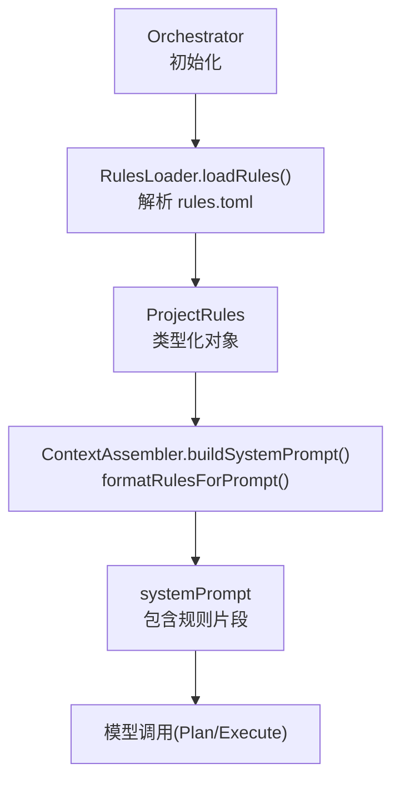
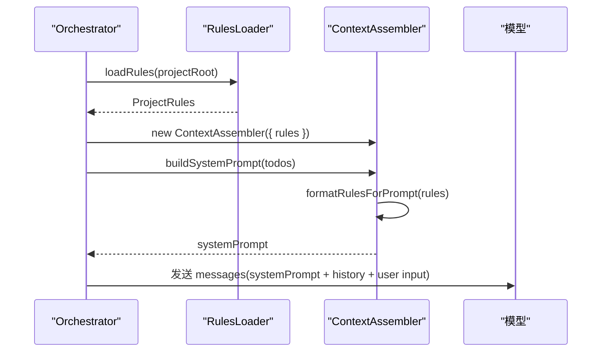
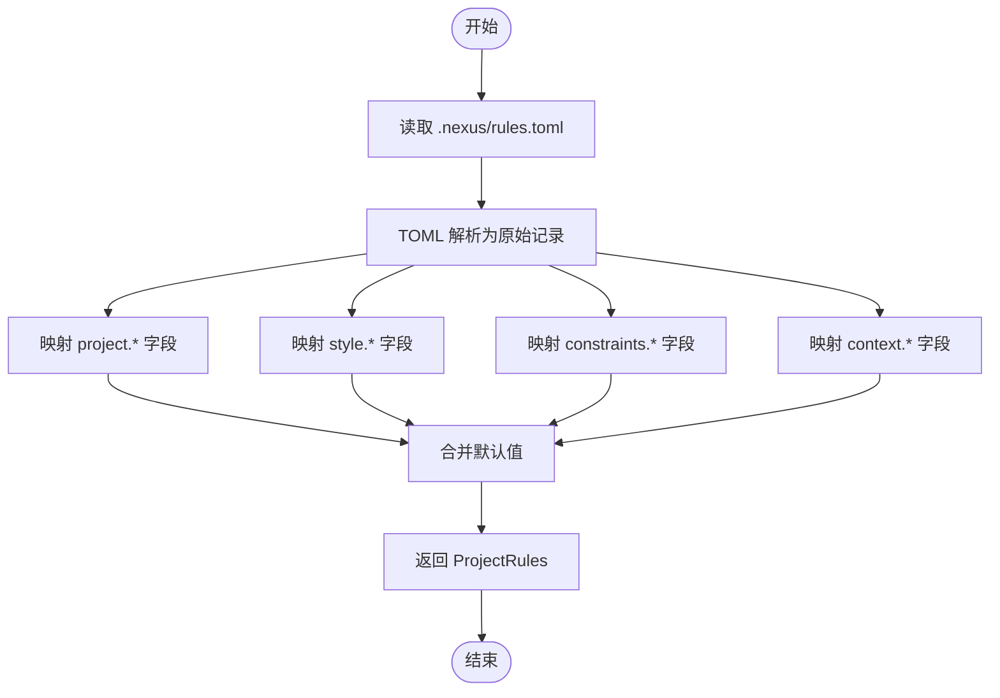
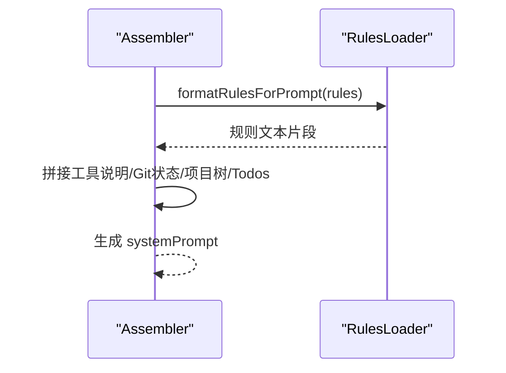
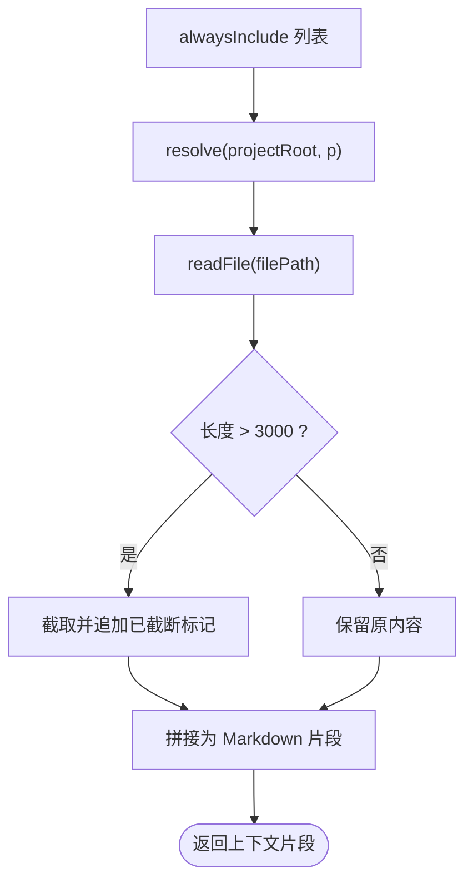
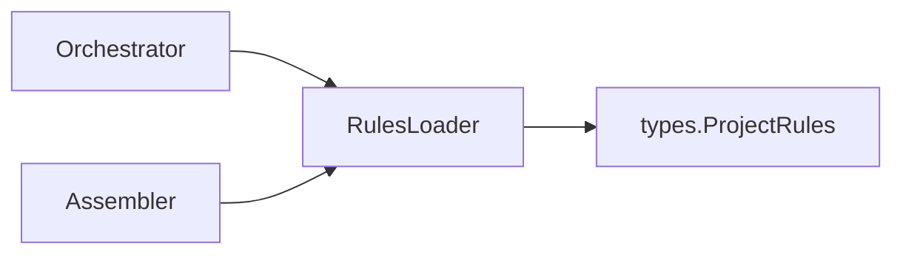

# 规则加载器

<cite>
**本文引用的文件**   
- [RulesLoader.ts](file://src/context/RulesLoader.ts)
- [Assembler.ts](file://src/context/Assembler.ts)
- [Orchestrator.ts](file://src/agent/Orchestrator.ts)
- [types.ts](file://src/agent/types.ts)
- [rules.toml](file://.nexus/rules.toml)
- [config.toml](file://.nexus/config.toml)
</cite>

## 目录
1. [简介](#简介)
2. [项目结构](#项目结构)
3. [核心组件](#核心组件)
4. [架构总览](#架构总览)
5. [详细组件分析](#详细组件分析)
6. [依赖关系分析](#依赖关系分析)
7. [性能考量](#性能考量)
8. [故障排查指南](#故障排查指南)
9. [结论](#结论)
10. [附录](#附录)

## 简介
本文件面向规则加载器，围绕 .nexus/rules.toml 的解析机制、数据结构定义、规则格式化与注入系统提示的流程进行系统化说明。同时给出规则优先级与冲突解决策略、完整配置示例（代码风格、安全约束、开发规范等），并指导如何编写自定义规则验证器与规则模板。

## 项目结构
规则加载器位于上下文工程层，负责从项目级配置文件读取并标准化规则，随后由上下文组装器将规则以人类可读的方式注入到 system prompt 中，供模型遵循。



**图表来源** 
- [Orchestrator.ts:60-86](file://src/agent/Orchestrator.ts#L60-L86)
- [RulesLoader.ts:29-58](file://src/context/RulesLoader.ts#L29-L58)
- [Assembler.ts:55-90](file://src/context/Assembler.ts#L55-L90)

**章节来源**
- [Orchestrator.ts:60-86](file://src/agent/Orchestrator.ts#L60-L86)
- [RulesLoader.ts:29-58](file://src/context/RulesLoader.ts#L29-L58)
- [Assembler.ts:55-90](file://src/context/Assembler.ts#L55-L90)

## 核心组件
- 规则加载器 RulesLoader：读取并解析 .nexus/rules.toml，映射为 ProjectRules 类型，提供格式化与路径解析工具函数。
- 上下文组装器 Assembler：在构建 system prompt 时插入规则片段，并结合工具说明、Git 状态、项目树与任务进度生成最终提示。
- 编排器 Orchestrator：在初始化阶段加载规则，并将规则对象传递给上下文组装器。

**章节来源**
- [RulesLoader.ts:1-90](file://src/context/RulesLoader.ts#L1-L90)
- [Assembler.ts:1-184](file://src/context/Assembler.ts#L1-L184)
- [Orchestrator.ts:60-86](file://src/agent/Orchestrator.ts#L60-L86)

## 架构总览
规则加载器的数据流如下：
- 入口：Orchestrator.init() 调用 loadRules()
- 解析：RulesLoader 使用 TOML 解析器读取 .nexus/rules.toml，映射为 ProjectRules
- 格式化：formatRulesForPrompt() 将规则转为自然语言片段
- 注入：Assembler.buildSystemPrompt() 将片段拼接到 systemPrompt
- 消费：后续 Plan/Execute 阶段基于 systemPrompt 驱动模型行为



**图表来源** 
- [Orchestrator.ts:60-86](file://src/agent/Orchestrator.ts#L60-L86)
- [RulesLoader.ts:29-58](file://src/context/RulesLoader.ts#L29-L58)
- [Assembler.ts:55-90](file://src/context/Assembler.ts#L55-L90)

## 详细组件分析

### 规则数据结构与默认值
- ProjectRules 定义了四类规则：
  - project：项目名称、语言、测试命令、构建命令
  - style：缩进、引号、分号
  - constraints：布尔键值对，表示硬约束是否启用
  - context：alwaysInclude 数组，指定常驻上下文文件
- 当 rules.toml 缺失或字段缺失时，RulesLoader 返回默认值，保证系统稳定运行。

```mermaid
classDiagram
class ProjectRules {
+project : { name, language, testCommand, buildCommand }
+style : { indent, quote, semicolons }
+constraints : Record<string, boolean>
+context : { alwaysInclude : string[] }
}
```

**图表来源** 
- [types.ts:168-184](file://src/agent/types.ts#L168-L184)

**章节来源**
- [types.ts:168-184](file://src/agent/types.ts#L168-L184)
- [RulesLoader.ts:11-27](file://src/context/RulesLoader.ts#L11-L27)

### TOML 解析与字段映射
- 解析流程：
  - 读取 .nexus/rules.toml
  - 使用 smol-toml 解析为原始记录
  - 按字段映射到 ProjectRules，缺失字段回退到默认值
- 字段名映射：
  - project.test_command → project.testCommand
  - project.build_command → project.buildCommand
  - style.quote 限定为 'single' | 'double'
  - constraints 为字符串→布尔映射
  - context.always_include → context.alwaysInclude



**图表来源** 
- [RulesLoader.ts:29-58](file://src/context/RulesLoader.ts#L29-L58)

**章节来源**
- [RulesLoader.ts:29-58](file://src/context/RulesLoader.ts#L29-L58)

### 规则格式化与系统提示注入
- formatRulesForPrompt() 将 ProjectRules 转换为自然语言片段，包括：
  - 项目信息（名称、语言、测试/构建命令）
  - 代码风格（缩进、引号、分号）
  - 硬约束（仅输出值为 true 的条目）
- Assembler.buildSystemPrompt() 将规则片段与其他静态上下文（工具说明、Git 状态、项目树、任务进度）拼接成 systemPrompt。



**图表来源** 
- [RulesLoader.ts:60-84](file://src/context/RulesLoader.ts#L60-L84)
- [Assembler.ts:55-90](file://src/context/Assembler.ts#L55-L90)

**章节来源**
- [RulesLoader.ts:60-84](file://src/context/RulesLoader.ts#L60-L84)
- [Assembler.ts:55-90](file://src/context/Assembler.ts#L55-L90)

### 常驻上下文文件加载
- getAlwaysIncludePaths() 将相对路径解析为绝对路径
- Assembler.loadAlwaysIncludeFiles() 读取这些文件内容并截断过长内容，作为额外上下文注入



**图表来源** 
- [RulesLoader.ts:86-89](file://src/context/RulesLoader.ts#L86-L89)
- [Assembler.ts:155-168](file://src/context/Assembler.ts#L155-L168)

**章节来源**
- [RulesLoader.ts:86-89](file://src/context/RulesLoader.ts#L86-L89)
- [Assembler.ts:155-168](file://src/context/Assembler.ts#L155-L168)

### 规则优先级与冲突解决策略
- 当前实现未内置多规则源合并与优先级比较逻辑；规则来自单一 .nexus/rules.toml 文件。
- 冲突解决策略建议：
  - 字段级覆盖：后出现的同名字段直接覆盖前值（单文件内不存在此问题）
  - 语义约束优先级：constraints 中的布尔项视为“必须遵守”的硬约束，优先于风格类建议
  - 扩展性预留：未来若引入多规则源，可基于“来源权重 + 字段优先级表”进行合并

[本节为概念性说明，不直接分析具体文件]

### 完整规则配置示例
以下示例展示常见规则类型，可直接用于 .nexus/rules.toml：

- 项目信息
  - name：项目名
  - language：主语言（如 typescript）
  - test_command：测试命令（如 bun test）
  - build_command：构建命令（如 bun run build）
- 代码风格
  - indent：缩进空格数（如 2）
  - quote：引号风格（single/double）
  - semicolons：是否使用分号（true/false）
- 安全约束（硬约束）
  - 不要引入新的运行时依赖 = true
  - 修改 core/ 前必须写测试 = true
- 开发规范（可作为 constraints 条目）
  - 所有新增 API 需附带单元测试 = true
  - 禁止在生产代码中使用 console.log = true
- 常驻上下文
  - always_include：DESIGN.md、src/agent/types.ts 等关键文件

参考实际配置位置：
- [rules.toml](file://.nexus/rules.toml)

**章节来源**
- [rules.toml:1-21](file://.nexus/rules.toml#L1-L21)

### 自定义规则验证器与规则模板
- 自定义验证器
  - 在 RulesLoader 中增加 validateRules(rules) 函数，对字段范围、枚举值、必填项进行检查
  - 校验失败抛出错误，或在日志中记录警告并降级为默认值
- 自定义模板
  - 扩展 formatRulesForPrompt() 支持模板变量（如 {{project.name}}）
  - 通过模板引擎渲染，便于统一输出格式
- 集成方式
  - 在 Orchestrator.init() 中先执行 validateRules()，再进入 Assembler 构建 systemPrompt

[本节为扩展建议，不直接分析具体文件]

## 依赖关系分析
- Orchestrator 依赖 RulesLoader 获取 ProjectRules
- Assembler 依赖 RulesLoader.formatRulesForPrompt() 生成规则片段
- ProjectRules 类型定义在 types.ts，被 RulesLoader 与 Assembler 共同使用



**图表来源** 
- [Orchestrator.ts:60-86](file://src/agent/Orchestrator.ts#L60-L86)
- [RulesLoader.ts:29-58](file://src/context/RulesLoader.ts#L29-L58)
- [Assembler.ts:55-90](file://src/context/Assembler.ts#L55-L90)
- [types.ts:168-184](file://src/agent/types.ts#L168-L184)

**章节来源**
- [Orchestrator.ts:60-86](file://src/agent/Orchestrator.ts#L60-L86)
- [RulesLoader.ts:29-58](file://src/context/RulesLoader.ts#L29-L58)
- [Assembler.ts:55-90](file://src/context/Assembler.ts#L55-L90)
- [types.ts:168-184](file://src/agent/types.ts#L168-L184)

## 性能考量
- 文件 I/O：读取 rules.toml 与 always_include 文件均为同步/异步 I/O，建议仅在初始化阶段执行一次
- 解析开销：smol-toml 解析轻量，但 large always_include 列表会增加内存占用
- 上下文预算：Assembler 结合 TokenBudget 控制 systemPrompt 大小，避免超出模型窗口

[本节为通用指导，不直接分析具体文件]

## 故障排查指南
- 常见问题
  - rules.toml 缺失或语法错误：RulesLoader 捕获异常并返回默认值，检查文件格式与字段名
  - always_include 路径无效：确保路径相对于 projectRoot，且文件存在
  - 字段映射不一致：确认 TOML 字段名与映射规则一致（如 test_command → testCommand）
- 定位方法
  - 查看 Orchestrator.init() 是否成功加载 rules
  - 检查 Assembler.buildSystemPrompt() 输出的 systemPrompt 是否包含规则片段
  - 打印 ProjectRules 对象确认字段值

**章节来源**
- [RulesLoader.ts:29-58](file://src/context/RulesLoader.ts#L29-L58)
- [Assembler.ts:55-90](file://src/context/Assembler.ts#L55-L90)
- [Orchestrator.ts:60-86](file://src/agent/Orchestrator.ts#L60-L86)

## 结论
规则加载器以简洁可靠的机制将 .nexus/rules.toml 转化为结构化规则，并通过格式化函数注入 systemPrompt，使模型在 Plan/Execute 阶段遵循项目约定与硬约束。当前实现聚焦单文件规则源，未来可扩展多源合并、优先级与模板化能力，以满足更复杂的团队规范需求。

## 附录
- 相关配置文件
  - [config.toml](file://.nexus/config.toml)：模型路由、权限模式、成本限制等全局配置
  - [rules.toml](file://.nexus/rules.toml)：项目级规则定义

**章节来源**
- [config.toml:1-62](file://.nexus/config.toml#L1-L62)
- [rules.toml:1-21](file://.nexus/rules.toml#L1-L21)