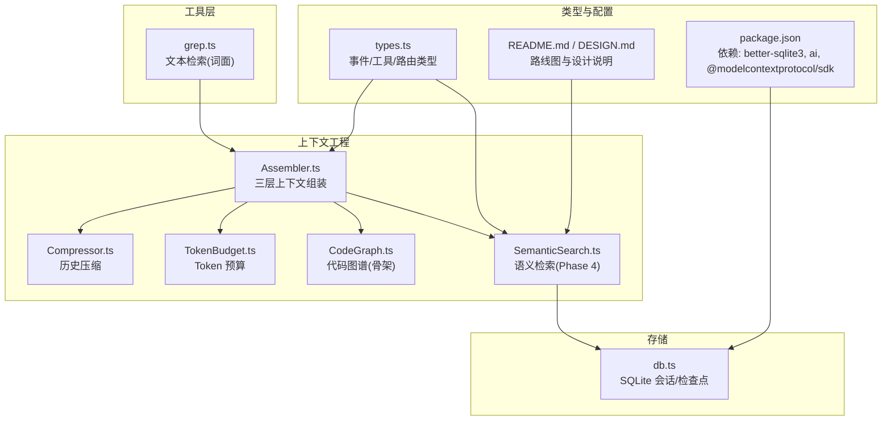
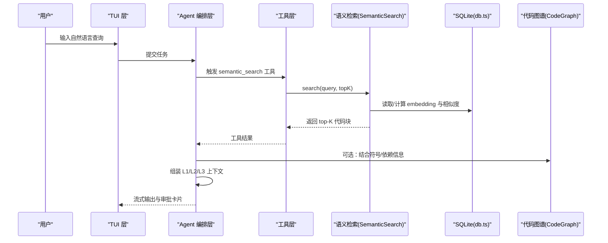
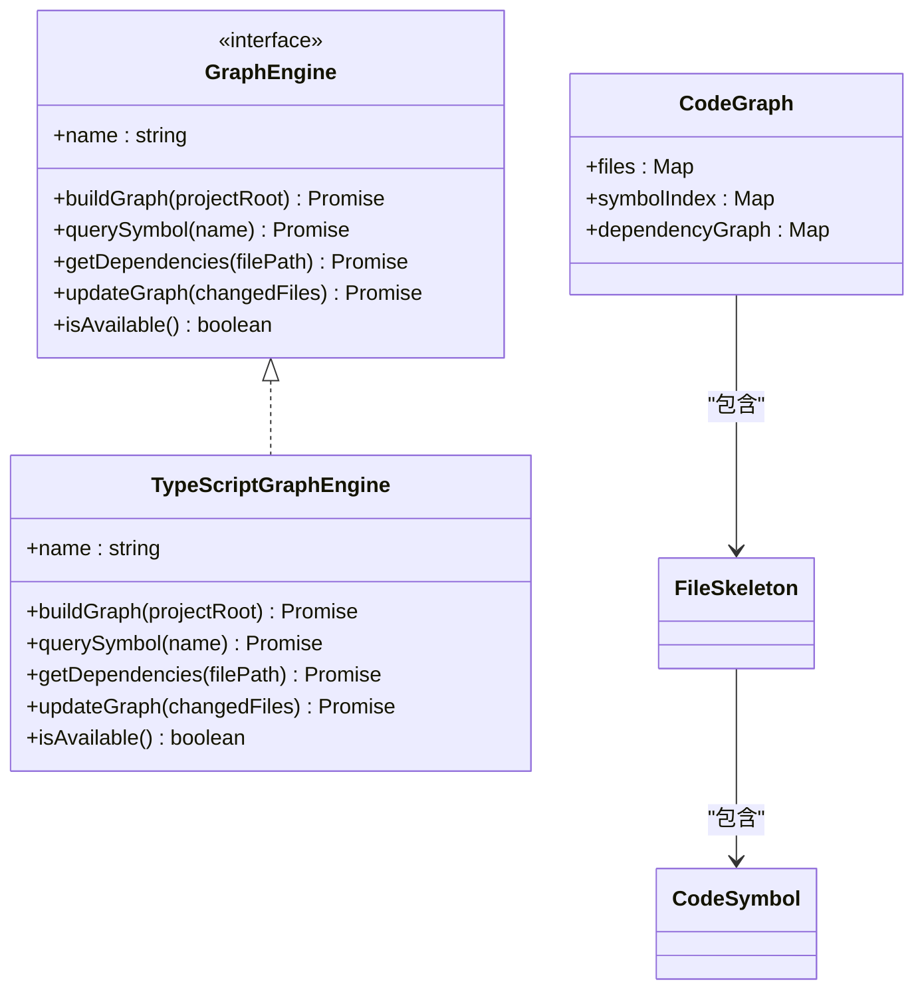
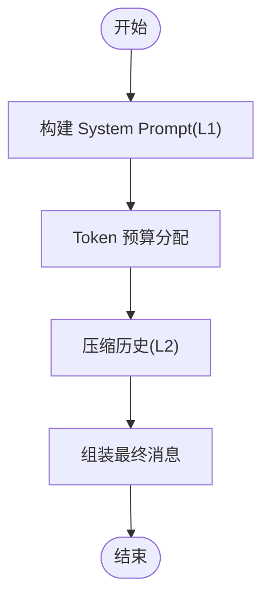
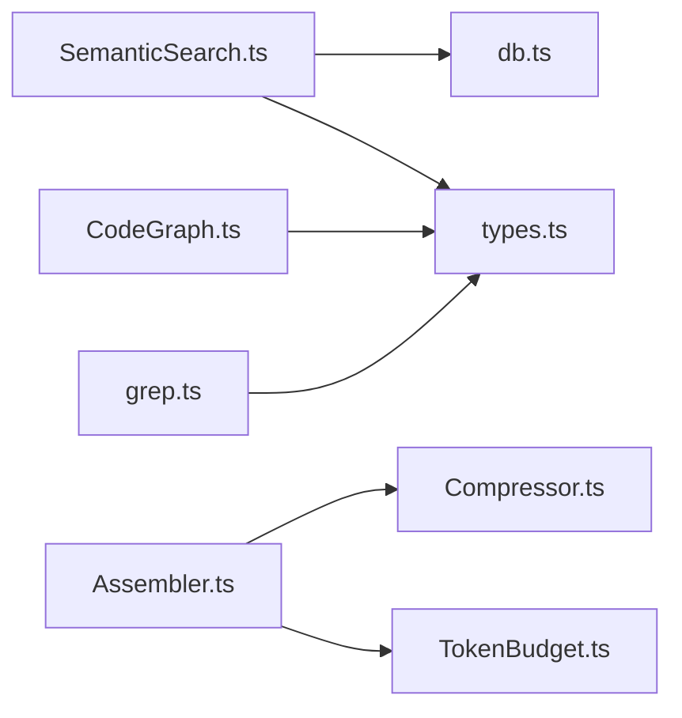

# 语义检索引擎

<cite>
**本文引用的文件列表**
- [SemanticSearch.ts](file://src/context/SemanticSearch.ts)
- [CodeGraph.ts](file://src/context/CodeGraph.ts)
- [Assembler.ts](file://src/context/Assembler.ts)
- [Compressor.ts](file://src/context/Compressor.ts)
- [TokenBudget.ts](file://src/context/TokenBudget.ts)
- [db.ts](file://src/storage/db.ts)
- [grep.ts](file://src/tools/grep.ts)
- [types.ts](file://src/agent/types.ts)
- [README.md](file://README.md)
- [DESIGN.md](file://DESIGN.md)
- [package.json](file://package.json)
</cite>

## 目录
1. [引言](#引言)
2. [项目结构](#项目结构)
3. [核心组件](#核心组件)
4. [架构总览](#架构总览)
5. [详细组件分析](#详细组件分析)
6. [依赖关系分析](#依赖关系分析)
7. [性能考量](#性能考量)
8. [故障排查指南](#故障排查指南)
9. [结论](#结论)
10. [附录](#附录)

## 引言
本文件为 Nexus 项目的“语义检索引擎”提供系统化、可落地的技术文档。当前仓库中语义检索处于 Phase 4 规划与占位实现阶段，已定义数据结构、工具契约与持久化基础能力，并给出本地 embedding + SQLite 索引的完整设计蓝图。本文将围绕以下目标展开：
- 解释向量嵌入生成与相似度计算的实现原理（基于设计蓝图）
- 说明索引构建策略与增量更新机制
- 阐述不同检索算法（余弦相似度、欧几里得距离）的选择与调优建议
- 提供自定义嵌入模型的集成指南与检索结果重排序策略
- 给出检索性能优化技巧与大规模代码库处理方案

## 项目结构
与语义检索相关的模块主要位于 context 层与 storage 层，并通过工具层暴露给 Agent 编排层使用。



图表来源
- [Assembler.ts:1-184](file://src/context/Assembler.ts#L1-L184)
- [Compressor.ts:1-159](file://src/context/Compressor.ts#L1-L159)
- [TokenBudget.ts:1-79](file://src/context/TokenBudget.ts#L1-L79)
- [CodeGraph.ts:1-175](file://src/context/CodeGraph.ts#L1-L175)
- [SemanticSearch.ts:1-101](file://src/context/SemanticSearch.ts#L1-L101)
- [db.ts:1-147](file://src/storage/db.ts#L1-L147)
- [grep.ts:1-178](file://src/tools/grep.ts#L1-L178)
- [types.ts:1-269](file://src/agent/types.ts#L1-L269)
- [README.md:1-174](file://README.md#L1-L174)
- [DESIGN.md:1-774](file://DESIGN.md#L1-L774)
- [package.json:1-43](file://package.json#L1-L43)

章节来源
- [README.md:1-174](file://README.md#L1-L174)
- [DESIGN.md:1-774](file://DESIGN.md#L1-L774)
- [package.json:1-43](file://package.json#L1-L43)

## 核心组件
- 语义检索引擎（占位）：定义了搜索接口、返回结构与工具契约，预留本地 embedding + SQLite 索引的实现入口。
- 代码图谱（骨架）：以 tree-sitter 解析函数/类/方法签名，形成“地图”，常驻 L1 上下文，辅助 agent 快速定位符号与依赖。
- 上下文组装器：将系统提示、规则、Git 状态、项目树、任务进度等组合成 LLM 输入，并进行 token 预算控制。
- 历史压缩器：对早期对话进行摘要与分级压缩，保障长会话不爆窗口。
- Token 预算：按系统提示、历史、工具结果分层分配预算，超预算时裁剪。
- SQLite 存储：会话消息、检查点等持久化；为未来 embedding 表扩展奠定基础。
- grep 工具：基于 ripgrep 的词面检索，作为语义检索的补充。

章节来源
- [SemanticSearch.ts:1-101](file://src/context/SemanticSearch.ts#L1-L101)
- [CodeGraph.ts:1-175](file://src/context/CodeGraph.ts#L1-L175)
- [Assembler.ts:1-184](file://src/context/Assembler.ts#L1-L184)
- [Compressor.ts:1-159](file://src/context/Compressor.ts#L1-L159)
- [TokenBudget.ts:1-79](file://src/context/TokenBudget.ts#L1-L79)
- [db.ts:1-147](file://src/storage/db.ts#L1-L147)
- [grep.ts:1-178](file://src/tools/grep.ts#L1-L178)

## 架构总览
语义检索在整体架构中的位置如下：Agent 编排层通过工具层调用语义检索，检索结果注入到 L3 检索上下文，再由上下文组装器统一打包发送给模型。



图表来源
- [SemanticSearch.ts:1-101](file://src/context/SemanticSearch.ts#L1-L101)
- [db.ts:1-147](file://src/storage/db.ts#L1-L147)
- [CodeGraph.ts:1-175](file://src/context/CodeGraph.ts#L1-L175)
- [Assembler.ts:1-184](file://src/context/Assembler.ts#L1-L184)

## 详细组件分析

### 语义检索引擎（Phase 4 占位）
- 数据模型
  - SearchResult：包含文件路径、起止行、内容片段、相似度分数、可选符号名。
  - EmbeddingRecord：记录每个代码块的元信息与 Float32Array 向量。
- 生命周期
  - init：加载本地 embedding 模型（计划使用 transformers.js），扫描项目文件，切分函数级代码块，计算 embedding 并存入 SQLite。
  - search：将 query 转为 embedding，在 SQLite 中进行相似度检索，返回 top-K。
  - reindex：增量索引，仅重算变化文件的 embedding。
  - getStats：统计索引规模（chunk 数、文件数）。
- 工具契约
  - semantic_search 工具定义：参数包括 query 与 top_k，描述强调跨词面匹配能力。

```mermaid
classDiagram
class SemanticSearchEngine {
-projectRoot : string
-initialized : boolean
+init() Promise<void>
+search(query : string, topK? : number) Promise<SearchResult[]>
+reindex(changedFiles : string[]) Promise<void>
+getStats() { totalChunks : number; totalFiles : number }
}
class SearchResult {
+filePath : string
+startLine : number
+endLine : number
+content : string
+score : number
+symbol? : string
}
class EmbeddingRecord {
+id : string
+filePath : string
+startLine : number
+endLine : number
+content : string
+embedding : Float32Array
}
SemanticSearchEngine --> SearchResult : "返回"
SemanticSearchEngine --> EmbeddingRecord : "写入/读取"
```

图表来源
- [SemanticSearch.ts:1-101](file://src/context/SemanticSearch.ts#L1-L101)

章节来源
- [SemanticSearch.ts:1-101](file://src/context/SemanticSearch.ts#L1-L101)

### 代码图谱（骨架）
- 作用：用 tree-sitter 提取函数/类/方法签名与 docstring，生成每文件“地图”，常驻 L1 上下文，帮助 agent 理解全库结构。
- 接口抽象：GraphEngine 定义 buildGraph/querySymbol/getDependencies/updateGraph/isAvailable/name，便于 v2 替换为 Go 后端。
- 默认实现：TypeScriptGraphEngine 当前返回空图谱，作为 fallback。



图表来源
- [CodeGraph.ts:1-175](file://src/context/CodeGraph.ts#L1-L175)

章节来源
- [CodeGraph.ts:1-175](file://src/context/CodeGraph.ts#L1-L175)

### 上下文组装与压缩
- 组装器（Assembler）：拼装 system prompt、规则、工具说明、Git 状态、项目树、todos，并调用 TokenBudget 做预算分配。
- 压缩器（Compressor）：对早期消息进行摘要，并对工具结果进行分级压缩（bash 失败保留、read_file/grep 只留路径或计数等）。
- Token 预算（TokenBudget）：按系统提示、历史、工具结果比例分配，支持动态调整上下文窗口。



图表来源
- [Assembler.ts:1-184](file://src/context/Assembler.ts#L1-L184)
- [Compressor.ts:1-159](file://src/context/Compressor.ts#L1-L159)
- [TokenBudget.ts:1-79](file://src/context/TokenBudget.ts#L1-L79)

章节来源
- [Assembler.ts:1-184](file://src/context/Assembler.ts#L1-L184)
- [Compressor.ts:1-159](file://src/context/Compressor.ts#L1-L159)
- [TokenBudget.ts:1-79](file://src/context/TokenBudget.ts#L1-L79)

### 存储层（SQLite）
- 现有表：sessions、messages、checkpoints，用于会话历史与检查点。
- 扩展点：可在同一数据库新增 embedding 相关表（如 chunks、embeddings），配合 WAL 模式提升并发读写性能。

章节来源
- [db.ts:1-147](file://src/storage/db.ts#L1-L147)

### 词面检索（grep）
- 封装 ripgrep，支持正则、文件过滤、上下文行、大小写忽略等。
- 作为语义检索的互补手段，适合精确关键词定位。

章节来源
- [grep.ts:1-178](file://src/tools/grep.ts#L1-L178)

## 依赖关系分析
- 运行时与依赖
  - Bun 运行环境，内置 TS 与测试。
  - better-sqlite3 用于本地 SQLite 存储。
  - ai 与 @ai-sdk/* 用于多 Provider 接入（未来可扩展 embedding 模型）。
  - @modelcontextprotocol/sdk 用于 MCP 工具协议。
- 模块耦合
  - SemanticSearch 依赖 db.ts 进行持久化，依赖 types.ts 的工具与事件类型。
  - Assembler 依赖 Compressor 与 TokenBudget 完成上下文组装与预算控制。
  - CodeGraph 提供 GraphEngine 接口，便于未来替换为 Go 后端。



图表来源
- [SemanticSearch.ts:1-101](file://src/context/SemanticSearch.ts#L1-L101)
- [db.ts:1-147](file://src/storage/db.ts#L1-L147)
- [types.ts:1-269](file://src/agent/types.ts#L1-L269)
- [Assembler.ts:1-184](file://src/context/Assembler.ts#L1-L184)
- [Compressor.ts:1-159](file://src/context/Compressor.ts#L1-L159)
- [TokenBudget.ts:1-79](file://src/context/TokenBudget.ts#L1-L79)
- [CodeGraph.ts:1-175](file://src/context/CodeGraph.ts#L1-L175)
- [grep.ts:1-178](file://src/tools/grep.ts#L1-L178)

章节来源
- [package.json:1-43](file://package.json#L1-L43)

## 性能考量
- 索引构建
  - 分块粒度：函数级优先，避免过大 chunk 导致向量噪声；对短函数合并相邻小函数以减少碎片。
  - 并行计算：利用 Node 线程池或子进程并行生成 embedding，注意内存峰值控制。
  - 增量更新：监听文件变更，仅重算受影响文件及其直接依赖文件，减少无效计算。
- 相似度检索
  - 余弦相似度：适用于归一化后的向量，对量纲不敏感，推荐作为默认度量。
  - 欧几里得距离：对绝对差异更敏感，适合需要捕捉数值幅度差异的场景；可与余弦联合打分后融合。
  - 近似最近邻（ANN）：当索引规模达到百万级时，引入 FAISS/HNSW 等 ANN 库替代全量扫描。
- 存储与 IO
  - SQLite WAL 模式提升并发读性能；对 embedding 表建立索引（如文件路径、哈希）加速增量更新。
  - 批量写入与事务包裹，降低磁盘 IO 次数。
- 上下文与预算
  - 通过 TokenBudget 限制输入长度，避免大结果集撑爆上下文窗口。
  - 对搜索结果进行二次筛选（去重、截断、摘要），确保 L3 上下文质量。

[本节为通用指导，无需特定文件引用]

## 故障排查指南
- 语义检索未生效
  - 确认初始化流程是否执行（init 是否被调用），以及索引是否成功写入 SQLite。
  - 检查 semantic_search 工具注册与调用链路是否正确。
- 增量索引异常
  - 验证 changedFiles 列表准确性；确保旧 embedding 删除与新写入在同一事务内。
- 相似度结果不稳定
  - 检查 embedding 维度与数据类型（Float32Array）一致性；确认预处理（清洗、标准化）步骤一致。
- 性能瓶颈
  - 监控 SQLite 写入延迟与查询耗时；必要时引入 ANN 或分片索引。
  - 评估并行度与内存占用，避免 OOM。

章节来源
- [SemanticSearch.ts:1-101](file://src/context/SemanticSearch.ts#L1-L101)
- [db.ts:1-147](file://src/storage/db.ts#L1-L147)

## 结论
Nexus 的语义检索引擎在 Phase 4 已具备清晰的接口契约、数据结构与持久化基础，并给出了本地 embedding + SQLite 的完整设计蓝图。下一步应聚焦于：
- 落地本地 embedding 模型（transformers.js）与分块策略
- 实现余弦相似度检索与增量索引
- 结合代码图谱进行结果重排序与上下文增强
- 在大规模代码库场景下引入 ANN 与批处理优化

[本节为总结性内容，无需特定文件引用]

## 附录

### 向量嵌入生成与相似度计算（实现原理）
- 嵌入生成
  - 使用本地模型（如 Xenova/all-MiniLM-L6-v2 via transformers.js）将代码块文本编码为固定维度的向量。
  - 预处理：去除注释、空白符规范化、保留关键标识符与签名，以提升语义表征。
- 相似度计算
  - 余弦相似度：cos(A,B) = (A·B)/(|A||B|)，适合衡量方向相似性。
  - 欧几里得距离：d(A,B) = sqrt(Σ(ai-bi)^2)，适合衡量绝对差异。
  - 混合评分：将余弦与距离归一化后加权融合，平衡方向与幅度信息。

章节来源
- [DESIGN.md:312-324](file://DESIGN.md#L312-L324)
- [SemanticSearch.ts:1-101](file://src/context/SemanticSearch.ts#L1-L101)

### 索引构建策略与增量更新机制
- 构建策略
  - 全量构建：扫描项目文件，按函数级切分，计算 embedding，写入 SQLite。
  - 索引组织：chunks 表（元信息）、embeddings 表（向量），以 id 关联。
- 增量更新
  - 监听文件变更，识别受影响的 chunk；删除旧 embedding，重新计算并写入。
  - 依赖传播：若修改影响导入/导出，需递归更新依赖链上的 chunk。

章节来源
- [DESIGN.md:312-324](file://DESIGN.md#L312-L324)
- [SemanticSearch.ts:61-74](file://src/context/SemanticSearch.ts#L61-L74)

### 检索算法选择与调优
- 余弦相似度
  - 优点：对向量尺度不敏感，适合语义匹配。
  - 调优：对向量进行 L2 归一化；对短文本采用子句切分后再聚合。
- 欧几里得距离
  - 优点：对数值差异敏感，适合捕捉具体实现差异。
  - 调优：先对向量标准化（零均值、单位方差），再计算距离。
- 混合与阈值
  - 设定相似度阈值过滤低质结果；对 top-K 进行二次重排（结合符号命中、依赖权重）。

章节来源
- [DESIGN.md:312-324](file://DESIGN.md#L312-L324)

### 自定义嵌入模型集成指南
- 模型选型
  - 本地优先：transformers.js 支持的轻量模型（如 MiniLM）。
  - 云端备选：OpenAI embeddings API（通过 ai SDK 接入）。
- 集成步骤
  - 在 init 中加载模型；在 search 中将 query 编码为向量。
  - 在 reindex 中为每个 chunk 计算 embedding 并持久化。
  - 保持向量维度与数据类型一致（Float32Array）。
- 兼容性
  - 通过 GraphEngine 与工具契约解耦，便于替换不同模型实现。

章节来源
- [SemanticSearch.ts:29-46](file://src/context/SemanticSearch.ts#L29-L46)
- [DESIGN.md:312-324](file://DESIGN.md#L312-L324)

### 检索结果重排序策略
- 符号匹配加分：命中同名符号或继承关系的 chunk 提高权重。
- 依赖权重：与被查询文件存在直接依赖关系的 chunk 提高权重。
- 上下文相关性：结合 grep 结果（关键词命中）与语义相似度进行融合。
- 去重与截断：按文件去重，限制返回行数与内容长度，避免上下文爆炸。

章节来源
- [CodeGraph.ts:1-175](file://src/context/CodeGraph.ts#L1-L175)
- [Assembler.ts:1-184](file://src/context/Assembler.ts#L1-L184)

### 检索性能优化与大规模代码库方案
- 并行与批处理
  - 并行生成 embedding；批量写入 SQLite 事务。
- 近似最近邻
  - 百万级索引引入 FAISS/HNSW，牺牲少量召回率换取显著速度提升。
- 分片与缓存
  - 按目录或语言分片索引；热点文件 embedding 缓存至内存。
- 上下文预算
  - 通过 TokenBudget 控制 L3 上下文大小，避免大结果集影响响应时间。

章节来源
- [TokenBudget.ts:1-79](file://src/context/TokenBudget.ts#L1-L79)
- [DESIGN.md:312-324](file://DESIGN.md#L312-L324)