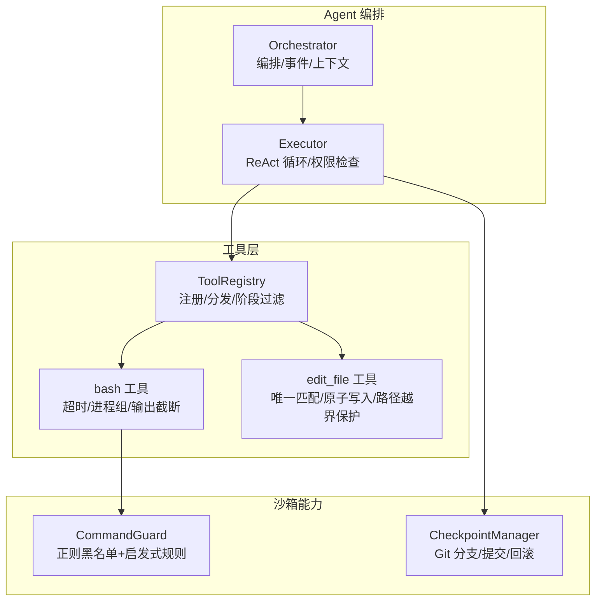
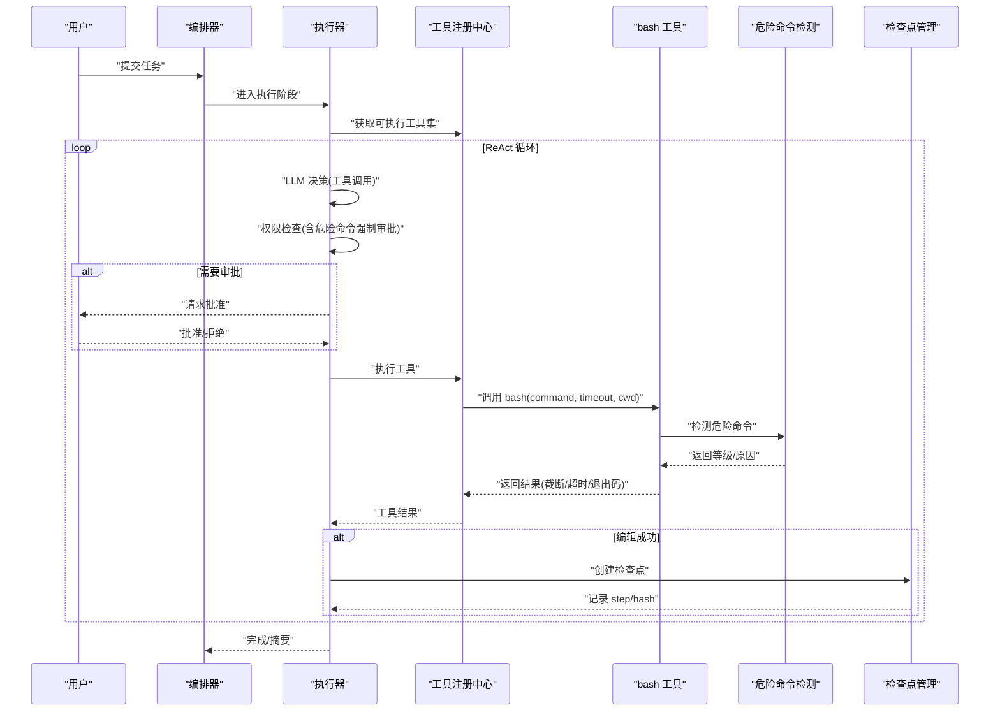
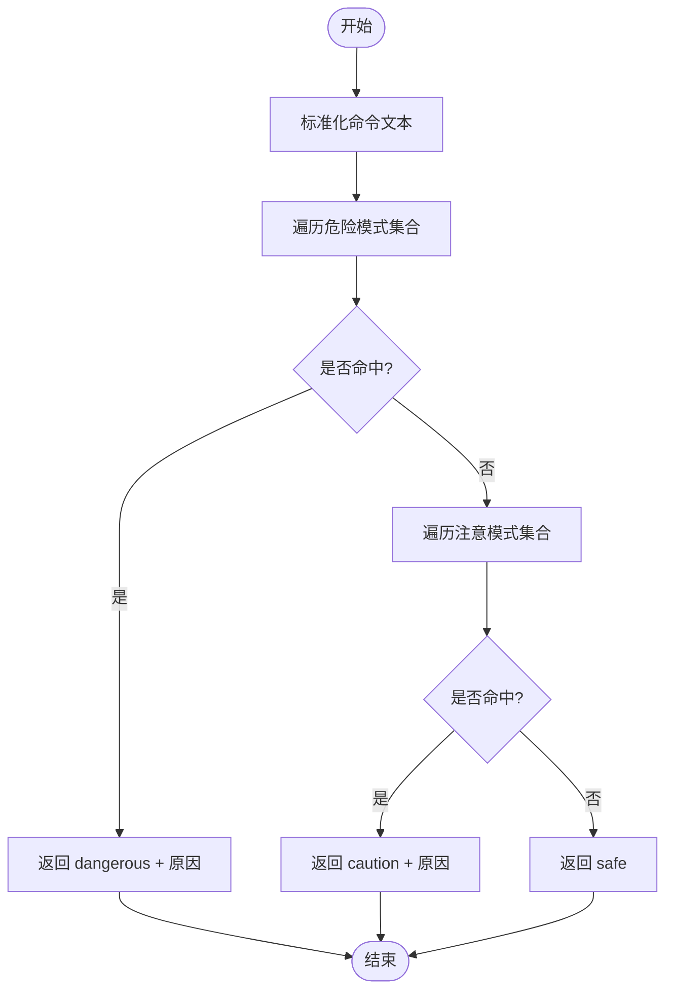
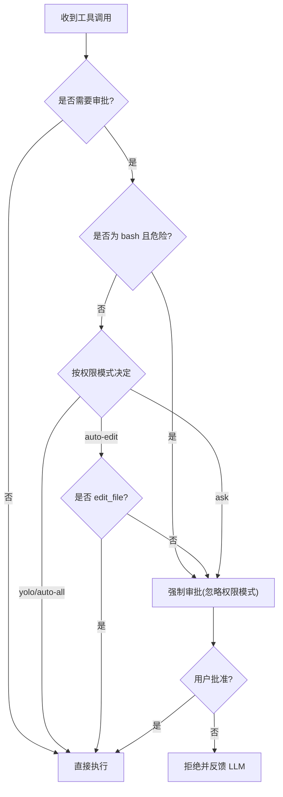
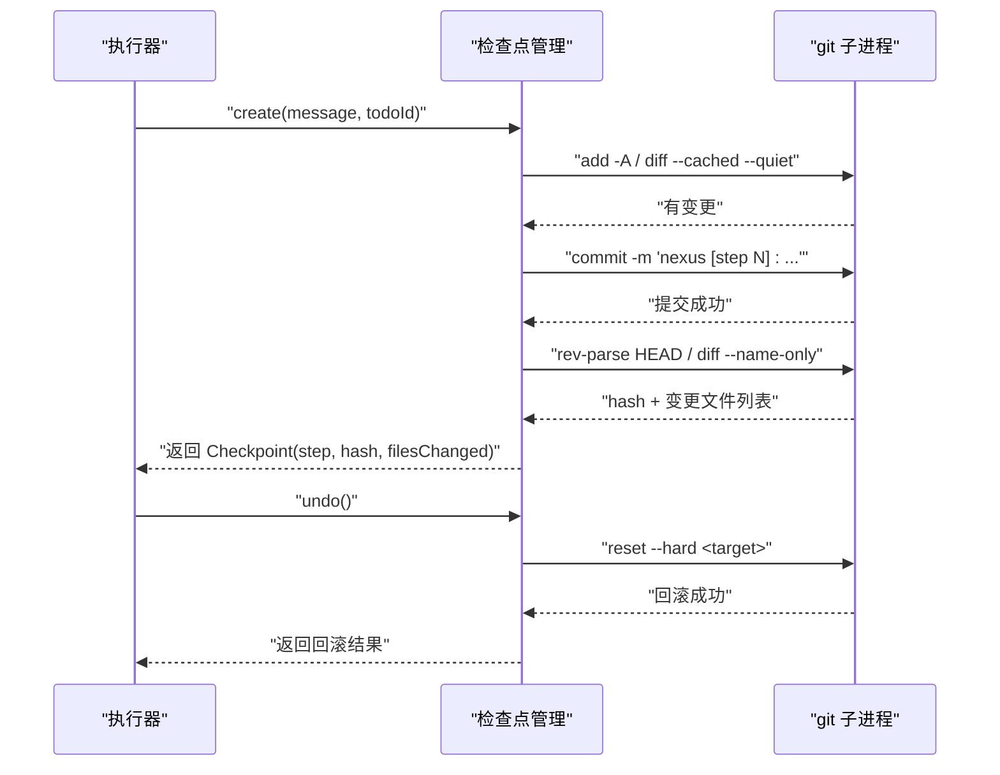
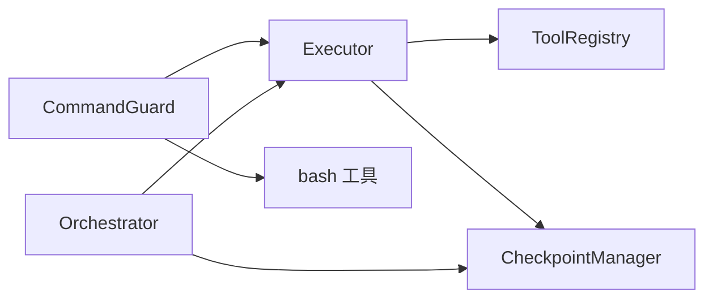

# 安全沙箱架构

<cite>
**本文引用的文件**   
- [CommandGuard.ts](file://src/sandbox/CommandGuard.ts)
- [Checkpoint.ts](file://src/sandbox/Checkpoint.ts)
- [bash.ts](file://src/tools/bash.ts)
- [editFile.ts](file://src/tools/editFile.ts)
- [registry.ts](file://src/tools/registry.ts)
- [Executor.ts](file://src/agent/Executor.ts)
- [Orchestrator.ts](file://src/agent/Orchestrator.ts)
- [types.ts](file://src/agent/types.ts)
- [config.ts](file://src/config.ts)
- [config.toml](file://.nexus/config.toml)
- [rules.toml](file://.nexus/rules.toml)
- [commandGuard.test.ts](file://tests/unit/commandGuard.test.ts)
</cite>

## 目录
1. [简介](#简介)
2. [项目结构](#项目结构)
3. [核心组件](#核心组件)
4. [架构总览](#架构总览)
5. [详细组件分析](#详细组件分析)
6. [依赖关系分析](#依赖关系分析)
7. [性能与资源限制](#性能与资源限制)
8. [故障排查指南](#故障排查指南)
9. [结论](#结论)
10. [附录：配置与审计扩展](#附录配置与审计扩展)

## 简介
本架构文档聚焦于安全沙箱系统，围绕以下目标展开：
- 危险命令检测机制（正则黑名单 + 启发式规则）与强制审批策略
- Git 检查点系统的实现原理与回滚机制
- 工作目录锁定、进程隔离与资源限制措施
- 审批策略的颗粒度控制与用户授权流程
- 安全检查流程图与回滚操作时序图
- 安全配置定制与审计日志扩展指南

## 项目结构
与安全相关的核心代码分布在 sandbox、tools、agent 三个层次：
- sandbox：危险命令检测与 Git 检查点管理
- tools：工具执行层（bash、edit_file 等），承载权限校验、输出截断、工作目录锁定
- agent：编排与执行（Orchestrator、Executor），负责审批流、ReAct 循环、检查点联动

图表来源
- [Orchestrator.ts:1-260](file://src/agent/Orchestrator.ts#L1-L260)
- [Executor.ts:1-234](file://src/agent/Executor.ts#L1-L234)
- [registry.ts:1-96](file://src/tools/registry.ts#L1-L96)
- [bash.ts:1-186](file://src/tools/bash.ts#L1-L186)
- [editFile.ts:1-170](file://src/tools/editFile.ts#L1-L170)
- [CommandGuard.ts:1-98](file://src/sandbox/CommandGuard.ts#L1-L98)
- [Checkpoint.ts:1-182](file://src/sandbox/Checkpoint.ts#L1-L182)

章节来源
- [Orchestrator.ts:1-260](file://src/agent/Orchestrator.ts#L1-L260)
- [Executor.ts:1-234](file://src/agent/Executor.ts#L1-L234)
- [registry.ts:1-96](file://src/tools/registry.ts#L1-L96)
- [bash.ts:1-186](file://src/tools/bash.ts#L1-L186)
- [editFile.ts:1-170](file://src/tools/editFile.ts#L1-L170)
- [CommandGuard.ts:1-98](file://src/sandbox/CommandGuard.ts#L1-L98)
- [Checkpoint.ts:1-182](file://src/sandbox/Checkpoint.ts#L1-L182)

## 核心组件
- 危险命令检测器：基于正则黑名单与启发式规则，返回“安全/注意/危险”等级；危险级别强制审批。
- Git 检查点管理器：在专用分支上为每次编辑创建提交，支持撤销到上一个或跳转到任意步骤，并可选择合并回工作分支。
- bash 工具：执行 shell 命令，具备超时、进程组终止、输出截断、工作目录锁定与危险标记。
- edit_file 工具：精准替换、唯一匹配、原子写入、路径越界保护，生成 diff 反馈给 LLM。
- 工具注册中心：按阶段暴露工具、收集需审批工具列表、统一执行入口。
- 执行器：ReAct 循环中集成权限检查、工具调用、检查点创建与 todo 状态推进。
- 编排器：初始化模型路由、上下文组装、计划审批、执行器调度与检查点生命周期管理。

章节来源
- [CommandGuard.ts:1-98](file://src/sandbox/CommandGuard.ts#L1-L98)
- [Checkpoint.ts:1-182](file://src/sandbox/Checkpoint.ts#L1-L182)
- [bash.ts:1-186](file://src/tools/bash.ts#L1-L186)
- [editFile.ts:1-170](file://src/tools/editFile.ts#L1-L170)
- [registry.ts:1-96](file://src/tools/registry.ts#L1-L96)
- [Executor.ts:1-234](file://src/agent/Executor.ts#L1-L234)
- [Orchestrator.ts:1-260](file://src/agent/Orchestrator.ts#L1-L260)

## 架构总览
下图展示了从用户输入到工具执行、安全检查、检查点落盘与回滚的整体流程。

图表来源
- [Orchestrator.ts:1-260](file://src/agent/Orchestrator.ts#L1-L260)
- [Executor.ts:1-234](file://src/agent/Executor.ts#L1-L234)
- [registry.ts:1-96](file://src/tools/registry.ts#L1-L96)
- [bash.ts:1-186](file://src/tools/bash.ts#L1-L186)
- [CommandGuard.ts:1-98](file://src/sandbox/CommandGuard.ts#L1-L98)
- [Checkpoint.ts:1-182](file://src/sandbox/Checkpoint.ts#L1-L182)

## 详细组件分析

### 危险命令检测机制（正则黑名单 + 启发式规则）
- 设计要点
  - 定义两类模式集合：危险模式（dangerous）与注意模式（caution）。
  - 对输入命令进行标准化后顺序匹配，命中 dangerous 即强制审批；caution 仅提示。
  - 覆盖文件系统破坏、磁盘/分区操作、Fork 炸弹、管道远程执行、权限提升、关键系统文件覆写、Windows 危险操作、Git 破坏性操作、敏感信息泄露等场景。
- 复杂度与可扩展性
  - 时间复杂度 O(n)，n 为模式数量；可通过新增条目快速扩展。
  - 建议将模式集中维护，并提供单元测试覆盖典型用例。
- 与权限控制的衔接
  - 在执行器权限检查阶段，若检测到危险命令，无论当前权限模式如何，均触发强制审批。

图表来源
- [CommandGuard.ts:1-98](file://src/sandbox/CommandGuard.ts#L1-L98)

章节来源
- [CommandGuard.ts:1-98](file://src/sandbox/CommandGuard.ts#L1-L98)
- [commandGuard.test.ts:1-88](file://tests/unit/commandGuard.test.ts#L1-L88)

### 权限控制策略与审批流程
- 权限模式
  - ask：所有写操作均需审批
  - auto-edit：自动批准编辑，其他仍问
  - auto-all：全部自动（但危险命令仍强制问）
  - yolo：全部自动，包含危险命令（自负责任）
- 强制审批
  - 当 bash 命令被判定为 dangerous 时，无论何种模式都强制审批。
- 审批粒度
  - 以工具为单位，结合参数与 diff 展示，便于人工判断。
- 执行器中的权限检查
  - 先判断是否需要审批；再根据模式决定是否放行；危险命令优先走强制审批。

图表来源
- [Executor.ts:167-196](file://src/agent/Executor.ts#L167-L196)
- [CommandGuard.ts:91-98](file://src/sandbox/CommandGuard.ts#L91-L98)

章节来源
- [Executor.ts:167-196](file://src/agent/Executor.ts#L167-L196)
- [types.ts:27-27](file://src/agent/types.ts#L27-L27)
- [config.toml:35-37](file://.nexus/config.toml#L35-L37)

### Git 检查点系统与回滚机制
- 初始化
  - 确保处于 git 仓库；若无初始提交则创建空提交；创建或切换到专用 checkpoint 分支。
- 创建检查点
  - 暂存变更 → 检测是否有差异 → 提交并记录 commit hash、变更文件列表、步骤号与消息。
- 回滚
  - undo：回退到上一个检查点（或 HEAD~1）；jumpTo：跳转到指定步骤并裁剪后续检查点。
- 合并
  - 会话结束时可选择将 checkpoint 分支合并回工作分支。
- 与编辑工具的联动
  - edit_file 成功后自动创建检查点，便于一键回滚。

图表来源
- [Checkpoint.ts:42-116](file://src/sandbox/Checkpoint.ts#L42-L116)
- [Checkpoint.ts:118-155](file://src/sandbox/Checkpoint.ts#L118-L155)
- [Executor.ts:135-144](file://src/agent/Executor.ts#L135-L144)

章节来源
- [Checkpoint.ts:1-182](file://src/sandbox/Checkpoint.ts#L1-L182)
- [Executor.ts:135-144](file://src/agent/Executor.ts#L135-L144)

### 工作目录锁定、进程隔离与资源限制
- 工作目录锁定
  - bash 工具强制使用项目根目录作为工作目录，避免跨目录访问。
- 进程隔离与终止
  - Unix 下通过 detached 进程组并使用负 PID 发送 SIGKILL 终止整个进程树；Windows 下使用 taskkill /T 终止进程树。
- 超时与输出限制
  - 可配置 bash 超时秒数；stdout/stderr 输出按字节上限截断，保留错误尾部信息。
- 文件写入安全
  - edit_file 禁止路径越界；采用原子写入（临时文件 + rename）避免部分写入导致损坏。

章节来源
- [bash.ts:42-121](file://src/tools/bash.ts#L42-L121)
- [bash.ts:123-186](file://src/tools/bash.ts#L123-L186)
- [editFile.ts:52-59](file://src/tools/editFile.ts#L52-L59)
- [editFile.ts:61-101](file://src/tools/editFile.ts#L61-L101)
- [config.toml:39-49](file://.nexus/config.toml#L39-L49)

### 审批策略的颗粒度控制与用户授权流程
- 工具级粒度
  - 通过 requiresApproval 标志与阶段过滤，精确控制哪些工具在何时需要审批。
- 参数与 Diff 可见性
  - 审批回调携带工具名、参数与 diff（如 edit_file），辅助人工决策。
- 强制审批兜底
  - 危险命令不受权限模式影响，始终要求人工确认。

章节来源
- [registry.ts:44-56](file://src/tools/registry.ts#L44-L56)
- [Executor.ts:167-196](file://src/agent/Executor.ts#L167-L196)
- [types.ts:44-50](file://src/agent/types.ts#L44-L50)

## 依赖关系分析
- 低耦合高内聚
  - 危险命令检测独立于执行器，仅通过函数接口提供检测结果。
  - 检查点管理与执行器通过明确的事件与返回值交互。
- 外部依赖
  - git 子进程用于版本化与回滚；child_process 用于命令执行与进程组管理。
- 潜在风险
  - 正则规则维护成本较高，需持续补充与回归测试。
  - 进程组终止在非 Unix 平台行为差异需关注。

图表来源
- [Executor.ts:1-234](file://src/agent/Executor.ts#L1-L234)
- [Orchestrator.ts:1-260](file://src/agent/Orchestrator.ts#L1-L260)
- [CommandGuard.ts:1-98](file://src/sandbox/CommandGuard.ts#L1-L98)
- [Checkpoint.ts:1-182](file://src/sandbox/Checkpoint.ts#L1-L182)
- [registry.ts:1-96](file://src/tools/registry.ts#L1-L96)

章节来源
- [Executor.ts:1-234](file://src/agent/Executor.ts#L1-L234)
- [Orchestrator.ts:1-260](file://src/agent/Orchestrator.ts#L1-L260)
- [CommandGuard.ts:1-98](file://src/sandbox/CommandGuard.ts#L1-L98)
- [Checkpoint.ts:1-182](file://src/sandbox/Checkpoint.ts#L1-L182)
- [registry.ts:1-96](file://src/tools/registry.ts#L1-L96)

## 性能与资源限制
- 命令执行
  - 超时控制防止长时间占用；输出截断降低内存与传输开销。
- 文件编辑
  - 原子写入减少中间态风险；diff 生成轻量，利于 UI 展示。
- 检查点
  - 仅在存在变更时提交，避免无意义历史膨胀。
- 配置项
  - 通过 limits 与 context 预算比例控制整体资源消耗。

章节来源
- [bash.ts:111-121](file://src/tools/bash.ts#L111-L121)
- [editFile.ts:158-166](file://src/tools/editFile.ts#L158-L166)
- [Checkpoint.ts:72-116](file://src/sandbox/Checkpoint.ts#L72-L116)
- [config.ts:45-59](file://src/config.ts#L45-L59)
- [config.toml:39-59](file://.nexus/config.toml#L39-L59)

## 故障排查指南
- 危险命令误判/漏判
  - 核对 CommandGuard 的模式集合，补充边界用例，运行单元测试验证。
- 回滚失败
  - 检查 git 子进程返回码与 stderr；确认当前分支与权限；必要时手动 reset。
- 命令未终止
  - 确认进程组 kill 逻辑是否生效；在 Windows 下检查 taskkill 行为。
- 输出过大
  - 调整 max_output_bytes 与 bash_timeout；观察截断提示。
- 权限模式不符合预期
  - 确认配置文件 permissions.mode 与工具 requiresApproval 设置；检查危险命令强制审批分支。

章节来源
- [commandGuard.test.ts:1-88](file://tests/unit/commandGuard.test.ts#L1-L88)
- [Checkpoint.ts:118-155](file://src/sandbox/Checkpoint.ts#L118-L155)
- [bash.ts:91-109](file://src/tools/bash.ts#L91-L109)
- [config.toml:35-49](file://.nexus/config.toml#L35-L49)

## 结论
该安全沙箱通过“正则黑名单 + 启发式规则”的危险命令检测、严格的权限审批与 Git 检查点机制，构建了“可解释、可回滚、可控”的执行环境。配合工作目录锁定、进程组隔离与资源限制，有效降低了自动化 Agent 在生产环境中的安全风险。建议在持续演进中完善规则库、增强审计追踪，并在复杂场景中引入更细粒度的策略引擎。

## 附录：配置与审计扩展

### 安全配置定制
- 权限模式
  - 在 .nexus/config.toml 的 permissions.mode 中设置 ask/auto-edit/auto-all/yolo。
- 资源限制
  - limits.bash_timeout、limits.max_output_bytes、limits.max_iterations 等可按项目需求调整。
- 检查点策略
  - checkpoint.auto_checkpoint 与 branch 可在配置中开关与命名。
- 项目约束
  - .nexus/rules.toml 可声明风格与硬约束，辅助 Agent 遵循团队规范。

章节来源
- [config.toml:35-62](file://.nexus/config.toml#L35-L62)
- [rules.toml:1-21](file://.nexus/rules.toml#L1-L21)
- [config.ts:76-131](file://src/config.ts#L76-L131)

### 审计日志扩展指南
- 事件流
  - 利用 NexusEvent 类型（tool_call、tool_approval_request、tool_result、checkpoint、cost_update、phase_change、error 等）在编排层 onEvent 回调中统一采集。
- 建议落地
  - 将关键事件持久化至结构化日志或审计数据库，包含 callId、工具名、参数摘要、审批结果、检查点 step/hash、耗时与退出码。
  - 对危险命令命中与强制审批进行重点标注，便于事后复盘。
- 与现有集成
  - 编排器已提供 onEvent 钩子，可在上层 TUI 或 CLI 中接入外部审计系统。

章节来源
- [types.ts:8-21](file://src/agent/types.ts#L8-L21)
- [Orchestrator.ts:256-258](file://src/agent/Orchestrator.ts#L256-L258)
- [Executor.ts:105-164](file://src/agent/Executor.ts#L105-L164)