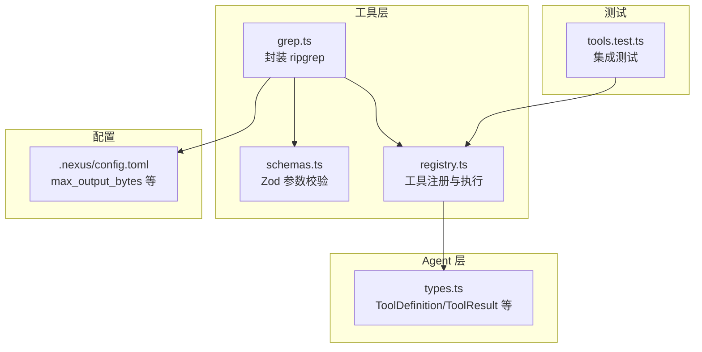
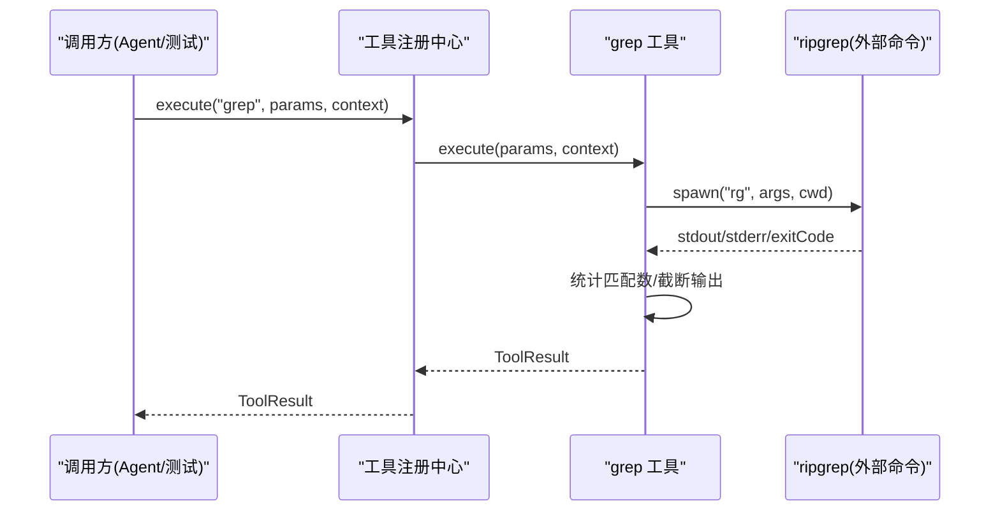
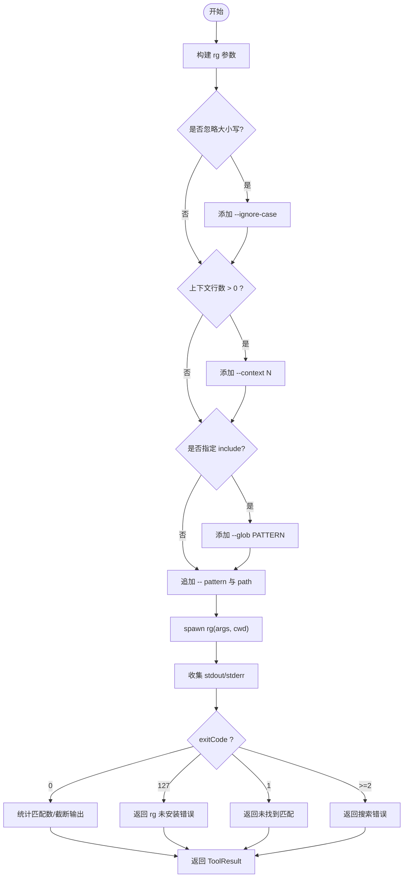

# 代码搜索工具 (grep)

<cite>
**本文引用的文件**   
- [src/tools/grep.ts](file://src/tools/grep.ts)
- [src/tools/schemas.ts](file://src/tools/schemas.ts)
- [src/tools/registry.ts](file://src/tools/registry.ts)
- [src/agent/types.ts](file://src/agent/types.ts)
- [.nexus/config.toml](file://.nexus/config.toml)
- [tests/integration/tools.test.ts](file://tests/integration/tools.test.ts)
- [README.md](file://README.md)
</cite>

## 目录
1. [简介](#简介)
2. [项目结构](#项目结构)
3. [核心组件](#核心组件)
4. [架构总览](#架构总览)
5. [详细组件分析](#详细组件分析)
6. [依赖关系分析](#依赖关系分析)
7. [性能考量与优化](#性能考量与优化)
8. [故障排查指南](#故障排查指南)
9. [结论](#结论)
10. [附录：参数说明与使用示例](#附录参数说明与使用示例)

## 简介
本技术文档聚焦于 Nexus 中的 grep 工具，该工具封装了 ripgrep（rg）进行高性能正则搜索。它支持模式匹配、文件类型过滤、上下文行显示、大小写敏感控制等能力，并通过统一的工具注册中心暴露给 Agent 编排层。本文从实现原理、参数配置、结果格式化、错误处理到性能优化进行全面解析，并提供丰富的使用示例和大规模代码库搜索的最佳实践。

## 项目结构
grep 工具位于 src/tools 目录下，通过工具注册中心统一管理与调度；其输入参数由 Zod Schema 校验；Agent 层提供统一的类型定义与上下文信息；配置文件定义了输出字节限制等关键阈值。



图表来源
- [src/tools/grep.ts:1-178](file://src/tools/grep.ts#L1-L178)
- [src/tools/schemas.ts:25-31](file://src/tools/schemas.ts#L25-L31)
- [src/tools/registry.ts:1-96](file://src/tools/registry.ts#L1-L96)
- [src/agent/types.ts:44-78](file://src/agent/types.ts#L44-L78)
- [.nexus/config.toml:39-49](file://.nexus/config.toml#L39-L49)
- [tests/integration/tools.test.ts:1-100](file://tests/integration/tools.test.ts#L1-L100)

章节来源
- [src/tools/grep.ts:1-178](file://src/tools/grep.ts#L1-L178)
- [src/tools/schemas.ts:25-31](file://src/tools/schemas.ts#L25-L31)
- [src/tools/registry.ts:1-96](file://src/tools/registry.ts#L1-L96)
- [src/agent/types.ts:44-78](file://src/agent/types.ts#L44-L78)
- [.nexus/config.toml:39-49](file://.nexus/config.toml#L39-L49)
- [tests/integration/tools.test.ts:1-100](file://tests/integration/tools.test.ts#L1-L100)

## 核心组件
- grep 工具实现：封装 rg 子进程调用，构建参数、收集输出、统计匹配数、截断输出、返回结构化结果。
- 参数 Schema：使用 Zod 定义 pattern、path、include、context_lines、case_insensitive 等字段及描述。
- 工具注册中心：统一管理工具生命周期、阶段过滤、AI SDK 兼容的工具定义转换、执行入口。
- Agent 类型系统：定义 ToolDefinition、ToolResult、ToolContext 等核心类型，贯穿工具调用链。
- 配置项：max_output_bytes 控制输出截断阈值，bash_timeout 等影响整体行为。

章节来源
- [src/tools/grep.ts:11-43](file://src/tools/grep.ts#L11-L43)
- [src/tools/schemas.ts:25-31](file://src/tools/schemas.ts#L25-L31)
- [src/tools/registry.ts:25-83](file://src/tools/registry.ts#L25-L83)
- [src/agent/types.ts:44-78](file://src/agent/types.ts#L44-L78)
- [.nexus/config.toml:39-49](file://.nexus/config.toml#L39-L49)

## 架构总览
grep 工具在 Agent 编排层中以“只读”工具身份参与 Plan 与 Execute 两个阶段。调用流程如下：



图表来源
- [src/tools/registry.ts:70-83](file://src/tools/registry.ts#L70-L83)
- [src/tools/grep.ts:46-78](file://src/tools/grep.ts#L46-L78)
- [src/tools/grep.ts:80-175](file://src/tools/grep.ts#L80-L175)

章节来源
- [src/tools/registry.ts:70-83](file://src/tools/registry.ts#L70-L83)
- [src/tools/grep.ts:80-175](file://src/tools/grep.ts#L80-L175)

## 详细组件分析

### grep 工具实现
- 子进程管理：使用 child_process.spawn 启动 rg，监听 stdout/stderr，捕获 close/error 事件。
- 参数构建：默认启用行号、无标题分组、禁用颜色、每文件最多匹配数限制；根据 case_insensitive、context_lines、include 动态追加参数；pattern 以 -- 分隔后传入。
- 结果处理：根据 exitCode 区分成功、无匹配、错误；统计匹配行数并拼接提示；按 maxOutputBytes 截断输出并标记 truncated。
- 错误回退：当 rg 不可用时返回明确错误提示，便于安装指引。



图表来源
- [src/tools/grep.ts:46-78](file://src/tools/grep.ts#L46-L78)
- [src/tools/grep.ts:88-175](file://src/tools/grep.ts#L88-L175)

章节来源
- [src/tools/grep.ts:46-78](file://src/tools/grep.ts#L46-L78)
- [src/tools/grep.ts:88-175](file://src/tools/grep.ts#L88-L175)

### 参数 Schema 与校验
- 字段定义：pattern（必填）、path（可选）、include（可选 glob）、context_lines（可选数字）、case_insensitive（可选布尔）。
- 描述信息：为 AI SDK 生成参数描述，便于模型理解各字段用途。
- 映射表：toolSchemas 将工具名与对应 Zod Schema 关联，供上层调用时校验。

章节来源
- [src/tools/schemas.ts:25-31](file://src/tools/schemas.ts#L25-L31)
- [src/tools/schemas.ts:33-39](file://src/tools/schemas.ts#L33-L39)

### 工具注册与执行
- 注册：createToolRegistry 初始化并注册 read_file、edit_file、bash、grep 四个工具。
- 阶段过滤：getForPhase 根据 phase 属性筛选可用工具，grep 的 phase 为 both，故在 plan 与 execute 均可用。
- AI SDK 兼容：toAISDKTools 将 ToolDefinition 转换为 {description, parameters} 格式。
- 执行：execute(name, params, context) 查找处理器并调用 execute(params, context)。

章节来源
- [src/tools/registry.ts:25-83](file://src/tools/registry.ts#L25-L83)
- [src/tools/registry.ts:86-93](file://src/tools/registry.ts#L86-L93)
- [tests/integration/tools.test.ts:83-98](file://tests/integration/tools.test.ts#L83-L98)

### Agent 类型与上下文
- ToolDefinition：包含 name、description、inputSchema、requiresApproval、phase。
- ToolResult：包含 callId、tool、result、error、truncated。
- ToolContext：包含 projectRoot、callId、maxReadLines、maxOutputBytes、bashTimeout。
- 这些类型贯穿工具调用链路，确保类型安全与一致性。

章节来源
- [src/agent/types.ts:44-78](file://src/agent/types.ts#L44-L78)
- [src/agent/types.ts:17-23](file://src/agent/types.ts#L17-L23)

## 依赖关系分析
- 外部依赖：ripgrep（rg）作为高性能搜索引擎，需预先安装。
- 内部依赖：child_process 用于子进程管理；path.resolve 用于路径规范化。
- 模块耦合：grep.ts 依赖 registry.ts 的 ToolHandler/ToolContext；依赖 agent/types.ts 的 ToolDefinition/ToolResult。
- 配置依赖：max_output_bytes 来自 .nexus/config.toml，影响输出截断策略。

```mermaid
classDiagram
class ToolRegistry {
+register(handler)
+get(name)
+getForPhase(phase)
+toAISDKTools(phase)
+execute(name, params, context)
}
class GrepTool {
+definition : ToolDefinition
+execute(params, context) : Promise~ToolResult~
-runRipgrep(args, cwd) : Promise~{stdout, stderr, exitCode}~
}
class ToolContext {
+projectRoot : string
+callId : string
+maxReadLines : number
+maxOutputBytes : number
+bashTimeout : number
}
class ToolDefinition {
+name : string
+description : string
+inputSchema : object
+requiresApproval : boolean
+phase : string
}
ToolRegistry --> GrepTool : "注册与调用"
GrepTool --> ToolContext : "使用"
GrepTool --> ToolDefinition : "声明"
```

图表来源
- [src/tools/registry.ts:25-83](file://src/tools/registry.ts#L25-L83)
- [src/tools/grep.ts:11-43](file://src/tools/grep.ts#L11-L43)
- [src/agent/types.ts:44-78](file://src/agent/types.ts#L44-L78)
- [src/agent/types.ts:17-23](file://src/agent/types.ts#L17-L23)

章节来源
- [src/tools/registry.ts:25-83](file://src/tools/registry.ts#L25-L83)
- [src/tools/grep.ts:11-43](file://src/tools/grep.ts#L11-L43)
- [src/agent/types.ts:44-78](file://src/agent/types.ts#L44-L78)

## 性能考量与优化
- 并行搜索：当前实现通过单个 rg 子进程串行执行，未实现多目录或多模式的并发搜索。若需提升吞吐，可在上层对多个 searchPath/pattern 组合进行并发调用，并在结果合并时去重排序。
- 缓存机制：当前未实现结果缓存。可基于 pattern+path+include+case_insensitive 的组合键对结果进行短期缓存，避免重复扫描相同范围。
- 内存管理：通过 maxOutputBytes 限制输出大小，防止大结果集导致内存膨胀；同时统计匹配行数并提示截断，引导用户缩小搜索范围。
- 资源释放：子进程结束后自动回收 stdout/stderr 缓冲区，避免泄漏。
- 平台差异：Windows 下设置 windowsHide=true 隐藏控制台窗口，减少 UI 干扰。

[本节为通用性能建议，不直接分析具体文件]

## 故障排查指南
- ripgrep 未安装：当 exitCode 为 127 时，返回明确错误信息与安装链接，指导用户安装 rg。
- 无匹配结果：exitCode 为 1 时，返回友好提示，包含 pattern 与 include 信息。
- 搜索出错：exitCode >= 2 时，返回 stderr 内容以便定位问题。
- 输出过大：超过 maxOutputBytes 时自动截断并附加提示，建议缩小搜索范围或提高精确度。
- 权限与路径：确保 projectRoot 正确，searchPath 相对项目根目录有效。

章节来源
- [src/tools/grep.ts:120-145](file://src/tools/grep.ts#L120-L145)
- [src/tools/grep.ts:147-165](file://src/tools/grep.ts#L147-L165)
- [README.md:23-24](file://README.md#L23-L24)

## 结论
grep 工具以简洁可靠的封装方式提供了高性能的代码搜索能力，结合 ripgrep 的正则引擎与灵活的参数配置，满足日常开发中的多种搜索需求。通过工具注册中心与 Agent 类型系统，实现了良好的可扩展性与类型安全。在生产环境中，建议结合并发调用、结果缓存与输出限制策略，进一步提升大规模代码库搜索的性能与稳定性。

[本节为总结性内容，不直接分析具体文件]

## 附录：参数说明与使用示例

### 参数说明
- pattern（必填）：搜索模式，支持正则表达式。
- path（可选）：搜索路径，相对于项目根目录，默认为整个项目。
- include（可选）：文件名 glob 过滤，如 "*.ts"、"*.{js,jsx}"。
- context_lines（可选）：显示匹配行前后的上下文行数，默认 0。
- case_insensitive（可选）：是否忽略大小写，默认 false。

章节来源
- [src/tools/schemas.ts:25-31](file://src/tools/schemas.ts#L25-L31)
- [src/tools/grep.ts:15-40](file://src/tools/grep.ts#L15-L40)

### 使用示例
- 基础搜索：在项目中搜索字符串 "hello"。
- 高级正则：使用正则表达式匹配函数定义，如 "function\s+\w+\s*\("。
- 多文件搜索：限定特定目录，如 "src/utils"，并结合 include 过滤文件类型。
- 结果过滤：通过 include 指定 "*.ts"，仅搜索 TypeScript 文件。
- 上下文显示：设置 context_lines 为 2，查看匹配行前后两行内容。
- 大小写不敏感：开启 case_insensitive，忽略大小写差异。

[本节为概念性示例，不直接分析具体文件]

### 性能调优建议
- 合理设置 max_output_bytes，避免输出过大导致内存压力。
- 使用 include 精确限定文件类型，减少无关文件扫描。
- 针对大型仓库，分目录并行搜索并合并结果，提升吞吐。
- 对高频查询引入结果缓存，降低重复扫描开销。
- 优先使用更精确的正则模式，减少匹配数量。

[本节为通用建议，不直接分析具体文件]