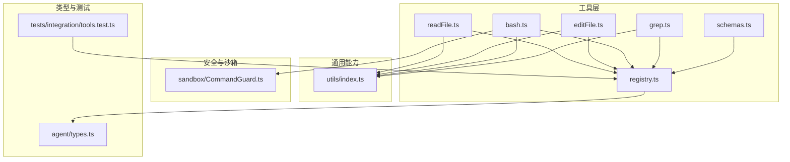
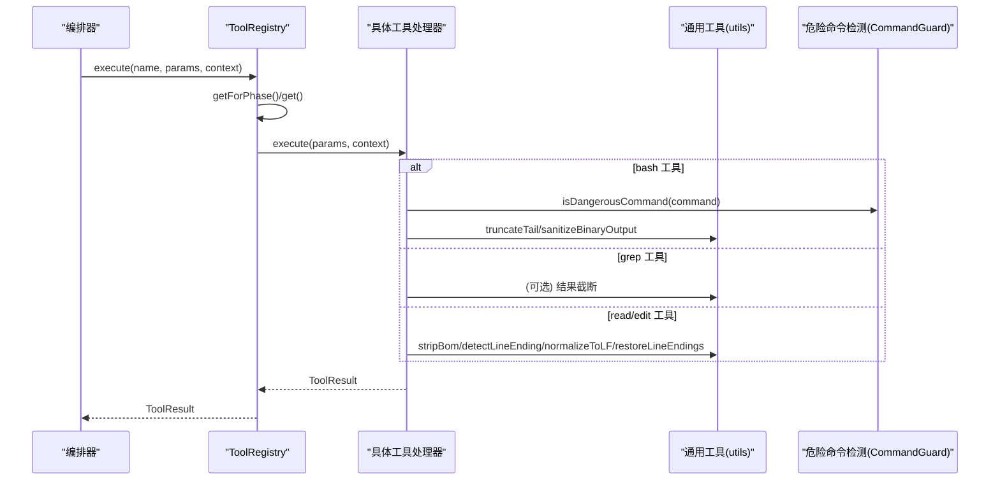
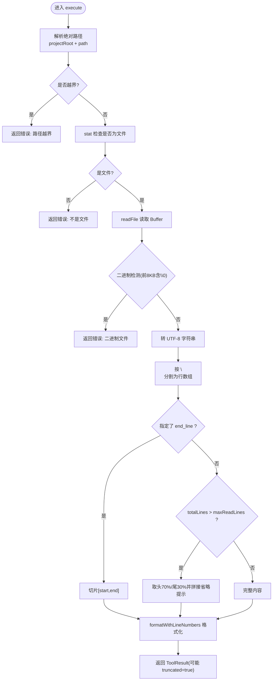
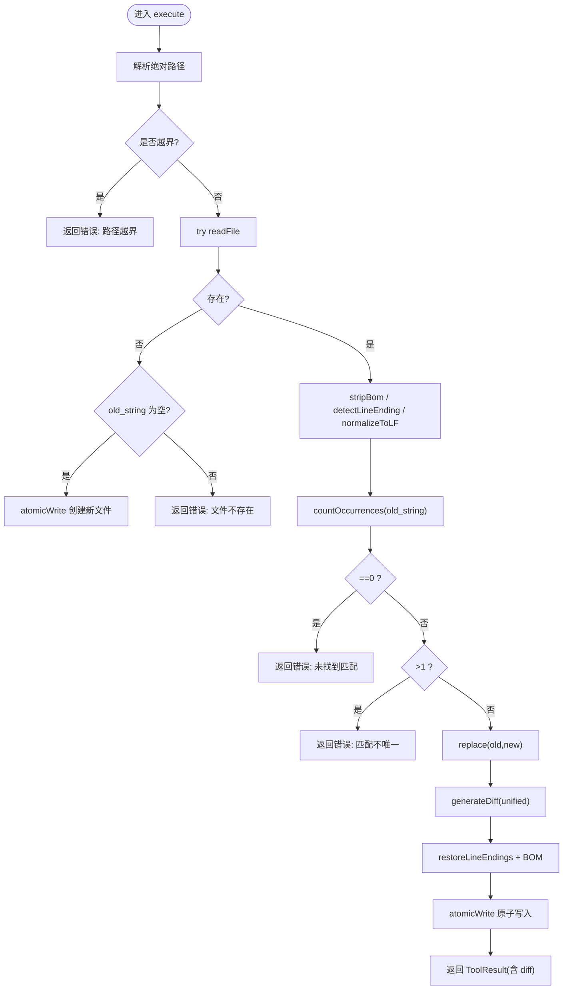
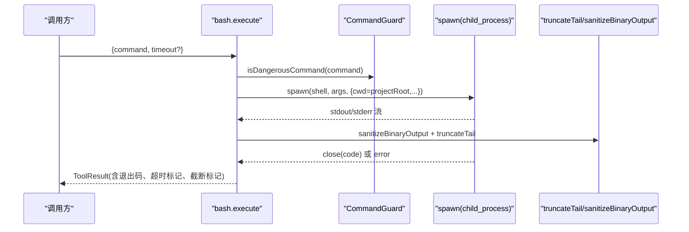
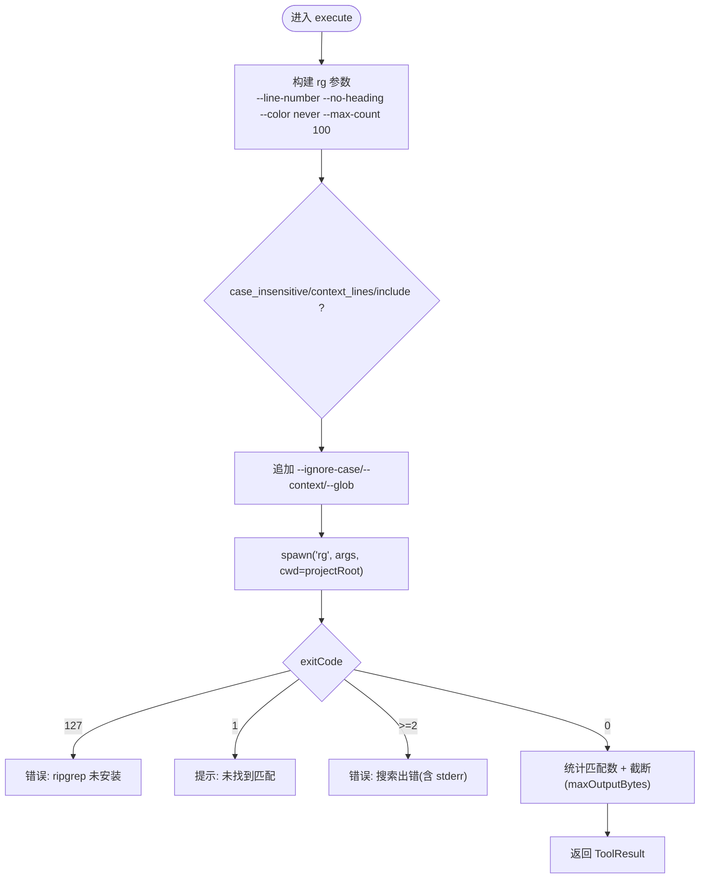
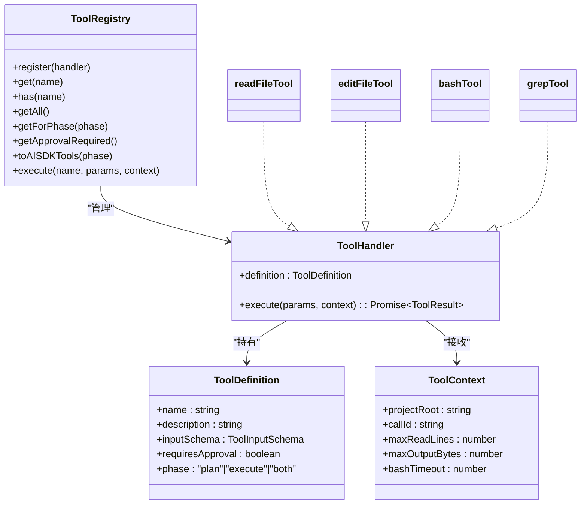

# 内置工具实现

<cite>
**本文引用的文件**   
- [src/tools/readFile.ts](file://src/tools/readFile.ts)
- [src/tools/editFile.ts](file://src/tools/editFile.ts)
- [src/tools/bash.ts](file://src/tools/bash.ts)
- [src/tools/grep.ts](file://src/tools/grep.ts)
- [src/tools/registry.ts](file://src/tools/registry.ts)
- [src/tools/schemas.ts](file://src/tools/schemas.ts)
- [src/utils/index.ts](file://src/utils/index.ts)
- [src/sandbox/CommandGuard.ts](file://src/sandbox/CommandGuard.ts)
- [src/agent/types.ts](file://src/agent/types.ts)
- [tests/integration/tools.test.ts](file://tests/integration/tools.test.ts)
</cite>

## 目录
1. [简介](#简介)
2. [项目结构](#项目结构)
3. [核心组件](#核心组件)
4. [架构总览](#架构总览)
5. [详细组件分析](#详细组件分析)
6. [依赖关系分析](#依赖关系分析)
7. [性能考量](#性能考量)
8. [故障排查指南](#故障排查指南)
9. [结论](#结论)
10. [附录：参数与行为对照表](#附录参数与行为对照表)

## 简介
本文件面向 Nexus 的“内置工具系统”，聚焦四个核心工具：read_file、edit_file、bash、grep。文档从实现细节、安全设计、可靠性保障、参数校验、错误处理与日志记录等维度进行系统化说明，并提供使用示例与故障排查建议，帮助读者快速理解并正确使用这些工具。

## 项目结构
工具层位于 src/tools，包含各工具的独立实现、注册中心与参数 Schema；通用能力（截断、二进制清理、行尾处理）集中在 src/utils；命令沙箱与危险命令检测在 src/sandbox；类型定义在 src/agent/types.ts；集成测试在 tests/integration/tools.test.ts。

图表来源
- [src/tools/readFile.ts:1-150](file://src/tools/readFile.ts#L1-L150)
- [src/tools/editFile.ts:1-170](file://src/tools/editFile.ts#L1-L170)
- [src/tools/bash.ts:1-186](file://src/tools/bash.ts#L1-L186)
- [src/tools/grep.ts:1-178](file://src/tools/grep.ts#L1-L178)
- [src/tools/registry.ts:1-96](file://src/tools/registry.ts#L1-L96)
- [src/tools/schemas.ts:1-40](file://src/tools/schemas.ts#L1-L40)
- [src/utils/index.ts:1-211](file://src/utils/index.ts#L1-L211)
- [src/sandbox/CommandGuard.ts:1-98](file://src/sandbox/CommandGuard.ts#L1-L98)
- [src/agent/types.ts:1-269](file://src/agent/types.ts#L1-L269)
- [tests/integration/tools.test.ts:1-100](file://tests/integration/tools.test.ts#L1-L100)

章节来源
- [src/tools/registry.ts:1-96](file://src/tools/registry.ts#L1-L96)
- [src/agent/types.ts:44-78](file://src/agent/types.ts#L44-L78)

## 核心组件
- 工具注册中心 ToolRegistry：集中管理工具生命周期、阶段过滤、审批清单、AI SDK 兼容导出与统一执行入口。
- 工具上下文 ToolContext：注入项目根路径、调用 ID、读取行数上限、输出字节上限、bash 超时等运行时限制。
- 工具定义 ToolDefinition：描述名称、说明、输入 Schema、是否需要审批、可用阶段。
- 工具处理器 ToolHandler：封装 definition 与 execute 函数，由注册中心调度。
- 参数校验 Schemas：Zod Schema 与 JSON Schema 双轨，确保 LLM 生成参数合法。

章节来源
- [src/tools/registry.ts:12-96](file://src/tools/registry.ts#L12-L96)
- [src/tools/schemas.ts:1-40](file://src/tools/schemas.ts#L1-L40)
- [src/agent/types.ts:44-78](file://src/agent/types.ts#L44-L78)

## 架构总览
工具通过注册中心暴露给上层编排器。每个工具内部遵循统一的错误返回格式 ToolResult，并在必要时利用通用工具函数完成截断、清洗、行尾处理等。

图表来源
- [src/tools/registry.ts:70-82](file://src/tools/registry.ts#L70-L82)
- [src/tools/bash.ts:123-186](file://src/tools/bash.ts#L123-L186)
- [src/tools/grep.ts:80-178](file://src/tools/grep.ts#L80-L178)
- [src/tools/readFile.ts:54-150](file://src/tools/readFile.ts#L54-L150)
- [src/tools/editFile.ts:61-170](file://src/tools/editFile.ts#L61-L170)
- [src/utils/index.ts:182-211](file://src/utils/index.ts#L182-L211)
- [src/sandbox/CommandGuard.ts:71-98](file://src/sandbox/CommandGuard.ts#L71-L98)

## 详细组件分析

### read_file 工具
功能要点
- 读取项目内文本文件，支持按行范围截取，自动添加行号。
- 二进制检测：前 8KB 含空字节即判定为二进制并拒绝。
- 大文件截断策略：超过 maxReadLines 时仅保留头部约 70% 与尾部约 30%，并提示使用 start_line/end_line 或 grep 定位。
- 路径安全：强制相对 projectRoot 解析，禁止越界访问。

关键流程

图表来源
- [src/tools/readFile.ts:54-150](file://src/tools/readFile.ts#L54-L150)

安全与可靠性
- 路径验证：resolve(projectRoot, filePath) 后校验以 projectRoot 开头，防止目录穿越。
- 二进制防护：isBinary 基于首段空字节判断，避免将二进制内容作为文本处理。
- 行数限制：maxReadLines 来自 ToolContext，默认值参考 utils 中的 DEFAULT_MAX_LINES。
- 错误处理：统一捕获异常并包装为 ToolResult.error。

章节来源
- [src/tools/readFile.ts:1-150](file://src/tools/readFile.ts#L1-L150)
- [src/utils/index.ts:40-41](file://src/utils/index.ts#L40-L41)
- [src/agent/types.ts:145-151](file://src/agent/types.ts#L145-L151)

### edit_file 工具
功能要点
- 精准替换：old_string 必须唯一匹配，否则报错；支持创建新文件（old_string 为空）。
- 原子写入：先写临时文件再 rename，避免部分写入导致损坏。
- 格式保持：去除 BOM、统一 LF 计算 diff，最后恢复原始行尾风格与 BOM。
- 变更可见：返回 unified diff，便于 LLM 确认修改。

关键流程

图表来源
- [src/tools/editFile.ts:61-170](file://src/tools/editFile.ts#L61-L170)

安全与可靠性
- 路径验证：同 read_file，禁止越界。
- 唯一性约束：严格计数 old_string 出现次数，避免误改。
- 原子性：临时文件 + rename 保证一致性。
- 格式稳定：BOM 与 CRLF/LF 均被正确保留。
- 审批控制：requiresApproval=true，需人工或策略审批。

章节来源
- [src/tools/editFile.ts:1-170](file://src/tools/editFile.ts#L1-L170)
- [src/utils/index.ts:182-211](file://src/utils/index.ts#L182-L211)

### bash 工具
功能要点
- 在项目根目录下执行 shell 命令，跨平台选择 powershell.exe 或 /bin/bash。
- 危险命令检测：基于正则黑名单与启发式规则，标记危险等级。
- 超时控制：可配置超时（秒），到达后终止进程组。
- 输出限制：二进制字符清理 + 尾部截断，保留错误信息。
- 工作目录锁定：cwd 固定为 projectRoot。

关键流程

图表来源
- [src/tools/bash.ts:42-122](file://src/tools/bash.ts#L42-L122)
- [src/sandbox/CommandGuard.ts:71-98](file://src/sandbox/CommandGuard.ts#L71-L98)
- [src/utils/index.ts:116-154](file://src/utils/index.ts#L116-L154)

安全与可靠性
- 危险命令拦截：dangerous/caution/safe 三级评估，dangerous 强制审批。
- 进程组管理：Unix 下 kill -SIGKILL 整个进程组，Windows 下 taskkill /T。
- 超时保护：定时器触发后主动终止子进程树。
- 输出净化：去除控制字符，尾部截断保留错误信息。
- 权限控制：requiresApproval=true，结合审批策略执行。

章节来源
- [src/tools/bash.ts:1-186](file://src/tools/bash.ts#L1-L186)
- [src/sandbox/CommandGuard.ts:1-98](file://src/sandbox/CommandGuard.ts#L1-L98)
- [src/utils/index.ts:163-180](file://src/utils/index.ts#L163-L180)

### grep 工具
功能要点
- 封装 ripgrep（rg），支持正则、文件名 glob 过滤、上下文行、忽略大小写。
- 性能优化：每文件最多 100 个匹配，颜色关闭，无标题分组。
- 回退策略：若 rg 不可用，返回安装提示。
- 结果截断：按 maxOutputBytes 截断，并提示缩小搜索范围。

关键流程

图表来源
- [src/tools/grep.ts:45-178](file://src/tools/grep.ts#L45-L178)

性能与可靠性
- 限制每文件匹配数量，避免海量结果。
- 关闭颜色与标题，减少无用开销。
- 对输出进行字节级截断，防止超大响应。
- 错误分类清晰：未安装、无匹配、运行错误分别处理。

章节来源
- [src/tools/grep.ts:1-178](file://src/tools/grep.ts#L1-L178)

## 依赖关系分析
- 工具与注册中心：所有工具通过 registry.register 注册，execute 统一分发。
- 工具与通用能力：read/edit 依赖行尾/BOM 处理；bash 依赖输出清理与尾部截断；grep 依赖字节长度计算。
- 工具与安全：bash 依赖 CommandGuard 进行危险命令评估。
- 类型契约：ToolDefinition/ToolResult/ToolContext 贯穿全链路。

图表来源
- [src/tools/registry.ts:12-96](file://src/tools/registry.ts#L12-L96)
- [src/agent/types.ts:44-78](file://src/agent/types.ts#L44-L78)

章节来源
- [src/tools/registry.ts:1-96](file://src/tools/registry.ts#L1-L96)
- [src/agent/types.ts:44-78](file://src/agent/types.ts#L44-L78)

## 性能考量
- read_file：大文件采用头尾分段读取与展示，避免一次性加载超长文本；二进制检测仅扫描前 8KB，时间复杂度 O(min(N, 8KB))。
- edit_file：diff 生成基于 LF 规范化后的内容，减少因换行差异导致的无效变更；原子写入降低 I/O 风险。
- bash：子进程隔离执行，超时与进程组管理避免资源泄漏；输出清理与尾部截断减少内存占用。
- grep：通过 rg 原生性能优势，配合 --max-count 与 no-heading/color 等参数提升检索效率。

[本节为通用性能讨论，无需特定文件引用]

## 故障排查指南
常见问题与定位方法
- read_file 报“路径越界”：检查 path 是否包含 “..” 或指向项目外路径。
- read_file 报“二进制文件”：目标文件可能是图片、压缩包等，改用其他工具或转换后再读。
- read_file 报“不是文件”：path 对应的是目录或符号链接，请修正路径。
- edit_file 报“未找到匹配”：old_string 与当前文件不一致，先 read_file 获取最新内容。
- edit_file 报“匹配不唯一”：增加上下文行使 old_string 唯一。
- edit_file 报“文件不存在”：如需新建文件，请将 old_string 设为空字符串。
- bash 报“命令超时”：增大 timeout 或优化命令逻辑；注意查看 stderr 末尾错误信息。
- bash 报“危险命令”：命令命中黑名单，需调整命令或通过审批流程。
- grep 报“ripgrep 未安装”：按提示安装 rg 或改用其他搜索方式。
- grep 报“搜索出错”：检查 pattern 语法、include 过滤条件与搜索路径。

章节来源
- [src/tools/readFile.ts:60-96](file://src/tools/readFile.ts#L60-L96)
- [src/tools/editFile.ts:81-130](file://src/tools/editFile.ts#L81-L130)
- [src/tools/bash.ts:123-186](file://src/tools/bash.ts#L123-L186)
- [src/tools/grep.ts:117-178](file://src/tools/grep.ts#L117-L178)

## 结论
内置工具系统在安全性、可靠性与可用性方面做了充分设计：严格的参数校验与路径白名单、原子写入与格式保持、危险命令检测与超时控制、以及针对大量输出的截断与清理策略。通过注册中心的统一管理，工具具备清晰的阶段划分与审批机制，既满足计划阶段的只读需求，又能在执行阶段提供可控的写操作能力。

[本节为总结性内容，无需特定文件引用]

## 附录：参数与行为对照表

- read_file
  - 参数
    - path: 必填，相对项目根的路径
    - start_line: 可选，起始行号（从 1 开始）
    - end_line: 可选，结束行号
  - 行为
    - 二进制检测失败则报错
    - 超出 maxReadLines 时仅显示头尾并提示使用范围或 grep
  - 示例
    - 读取 hello.ts 全文
    - 读取 hello.ts 第 10-20 行
  - 参考
    - [src/tools/readFile.ts:15-35](file://src/tools/readFile.ts#L15-L35)
    - [src/tools/readFile.ts:102-137](file://src/tools/readFile.ts#L102-L137)

- edit_file
  - 参数
    - path: 必填
    - old_string: 必填，必须唯一匹配
    - new_string: 必填
  - 行为
    - 唯一性校验失败报错
    - 支持创建新文件（old_string 为空）
    - 返回 unified diff
  - 示例
    - 将某函数返回值替换为新值
    - 创建新文件并写入初始内容
  - 参考
    - [src/tools/editFile.ts:18-38](file://src/tools/editFile.ts#L18-L38)
    - [src/tools/editFile.ts:110-146](file://src/tools/editFile.ts#L110-L146)

- bash
  - 参数
    - command: 必填
    - timeout: 可选，秒，默认来自配置
  - 行为
    - 危险命令检测与标记
    - 超时后终止进程组
    - 输出清理与尾部截断
  - 示例
    - 运行构建脚本
    - 列出当前目录文件
  - 参考
    - [src/tools/bash.ts:17-33](file://src/tools/bash.ts#L17-L33)
    - [src/tools/bash.ts:123-186](file://src/tools/bash.ts#L123-L186)

- grep
  - 参数
    - pattern: 必填，支持正则
    - path: 可选，搜索路径
    - include: 可选，文件名 glob
    - context_lines: 可选，上下文行数
    - case_insensitive: 可选，忽略大小写
  - 行为
    - 每文件最多 100 匹配
    - 未安装 rg 时给出安装提示
    - 结果按字节截断
  - 示例
    - 在所有 TypeScript 文件中搜索某个函数名
    - 忽略大小写搜索关键字并显示前后 2 行
  - 参考
    - [src/tools/grep.ts:15-43](file://src/tools/grep.ts#L15-L43)
    - [src/tools/grep.ts:91-178](file://src/tools/grep.ts#L91-L178)

章节来源
- [src/tools/schemas.ts:8-31](file://src/tools/schemas.ts#L8-L31)
- [tests/integration/tools.test.ts:36-98](file://tests/integration/tools.test.ts#L36-L98)