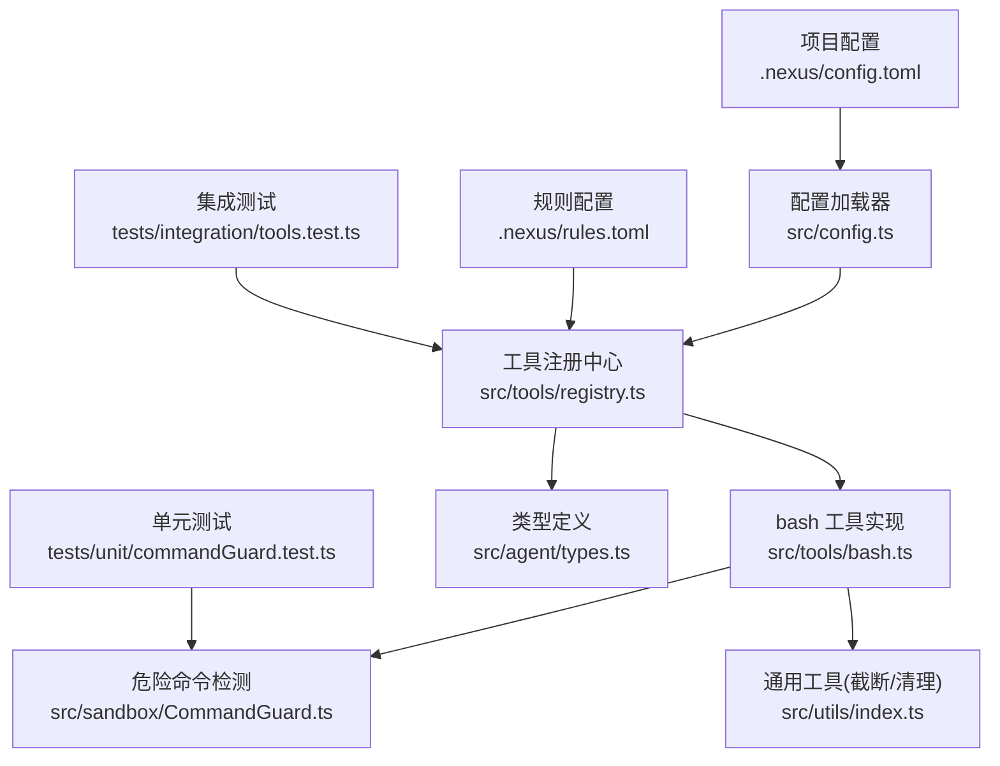
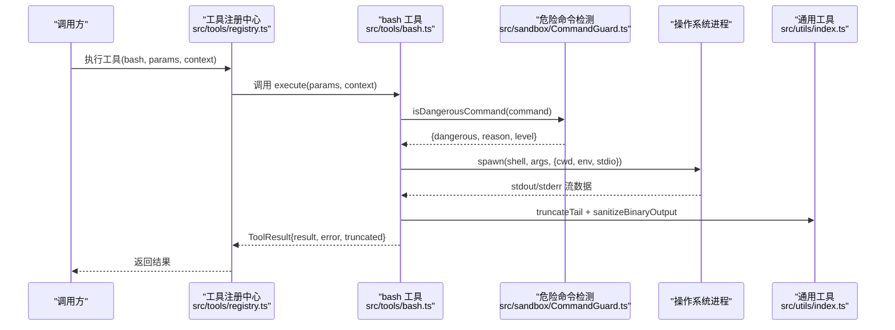
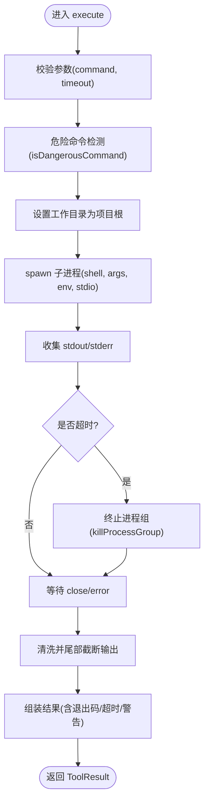
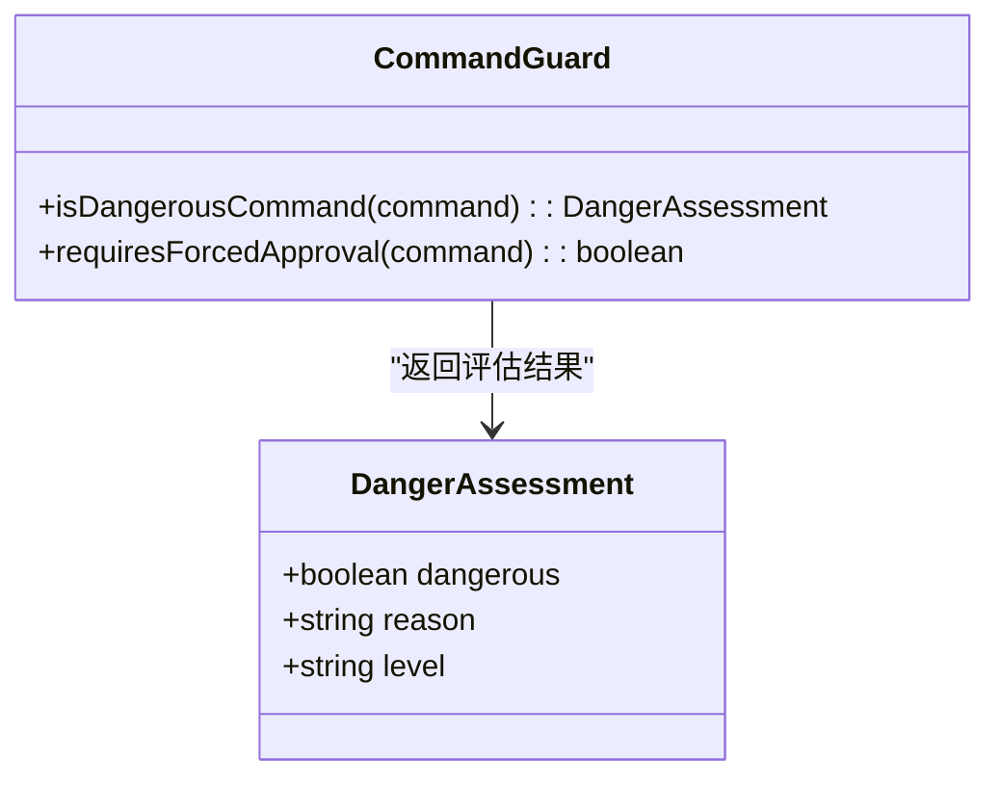
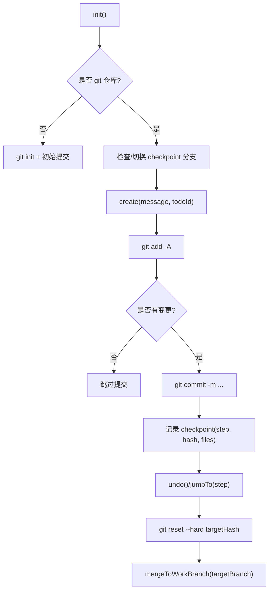
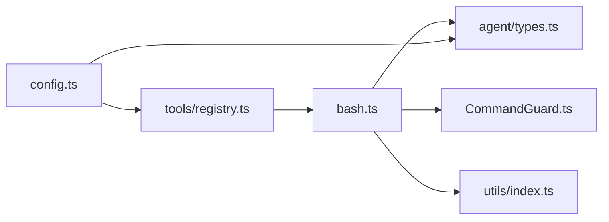

# 命令执行工具 (bash)

<cite>
**本文引用的文件**   
- [src/tools/bash.ts](file://src/tools/bash.ts)
- [src/sandbox/CommandGuard.ts](file://src/sandbox/CommandGuard.ts)
- [src/sandbox/Checkpoint.ts](file://src/sandbox/Checkpoint.ts)
- [src/tools/registry.ts](file://src/tools/registry.ts)
- [src/utils/index.ts](file://src/utils/index.ts)
- [src/config.ts](file://src/config.ts)
- [src/agent/types.ts](file://src/agent/types.ts)
- [.nexus/config.toml](file://.nexus/config.toml)
- [.nexus/rules.toml](file://.nexus/rules.toml)
- [tests/unit/commandGuard.test.ts](file://tests/unit/commandGuard.test.ts)
- [tests/integration/tools.test.ts](file://tests/integration/tools.test.ts)
</cite>

## 目录
1. [简介](#简介)
2. [项目结构](#项目结构)
3. [核心组件](#核心组件)
4. [架构总览](#架构总览)
5. [详细组件分析](#详细组件分析)
6. [依赖关系分析](#依赖关系分析)
7. [性能考量](#性能考量)
8. [故障排查指南](#故障排查指南)
9. [结论](#结论)
10. [附录](#附录)

## 简介
本技术文档聚焦于 bash 命令执行沙箱的实现机制与安全保障，覆盖命令白名单过滤、危险命令检测、权限控制策略、超时控制、输出限制、资源隔离、参数验证、环境变量注入、进程管理与信号处理、异常恢复等关键主题。同时提供安全配置示例与故障排查指南，帮助开发者在生产环境中安全、稳定地运行命令执行能力。

## 项目结构
与 bash 命令执行相关的代码主要分布在以下模块：
- 工具实现：src/tools/bash.ts（命令执行、超时、输出截断、工作目录锁定）
- 沙箱防护：src/sandbox/CommandGuard.ts（危险命令检测）、src/sandbox/Checkpoint.ts（Git 检查点回滚）
- 工具注册与上下文：src/tools/registry.ts（工具生命周期与上下文传递）
- 通用工具：src/utils/index.ts（输出截断、二进制清理、格式化）
- 配置加载：src/config.ts（默认值与 .nexus/config.toml 合并）
- 类型定义：src/agent/types.ts（工具接口、权限模式、限制项）
- 测试：tests/unit/commandGuard.test.ts、tests/integration/tools.test.ts

图表来源
- [src/tools/registry.ts:1-96](file://src/tools/registry.ts#L1-L96)
- [src/tools/bash.ts:1-186](file://src/tools/bash.ts#L1-L186)
- [src/sandbox/CommandGuard.ts:1-98](file://src/sandbox/CommandGuard.ts#L1-L98)
- [src/utils/index.ts:1-211](file://src/utils/index.ts#L1-L211)
- [src/config.ts:1-132](file://src/config.ts#L1-L132)
- [.nexus/config.toml:1-62](file://.nexus/config.toml#L1-L62)
- [.nexus/rules.toml:1-21](file://.nexus/rules.toml#L1-L21)
- [tests/unit/commandGuard.test.ts:1-88](file://tests/unit/commandGuard.test.ts#L1-L88)
- [tests/integration/tools.test.ts:1-100](file://tests/integration/tools.test.ts#L1-L100)

章节来源
- [src/tools/bash.ts:1-186](file://src/tools/bash.ts#L1-L186)
- [src/tools/registry.ts:1-96](file://src/tools/registry.ts#L1-L96)
- [src/sandbox/CommandGuard.ts:1-98](file://src/sandbox/CommandGuard.ts#L1-L98)
- [src/utils/index.ts:1-211](file://src/utils/index.ts#L1-L211)
- [src/config.ts:1-132](file://src/config.ts#L1-L132)
- [src/agent/types.ts:1-269](file://src/agent/types.ts#L1-L269)
- [.nexus/config.toml:1-62](file://.nexus/config.toml#L1-L62)
- [.nexus/rules.toml:1-21](file://.nexus/rules.toml#L1-L21)
- [tests/unit/commandGuard.test.ts:1-88](file://tests/unit/commandGuard.test.ts#L1-L88)
- [tests/integration/tools.test.ts:1-100](file://tests/integration/tools.test.ts#L1-L100)

## 核心组件
- bash 工具实现：负责命令执行、超时控制、输出截断、工作目录锁定、错误处理与结果组装。
- 危险命令检测：基于正则黑名单与启发式规则，对命令进行分级评估（safe/caution/dangerous），并支持强制审批判定。
- Git 检查点管理：在每次编辑后自动提交变更，支持回滚到任意步骤，降低“Agent 犯错”的风险。
- 工具注册与上下文：统一注册工具、按阶段过滤可用工具、传递执行上下文（项目根、超时、输出限制等）。
- 通用工具函数：提供头部/尾部截断、二进制输出清理、行尾风格保持等生产级能力。
- 配置加载：从 .nexus/config.toml 加载配置并与默认值合并，暴露 bashTimeout、maxOutputBytes 等限制项。

章节来源
- [src/tools/bash.ts:1-186](file://src/tools/bash.ts#L1-L186)
- [src/sandbox/CommandGuard.ts:1-98](file://src/sandbox/CommandGuard.ts#L1-L98)
- [src/sandbox/Checkpoint.ts:1-182](file://src/sandbox/Checkpoint.ts#L1-L182)
- [src/tools/registry.ts:1-96](file://src/tools/registry.ts#L1-L96)
- [src/utils/index.ts:1-211](file://src/utils/index.ts#L1-L211)
- [src/config.ts:1-132](file://src/config.ts#L1-L132)

## 架构总览
下图展示了 bash 命令执行的端到端流程，包括工具调用、危险命令检测、进程创建、超时控制、输出截断与结果返回。

图表来源
- [src/tools/registry.ts:70-82](file://src/tools/registry.ts#L70-L82)
- [src/tools/bash.ts:123-183](file://src/tools/bash.ts#L123-L183)
- [src/sandbox/CommandGuard.ts:71-98](file://src/sandbox/CommandGuard.ts#L71-L98)
- [src/utils/index.ts:116-154](file://src/utils/index.ts#L116-L154)

## 详细组件分析

### bash 工具实现（命令执行沙箱）
- 命令执行与进程管理
  - 使用 child_process.spawn 启动 shell（Windows 为 powershell.exe，Unix 为 /bin/bash），通过 detached 或 windowsHide 控制进程组。
  - 设置 cwd 为项目根目录，确保工作目录锁定；env 继承 process.env 并固定 TERM=dumb 避免终端交互。
  - 监听 stdout/stderr 流，累积输出并在 close/error 事件时清理定时器并返回结果。
- 超时控制与进程组终止
  - 通过 setTimeout 触发超时，调用 killProcessGroup 以跨平台方式终止进程组（Windows 用 taskkill /T，Unix 用 kill -SIGKILL 负 PID）。
  - 若进程已退出则忽略异常，保证健壮性。
- 输出限制与清洗
  - 先进行二进制输出清洗（去除控制字符），再使用尾部截断保留错误信息，附带原始大小与行数提示。
- 参数验证与安全边界
  - 输入 schema 要求 command 必填，timeout 可选且由 context.bashTimeout 提供默认值。
  - 工作目录锁定在项目根，避免路径逃逸。
- 异常恢复与结果组装
  - 捕获执行异常，标准化错误消息；根据 exitCode 与 timedOut 标记组装结果，包含 stdout/stderr 与警告信息。

图表来源
- [src/tools/bash.ts:43-89](file://src/tools/bash.ts#L43-L89)
- [src/tools/bash.ts:92-109](file://src/tools/bash.ts#L92-L109)
- [src/tools/bash.ts:112-121](file://src/tools/bash.ts#L112-L121)
- [src/tools/bash.ts:123-183](file://src/tools/bash.ts#L123-L183)

章节来源
- [src/tools/bash.ts:1-186](file://src/tools/bash.ts#L1-L186)

### 危险命令检测（CommandGuard）
- 规则设计
  - 危险模式列表涵盖文件系统破坏、磁盘操作、Fork 炸弹、管道远程执行、权限提升、系统关键文件覆写、Windows 危险操作、Git 破坏性操作、环境变量泄露等。
  - 注意模式列表用于“额外注意”，不强制拦截但可提示风险。
- 评估逻辑
  - 对命令进行规范化后依次匹配危险模式与注意模式，返回等级 safe/caution/dangerous 及原因。
  - requiresForcedApproval 仅当 level === dangerous 时强制审批，不受权限模式影响。
- 测试覆盖
  - 单元测试覆盖 rm -rf /、fork 炸弹、curl | bash、mkfs、dd 写块设备、git push --force main、Windows format 等场景，以及普通命令的安全判定。

图表来源
- [src/sandbox/CommandGuard.ts:6-10](file://src/sandbox/CommandGuard.ts#L6-L10)
- [src/sandbox/CommandGuard.ts:71-98](file://src/sandbox/CommandGuard.ts#L71-L98)

章节来源
- [src/sandbox/CommandGuard.ts:1-98](file://src/sandbox/CommandGuard.ts#L1-L98)
- [tests/unit/commandGuard.test.ts:1-88](file://tests/unit/commandGuard.test.ts#L1-L88)

### Git 检查点管理（Checkpoint）
- 初始化与分支管理
  - 确保当前目录为 git 仓库，必要时初始化仓库与初始提交；创建或切换到 checkpoint 分支。
- 检查点创建与回滚
  - 每次编辑后暂存并提交变更，记录 commit hash、变更文件列表与时间戳；支持 undo 与 jumpTo 回滚到指定步骤。
- 会话结束合并
  - 将 checkpoint 分支合并到目标工作分支，便于持久化变更。

图表来源
- [src/sandbox/Checkpoint.ts:43-70](file://src/sandbox/Checkpoint.ts#L43-L70)
- [src/sandbox/Checkpoint.ts:73-116](file://src/sandbox/Checkpoint.ts#L73-L116)
- [src/sandbox/Checkpoint.ts:119-155](file://src/sandbox/Checkpoint.ts#L119-L155)
- [src/sandbox/Checkpoint.ts:168-180](file://src/sandbox/Checkpoint.ts#L168-L180)

章节来源
- [src/sandbox/Checkpoint.ts:1-182](file://src/sandbox/Checkpoint.ts#L1-L182)

### 工具注册与上下文（registry）
- 工具注册与阶段过滤
  - 注册 read_file、edit_file、bash、grep 工具；按 phase 过滤可用工具（plan 阶段只读，execute 阶段全部）。
- 上下文传递
  - ToolContext 包含 projectRoot、callId、maxReadLines、maxOutputBytes、bashTimeout，供各工具统一使用。
- 执行入口
  - registry.execute(name, params, context) 查找处理器并调用 execute，未找到时返回未知工具错误。

章节来源
- [src/tools/registry.ts:1-96](file://src/tools/registry.ts#L1-L96)

### 通用工具（utils）
- 输出截断策略
  - truncateHead：适用于文件读取，保留开头且不返回不完整行。
  - truncateTail：适用于 bash 输出，保留结尾以便展示错误信息。
- 二进制输出清洗
  - sanitizeBinaryOutput：去除控制字符，保留换行与制表符，防止终端渲染异常。
- 行尾风格与 BOM
  - detectLineEnding、normalizeToLF、restoreLineEndings、stripBom，确保跨平台一致性。

章节来源
- [src/utils/index.ts:1-211](file://src/utils/index.ts#L1-L211)

### 配置加载（config）
- 默认配置与合并
  - DEFAULT_CONFIG 定义模型路由、权限模式、限制项（bashTimeout、maxOutputBytes 等）、上下文预算、检查点分支等。
  - loadConfig 读取 .nexus/config.toml 并与默认值合并，字段映射兼容下划线命名。
- 关键限制项
  - limits.bashTimeout：单次 bash 命令超时秒数。
  - limits.maxOutputBytes：bash 输出最大字节数。
  - permissions.mode：ask/auto-edit/auto-all/yolo。

章节来源
- [src/config.ts:1-132](file://src/config.ts#L1-L132)
- [.nexus/config.toml:1-62](file://.nexus/config.toml#L1-L62)

### 类型定义（types）
- 工具接口与权限模式
  - ToolDefinition、ToolInputSchema、ToolResult、PermissionMode（ask/auto-edit/auto-all/yolo）。
- 沙箱提供者接口
  - SandboxProvider 抽象命令执行接口，当前实现为 TypeScriptSandbox（spawn + CommandGuard），未来可替换为 GoSandbox（pty + cgroup + syscall 过滤）。
- 限制项与检查点
  - NexusConfig.limits 包含 bashTimeout、maxOutputBytes 等；Checkpoint 记录 step、commitHash、filesChanged 等。

章节来源
- [src/agent/types.ts:1-269](file://src/agent/types.ts#L1-L269)

## 依赖关系分析
- 模块耦合
  - bash 工具依赖 CommandGuard 进行危险命令检测，依赖 utils 进行输出处理，依赖 registry 的 ToolContext 获取执行上下文。
  - registry 聚合所有工具处理器，按阶段过滤并提供执行入口。
  - config 提供默认值与配置文件合并，影响 bash 工具的超时与输出限制。
- 外部依赖
  - child_process.spawn 用于进程创建与管理。
  - fs/promises 与 path 用于文件与路径操作。
  - smol-toml 用于解析 TOML 配置。
- 潜在循环依赖
  - 当前无循环依赖，模块职责清晰，工具层与沙箱层解耦良好。

图表来源
- [src/tools/bash.ts:1-186](file://src/tools/bash.ts#L1-L186)
- [src/tools/registry.ts:1-96](file://src/tools/registry.ts#L1-L96)
- [src/sandbox/CommandGuard.ts:1-98](file://src/sandbox/CommandGuard.ts#L1-L98)
- [src/utils/index.ts:1-211](file://src/utils/index.ts#L1-L211)
- [src/config.ts:1-132](file://src/config.ts#L1-L132)
- [src/agent/types.ts:1-269](file://src/agent/types.ts#L1-L269)

章节来源
- [src/tools/bash.ts:1-186](file://src/tools/bash.ts#L1-L186)
- [src/tools/registry.ts:1-96](file://src/tools/registry.ts#L1-L96)
- [src/sandbox/CommandGuard.ts:1-98](file://src/sandbox/CommandGuard.ts#L1-L98)
- [src/utils/index.ts:1-211](file://src/utils/index.ts#L1-L211)
- [src/config.ts:1-132](file://src/config.ts#L1-L132)
- [src/agent/types.ts:1-269](file://src/agent/types.ts#L1-L269)

## 性能考量
- 输出截断策略
  - 使用尾部截断保留错误信息，避免大输出阻塞内存；默认最大 50KB，可通过 maxOutputBytes 调整。
- 进程组终止
  - Unix 使用 kill -SIGKILL 负 PID 快速终止整个进程组，减少僵尸进程；Windows 使用 taskkill /T 递归终止。
- 二进制清洗
  - 在截断前清洗控制字符，减少渲染开销与潜在安全问题。
- 配置优化
  - 合理设置 bashTimeout 与 maxOutputBytes，避免长时间占用与内存峰值。

[本节为一般性指导，无需引用具体文件]

## 故障排查指南
- 常见安全问题
  - 危险命令未被拦截：确认 CommandGuard 规则是否覆盖对应模式；检查 requiresForcedApproval 是否正确触发。
  - 输出过大导致卡顿：调整 maxOutputBytes，启用尾部截断；检查 sanitizeBinaryOutput 是否生效。
  - 进程无法终止：确认 killProcessGroup 是否被调用；检查操作系统差异（Windows vs Unix）。
- 性能瓶颈
  - 长耗时命令：缩短 bashTimeout；拆分任务或使用后台服务。
  - 大量输出：增加 maxOutputBytes 上限或改用分页查询。
- 调试技巧
  - 启用更详细的日志（如打印 command、exitCode、timedOut）。
  - 使用单元测试覆盖危险命令场景，确保规则更新有效。
  - 通过集成测试验证工具链端到端行为。

章节来源
- [tests/unit/commandGuard.test.ts:1-88](file://tests/unit/commandGuard.test.ts#L1-L88)
- [tests/integration/tools.test.ts:1-100](file://tests/integration/tools.test.ts#L1-L100)

## 结论
bash 命令执行沙箱通过严格的危险命令检测、超时控制、输出限制与工作目录锁定，提供了安全可靠的命令执行环境。结合 Git 检查点与工具注册机制，实现了可回滚、可审计的执行流程。建议在生产环境中合理配置权限模式与限制项，并持续完善危险命令规则与监控手段。

[本节为总结性内容，无需引用具体文件]

## 附录

### 安全配置示例
- 自定义命令白名单与危险规则
  - 在 CommandGuard 中扩展 DANGEROUS_PATTERNS 与 CAUTION_PATTERNS，添加业务相关危险模式。
- 设置执行限制
  - 在 .nexus/config.toml 中调整 limits.bashTimeout 与 limits.maxOutputBytes，平衡安全性与性能。
- 监控命令执行
  - 在 bash 工具中增加日志记录（command、exitCode、timedOut、truncated），便于审计与告警。

章节来源
- [src/sandbox/CommandGuard.ts:13-55](file://src/sandbox/CommandGuard.ts#L13-L55)
- [.nexus/config.toml:39-49](file://.nexus/config.toml#L39-L49)
- [src/tools/bash.ts:147-173](file://src/tools/bash.ts#L147-L173)

### 权限控制策略
- 权限模式说明
  - ask：每个写操作都询问（默认）。
  - auto-edit：edit 自动批准，bash 仍询问。
  - auto-all：全部自动（危险命令仍强制问）。
  - yolo：全部自动，含危险命令（自负责任）。
- 强制审批
  - requiresForcedApproval 仅当命令等级为 dangerous 时强制审批，不受权限模式影响。

章节来源
- [src/agent/types.ts:27](file://src/agent/types.ts#L27)
- [src/sandbox/CommandGuard.ts:95-98](file://src/sandbox/CommandGuard.ts#L95-L98)

### 环境变量注入与安全边界
- 环境变量
  - 继承 process.env 并固定 TERM=dumb，避免交互式终端行为。
- 安全边界
  - 工作目录锁定在项目根，防止路径逃逸；输出清洗与控制字符去除，避免终端劫持。

章节来源
- [src/tools/bash.ts:49-55](file://src/tools/bash.ts#L49-L55)
- [src/utils/index.ts:166-180](file://src/utils/index.ts#L166-L180)

### 进程管理与信号处理
- 进程创建
  - 使用 child_process.spawn，设置 detached/windowsHide 控制进程组。
- 信号处理
  - 超时时发送 SIGKILL 终止进程组；捕获 close/error 事件清理资源。

章节来源
- [src/tools/bash.ts:49-55](file://src/tools/bash.ts#L49-L55)
- [src/tools/bash.ts:92-109](file://src/tools/bash.ts#L92-L109)

### 异常恢复机制
- 异常捕获
  - 捕获执行异常并标准化错误消息，返回 ToolResult 中的 error 字段。
- 资源清理
  - 在 close/error 事件中清除定时器，避免内存泄漏。

章节来源
- [src/tools/bash.ts:174-183](file://src/tools/bash.ts#L174-L183)