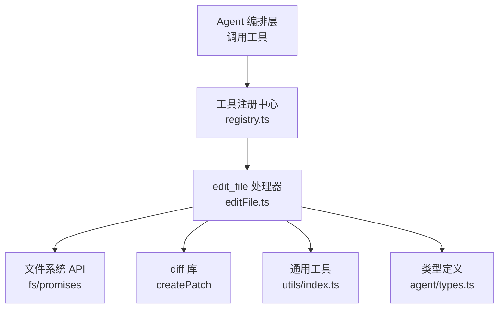
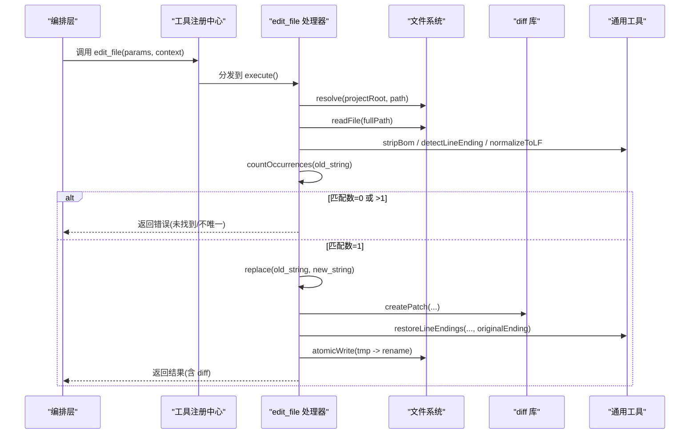
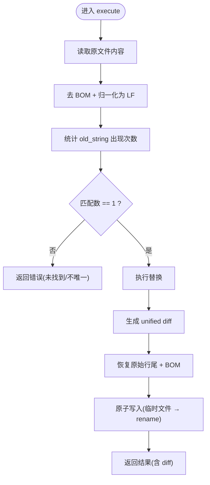
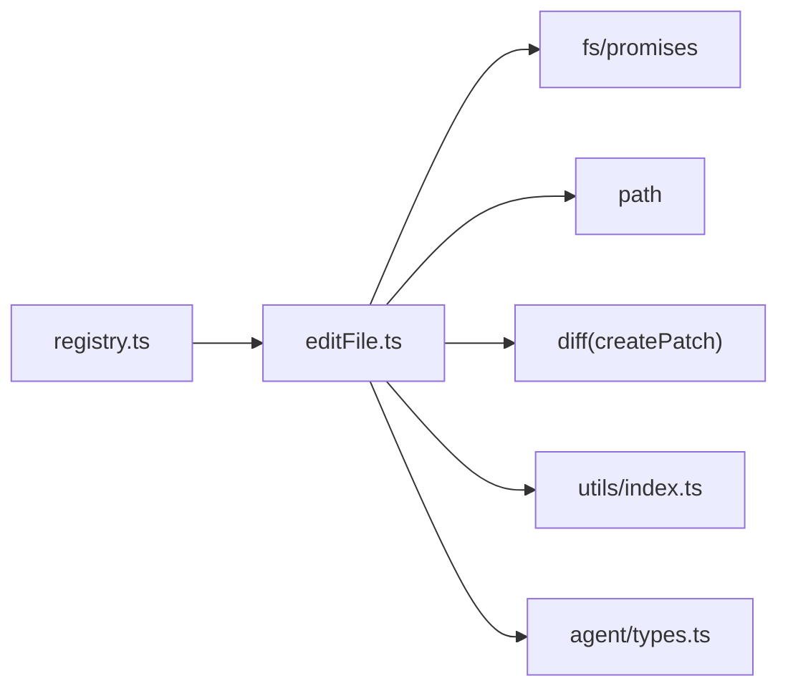

# 文件编辑工具 (edit_file)

<cite>
**本文引用的文件**   
- [src/tools/editFile.ts](file://src/tools/editFile.ts)
- [src/tools/schemas.ts](file://src/tools/schemas.ts)
- [src/tools/registry.ts](file://src/tools/registry.ts)
- [src/utils/index.ts](file://src/utils/index.ts)
- [src/agent/types.ts](file://src/agent/types.ts)
- [tests/integration/tools.test.ts](file://tests/integration/tools.test.ts)
- [DESIGN.md](file://DESIGN.md)
</cite>

## 目录
1. [简介](#简介)
2. [项目结构](#项目结构)
3. [核心组件](#核心组件)
4. [架构总览](#架构总览)
5. [详细组件分析](#详细组件分析)
6. [依赖分析](#依赖分析)
7. [性能考虑](#性能考虑)
8. [故障排查指南](#故障排查指南)
9. [结论](#结论)
10. [附录](#附录)

## 简介
本文件为 edit_file 工具的全面技术文档，聚焦于其实现原理、参数校验与安全机制、差异计算与变更展示、原子写入策略、错误处理与回滚建议，以及使用示例与最佳实践。该工具的核心目标是“精准替换”，通过强制唯一匹配与原子写入保障可靠性，同时保留原始编码与行尾风格，避免引入格式漂移。

## 项目结构
edit_file 位于工具层，遵循 MCP 风格的注册与执行模型：
- 工具定义与执行逻辑：src/tools/editFile.ts
- 输入 Schema（Zod）：src/tools/schemas.ts
- 工具注册中心：src/tools/registry.ts
- 通用工具函数（BOM/行尾等）：src/utils/index.ts
- 类型定义（ToolDefinition/ToolResult 等）：src/agent/types.ts
- 集成测试用例：tests/integration/tools.test.ts
- 设计说明（含 edit 可靠性设计要点）：DESIGN.md

图表来源
- [src/tools/registry.ts:25-96](file://src/tools/registry.ts#L25-L96)
- [src/tools/editFile.ts:1-170](file://src/tools/editFile.ts#L1-L170)
- [src/utils/index.ts:182-211](file://src/utils/index.ts#L182-L211)
- [src/agent/types.ts:44-78](file://src/agent/types.ts#L44-L78)

章节来源
- [src/tools/editFile.ts:1-170](file://src/tools/editFile.ts#L1-L170)
- [src/tools/registry.ts:1-96](file://src/tools/registry.ts#L1-L96)
- [src/tools/schemas.ts:1-40](file://src/tools/schemas.ts#L1-L40)
- [src/utils/index.ts:182-211](file://src/utils/index.ts#L182-L211)
- [src/agent/types.ts:44-78](file://src/agent/types.ts#L44-L78)
- [DESIGN.md:240-260](file://DESIGN.md#L240-L260)

## 核心组件
- 工具定义与输入约束
  - 名称：edit_file
  - 描述：精准替换文件中的字符串；old_string 必须唯一匹配（0 处或 >1 处均报错），需提供足够上下文确保唯一性。
  - 输入字段：path、old_string、new_string（均为必填）。
  - 审批要求：requiresApproval 为 true，属于写操作，默认需要用户审批。
  - 阶段：execute（仅在执行阶段可用）。

- 执行流程概览
  - 解析并校验参数（由上层 Zod schema 与内部路径检查共同完成）。
  - 安全检查：拒绝项目根目录之外的路径。
  - 读取原文件内容，处理 BOM 与行尾风格。
  - 在 LF 规范化后的文本中计数 old_string 出现次数。
  - 若匹配数为 0 或 >1，返回错误提示。
  - 应用替换，生成 unified diff。
  - 恢复原始行尾与 BOM，原子写入（临时文件 + rename）。
  - 返回包含 diff 的结果给 LLM。

章节来源
- [src/tools/editFile.ts:14-38](file://src/tools/editFile.ts#L14-L38)
- [src/tools/schemas.ts:14-18](file://src/tools/schemas.ts#L14-L18)
- [src/agent/types.ts:44-78](file://src/agent/types.ts#L44-L78)

## 架构总览
edit_file 作为 MCP 风格工具被注册到工具注册中心，由 Agent 编排层在 execute 阶段按需调用。其关键交互如下：

图表来源
- [src/tools/registry.ts:70-82](file://src/tools/registry.ts#L70-L82)
- [src/tools/editFile.ts:61-156](file://src/tools/editFile.ts#L61-L156)
- [src/utils/index.ts:182-211](file://src/utils/index.ts#L182-L211)
- [src/tools/editFile.ts:158-166](file://src/tools/editFile.ts#L158-L166)

## 详细组件分析

### 参数结构与验证规则
- 参数定义
  - path：相对项目根目录的文件路径（字符串）。
  - old_string：要替换的原文（字符串），必须在文件中唯一匹配。
  - new_string：替换后的新内容（字符串）。
- 校验与约束
  - 类型校验：由 Zod schema 保证三个字段均为字符串且必填。
  - 路径安全：resolve 后校验是否以 projectRoot 开头，越界直接拒绝。
  - 唯一匹配：在 LF 规范化后的文本中统计 old_string 出现次数，仅允许恰好一次。
  - 空 old_string 的特殊语义：当文件不存在且 old_string 为空时，将 new_string 作为新文件内容创建。

章节来源
- [src/tools/schemas.ts:14-18](file://src/tools/schemas.ts#L14-L18)
- [src/tools/editFile.ts:61-101](file://src/tools/editFile.ts#L61-L101)
- [src/tools/editFile.ts:110-129](file://src/tools/editFile.ts#L110-L129)

### 内容替换算法与差异计算
- 内容标准化
  - 去除 BOM，检测并记录原始行尾风格（CRLF/LF）。
  - 将内容与搜索串统一转换为 LF，以避免因换行符不一致导致匹配失败。
- 匹配与替换
  - 使用线性扫描统计 old_string 出现次数。
  - 仅当匹配数为 1 时执行单次替换。
- 差异生成
  - 基于 diff 库生成 unified diff，过滤头部信息，仅保留 @@ 起始的主体部分。
  - 若无变更，返回“(无变更)”。

图表来源
- [src/tools/editFile.ts:103-139](file://src/tools/editFile.ts#L103-L139)
- [src/tools/editFile.ts:158-166](file://src/tools/editFile.ts#L158-L166)

章节来源
- [src/tools/editFile.ts:103-139](file://src/tools/editFile.ts#L103-L139)
- [src/tools/editFile.ts:158-166](file://src/tools/editFile.ts#L158-L166)
- [src/utils/index.ts:182-211](file://src/utils/index.ts#L182-L211)

### 原子写入与一致性保障
- 原子写入策略
  - 先写入带时间戳后缀的临时文件，再 rename 为目标路径，保证写入的原子性与一致性。
  - 自动创建目标目录（递归 mkdir）。
- 行尾与 BOM 保留
  - 写入前恢复原始行尾风格与 BOM，避免编辑器/CI 环境对换行符敏感导致的误报。

章节来源
- [src/tools/editFile.ts:52-59](file://src/tools/editFile.ts#L52-L59)
- [src/tools/editFile.ts:137-139](file://src/tools/editFile.ts#L137-L139)
- [src/utils/index.ts:182-211](file://src/utils/index.ts#L182-L211)

### 安全机制
- 路径验证
  - 通过 resolve(projectRoot, filePath) 并校验是否以 projectRoot 开头，防止越界访问。
- 权限控制
  - requiresApproval 为 true，默认需要用户审批后方可执行。
- 审计与可观测性
  - 返回结果中包含 diff，便于 UI 展示与人工审查。
  - 工具注册中心暴露 getApprovalRequired()，用于收集需审批的工具名列表。

章节来源
- [src/tools/editFile.ts:71-79](file://src/tools/editFile.ts#L71-L79)
- [src/tools/editFile.ts:36-38](file://src/tools/editFile.ts#L36-L38)
- [src/tools/registry.ts:51-56](file://src/tools/registry.ts#L51-L56)

### 撤销机制、备份策略与冲突解决
- 撤销机制
  - 当前实现不包含内置撤销。建议在外部结合 Git checkpoint 进行回滚（参考设计文档关于检查点与回滚的建议）。
- 备份策略
  - 原子写入采用临时文件 + rename，不保留历史版本；如需保留备份，可在外部增加 copy 步骤。
- 冲突解决
  - 唯一匹配策略天然规避“多处替换”的歧义；若匹配不唯一，工具会明确报错并要求提供更多上下文。
  - 若文件在并发场景下被修改，read 到的内容可能已变化，此时会出现“未找到匹配”的错误，应重新读取最新内容后再尝试。

章节来源
- [DESIGN.md:475-484](file://DESIGN.md#L475-L484)
- [src/tools/editFile.ts:113-129](file://src/tools/editFile.ts#L113-L129)

### 错误处理与边界情况
- 常见错误
  - 路径越界：返回错误提示。
  - 文件不存在且 old_string 非空：返回错误提示，指导使用空 old_string 创建新文件。
  - 未找到匹配：提示文件可能已变更，建议重新 read_file。
  - 匹配不唯一：提示提供足够上下文以确保唯一匹配。
  - 其他异常：捕获并包装为错误消息返回。
- 边界情况
  - 空 old_string 且文件不存在：按新文件创建处理。
  - 大文件：注意内存占用与 I/O 开销，建议配合上下文压缩策略。

章节来源
- [src/tools/editFile.ts:71-101](file://src/tools/editFile.ts#L71-L101)
- [src/tools/editFile.ts:113-156](file://src/tools/editFile.ts#L113-L156)

## 依赖分析
- 直接依赖
  - fs/promises：文件读写、重命名、目录创建。
  - path：路径解析与相对路径计算。
  - diff：unified diff 生成。
  - utils：BOM 处理、行尾检测与恢复、LF 归一化。
  - agent/types：工具定义与结果类型。
  - registry：工具注册与执行分发。
- 间接依赖
  - Zod schema：参数校验（由上层注入）。
  - 集成测试：覆盖基本工作流与错误分支。

图表来源
- [src/tools/editFile.ts:7-12](file://src/tools/editFile.ts#L7-L12)
- [src/tools/registry.ts:1-11](file://src/tools/registry.ts#L1-L11)

章节来源
- [src/tools/editFile.ts:7-12](file://src/tools/editFile.ts#L7-L12)
- [src/tools/registry.ts:1-11](file://src/tools/registry.ts#L1-L11)

## 性能考虑
- 匹配复杂度
  - 匹配计数使用线性扫描，时间复杂度 O(n·m)，n 为文本长度，m 为 old_string 长度。对于大文件需注意内存与 CPU 消耗。
- 差异生成
  - unified diff 生成复杂度较高，建议限制参与 diff 的内容规模（例如只针对变更区域），或在外部做增量对比。
- I/O 优化
  - 原子写入减少中间状态风险，但会产生额外磁盘 I/O。在高并发场景下，可通过批量化提交或合并小改动降低系统压力。
- 行尾与 BOM
  - 归一化与恢复带来少量额外处理成本，但能显著减少跨平台差异带来的问题。

[本节为通用性能讨论，无需具体文件引用]

## 故障排查指南
- 常见问题定位
  - “未找到匹配”：确认 old_string 是否与当前文件一致，必要时先 read_file 获取最新内容。
  - “匹配不唯一”：扩大 old_string 上下文，包含更多前后行以提高唯一性。
  - “路径越界”：检查 path 是否为相对项目根目录的路径，避免使用绝对路径或 ../ 逃逸。
  - “文件不存在”：若意图创建新文件，请将 old_string 设为空字符串。
- 调试建议
  - 查看返回的 diff 输出，确认实际变更范围。
  - 在集成测试中复现问题，逐步缩小范围。
  - 关注行尾与 BOM 的影响，必要时在本地模拟相同环境。

章节来源
- [tests/integration/tools.test.ts:43-76](file://tests/integration/tools.test.ts#L43-L76)
- [src/tools/editFile.ts:113-156](file://src/tools/editFile.ts#L113-L156)

## 结论
edit_file 通过“强制唯一匹配 + 原子写入 + 格式保留”的设计，提供了高可靠性的文件编辑能力。其参数校验严格、错误提示清晰，适合在 Agent 执行阶段进行精准代码修改。结合外部 Git checkpoint 与审批机制，可在安全性与可回滚性方面形成完整闭环。

[本节为总结性内容，无需具体文件引用]

## 附录

### 使用示例（场景与预期行为）
- 单行替换
  - 场景：将某一行中的常量值从旧值改为新值。
  - 关键点：old_string 需包含该行完整内容，确保唯一匹配。
  - 预期：返回成功结果与 diff。
- 多行替换
  - 场景：替换一段连续的多行代码块。
  - 关键点：old_string 需包含完整的起止行，保持缩进与换行一致。
  - 预期：返回成功结果与 diff。
- 批量替换（多次调用）
  - 场景：对多个不同位置进行独立替换。
  - 关键点：每次调用一个文件的一个唯一匹配；避免一次性传入过多内容。
  - 预期：多次成功返回，每次附带对应 diff。
- 错误处理场景
  - 未找到匹配：提示重新读取文件。
  - 匹配不唯一：提示补充上下文。
  - 路径越界：拒绝执行并返回错误。
  - 文件不存在：指导使用空 old_string 创建新文件。

章节来源
- [tests/integration/tools.test.ts:43-76](file://tests/integration/tools.test.ts#L43-L76)
- [src/tools/editFile.ts:113-156](file://src/tools/editFile.ts#L113-L156)

### 最佳实践指南
- 构造 old_string
  - 包含足够的上下文行，确保唯一匹配。
  - 保持与源文件一致的缩进与换行。
- 控制变更粒度
  - 尽量小步提交，便于 diff 审阅与回滚。
- 利用 diff 审阅
  - 在审批环节仔细查看 diff，确认变更范围符合预期。
- 结合外部回滚
  - 使用 Git checkpoint 或类似机制，在出现问题时快速回滚。
- 大文件处理
  - 避免一次性替换超大片段，必要时分步进行。

[本节为通用实践建议，无需具体文件引用]