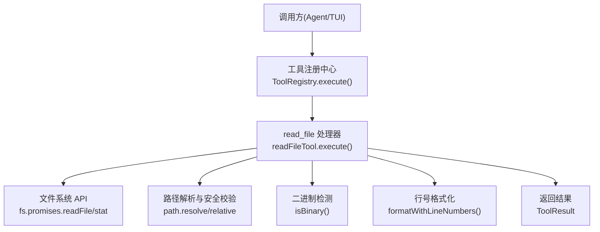
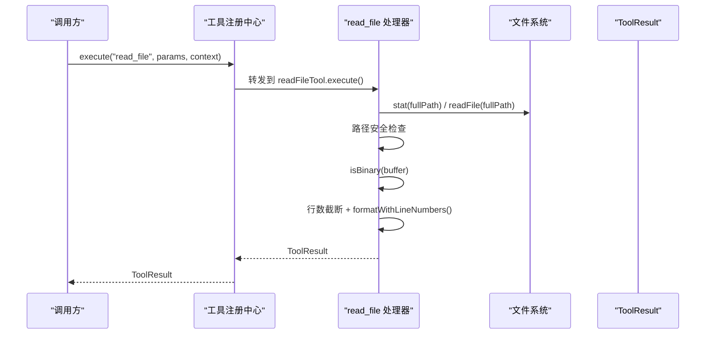
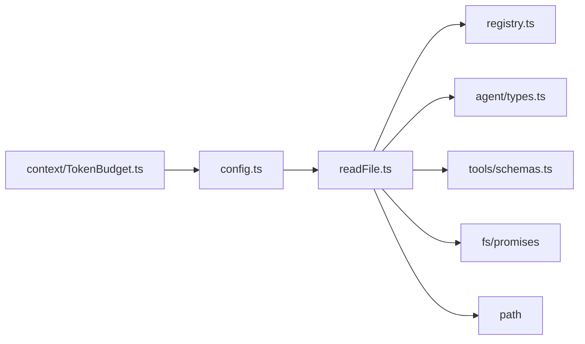

# 文件读取工具 (read_file)

<cite>
**本文引用的文件列表**
- [src/tools/readFile.ts](file://src/tools/readFile.ts)
- [src/tools/registry.ts](file://src/tools/registry.ts)
- [src/tools/schemas.ts](file://src/tools/schemas.ts)
- [src/agent/types.ts](file://src/agent/types.ts)
- [src/config.ts](file://src/config.ts)
- [.nexus/config.toml](file://.nexus/config.toml)
- [src/context/TokenBudget.ts](file://src/context/TokenBudget.ts)
- [tests/integration/tools.test.ts](file://tests/integration/tools.test.ts)
</cite>

## 目录
1. [简介](#简介)
2. [项目结构](#项目结构)
3. [核心组件](#核心组件)
4. [架构总览](#架构总览)
5. [详细组件分析](#详细组件分析)
6. [依赖关系分析](#依赖关系分析)
7. [性能与内存优化](#性能与内存优化)
8. [故障排查指南](#故障排查指南)
9. [结论](#结论)
10. [附录：使用示例](#附录使用示例)

## 简介
本文件为 read_file 工具的完整技术文档，聚焦以下方面：
- 路径验证与安全边界检查
- 二进制文件检测算法
- 行数截断策略与行号格式化
- 参数校验（path、start_line、end_line）
- 错误处理机制
- 文件大小限制、内存优化与性能考量
- 与上下文工程集成及 Token 预算控制
- 具体使用示例与常见错误场景

## 项目结构
read_file 工具位于工具层，通过工具注册中心暴露给上层编排器。其输入参数由 Zod Schema 定义，配置项来自项目级 TOML 配置文件，运行时上下文包含项目根目录与上限参数。

图示来源
- [src/tools/registry.ts:70-82](file://src/tools/registry.ts#L70-L82)
- [src/tools/readFile.ts:54-147](file://src/tools/readFile.ts#L54-L147)

章节来源
- [src/tools/readFile.ts:1-150](file://src/tools/readFile.ts#L1-L150)
- [src/tools/registry.ts:1-96](file://src/tools/registry.ts#L1-L96)
- [src/tools/schemas.ts:1-40](file://src/tools/schemas.ts#L1-L40)
- [src/agent/types.ts:44-78](file://src/agent/types.ts#L44-L78)
- [src/config.ts:11-60](file://src/config.ts#L11-L60)
- [.nexus/config.toml:39-50](file://.nexus/config.toml#L39-L50)

## 核心组件
- 工具定义与执行器
  - 名称：read_file
  - 描述：读取文件内容，返回带行号的内容；超过最大行数会截断；拒绝二进制文件
  - 输入参数：path（必填）、start_line（可选）、end_line（可选）
  - 阶段：both（计划与执行阶段均可用）
  - 审批：不需要
- 参数校验
  - 类型约束：path 为字符串，start_line/end_line 为数字且可选
  - 语义约束：start_line 从 1 开始；范围越界会被安全裁剪
- 安全限制
  - 路径必须位于项目根目录内，禁止读取上级目录或外部路径
- 二进制检测
  - 基于前 8KB 是否包含空字节判断
- 行数截断
  - 当总行数超过 maxReadLines 时，采用“头尾拼接”策略：头部占 70%，尾部占 30%
- 行号格式化
  - 按起始行号对齐输出，列宽根据最大行号长度动态计算

章节来源
- [src/tools/readFile.ts:11-35](file://src/tools/readFile.ts#L11-L35)
- [src/tools/schemas.ts:8-12](file://src/tools/schemas.ts#L8-L12)
- [src/agent/types.ts:44-78](file://src/agent/types.ts#L44-L78)

## 架构总览
read_file 在工具链中的位置如下：

图示来源
- [src/tools/registry.ts:70-82](file://src/tools/registry.ts#L70-L82)
- [src/tools/readFile.ts:54-147](file://src/tools/readFile.ts#L54-L147)

## 详细组件分析

### 参数验证与类型约束
- path
  - 必填，字符串类型，表示相对于项目根目录的路径
  - 在运行时被解析为绝对路径并进行边界检查
- start_line
  - 可选，数字类型，默认值为 1
  - 用于指定读取范围的起始行号（从 1 开始）
- end_line
  - 可选，数字类型
  - 若提供，则仅返回 [start_line, end_line] 范围内的行
- 校验来源
  - 运行时类型：Zod schema 定义
  - 行为约束：范围越界将被安全裁剪，最小行号为 1

章节来源
- [src/tools/schemas.ts:8-12](file://src/tools/schemas.ts#L8-L12)
- [src/tools/readFile.ts:54-112](file://src/tools/readFile.ts#L54-L112)

### 安全限制与路径边界检查
- 路径解析
  - 使用 resolve(projectRoot, filePath) 得到绝对路径
  - 使用 relative(projectRoot, fullPath) 生成相对路径用于展示
- 边界检查
  - 若解析后的路径不以项目根目录开头，视为越界并拒绝访问
- 目标存在性与类型检查
  - 使用 stat 确认路径存在且为普通文件
- 越界与非法类型错误
  - 返回明确的错误信息，便于上层日志与审计

章节来源
- [src/tools/readFile.ts:60-83](file://src/tools/readFile.ts#L60-L83)

### 二进制文件检测算法
- 采样窗口
  - 读取前 8KB 作为样本
- 判定规则
  - 若样本中包含任意空字节（0x00），则判定为二进制文件并拒绝读取
- 设计权衡
  - 快速失败，避免将二进制内容误当作文本处理
  - 对大文件的 I/O 开销可控（仅读取前 8KB）

章节来源
- [src/tools/readFile.ts:37-42](file://src/tools/readFile.ts#L37-L42)
- [src/tools/readFile.ts:85-96](file://src/tools/readFile.ts#L85-L96)

### 行数截断策略与行号格式化
- 行数阈值
  - 当 totalLines > maxReadLines 时触发截断
- 截断比例
  - 头部 70%、尾部 30%
  - 中间省略的行数以提示形式显示，建议用户使用 start_line/end_line 或 grep 定位
- 行号格式化
  - 以起始行号为基准，按最大行号宽度进行左对齐填充
  - 每行格式为“行号│内容”，便于阅读与定位

章节来源
- [src/tools/readFile.ts:114-130](file://src/tools/readFile.ts#L114-L130)
- [src/tools/readFile.ts:44-52](file://src/tools/readFile.ts#L44-L52)

### 错误处理机制
- 统一捕获
  - 所有异常均被捕获并转换为结构化错误响应
- 典型错误
  - 路径越界：不在项目目录内
  - 非文件：路径存在但不是普通文件
  - 二进制文件：无法读取
  - 系统错误：权限不足、磁盘错误等
- 错误字段
  - ToolResult.error 携带可读的错误消息，result 为空字符串

章节来源
- [src/tools/readFile.ts:138-146](file://src/tools/readFile.ts#L138-L146)

### 与上下文工程的集成与 Token 预算控制
- 上下文组装
  - read_file 的返回结果作为工具结果参与上下文组装
- Token 估算
  - 使用 estimateTokens 粗略估算文本 token 数（ASCII 与非 ASCII 字符分别估算）
- 预算分配
  - TokenBudget 根据模型上下文窗口与预算比例，分配 systemPrompt/history/toolResults 的预算
  - toolResults 预算直接影响可放入上下文的工具输出大小
- 压缩与裁剪
  - 当超预算时，优先丢弃低优先级上下文层，必要时对长工具结果进行截断
- 配置项
  - limits.max_read_lines 控制单文件最大读取行数
  - context.budget_ratio 控制输入 token 预算占比

章节来源
- [src/context/TokenBudget.ts:6-21](file://src/context/TokenBudget.ts#L6-L21)
- [src/context/TokenBudget.ts:31-78](file://src/context/TokenBudget.ts#L31-L78)
- [src/config.ts:45-55](file://src/config.ts#L45-L55)
- [.nexus/config.toml:44-55](file://.nexus/config.toml#L44-L55)

## 依赖关系分析
- 直接依赖
  - fs/promises：文件读取与状态查询
  - path：路径解析与相对路径计算
  - agent/types：工具定义与结果类型
  - tools/registry：工具注册与执行入口
  - tools/schemas：Zod 参数校验
- 间接依赖
  - config：加载 limits.max_read_lines 等限制
  - context/TokenBudget：上下文预算与裁剪策略

图示来源
- [src/tools/readFile.ts:6-9](file://src/tools/readFile.ts#L6-L9)
- [src/tools/registry.ts:70-82](file://src/tools/registry.ts#L70-L82)
- [src/config.ts:11-60](file://src/config.ts#L11-L60)
- [src/context/TokenBudget.ts:31-78](file://src/context/TokenBudget.ts#L31-L78)

章节来源
- [src/tools/readFile.ts:1-10](file://src/tools/readFile.ts#L1-L10)
- [src/tools/registry.ts:1-96](file://src/tools/registry.ts#L1-L96)
- [src/agent/types.ts:44-78](file://src/agent/types.ts#L44-L78)
- [src/tools/schemas.ts:1-40](file://src/tools/schemas.ts#L1-L40)
- [src/config.ts:11-60](file://src/config.ts#L11-L60)
- [src/context/TokenBudget.ts:31-78](file://src/context/TokenBudget.ts#L31-L78)

## 性能与内存优化
- I/O 策略
  - 先 stat 再 readFile，避免不必要的读取
  - 二进制检测仅读取前 8KB，降低大文件开销
- 内存占用
  - 全量读取后 split('\n') 会产生额外数组副本；对于超大文件，建议使用 start_line/end_line 缩小范围
- 截断策略
  - 超过 maxReadLines 时只保留头尾片段，减少上下文体积
- 行号格式化
  - 仅在需要时进行，避免重复计算
- 配置调优
  - 合理设置 limits.max_read_lines 与 context.budget_ratio，平衡可用信息与成本

[本节为通用性能讨论，不直接分析具体代码行]

## 故障排查指南
- 路径越界
  - 现象：返回错误包含“越界”
  - 原因：请求路径超出项目根目录
  - 解决：确保 path 是项目内的相对路径
- 非文件
  - 现象：返回错误包含“不是一个文件”
  - 原因：路径指向目录或其他非普通文件
  - 解决：确认路径正确且为文件
- 二进制文件
  - 现象：返回错误包含“二进制文件”
  - 原因：前 8KB 包含空字节
  - 解决：改用其他工具查看二进制内容，或转换格式
- 读取失败
  - 现象：返回错误包含“读取失败”
  - 原因：权限不足、磁盘错误、路径不存在等
  - 解决：检查文件权限与路径有效性

章节来源
- [src/tools/readFile.ts:64-96](file://src/tools/readFile.ts#L64-L96)
- [src/tools/readFile.ts:138-146](file://src/tools/readFile.ts#L138-L146)
- [tests/integration/tools.test.ts:78-81](file://tests/integration/tools.test.ts#L78-L81)

## 结论
read_file 工具提供了安全的文件读取能力，具备完善的参数校验、路径边界检查、二进制检测与行数截断策略。通过与上下文工程的 Token 预算联动，可在保证可用性的同时控制上下文膨胀。配合 start_line/end_line 与 grep 工具，可有效应对大文件与复杂检索场景。

[本节为总结性内容，不直接分析具体代码行]

## 附录：使用示例
- 读取特定行范围
  - 示例：读取 hello.ts 的第 1 至第 10 行
  - 参考测试用例：[tests/integration/tools.test.ts:36-41](file://tests/integration/tools.test.ts#L36-L41)
- 处理大文件
  - 策略：启用行数截断（maxReadLines=2000），或使用 start_line/end_line 精准定位
  - 相关逻辑：[src/tools/readFile.ts:114-130](file://src/tools/readFile.ts#L114-L130)
- 错误场景
  - 路径越界：[tests/integration/tools.test.ts:78-81](file://tests/integration/tools.test.ts#L78-L81)
  - 非文件/二进制/系统错误：[src/tools/readFile.ts:74-96](file://src/tools/readFile.ts#L74-L96), [src/tools/readFile.ts:138-146](file://src/tools/readFile.ts#L138-L146)
- 与上下文工程集成
  - Token 估算与预算分配：[src/context/TokenBudget.ts:6-21](file://src/context/TokenBudget.ts#L6-L21), [src/context/TokenBudget.ts:31-78](file://src/context/TokenBudget.ts#L31-L78)
  - 配置项：limits.max_read_lines、context.budget_ratio
    - 默认值与合并逻辑：[src/config.ts:45-55](file://src/config.ts#L45-L55)
    - 项目配置示例：[.nexus/config.toml:44-55](file://.nexus/config.toml#L44-L55)