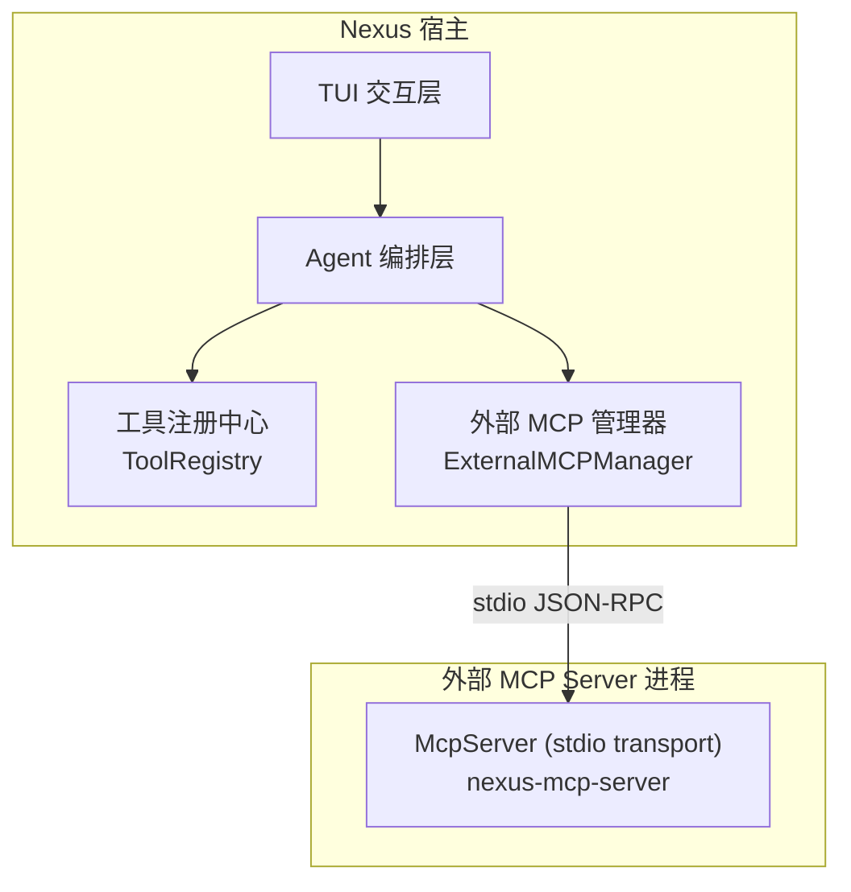
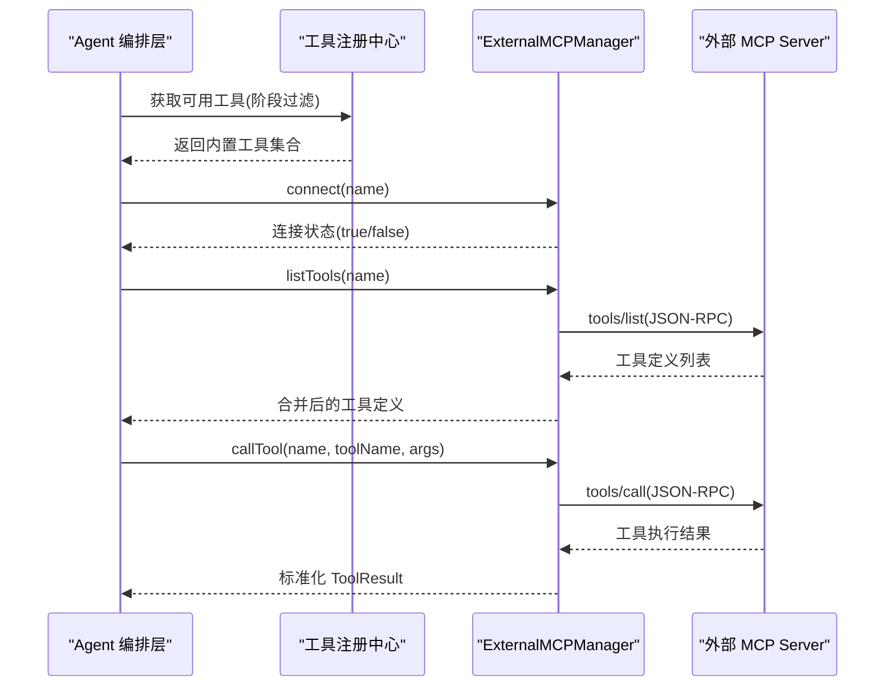
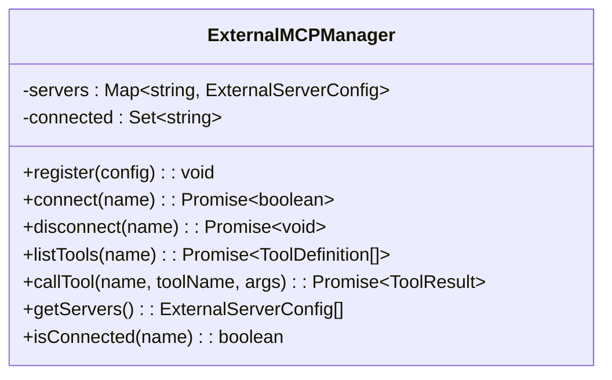
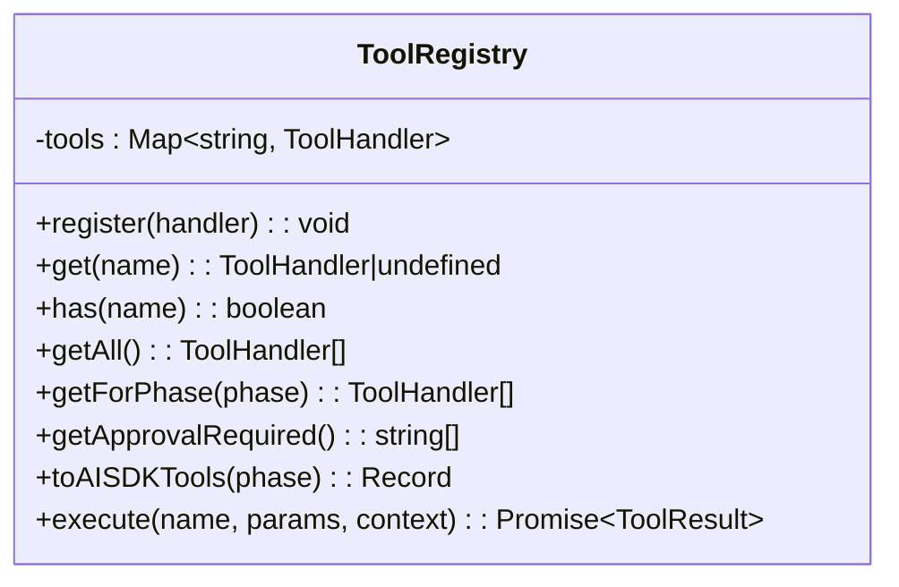
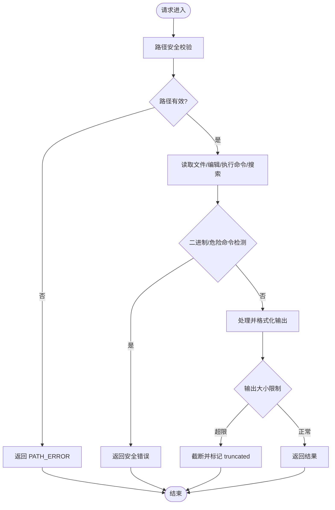
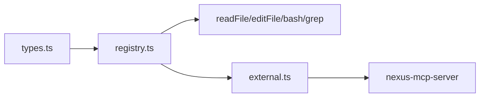

# 外部 MCP Server 集成

<cite>
**本文引用的文件**   
- [src/tools/external.ts](file://src/tools/external.ts)
- [packages/nexus-mcp-server/src/index.ts](file://packages/nexus-mcp-server/src/index.ts)
- [src/tools/registry.ts](file://src/tools/registry.ts)
- [src/agent/types.ts](file://src/agent/types.ts)
- [DESIGN.md](file://DESIGN.md)
- [README.md](file://README.md)
- [packages/nexus-mcp-server/package.json](file://packages/nexus-mcp-server/package.json)
</cite>

## 目录
1. [引言](#引言)
2. [项目结构](#项目结构)
3. [核心组件](#核心组件)
4. [架构总览](#架构总览)
5. [详细组件分析](#详细组件分析)
6. [依赖关系分析](#依赖关系分析)
7. [性能考量](#性能考量)
8. [故障排查指南](#故障排查指南)
9. [结论](#结论)
10. [附录：外部 MCP Server 开发指南与集成示例](#附录外部-mcp-server-开发指南与集成示例)

## 引言
本文件面向需要在 Nexus 中接入“外部 MCP Server”的开发者，系统性阐述 external 工具如何桥接本地工具系统与远程 MCP Server。内容涵盖：
- MCP 协议的传输层抽象与消息格式转换
- 连接管理、错误重试与超时处理机制（当前为预留接口，Phase 2 实现）
- 工具定义的动态发现与同步流程
- 网络通信安全与认证考虑
- 外部 MCP Server 开发指南与集成示例

## 项目结构
Nexus 将“内部工具”和“外部 MCP Server”通过统一的工具注册中心进行编排。外部 MCP Server 以独立进程形式运行，通过 stdio JSON-RPC 与宿主进程通信。MCP Server 包可独立发布，供 IDE 或桌面应用挂载。

图表来源
- [src/tools/registry.ts:1-96](file://src/tools/registry.ts#L1-L96)
- [src/tools/external.ts:1-76](file://src/tools/external.ts#L1-L76)
- [packages/nexus-mcp-server/src/index.ts:1-383](file://packages/nexus-mcp-server/src/index.ts#L1-L383)

章节来源
- [README.md:1-174](file://README.md#L1-L174)
- [DESIGN.md:540-739](file://DESIGN.md#L540-L739)

## 核心组件
- ExternalMCPManager：负责外部 MCP Server 的注册、连接、断开、工具列表获取与工具调用。当前为 Phase 1 预留接口，实际 stdio JSON-RPC 在 Phase 2 实现。
- ToolRegistry：统一注册与调度内置工具（read_file/edit_file/bash/grep），并生成 Vercel AI SDK 兼容的工具定义。
- nexus-mcp-server：独立的 MCP Server，使用 @modelcontextprotocol/sdk 的 StdioServerTransport，暴露 read_file/edit_file/bash/grep 等工具。

章节来源
- [src/tools/external.ts:1-76](file://src/tools/external.ts#L1-L76)
- [src/tools/registry.ts:1-96](file://src/tools/registry.ts#L1-L96)
- [packages/nexus-mcp-server/src/index.ts:1-383](file://packages/nexus-mcp-server/src/index.ts#L1-L383)

## 架构总览
Nexus 通过工具注册中心统一管理工具能力；未来将通过 ExternalMCPManager 以 stdio JSON-RPC 与外部 MCP Server 通信。MCP 协议定义了 tools/list 与 tools/call 两个关键方法，用于工具发现与执行。

图表来源
- [src/tools/external.ts:1-76](file://src/tools/external.ts#L1-L76)
- [DESIGN.md:549-571](file://DESIGN.md#L549-L571)
- [packages/nexus-mcp-server/src/index.ts:112-383](file://packages/nexus-mcp-server/src/index.ts#L112-L383)

## 详细组件分析

### ExternalMCPManager（外部 MCP 管理器）
职责
- 注册外部 MCP Server（名称、命令、参数、环境变量）
- 连接/断开管理（当前为占位逻辑，Phase 2 实现 stdio JSON-RPC）
- 工具列表获取（tools/list）与工具调用（tools/call）
- 维护已连接服务器集合

数据结构与复杂度
- servers: Map<string, ExternalServerConfig>，O(1) 查找
- connected: Set<string>，O(1) 判断是否连接
- getServers(): O(n) 遍历

错误处理
- 未找到配置时返回 false
- 未连接时返回错误信息占位（Phase 2 实现）

优化机会
- 连接池与心跳检测
- 工具缓存与增量同步
- 重试与退避策略

图表来源
- [src/tools/external.ts:1-76](file://src/tools/external.ts#L1-L76)

章节来源
- [src/tools/external.ts:1-76](file://src/tools/external.ts#L1-L76)

### ToolRegistry（工具注册中心）
职责
- 注册/查询/枚举工具处理器
- 按阶段过滤工具（plan/execute/both）
- 生成 Vercel AI SDK 兼容的工具定义
- 执行工具调用并返回标准 ToolResult

数据结构与复杂度
- tools: Map<string, ToolHandler>，O(1) 查找
- getForPhase(): O(n) 过滤
- toAISDKTools(): O(n) 转换

错误处理
- 未知工具返回错误信息

图表来源
- [src/tools/registry.ts:1-96](file://src/tools/registry.ts#L1-L96)

章节来源
- [src/tools/registry.ts:1-96](file://src/tools/registry.ts#L1-L96)

### nexus-mcp-server（独立 MCP Server）
职责
- 使用 @modelcontextprotocol/sdk 的 McpServer 与 StdioServerTransport
- 暴露 read_file/edit_file/bash/grep 四个工具
- 路径安全校验、危险命令检测、输出清理、原子写入、优雅退出

关键实现要点
- 路径越界校验：resolve 后检查是否在 PROJECT_ROOT 内
- 危险命令检测：正则模式匹配拒绝高危命令
- 二进制输出清理：过滤控制字符，限制最大输出字节
- 结构化错误返回：统一 errorResult 格式

图表来源
- [packages/nexus-mcp-server/src/index.ts:28-108](file://packages/nexus-mcp-server/src/index.ts#L28-L108)
- [packages/nexus-mcp-server/src/index.ts:118-356](file://packages/nexus-mcp-server/src/index.ts#L118-L356)

章节来源
- [packages/nexus-mcp-server/src/index.ts:1-383](file://packages/nexus-mcp-server/src/index.ts#L1-L383)

### 类型与事件流
Nexus 的核心类型包括工具定义、工具结果、Agent 状态、上下文等，确保各模块间契约一致。

章节来源
- [src/agent/types.ts:44-78](file://src/agent/types.ts#L44-L78)
- [src/agent/types.ts:134-166](file://src/agent/types.ts#L134-L166)

## 依赖关系分析
- ExternalMCPManager 依赖 ToolDefinition/ToolResult 类型
- ToolRegistry 依赖各工具处理器（readFile/editFile/bash/grep）
- nexus-mcp-server 依赖 @modelcontextprotocol/sdk 与 Node.js 文件系统/子进程 API

图表来源
- [src/agent/types.ts:44-78](file://src/agent/types.ts#L44-L78)
- [src/tools/registry.ts:1-96](file://src/tools/registry.ts#L1-L96)
- [src/tools/external.ts:1-76](file://src/tools/external.ts#L1-L76)
- [packages/nexus-mcp-server/src/index.ts:1-383](file://packages/nexus-mcp-server/src/index.ts#L1-L383)

章节来源
- [src/tools/registry.ts:1-96](file://src/tools/registry.ts#L1-L96)
- [src/tools/external.ts:1-76](file://src/tools/external.ts#L1-L76)
- [packages/nexus-mcp-server/src/index.ts:1-383](file://packages/nexus-mcp-server/src/index.ts#L1-L383)

## 性能考量
- 内部工具采用 in-process 调用，零开销
- 外部 MCP Server 通过 stdio JSON-RPC，存在序列化/反序列化和进程间通信成本
- 建议对工具定义进行缓存，避免重复 discovery
- 对长输出进行截断，减少内存占用与带宽消耗
- 连接复用与心跳检测可降低重连开销

[本节为通用指导，不直接分析具体文件]

## 故障排查指南
常见问题与定位
- 外部 MCP Server 未连接：检查 register/connect 流程与环境变量
- 工具调用失败：确认 tools/call 参数与返回值是否符合 MCP 规范
- 路径越界/权限问题：检查 assertPathSafe 与安全策略
- 危险命令被拦截：查看 DANGEROUS_PATTERNS 与审批流程
- 输出过大：确认 MAX_OUTPUT_BYTES 与 truncate 逻辑

章节来源
- [packages/nexus-mcp-server/src/index.ts:28-108](file://packages/nexus-mcp-server/src/index.ts#L28-L108)
- [src/tools/bash.ts:123-186](file://src/tools/bash.ts#L123-L186)

## 结论
Nexus 通过工具注册中心与外部 MCP 管理器，实现了本地工具与外部 MCP Server 的统一编排。当前 external.ts 提供预留接口，Phase 2 将完整实现 stdio JSON-RPC 的传输层抽象、消息格式转换、连接管理与错误重试。nexus-mcp-server 作为独立 MCP Server，遵循 MCP 协议，提供安全的文件与命令操作能力。

[本节为总结性内容，不直接分析具体文件]

## 附录：外部 MCP Server 开发指南与集成示例

### MCP 协议传输层抽象与消息格式
- 传输层：stdio JSON-RPC（stdin/stdout 行分隔的 JSON 消息）
- 关键方法：tools/list（工具发现）、tools/call（工具执行）
- 消息结构：JSON-RPC 2.0，包含 jsonrpc、id、method、params、result/error

章节来源
- [DESIGN.md:549-571](file://DESIGN.md#L549-L571)

### 连接管理、错误重试与超时处理
- 连接管理：ExternalMCPManager.register/connect/disconnect
- 错误重试：建议在 Phase 2 增加指数退避与最大重试次数
- 超时处理：bash 工具默认 30s 超时，外部 MCP Server 应设置合理的 RPC 超时

章节来源
- [src/tools/external.ts:24-43](file://src/tools/external.ts#L24-L43)
- [src/tools/bash.ts:123-186](file://src/tools/bash.ts#L123-L186)

### 工具定义的动态发现与同步
- tools/list 返回工具名、描述与输入 schema
- 建议缓存工具定义，支持增量更新（如 tools/listChanged 通知）

章节来源
- [DESIGN.md:549-571](file://DESIGN.md#L549-L571)

### 安全考虑与认证机制
- 路径越界校验：确保文件操作在项目根目录下
- 危险命令检测：正则模式匹配拒绝高危命令
- 输出清理：过滤控制字符，限制最大输出字节
- 认证机制：可在环境变量中注入密钥，或通过启动参数传递鉴权信息

章节来源
- [packages/nexus-mcp-server/src/index.ts:28-108](file://packages/nexus-mcp-server/src/index.ts#L28-L108)

### 外部 MCP Server 开发步骤
1. 初始化项目并安装依赖（@modelcontextprotocol/sdk）
2. 创建 McpServer 实例并注册工具
3. 使用 StdioServerTransport 启动服务
4. 实现工具逻辑（路径安全、危险命令检测、输出清理）
5. 测试 tools/list 与 tools/call 接口

章节来源
- [packages/nexus-mcp-server/src/index.ts:112-383](file://packages/nexus-mcp-server/src/index.ts#L112-L383)
- [packages/nexus-mcp-server/package.json:1-18](file://packages/nexus-mcp-server/package.json#L1-L18)

### 集成示例
- 在 Nexus 中注册外部 MCP Server：指定命令、参数与环境变量
- 连接并获取工具列表：调用 connect 与 listTools
- 调用外部工具：通过 callTool 传递工具名与参数

章节来源
- [src/tools/external.ts:24-60](file://src/tools/external.ts#L24-L60)