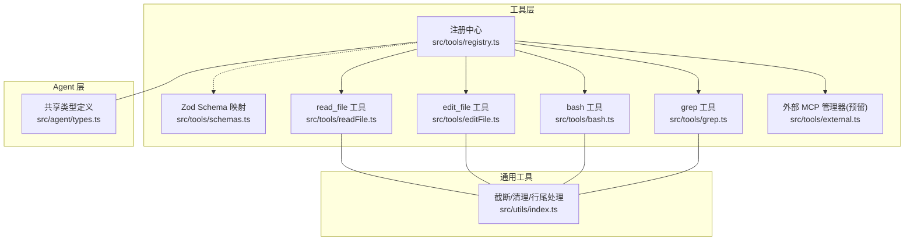
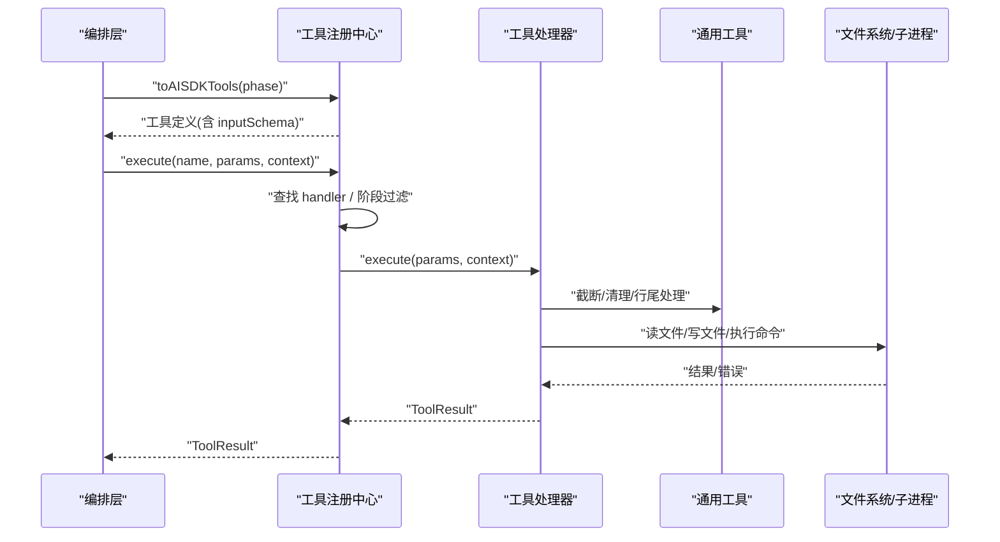
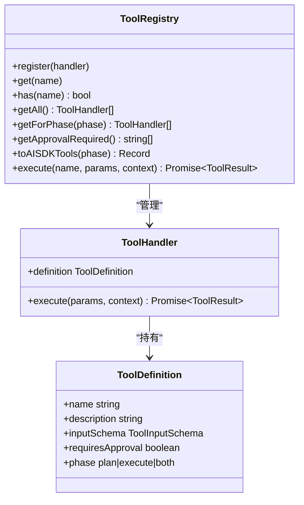
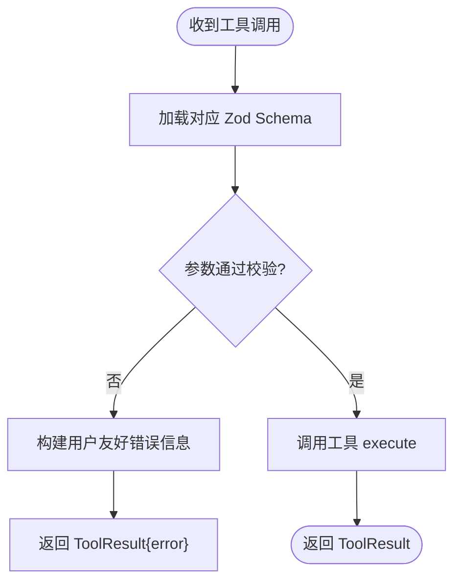
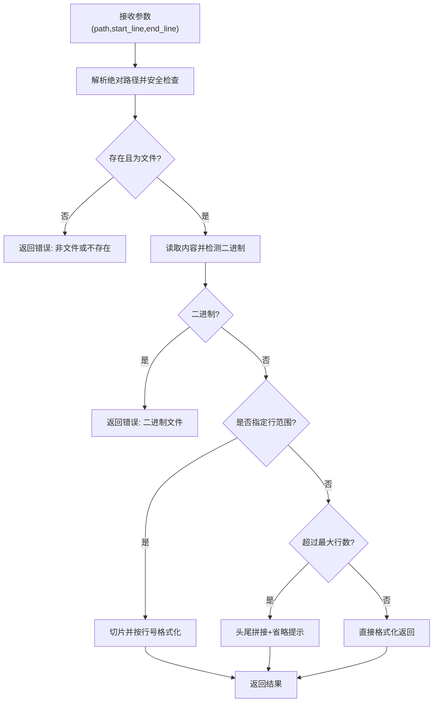
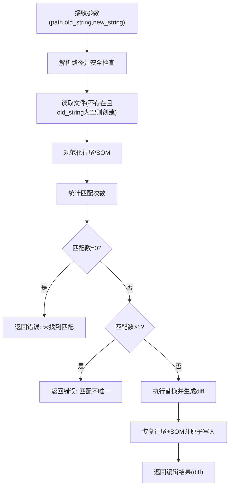
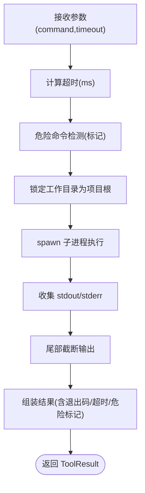
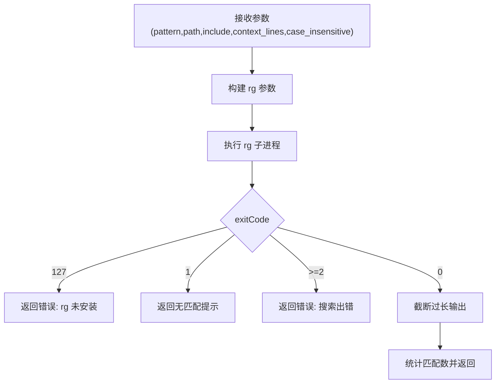
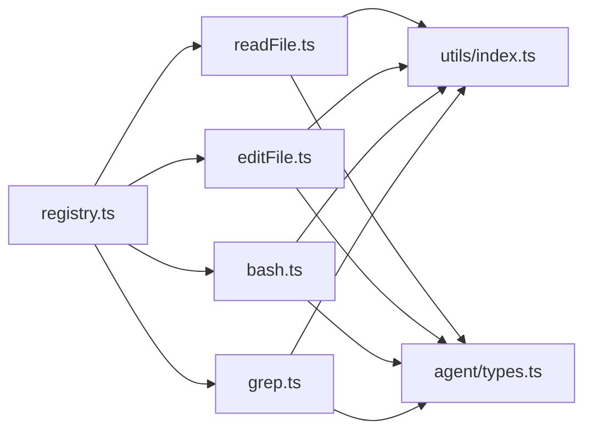

# 工具模式验证

<cite>
**本文引用的文件**   
- [src/tools/schemas.ts](file://src/tools/schemas.ts)
- [src/tools/registry.ts](file://src/tools/registry.ts)
- [src/tools/readFile.ts](file://src/tools/readFile.ts)
- [src/tools/editFile.ts](file://src/tools/editFile.ts)
- [src/tools/bash.ts](file://src/tools/bash.ts)
- [src/tools/grep.ts](file://src/tools/grep.ts)
- [src/tools/external.ts](file://src/tools/external.ts)
- [src/agent/types.ts](file://src/agent/types.ts)
- [src/utils/index.ts](file://src/utils/index.ts)
- [tests/integration/tools.test.ts](file://tests/integration/tools.test.ts)
</cite>

## 目录
1. [简介](#简介)
2. [项目结构](#项目结构)
3. [核心组件](#核心组件)
4. [架构总览](#架构总览)
5. [详细组件分析](#详细组件分析)
6. [依赖关系分析](#依赖关系分析)
7. [性能考量](#性能考量)
8. [故障排查指南](#故障排查指南)
9. [结论](#结论)
10. [附录](#附录)

## 简介
本技术文档聚焦于“工具模式验证系统”，围绕 Zod schema 在工具参数校验中的应用与设计模式展开，系统性阐述输入参数的类型检查、格式验证与业务规则约束；说明错误信息的生成与用户友好提示机制；给出 schema 版本兼容性与向后兼容策略；提供自定义验证器的开发与集成指南；并总结参数验证的最佳实践与性能优化建议。

本项目中，工具定义采用 JSON Schema 风格的 inputSchema（用于 Vercel AI SDK 等外部调用方），同时维护一份独立的 Zod schema 映射，以支持更严格的运行时校验与可扩展的自定义验证器。注册中心负责将工具定义暴露给上层编排层，并在执行前进行参数校验与权限控制。

## 项目结构
与工具验证相关的核心代码位于 src/tools 目录，配合 agent 层的类型定义与 utils 中的通用工具函数，形成“声明式 schema + 注册中心 + 工具实现 + 通用能力”的分层架构。

图表来源
- [src/tools/registry.ts:1-96](file://src/tools/registry.ts#L1-L96)
- [src/tools/schemas.ts:1-40](file://src/tools/schemas.ts#L1-L40)
- [src/tools/readFile.ts:1-150](file://src/tools/readFile.ts#L1-L150)
- [src/tools/editFile.ts:1-170](file://src/tools/editFile.ts#L1-L170)
- [src/tools/bash.ts:1-186](file://src/tools/bash.ts#L1-L186)
- [src/tools/grep.ts:1-178](file://src/tools/grep.ts#L1-L178)
- [src/tools/external.ts:1-76](file://src/tools/external.ts#L1-L76)
- [src/agent/types.ts:1-269](file://src/agent/types.ts#L1-L269)
- [src/utils/index.ts:1-211](file://src/utils/index.ts#L1-L211)

章节来源
- [src/tools/registry.ts:1-96](file://src/tools/registry.ts#L1-L96)
- [src/tools/schemas.ts:1-40](file://src/tools/schemas.ts#L1-L40)
- [src/agent/types.ts:44-78](file://src/agent/types.ts#L44-L78)

## 核心组件
- 工具注册中心：集中管理工具的注册、查询、阶段过滤、AI SDK 兼容导出以及统一执行入口。
- 工具定义与输入 schema：每个工具通过 ToolDefinition 描述名称、描述、inputSchema、是否需审批、可用阶段等。
- 工具实现：具体工具逻辑封装为 ToolHandler，包含 definition 与 execute 方法。
- 通用工具：提供输出截断、二进制清理、行尾风格保留、BOM 处理等能力。
- 共享类型：定义 ToolDefinition、ToolInputSchema、ToolResult 等跨模块类型。

章节来源
- [src/tools/registry.ts:12-83](file://src/tools/registry.ts#L12-L83)
- [src/agent/types.ts:44-78](file://src/agent/types.ts#L44-L78)
- [src/utils/index.ts:37-154](file://src/utils/index.ts#L37-L154)

## 架构总览
下图展示了从上层编排到工具执行的完整流程，包括参数校验、权限控制、沙箱执行与结果返回。

图表来源
- [src/tools/registry.ts:58-82](file://src/tools/registry.ts#L58-L82)
- [src/tools/readFile.ts:54-147](file://src/tools/readFile.ts#L54-L147)
- [src/tools/editFile.ts:61-156](file://src/tools/editFile.ts#L61-L156)
- [src/tools/bash.ts:123-183](file://src/tools/bash.ts#L123-L183)
- [src/tools/grep.ts:80-175](file://src/tools/grep.ts#L80-L175)
- [src/utils/index.ts:37-154](file://src/utils/index.ts#L37-L154)

## 详细组件分析

### 组件一：工具注册中心与执行流
- 职责
  - 注册/获取/枚举工具
  - 按阶段过滤（plan/execute）
  - 生成 AI SDK 兼容的工具定义（description + parameters）
  - 统一执行入口，返回标准化 ToolResult
- 关键点
  - getForPhase 基于 definition.phase 过滤
  - toAISDKTools 将内部 ToolDefinition 转换为 { description, parameters }
  - execute 根据 name 定位 handler 并调用其 execute

图表来源
- [src/tools/registry.ts:25-83](file://src/tools/registry.ts#L25-L83)
- [src/agent/types.ts:44-78](file://src/agent/types.ts#L44-L78)

章节来源
- [src/tools/registry.ts:25-83](file://src/tools/registry.ts#L25-L83)
- [src/agent/types.ts:44-78](file://src/agent/types.ts#L44-L78)

### 组件二：Zod Schema 与输入参数校验
- 设计要点
  - schemas.ts 定义了各工具的 Zod schema，并通过 toolSchemas 映射工具名到 schema
  - 当前工具实现使用 JSON Schema 风格的 inputSchema（供 AI SDK 使用）
  - 可在注册中心或编排层对传入 params 使用对应 Zod schema 进行强校验，确保类型安全与可解释的错误信息
- 校验覆盖范围
  - 必填字段校验（如 read_file.path、edit_file.old_string/new_string、bash.command、grep.pattern）
  - 可选字段默认值与类型约束（如 bash.timeout、grep.context_lines/case_insensitive）
  - 字段描述（describe）可用于生成用户友好的提示
- 扩展点
  - 新增工具时，同步补充 zod schema 与 toolSchemas 映射
  - 在 registry.execute 前后接入 Zod 校验，失败则返回结构化错误

图表来源
- [src/tools/schemas.ts:1-40](file://src/tools/schemas.ts#L1-L40)
- [src/tools/registry.ts:70-82](file://src/tools/registry.ts#L70-L82)

章节来源
- [src/tools/schemas.ts:1-40](file://src/tools/schemas.ts#L1-L40)
- [src/tools/registry.ts:70-82](file://src/tools/registry.ts#L70-L82)

### 组件三：read_file 工具（读取文件）
- 输入参数
  - path（必填）：相对项目根目录的文件路径
  - start_line（可选）：起始行号（从 1 开始）
  - end_line（可选）：结束行号
- 业务规则
  - 路径越界拒绝（不允许访问项目外）
  - 非文件拒绝
  - 二进制检测拒绝
  - 行数超限采用“头尾拼接”的截断策略，并提示可使用 grep 或指定行范围
- 输出
  - 带行号的内容；若被截断，返回 truncated=true

图表来源
- [src/tools/readFile.ts:54-147](file://src/tools/readFile.ts#L54-L147)

章节来源
- [src/tools/readFile.ts:11-35](file://src/tools/readFile.ts#L11-L35)
- [src/tools/readFile.ts:54-147](file://src/tools/readFile.ts#L54-L147)

### 组件四：edit_file 工具（精准替换）
- 输入参数
  - path（必填）：目标文件路径
  - old_string（必填）：原文片段，要求唯一匹配
  - new_string（必填）：替换后的新内容
- 业务规则
  - 路径越界拒绝
  - 未找到匹配报错
  - 匹配不唯一报错（需提供足够上下文）
  - 原子写入（临时文件 + rename）
  - 保留原始行尾风格与 BOM
- 输出
  - 返回 unified diff 摘要；创建新文件场景下 old_string 为空字符串

图表来源
- [src/tools/editFile.ts:61-156](file://src/tools/editFile.ts#L61-L156)
- [src/utils/index.ts:185-210](file://src/utils/index.ts#L185-L210)

章节来源
- [src/tools/editFile.ts:14-38](file://src/tools/editFile.ts#L14-L38)
- [src/tools/editFile.ts:61-156](file://src/tools/editFile.ts#L61-L156)
- [src/utils/index.ts:185-210](file://src/utils/index.ts#L185-L210)

### 组件五：bash 工具（执行 shell 命令）
- 输入参数
  - command（必填）：要执行的 shell 命令
  - timeout（可选）：超时秒数，默认由上下文提供
- 业务规则
  - 危险命令检测（标记，实际拦截在审批层）
  - 工作目录锁定在项目根
  - 超时终止与进程组清理
  - 输出截断（尾部优先，保留错误信息）
- 输出
  - 包含退出码、stdout/stderr、超时与危险标记提示

图表来源
- [src/tools/bash.ts:123-183](file://src/tools/bash.ts#L123-L183)
- [src/utils/index.ts:116-154](file://src/utils/index.ts#L116-L154)

章节来源
- [src/tools/bash.ts:13-33](file://src/tools/bash.ts#L13-L33)
- [src/tools/bash.ts:123-183](file://src/tools/bash.ts#L123-L183)

### 组件六：grep 工具（代码搜索）
- 输入参数
  - pattern（必填）：搜索模式（支持正则）
  - path（可选）：搜索路径
  - include（可选）：文件名 glob 过滤
  - context_lines（可选）：上下文行数
  - case_insensitive（可选）：忽略大小写
- 业务规则
  - 优先使用 ripgrep（rg），不可用时返回安装提示
  - 限制每文件匹配数量与总输出字节数
  - 不同 exit code 语义化返回
- 输出
  - 匹配计数与结果文本；超长时截断并提示缩小范围

图表来源
- [src/tools/grep.ts:80-175](file://src/tools/grep.ts#L80-L175)

章节来源
- [src/tools/grep.ts:11-43](file://src/tools/grep.ts#L11-L43)
- [src/tools/grep.ts:80-175](file://src/tools/grep.ts#L80-L175)

### 组件七：外部 MCP Server（预留扩展）
- 角色
  - 未来通过 stdio JSON-RPC 连接外部 MCP Server，动态发现并调用其工具
- 现状
  - 提供接口与占位实现，尚未启用真实通信

章节来源
- [src/tools/external.ts:1-76](file://src/tools/external.ts#L1-L76)

## 依赖关系分析
- 低耦合高内聚
  - 注册中心仅依赖 ToolHandler 抽象，不关心具体实现细节
  - 工具实现依赖通用工具（utils）完成输出与文本处理
- 关键依赖链
  - registry.ts → readFile.ts/editFile.ts/bash.ts/grep.ts
  - 各工具 → utils/index.ts（截断/清理/行尾/BOM）
  - 所有工具 → agent/types.ts（ToolDefinition/ToolResult 等）

图表来源
- [src/tools/registry.ts:1-96](file://src/tools/registry.ts#L1-L96)
- [src/tools/readFile.ts:1-150](file://src/tools/readFile.ts#L1-L150)
- [src/tools/editFile.ts:1-170](file://src/tools/editFile.ts#L1-L170)
- [src/tools/bash.ts:1-186](file://src/tools/bash.ts#L1-L186)
- [src/tools/grep.ts:1-178](file://src/tools/grep.ts#L1-L178)
- [src/utils/index.ts:1-211](file://src/utils/index.ts#L1-L211)
- [src/agent/types.ts:1-269](file://src/agent/types.ts#L1-L269)

章节来源
- [src/tools/registry.ts:1-96](file://src/tools/registry.ts#L1-L96)
- [src/agent/types.ts:44-78](file://src/agent/types.ts#L44-L78)

## 性能考量
- 输出截断
  - 使用尾部截断（bash）与头部/头尾拼接（read_file）避免大对象内存占用
  - 通过字节长度与行数双重阈值控制，防止 OOM
- 子进程与资源释放
  - bash 工具使用进程组终止与超时定时器，避免僵尸进程
- 磁盘 I/O
  - edit_file 使用原子写入减少中间态风险
- 搜索优化
  - grep 限制每文件匹配数量与总输出大小，降低网络与渲染压力

[本节为通用指导，无需特定文件引用]

## 故障排查指南
- 常见错误与定位
  - 未知工具：检查注册表是否正确注册与名称一致
  - 路径越界：确认 projectRoot 与传入路径的相对关系
  - 二进制文件：read_file 会拒绝二进制，改用其他工具或转换
  - 匹配不唯一/未找到：edit_file 需要更多上下文或重新读取最新内容
  - rg 未安装：grep 返回安装提示，按指引安装 ripgrep
- 调试建议
  - 开启日志打印 ToolResult.error 与 truncated 标志
  - 使用集成测试复现问题（参考 tests/integration/tools.test.ts）

章节来源
- [src/tools/registry.ts:70-82](file://src/tools/registry.ts#L70-L82)
- [src/tools/readFile.ts:64-96](file://src/tools/readFile.ts#L64-L96)
- [src/tools/editFile.ts:113-129](file://src/tools/editFile.ts#L113-L129)
- [src/tools/grep.ts:120-145](file://src/tools/grep.ts#L120-L145)
- [tests/integration/tools.test.ts:36-98](file://tests/integration/tools.test.ts#L36-L98)

## 结论
通过将 JSON Schema 风格的 inputSchema 与 Zod schema 结合，系统在对外兼容性的同时获得了更强的运行时校验能力。注册中心作为单一入口，统一了工具发现、阶段过滤与执行流程；工具实现遵循最小权限与安全边界原则，结合通用工具保证输出可控与用户体验友好。后续可通过在注册中心引入 Zod 校验链路，进一步提升参数安全性与错误可读性。

[本节为总结性内容，无需特定文件引用]

## 附录

### 输入参数校验与错误提示最佳实践
- 强制必填字段校验与类型约束
- 使用 describe 提供人类可读的字段说明
- 对业务规则进行二次校验（如唯一匹配、路径越界、二进制检测）
- 错误信息应包含原因与修复建议（例如“请提供更多上下文行以确保唯一匹配”）
- 对超大输出进行截断并明确告知用户

章节来源
- [src/tools/schemas.ts:8-31](file://src/tools/schemas.ts#L8-L31)
- [src/tools/editFile.ts:113-129](file://src/tools/editFile.ts#L113-L129)
- [src/tools/readFile.ts:88-96](file://src/tools/readFile.ts#L88-L96)
- [src/tools/grep.ts:147-155](file://src/tools/grep.ts#L147-L155)

### Schema 版本兼容性与向后兼容策略
- 保持 inputSchema 的 properties 只增不减，新增字段设为 optional
- 对旧字段保留默认值与兼容行为，避免破坏现有调用方
- 在 Zod schema 中使用 .optional() 与默认值策略，逐步推进迁移
- 在注册中心增加 schema 版本字段（可选），以便未来做差异化处理

章节来源
- [src/tools/schemas.ts:8-31](file://src/tools/schemas.ts#L8-L31)
- [src/tools/registry.ts:58-68](file://src/tools/registry.ts#L58-L68)

### 自定义验证器开发与集成指南
- 步骤
  - 在 schemas.ts 中新增 Zod schema，并为字段添加 describe 说明
  - 在 toolSchemas 中建立工具名到 schema 的映射
  - 在 registry.execute 前后接入 Zod 校验，失败时构造结构化错误
- 示例思路
  - 对 bash.timeout 设置正整数约束
  - 对 grep.include 使用 refine 进行 glob 合法性校验
  - 对 edit_file.old_string 增加最小长度与去空白校验

章节来源
- [src/tools/schemas.ts:33-39](file://src/tools/schemas.ts#L33-L39)
- [src/tools/registry.ts:70-82](file://src/tools/registry.ts#L70-L82)

### 端到端验证与回归测试
- 使用集成测试覆盖典型路径：成功、越界、不唯一、未找到、阶段过滤等
- 关注 truncated 标志与错误消息的可读性
- 持续更新测试用例以覆盖新增校验规则

章节来源
- [tests/integration/tools.test.ts:36-98](file://tests/integration/tools.test.ts#L36-L98)