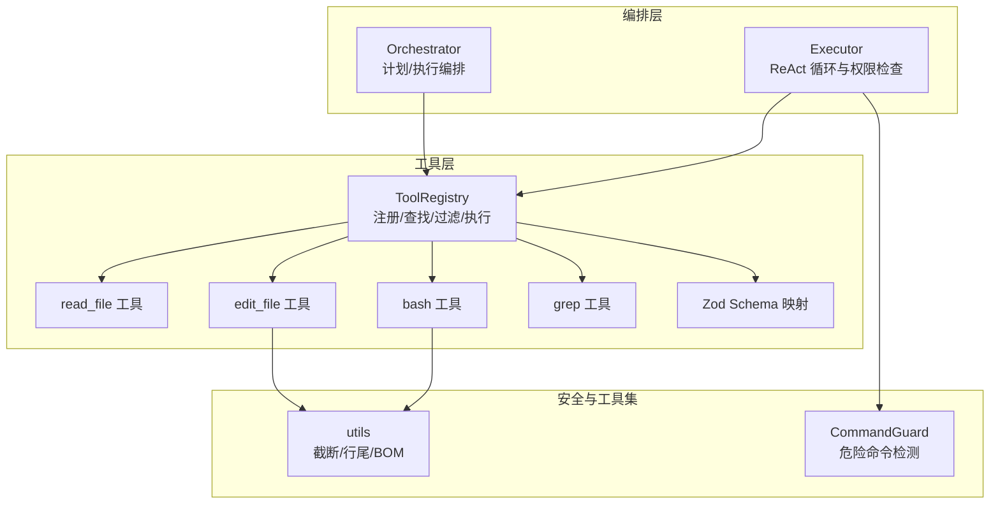
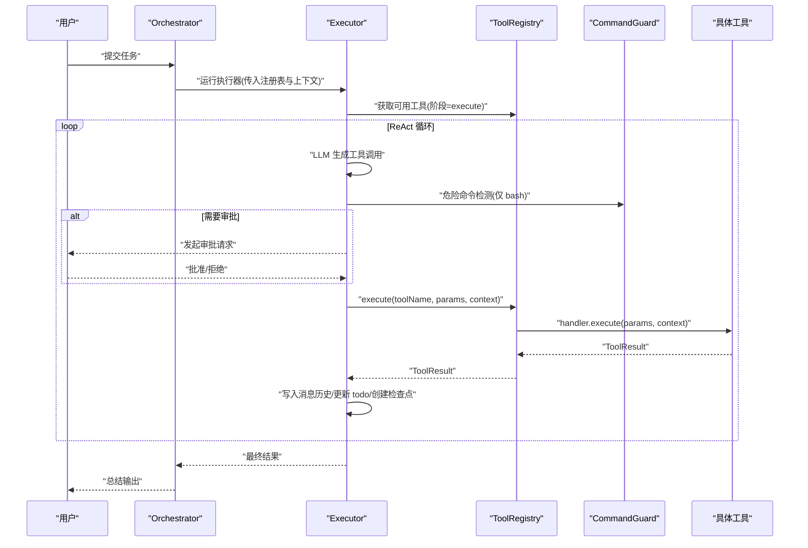
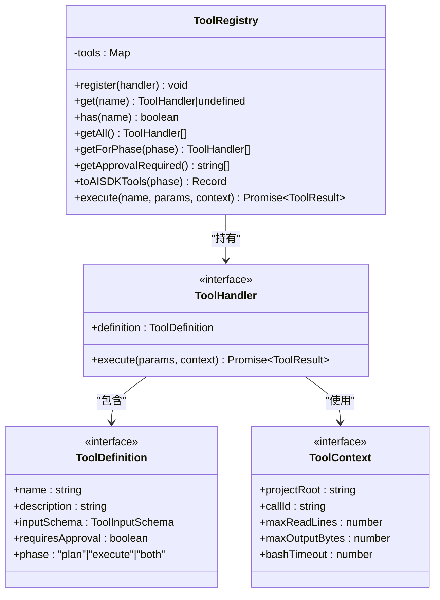
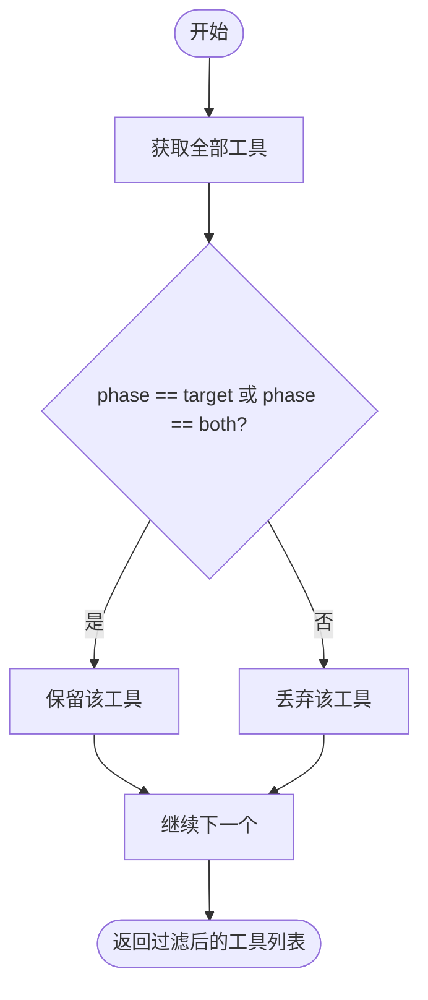
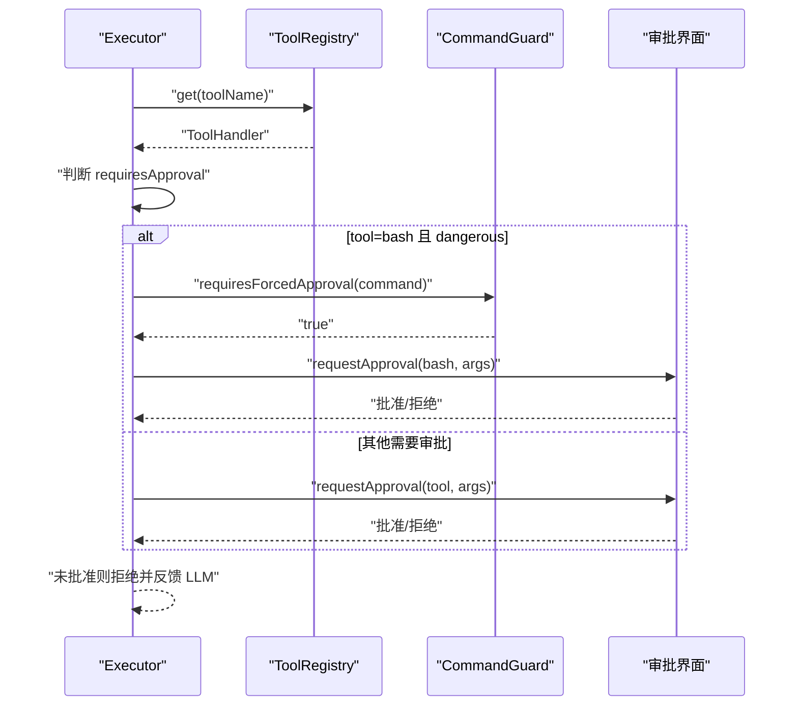
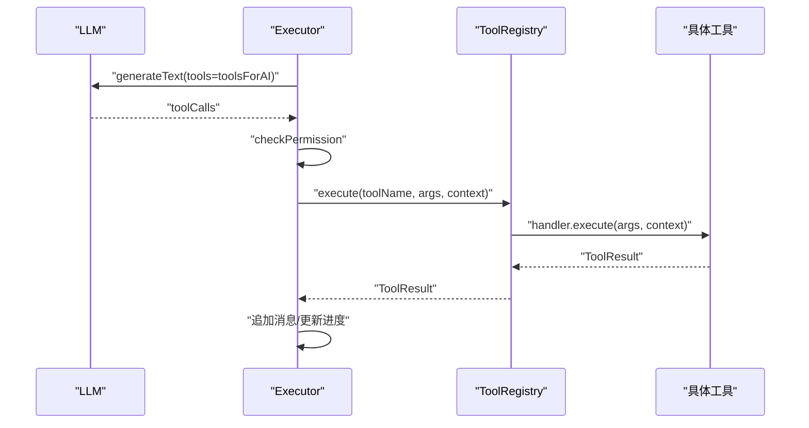
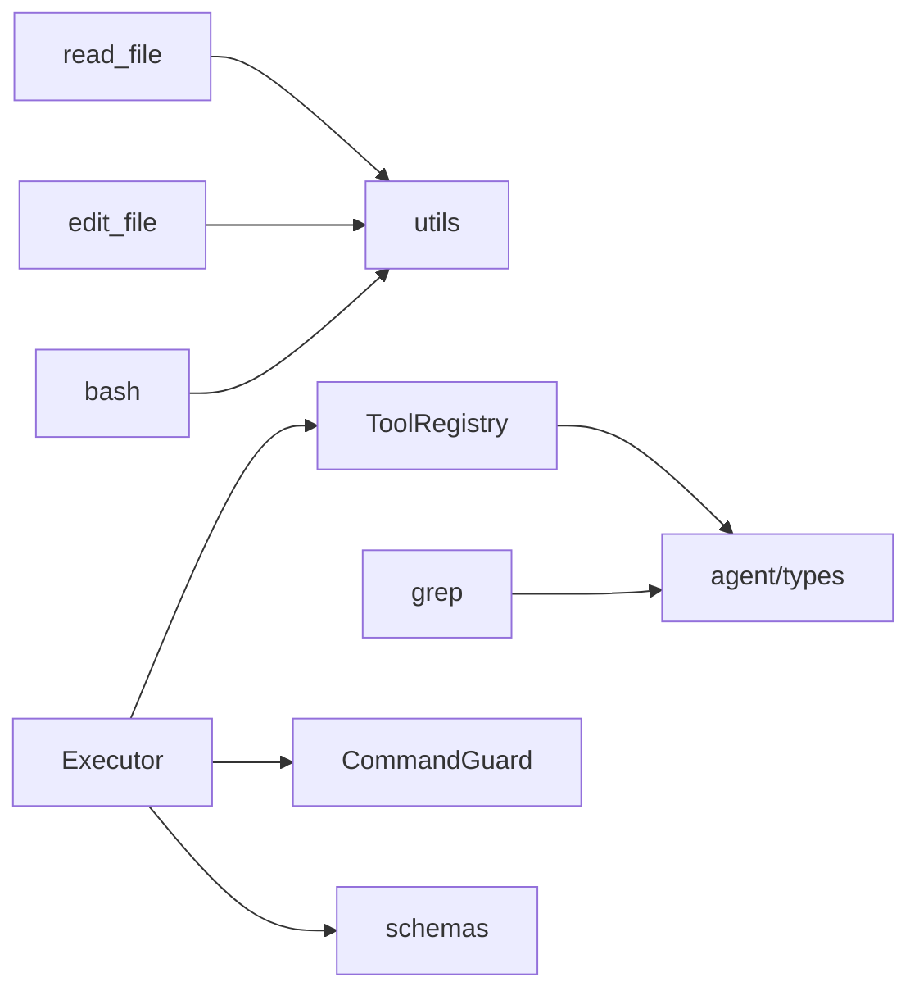

# 工具注册中心

<cite>
**本文引用的文件**   
- [src/tools/registry.ts](file://src/tools/registry.ts)
- [src/tools/readFile.ts](file://src/tools/readFile.ts)
- [src/tools/editFile.ts](file://src/tools/editFile.ts)
- [src/tools/bash.ts](file://src/tools/bash.ts)
- [src/tools/grep.ts](file://src/tools/grep.ts)
- [src/tools/schemas.ts](file://src/tools/schemas.ts)
- [src/agent/types.ts](file://src/agent/types.ts)
- [src/agent/Executor.ts](file://src/agent/Executor.ts)
- [src/agent/Orchestrator.ts](file://src/agent/Orchestrator.ts)
- [src/sandbox/CommandGuard.ts](file://src/sandbox/CommandGuard.ts)
- [src/utils/index.ts](file://src/utils/index.ts)
- [tests/integration/tools.test.ts](file://tests/integration/tools.test.ts)
</cite>

## 目录
1. [简介](#简介)
2. [项目结构](#项目结构)
3. [核心组件](#核心组件)
4. [架构总览](#架构总览)
5. [详细组件分析](#详细组件分析)
6. [依赖分析](#依赖分析)
7. [性能考虑](#性能考虑)
8. [故障排查指南](#故障排查指南)
9. [结论](#结论)
10. [附录：自定义工具开发指南与最佳实践](#附录自定义工具开发指南与最佳实践)

## 简介
本技术文档聚焦于 MCP 工具注册中心，围绕 ToolRegistry 类的设计模式与生命周期管理展开，系统阐述工具的注册、查找、过滤与执行机制；解释 ToolHandler 接口定义与 ToolContext 上下文传递；说明阶段化工具管理（plan/execute/both）的实现原理；并深入解析工具权限控制机制与审批流程集成。文末提供工具注册流程图与调用时序图，以及自定义工具开发的完整指南与最佳实践示例路径。

## 项目结构
工具注册中心位于 src/tools 目录，包含注册表、内置工具实现与参数 Schema 定义；Agent 编排层在 src/agent 中通过 Orchestrator 和 Executor 消费注册表；沙箱安全策略在 src/sandbox 中提供危险命令检测；通用工具函数在 src/utils 中提供截断、行尾处理等能力。测试用例位于 tests/integration/tools.test.ts，覆盖端到端工作流与阶段过滤。

图表来源
- [src/tools/registry.ts:25-96](file://src/tools/registry.ts#L25-L96)
- [src/tools/readFile.ts:11-35](file://src/tools/readFile.ts#L11-L35)
- [src/tools/editFile.ts:14-38](file://src/tools/editFile.ts#L14-L38)
- [src/tools/bash.ts:13-33](file://src/tools/bash.ts#L13-L33)
- [src/tools/grep.ts:11-43](file://src/tools/grep.ts#L11-L43)
- [src/tools/schemas.ts:33-40](file://src/tools/schemas.ts#L33-L40)
- [src/agent/Orchestrator.ts:38-86](file://src/agent/Orchestrator.ts#L38-L86)
- [src/agent/Executor.ts:41-165](file://src/agent/Executor.ts#L41-L165)
- [src/sandbox/CommandGuard.ts:71-98](file://src/sandbox/CommandGuard.ts#L71-L98)
- [src/utils/index.ts:116-154](file://src/utils/index.ts#L116-L154)

章节来源
- [src/tools/registry.ts:1-96](file://src/tools/registry.ts#L1-L96)
- [src/agent/Orchestrator.ts:38-86](file://src/agent/Orchestrator.ts#L38-L86)
- [src/agent/Executor.ts:41-165](file://src/agent/Executor.ts#L41-L165)

## 核心组件
- ToolRegistry：集中管理所有工具的生命周期，提供注册、查询、按阶段过滤、生成 AI SDK 兼容定义、统一执行入口。
- ToolHandler：工具处理器契约，包含声明式定义与异步执行方法。
- ToolContext：跨工具共享的运行时上下文，如项目根、调用标识、输出限制等。
- ToolDefinition：工具元数据，包括名称、描述、输入 Schema、是否需要审批、适用阶段。
- ToolResult：工具执行结果，包含文本结果、错误信息、是否被截断等。

关键职责与交互
- 注册：createToolRegistry 初始化时注册内置工具。
- 查找：get/has 支持 O(1) 查找。
- 过滤：getForPhase 根据 phase 字段筛选 plan/execute/both。
- 执行：execute 路由到具体 handler.execute，返回标准化结果。
- 权限：结合 requiresApproval 与 CommandGuard 强制审批规则，由上层编排层驱动审批回调。

章节来源
- [src/tools/registry.ts:12-83](file://src/tools/registry.ts#L12-L83)
- [src/agent/types.ts:44-78](file://src/agent/types.ts#L44-L78)

## 架构总览
工具注册中心作为“单一事实源”，为 Planner/Executor 提供工具清单与执行能力。Executor 在 ReAct 循环中基于 LLM 的工具调用请求，先进行权限检查，再委托 ToolRegistry 执行，并将结果回灌给 LLM。危险命令检测在 bash 工具与权限检查处联动，确保高风险操作必须人工审批。

图表来源
- [src/agent/Orchestrator.ts:120-180](file://src/agent/Orchestrator.ts#L120-L180)
- [src/agent/Executor.ts:80-165](file://src/agent/Executor.ts#L80-L165)
- [src/tools/registry.ts:70-83](file://src/tools/registry.ts#L70-L83)
- [src/sandbox/CommandGuard.ts:71-98](file://src/sandbox/CommandGuard.ts#L71-L98)

## 详细组件分析

### ToolRegistry 设计与生命周期
- 设计模式：单例工厂 + 注册表模式。createToolRegistry 负责装配默认工具；内部 Map 维护 name→handler 索引。
- 生命周期：
  - 启动期：创建实例并注册内置工具。
  - 运行期：按需 get/getForPhase/toAISDKTools 暴露给编排层。
  - 执行期：execute 路由到具体 handler，统一封装 ToolResult。
- 复杂度：注册 O(1)，查找 O(1)，过滤 O(n)，AI SDK 转换 O(n)。

图表来源
- [src/tools/registry.ts:12-83](file://src/tools/registry.ts#L12-L83)
- [src/agent/types.ts:44-78](file://src/agent/types.ts#L44-L78)

章节来源
- [src/tools/registry.ts:25-96](file://src/tools/registry.ts#L25-L96)

### 阶段化工具管理（plan/execute/both）
- 实现原理：每个 ToolDefinition 声明 phase 字段；getForPhase 过滤出 phase 等于目标阶段或 both 的工具。
- 典型用法：
  - Plan 阶段：只读工具（read_file、grep）。
  - Execute 阶段：全部工具（含 edit_file、bash）。
- 验证方式：集成测试断言 plan/execute 阶段的工具集合差异。

图表来源
- [src/tools/registry.ts:44-49](file://src/tools/registry.ts#L44-L49)
- [tests/integration/tools.test.ts:83-98](file://tests/integration/tools.test.ts#L83-L98)

章节来源
- [src/tools/registry.ts:44-49](file://src/tools/registry.ts#L44-L49)
- [tests/integration/tools.test.ts:83-98](file://tests/integration/tools.test.ts#L83-L98)

### 工具权限控制与审批流程集成
- 权限模型：PermissionMode 支持 ask/auto-edit/auto-all/yolo；ToolDefinition.requiresApproval 标记工具是否需要审批。
- 强制审批：CommandGuard 对 bash 命令进行危险检测，dangerous 级别无论模式都强制审批。
- 集成点：
  - Executor.checkPermission 读取 handler.definition.requiresApproval，必要时调用 requestApproval 回调。
  - bash 工具在执行前可标记危险命令，实际拦截在上层审批逻辑。
  - edit_file 成功后自动创建检查点，便于回滚。

图表来源
- [src/agent/Executor.ts:167-196](file://src/agent/Executor.ts#L167-L196)
- [src/sandbox/CommandGuard.ts:91-98](file://src/sandbox/CommandGuard.ts#L91-L98)
- [src/agent/types.ts:25-27](file://src/agent/types.ts#L25-27)

章节来源
- [src/agent/Executor.ts:167-196](file://src/agent/Executor.ts#L167-L196)
- [src/sandbox/CommandGuard.ts:71-98](file://src/sandbox/CommandGuard.ts#L71-L98)
- [src/agent/types.ts:25-27](file://src/agent/types.ts#L25-27)

### 工具执行流程与上下文传递
- 上下文：ToolContext 注入 projectRoot、callId、maxReadLines、maxOutputBytes、bashTimeout，供各工具统一约束行为。
- 执行路径：Executor 构造 toolsForAI（合并 ToolDefinition 与 Zod Schema），调用 LLM 生成工具调用，经权限检查后交由 ToolRegistry.execute 执行。
- 结果回灌：将 ToolResult 以结构化消息写回对话历史，驱动 LLM 继续推理。

图表来源
- [src/agent/Executor.ts:80-165](file://src/agent/Executor.ts#L80-L165)
- [src/tools/registry.ts:70-83](file://src/tools/registry.ts#L70-L83)
- [src/tools/schemas.ts:33-40](file://src/tools/schemas.ts#L33-L40)

章节来源
- [src/agent/Executor.ts:80-165](file://src/agent/Executor.ts#L80-L165)
- [src/tools/registry.ts:70-83](file://src/tools/registry.ts#L70-L83)
- [src/tools/schemas.ts:33-40](file://src/tools/schemas.ts#L33-L40)

### 内置工具实现要点

#### read_file
- 功能：读取文件内容，支持行号格式化、范围读取、二进制检测、行数截断。
- 安全：路径越界校验，拒绝非文件类型。
- 性能：大文件采用头尾截断策略，避免一次性加载过多内容。

章节来源
- [src/tools/readFile.ts:11-35](file://src/tools/readFile.ts#L11-L35)
- [src/tools/readFile.ts:54-147](file://src/tools/readFile.ts#L54-L147)

#### edit_file
- 功能：精准替换，要求 old_string 唯一匹配；原子写入（临时文件+rename）；生成 unified diff。
- 安全：路径越界校验；BOM 与行尾风格保留。
- 可靠性：匹配数校验（0 或 >1 报错），失败提示重新读取最新内容。

章节来源
- [src/tools/editFile.ts:14-38](file://src/tools/editFile.ts#L14-L38)
- [src/tools/editFile.ts:61-156](file://src/tools/editFile.ts#L61-L156)

#### bash
- 功能：执行 shell 命令，带超时、进程组管理、输出截断、危险命令标注。
- 安全：危险命令检测（仅标注，实际拦截在审批层）；工作目录锁定在项目根。
- 健壮性：跨平台 shell 选择；异常捕获与退出码处理。

章节来源
- [src/tools/bash.ts:13-33](file://src/tools/bash.ts#L13-L33)
- [src/tools/bash.ts:123-183](file://src/tools/bash.ts#L123-L183)
- [src/sandbox/CommandGuard.ts:71-98](file://src/sandbox/CommandGuard.ts#L71-L98)

#### grep
- 功能：封装 ripgrep，支持正则、文件过滤、上下文行、大小写不敏感。
- 降级：ripgrep 不可用时返回友好提示。
- 性能：限制每文件匹配数量与输出字节上限。

章节来源
- [src/tools/grep.ts:11-43](file://src/tools/grep.ts#L11-L43)
- [src/tools/grep.ts:80-175](file://src/tools/grep.ts#L80-L175)

## 依赖分析
- 模块耦合：
  - ToolRegistry 低耦合，仅依赖 ToolHandler 与 ToolDefinition 类型。
  - 各工具实现依赖 utils 与 agent types，保持内聚。
  - Executor 依赖 ToolRegistry、CommandGuard、schemas，形成清晰边界。
- 外部依赖：
  - ai.generateText 用于 LLM 工具调用。
  - child_process 用于 bash/grep 子进程。
  - fs/promises 用于文件读写。
  - zod 用于参数校验（在 schemas 中定义）。

图表来源
- [src/tools/registry.ts:1-11](file://src/tools/registry.ts#L1-L11)
- [src/agent/Executor.ts:1-12](file://src/agent/Executor.ts#L1-L12)
- [src/tools/schemas.ts:1-10](file://src/tools/schemas.ts#L1-L10)
- [src/sandbox/CommandGuard.ts:1-10](file://src/sandbox/CommandGuard.ts#L1-L10)

章节来源
- [src/tools/registry.ts:1-11](file://src/tools/registry.ts#L1-L11)
- [src/agent/Executor.ts:1-12](file://src/agent/Executor.ts#L1-L12)
- [src/tools/schemas.ts:1-10](file://src/tools/schemas.ts#L1-L10)
- [src/sandbox/CommandGuard.ts:1-10](file://src/sandbox/CommandGuard.ts#L1-L10)

## 性能考虑
- 输出截断：bash 与 grep 均限制最大输出字节，防止大响应阻塞 LLM 与 UI。
- 文件读取：read_file 对大文件采用头尾截断，减少内存占用。
- 子进程管理：bash 使用进程组与超时，避免僵尸进程与长时间占用。
- 工具过滤：仅在需要的阶段暴露工具，降低 LLM 决策空间与调用开销。

[本节为通用指导，无需源码引用]

## 故障排查指南
- 未知工具：ToolRegistry.execute 返回“未知工具”错误，检查工具名是否正确注册。
- 匹配不唯一/未找到：edit_file 明确返回错误信息，建议先 read_file 获取最新内容。
- 路径越界：read_file/edit_file 拒绝访问项目外路径，确认相对路径正确。
- ripgrep 不可用：grep 返回安装提示，需安装 rg 或使用更简单搜索策略。
- 危险命令被拒：bash 触发强制审批，需在审批界面确认。

章节来源
- [src/tools/registry.ts:70-83](file://src/tools/registry.ts#L70-L83)
- [src/tools/editFile.ts:113-129](file://src/tools/editFile.ts#L113-L129)
- [src/tools/readFile.ts:64-72](file://src/tools/readFile.ts#L64-L72)
- [src/tools/grep.ts:120-128](file://src/tools/grep.ts#L120-L128)
- [src/sandbox/CommandGuard.ts:91-98](file://src/sandbox/CommandGuard.ts#L91-L98)

## 结论
工具注册中心以简洁清晰的接口与严格的权限控制，为 Agent 提供了稳定可靠的工具执行能力。通过阶段化过滤、上下文传递与审批集成，系统在灵活性与安全性之间取得良好平衡。配合完善的工具实现与测试覆盖，能够支撑复杂的多步骤自动化任务。

[本节为总结，无需源码引用]

## 附录：自定义工具开发指南与最佳实践

### 开发步骤
- 定义 ToolDefinition：包含 name、description、inputSchema、requiresApproval、phase。
- 实现 ToolHandler：提供 execute(params, context) 异步方法，返回 ToolResult。
- 注册工具：在 createToolRegistry 中 registry.register(yourTool)。
- 可选：在 schemas.ts 中添加 Zod Schema 映射，提升 LLM 参数质量。

章节来源
- [src/tools/registry.ts:85-93](file://src/tools/registry.ts#L85-L93)
- [src/tools/schemas.ts:33-40](file://src/tools/schemas.ts#L33-L40)

### 最佳实践
- 安全优先：始终校验路径越界、资源访问范围；对危险操作启用 requiresApproval。
- 幂等与原子性：编辑类工具尽量原子写入，避免中间状态。
- 输出可控：限制输出大小，必要时截断并提示缩小范围。
- 错误显式：返回结构化错误信息，便于 LLM 自我修正。
- 阶段合理：只读工具设为 both 或 plan，写操作设为 execute。

章节来源
- [src/tools/editFile.ts:52-59](file://src/tools/editFile.ts#L52-L59)
- [src/tools/bash.ts:123-183](file://src/tools/bash.ts#L123-L183)
- [src/tools/grep.ts:147-155](file://src/tools/grep.ts#L147-L155)

### 参考示例路径
- 只读工具示例：read_file
  - [src/tools/readFile.ts:11-35](file://src/tools/readFile.ts#L11-L35)
- 写操作工具示例：edit_file
  - [src/tools/editFile.ts:14-38](file://src/tools/editFile.ts#L14-L38)
- 系统交互工具示例：bash
  - [src/tools/bash.ts:13-33](file://src/tools/bash.ts#L13-L33)
- 搜索工具示例：grep
  - [src/tools/grep.ts:11-43](file://src/tools/grep.ts#L11-L43)
- 参数 Schema 示例：
  - [src/tools/schemas.ts:8-31](file://src/tools/schemas.ts#L8-L31)
- 集成测试参考：
  - [tests/integration/tools.test.ts:36-98](file://tests/integration/tools.test.ts#L36-L98)