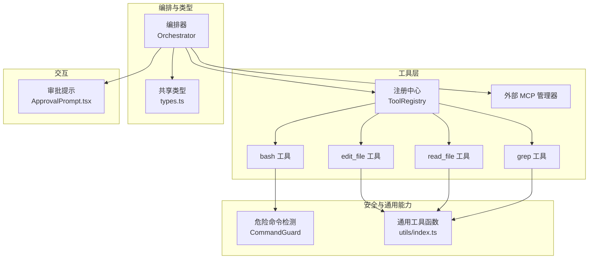
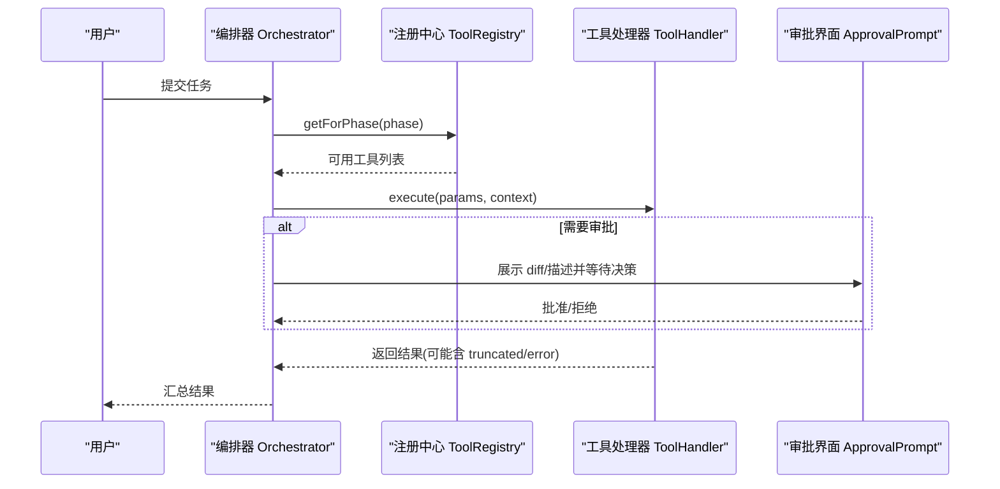
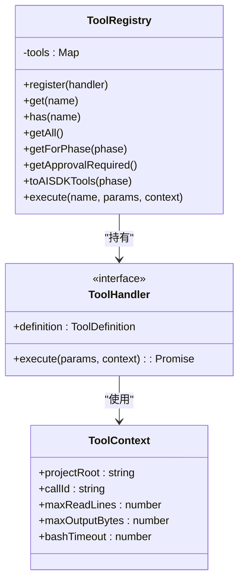
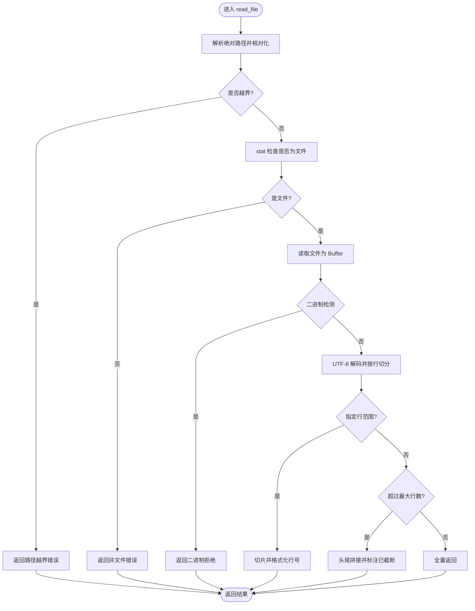
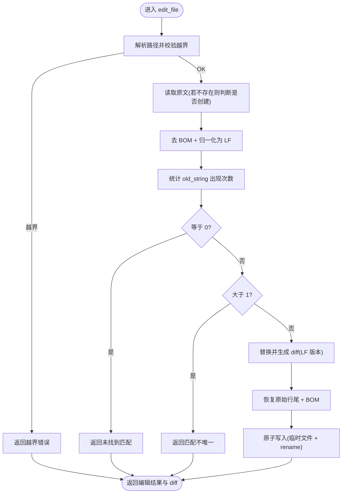
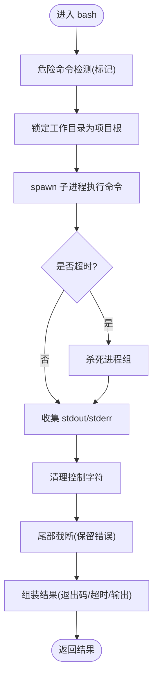
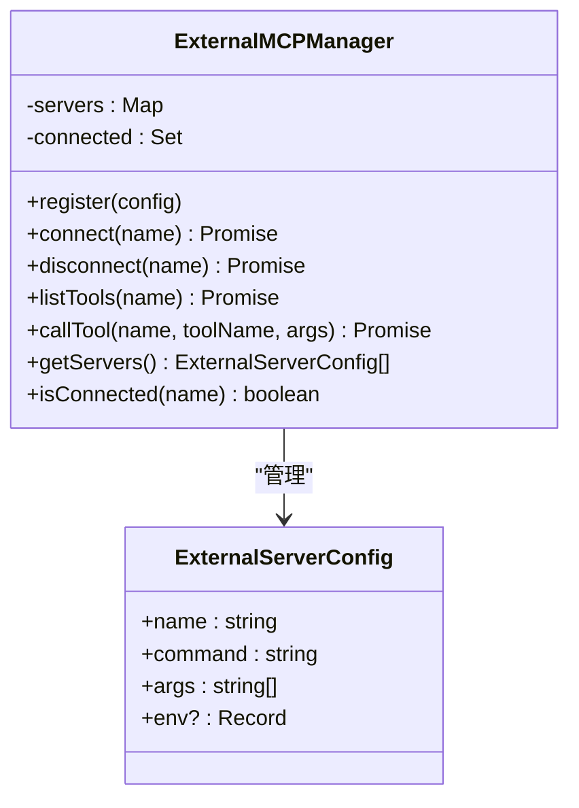
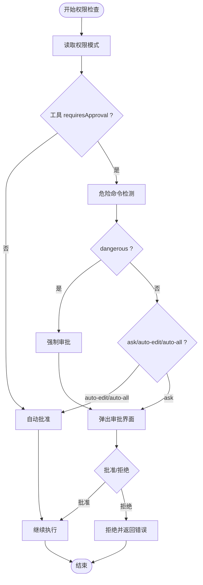
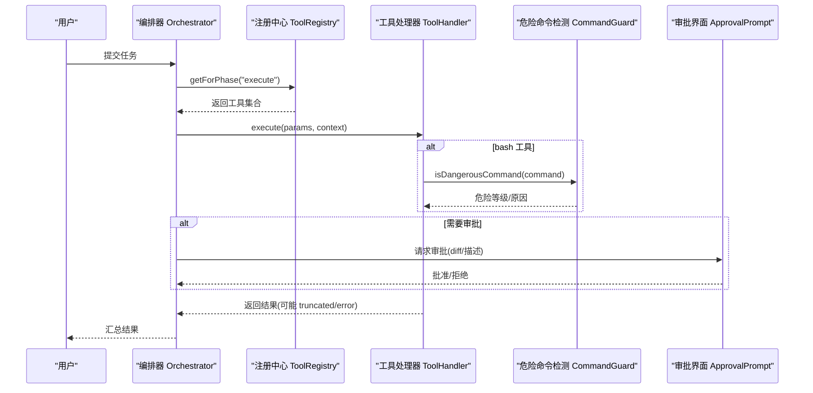
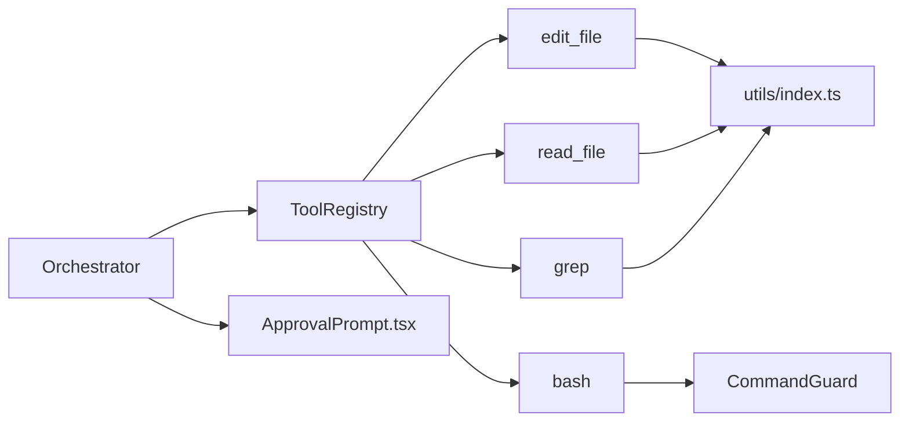

# 工具系统架构

<cite>
**本文引用的文件**   
- [src/tools/registry.ts](file://src/tools/registry.ts)
- [src/tools/readFile.ts](file://src/tools/readFile.ts)
- [src/tools/editFile.ts](file://src/tools/editFile.ts)
- [src/tools/bash.ts](file://src/tools/bash.ts)
- [src/tools/grep.ts](file://src/tools/grep.ts)
- [src/tools/schemas.ts](file://src/tools/schemas.ts)
- [src/tools/external.ts](file://src/tools/external.ts)
- [src/sandbox/CommandGuard.ts](file://src/sandbox/CommandGuard.ts)
- [src/tui/components/ApprovalPrompt.tsx](file://src/tui/components/ApprovalPrompt.tsx)
- [src/agent/types.ts](file://src/agent/types.ts)
- [src/utils/index.ts](file://src/utils/index.ts)
- [src/agent/Orchestrator.ts](file://src/agent/Orchestrator.ts)
- [README.md](file://README.md)
</cite>

## 目录
1. [简介](#简介)
2. [项目结构](#项目结构)
3. [核心组件](#核心组件)
4. [架构总览](#架构总览)
5. [详细组件分析](#详细组件分析)
6. [依赖关系分析](#依赖关系分析)
7. [性能与可靠性](#性能与可靠性)
8. [故障排查指南](#故障排查指南)
9. [结论](#结论)
10. [附录：自定义工具开发指南](#附录自定义工具开发指南)

## 简介
本文件面向 MCP 原生工具系统的架构设计与实现，聚焦以下目标：
- 工具注册中心的设计模式与生命周期管理
- 内置工具（read_file、edit_file、bash、grep）的安全设计与可靠性保障
- 外部 MCP Server 的接入机制与传输层抽象
- 工具权限控制与审批流程
- 工具调用时序图与权限检查流程图
- 自定义工具开发的完整指南与最佳实践

## 项目结构
工具系统位于 src/tools 下，围绕“注册中心 + 工具处理器”的模式组织；安全策略集中在沙箱与命令检测模块；TUI 提供审批交互；编排层 Orchestrator 串联计划与执行阶段。

图表来源
- [src/tools/registry.ts:25-93](file://src/tools/registry.ts#L25-L93)
- [src/tools/readFile.ts:11-35](file://src/tools/readFile.ts#L11-L35)
- [src/tools/editFile.ts:14-38](file://src/tools/editFile.ts#L14-L38)
- [src/tools/bash.ts:13-33](file://src/tools/bash.ts#L13-L33)
- [src/tools/grep.ts:11-43](file://src/tools/grep.ts#L11-L43)
- [src/tools/external.ts:20-70](file://src/tools/external.ts#L20-L70)
- [src/sandbox/CommandGuard.ts:71-98](file://src/sandbox/CommandGuard.ts#L71-L98)
- [src/utils/index.ts:166-210](file://src/utils/index.ts#L166-L210)
- [src/agent/Orchestrator.ts:38-86](file://src/agent/Orchestrator.ts#L38-L86)
- [src/agent/types.ts:44-78](file://src/agent/types.ts#L44-L78)
- [src/tui/components/ApprovalPrompt.tsx:18-56](file://src/tui/components/ApprovalPrompt.tsx#L18-L56)

章节来源
- [README.md:134-146](file://README.md#L134-L146)

## 核心组件
- 工具注册中心 ToolRegistry
  - 职责：集中注册、查找、按阶段过滤、生成 AI SDK 兼容定义、统一执行入口
  - 关键方法：register/get/getAll/getForPhase/toAISDKTools/execute
- 工具处理器 ToolHandler
  - 每个工具暴露 definition 与 execute(params, context)，definition 包含 name/description/inputSchema/requiresApproval/phase
- 工具上下文 ToolContext
  - 携带 projectRoot/callId/限制参数等，贯穿所有工具执行
- 外部 MCP 管理器 ExternalMCPManager
  - 预留接口用于未来通过 stdio JSON-RPC 连接外部 MCP Server，当前为占位实现
- 危险命令检测 CommandGuard
  - 基于正则黑名单与启发式规则，返回危险等级与安全原因
- 通用工具 utils/index.ts
  - 提供截断策略（头部/尾部）、二进制输出清理、行尾处理、BOM 处理等

章节来源
- [src/tools/registry.ts:12-93](file://src/tools/registry.ts#L12-L93)
- [src/tools/external.ts:20-70](file://src/tools/external.ts#L20-L70)
- [src/sandbox/CommandGuard.ts:71-98](file://src/sandbox/CommandGuard.ts#L71-L98)
- [src/utils/index.ts:72-154](file://src/utils/index.ts#L72-L154)

## 架构总览
工具系统采用“注册中心 + 处理器”的插件化设计，编排层 Orchestrator 负责在 Plan/Execute 两阶段中按需选择工具集，并通过 ToolRegistry 分发到具体处理器。权限控制由 PermissionMode 与 requiresApproval 共同决定，必要时触发 TUI 审批。

图表来源
- [src/agent/Orchestrator.ts:121-180](file://src/agent/Orchestrator.ts#L121-L180)
- [src/tools/registry.ts:44-82](file://src/tools/registry.ts#L44-L82)
- [src/tui/components/ApprovalPrompt.tsx:18-56](file://src/tui/components/ApprovalPrompt.tsx#L18-L56)

## 详细组件分析

### 工具注册中心与生命周期
- 设计模式
  - 工厂+注册表：createToolRegistry 初始化并注入默认工具
  - 策略模式：各工具以 ToolHandler 形式实现，统一接口
- 生命周期
  - 启动时创建注册中心并注册内置工具
  - 运行时根据 phase 过滤可用工具集
  - 执行时通过 execute(name, params, context) 路由到具体处理器
- 扩展点
  - 新增工具只需实现 ToolHandler 并在 createToolRegistry 中 register
  - 可通过 toAISDKTools 将工具定义适配到上层模型调用

图表来源
- [src/tools/registry.ts:25-93](file://src/tools/registry.ts#L25-L93)
- [src/tools/registry.ts:12-23](file://src/tools/registry.ts#L12-L23)

章节来源
- [src/tools/registry.ts:25-93](file://src/tools/registry.ts#L25-L93)

### 内置工具安全与可靠性

#### read_file
- 安全设计
  - 路径越界校验：仅允许读取项目根目录下的文件
  - 二进制检测：前 8KB 含空字节即判定为二进制并拒绝
  - 行数截断：超过 maxReadLines 时采用头尾拼接策略，避免大文件导致上下文溢出
- 可靠性保障
  - 统一错误包装与 callId 追踪
  - 支持 start_line/end_line 范围读取，便于精准定位
- 复杂度
  - 时间 O(n)（n 为文件行数），空间 O(n)（内容切片）

图表来源
- [src/tools/readFile.ts:54-147](file://src/tools/readFile.ts#L54-L147)

章节来源
- [src/tools/readFile.ts:11-35](file://src/tools/readFile.ts#L11-L35)
- [src/tools/readFile.ts:54-147](file://src/tools/readFile.ts#L54-L147)

#### edit_file
- 安全设计
  - 路径越界校验：仅允许在项目根目录下编辑
  - 唯一匹配强制：old_string 必须精确且唯一，否则报错，防止误替换
  - 原子写入：先写临时文件再 rename，避免部分写入导致损坏
  - 格式保留：自动处理 BOM 与行尾风格（CRLF/LF），确保不破坏原有格式
- 可靠性保障
  - 差异输出：生成 unified diff 供 LLM 与人类审阅
  - 新文件创建：当 old_string 为空且文件不存在时，直接创建
- 复杂度
  - 时间 O(n)（全文扫描匹配），空间 O(n)（文本处理）

图表来源
- [src/tools/editFile.ts:61-156](file://src/tools/editFile.ts#L61-L156)
- [src/tools/editFile.ts:158-166](file://src/tools/editFile.ts#L158-L166)

章节来源
- [src/tools/editFile.ts:14-38](file://src/tools/editFile.ts#L14-L38)
- [src/tools/editFile.ts:61-156](file://src/tools/editFile.ts#L61-L156)

#### bash
- 安全设计
  - 工作目录锁定：始终在项目根目录执行
  - 超时控制：可配置超时，到达后终止进程组
  - 危险命令检测：结合 CommandGuard 进行标记与后续审批拦截
  - 输出清洗与截断：去除控制字符，按尾部截断保留错误信息
- 可靠性保障
  - 跨平台 shell 选择（Windows PowerShell / Unix bash）
  - 进程组杀除（Unix kill -SIGKILL 进程组；Windows taskkill /T）
- 复杂度
  - 受限于外部进程 I/O，整体耗时取决于命令执行时间与输出大小

图表来源
- [src/tools/bash.ts:123-183](file://src/tools/bash.ts#L123-L183)
- [src/sandbox/CommandGuard.ts:71-98](file://src/sandbox/CommandGuard.ts#L71-L98)

章节来源
- [src/tools/bash.ts:13-33](file://src/tools/bash.ts#L13-L33)
- [src/tools/bash.ts:123-183](file://src/tools/bash.ts#L123-L183)

#### grep
- 功能特性
  - 基于 ripgrep 的快速正则搜索，支持 include 过滤、上下文行、忽略大小写
  - 结果限流：每文件最多 100 个匹配，总输出按 maxOutputBytes 截断
- 回退策略
  - 若 rg 不可用，返回安装提示而非崩溃
- 复杂度
  - 主要开销在 rg 进程执行与输出处理

章节来源
- [src/tools/grep.ts:11-43](file://src/tools/grep.ts#L11-L43)
- [src/tools/grep.ts:80-175](file://src/tools/grep.ts#L80-L175)

### 外部 MCP Server 接入机制与传输层抽象
- 当前状态
  - ExternalMCPManager 提供注册、连接、断开、列出工具、调用工具的接口
  - v1 为简化实现，connect/listTools/callTool 均为占位，返回未完成提示
- 未来规划
  - Phase 2 引入 stdio JSON-RPC 传输，对接 @modelcontextprotocol/sdk 的 Client + StdioClientTransport
  - 通过 MCP tools/list 与 tools/call 完成工具发现与调用

图表来源
- [src/tools/external.ts:20-70](file://src/tools/external.ts#L20-L70)

章节来源
- [src/tools/external.ts:9-14](file://src/tools/external.ts#L9-L14)
- [src/tools/external.ts:20-70](file://src/tools/external.ts#L20-L70)

### 权限控制系统与审批流程
- 权限模式
  - ask/auto-edit/auto-all/yolo，影响是否需要人工审批
- 工具级要求
  - ToolDefinition.requiresApproval 标记是否需要审批
  - ToolRegistry.getApprovalRequired 汇总需审批工具名
- 危险命令强制审批
  - CommandGuard 对命令进行分级评估，dangerous 级别强制审批
- 审批交互
  - TUI 组件 ApprovalPrompt 展示工具描述与 diff，支持 Y/N 决策

图表来源
- [src/agent/types.ts:27](file://src/agent/types.ts#L27)
- [src/tools/registry.ts:51-56](file://src/tools/registry.ts#L51-L56)
- [src/sandbox/CommandGuard.ts:95-98](file://src/sandbox/CommandGuard.ts#L95-L98)
- [src/tui/components/ApprovalPrompt.tsx:18-56](file://src/tui/components/ApprovalPrompt.tsx#L18-L56)

章节来源
- [src/agent/types.ts:27](file://src/agent/types.ts#L27)
- [src/tools/registry.ts:51-56](file://src/tools/registry.ts#L51-L56)
- [src/sandbox/CommandGuard.ts:95-98](file://src/sandbox/CommandGuard.ts#L95-L98)
- [src/tui/components/ApprovalPrompt.tsx:18-56](file://src/tui/components/ApprovalPrompt.tsx#L18-L56)

### 工具调用时序图（端到端）

图表来源
- [src/agent/Orchestrator.ts:163-180](file://src/agent/Orchestrator.ts#L163-L180)
- [src/tools/registry.ts:44-82](file://src/tools/registry.ts#L44-L82)
- [src/tools/bash.ts:123-183](file://src/tools/bash.ts#L123-L183)
- [src/sandbox/CommandGuard.ts:71-98](file://src/sandbox/CommandGuard.ts#L71-L98)
- [src/tui/components/ApprovalPrompt.tsx:18-56](file://src/tui/components/ApprovalPrompt.tsx#L18-L56)

## 依赖关系分析
- 低耦合高内聚
  - 工具处理器仅依赖 types、registry 与少量通用工具
  - 注册中心屏蔽具体实现细节，对外暴露稳定接口
- 关键依赖链
  - Orchestrator → ToolRegistry → ToolHandler
  - bash → CommandGuard（危险命令检测）
  - edit_file/read_file → utils（截断、行尾、BOM）
  - TUI → ApprovalPrompt（审批交互）

图表来源
- [src/agent/Orchestrator.ts:38-86](file://src/agent/Orchestrator.ts#L38-L86)
- [src/tools/registry.ts:25-93](file://src/tools/registry.ts#L25-L93)
- [src/tools/bash.ts:123-183](file://src/tools/bash.ts#L123-L183)
- [src/tools/editFile.ts:61-156](file://src/tools/editFile.ts#L61-L156)
- [src/tools/readFile.ts:54-147](file://src/tools/readFile.ts#L54-L147)
- [src/tools/grep.ts:80-175](file://src/tools/grep.ts#L80-L175)
- [src/tui/components/ApprovalPrompt.tsx:18-56](file://src/tui/components/ApprovalPrompt.tsx#L18-L56)

章节来源
- [src/agent/Orchestrator.ts:38-86](file://src/agent/Orchestrator.ts#L38-L86)
- [src/tools/registry.ts:25-93](file://src/tools/registry.ts#L25-L93)

## 性能与可靠性
- 输入输出限制
  - 读文件：maxReadLines 控制行数上限，避免上下文爆炸
  - Bash 输出：maxOutputBytes 与尾部截断策略，优先保留错误信息
  - grep：每文件匹配数限制与总输出字节限制
- 资源保护
  - bash 超时与进程组杀除，防止僵尸进程
  - 原子写入避免并发或异常导致的文件损坏
- 稳定性
  - 统一错误包装与 callId 追踪，便于问题定位
  - 二进制输出清理与控制字符过滤，保证终端渲染稳定

章节来源
- [src/tools/readFile.ts:114-130](file://src/tools/readFile.ts#L114-L130)
- [src/tools/bash.ts:111-121](file://src/tools/bash.ts#L111-L121)
- [src/tools/grep.ts:147-155](file://src/tools/grep.ts#L147-L155)
- [src/tools/editFile.ts:52-59](file://src/tools/editFile.ts#L52-L59)
- [src/utils/index.ts:166-180](file://src/utils/index.ts#L166-L180)

## 故障排查指南
- 常见错误与定位
  - 未知工具：检查 ToolRegistry.execute 返回的错误信息
  - 路径越界：确认 projectRoot 与传入路径的相对关系
  - 二进制文件拒绝：read_file 检测到空字节，改用其他工具查看
  - ripgrep 不可用：grep 工具返回安装提示，按指引安装 rg
  - 命令超时/失败：bash 工具返回退出码与超时标记，检查命令逻辑与环境
- 调试建议
  - 关注 ToolResult.error 与 truncated 标志
  - 利用 callId 关联事件日志
  - 在 TUI 中查看 diff 与审批记录

章节来源
- [src/tools/registry.ts:70-82](file://src/tools/registry.ts#L70-L82)
- [src/tools/readFile.ts:88-96](file://src/tools/readFile.ts#L88-L96)
- [src/tools/grep.ts:120-128](file://src/tools/grep.ts#L120-L128)
- [src/tools/bash.ts:151-173](file://src/tools/bash.ts#L151-L173)

## 结论
本工具系统通过注册中心与处理器解耦，实现了可扩展的工具生态；内置工具在安全性与可靠性方面做了充分设计；外部 MCP Server 的接入机制预留了清晰的扩展点；权限控制与审批流程兼顾灵活性与安全性。整体架构清晰、易于维护与演进。

## 附录：自定义工具开发指南
- 步骤
  1. 新建工具文件（如 myTool.ts），导出 ToolHandler
     - 定义 ToolDefinition：name/description/inputSchema/requiresApproval/phase
     - 实现 execute(params, context)：返回 ToolResult
  2. 在 createToolRegistry 中注册该工具
  3. （可选）在 schemas.ts 中添加 Zod Schema，以便上层模型校验
  4. 如需外部依赖（如子进程），遵循安全规范：
     - 工作目录锁定、超时控制、输出截断、危险操作检测
  5. 在 TUI 中测试审批流程（requiresApproval=true 时）
- 最佳实践
  - 明确 inputSchema 的必填字段与描述，提升 LLM 调用成功率
  - 使用 callId 追踪每次调用，便于审计与排障
  - 对大输出采用截断策略，避免上下文溢出
  - 对写操作采用原子写入与差异输出，提高可回溯性
  - 对敏感操作设置 requiresApproval=true，配合审批流程

章节来源
- [src/tools/registry.ts:85-93](file://src/tools/registry.ts#L85-L93)
- [src/tools/schemas.ts:33-39](file://src/tools/schemas.ts#L33-39)
- [src/agent/types.ts:44-78](file://src/agent/types.ts#L44-L78)