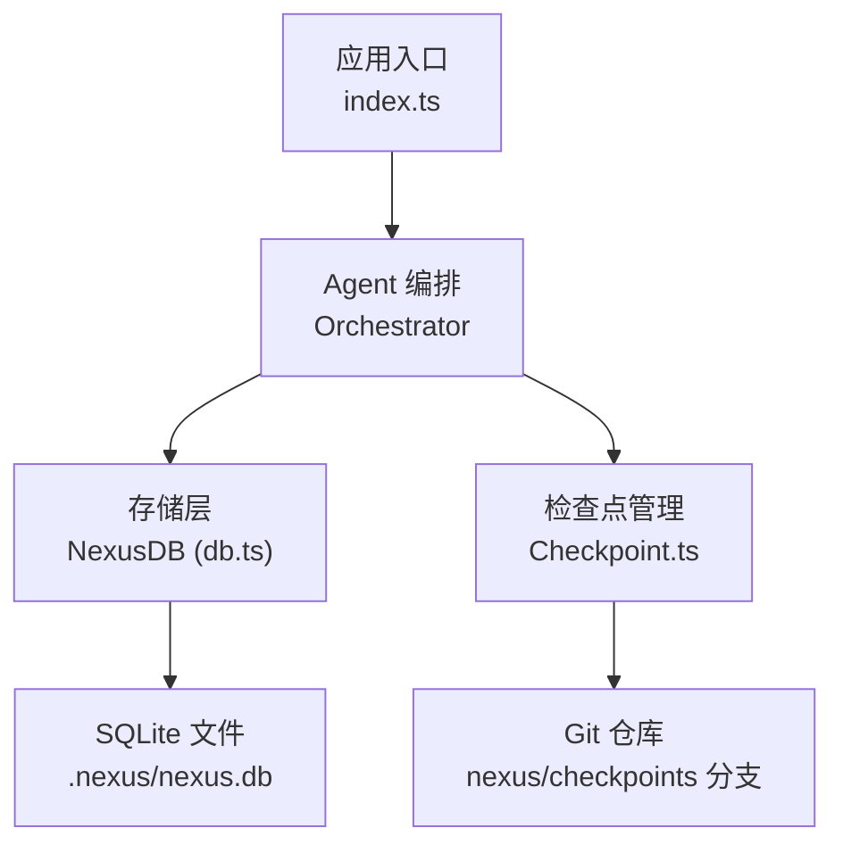
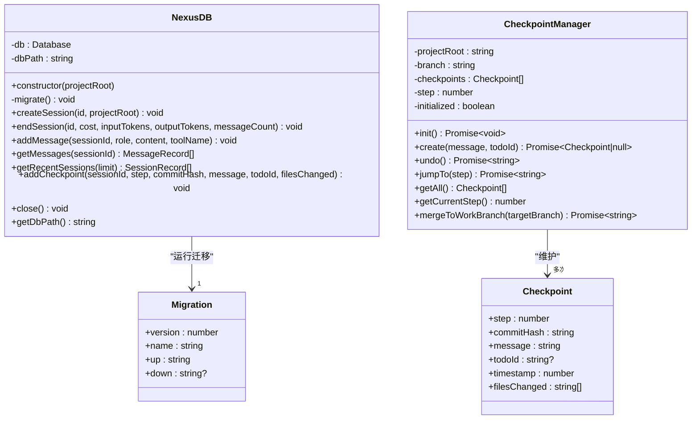
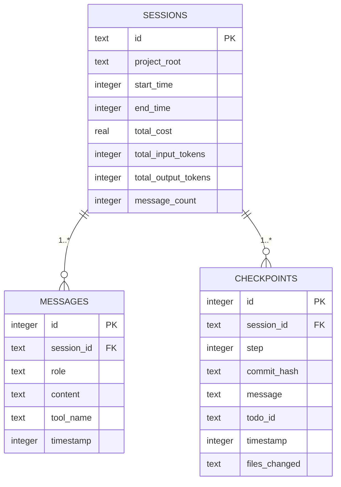
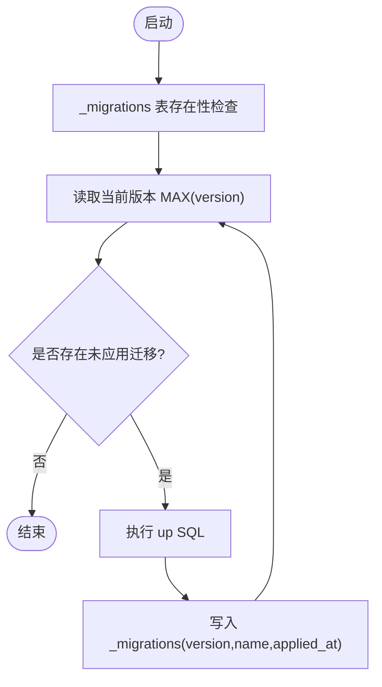
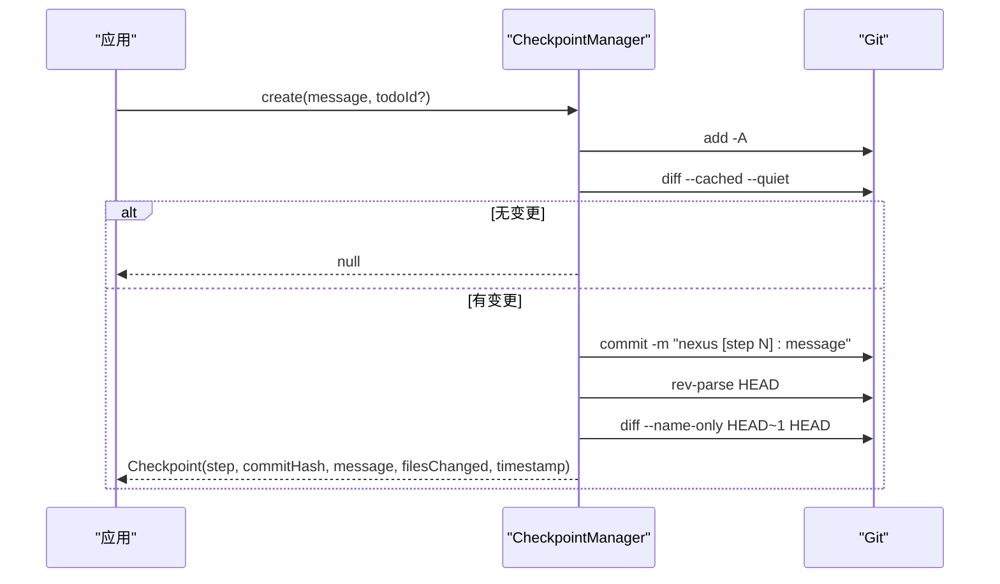
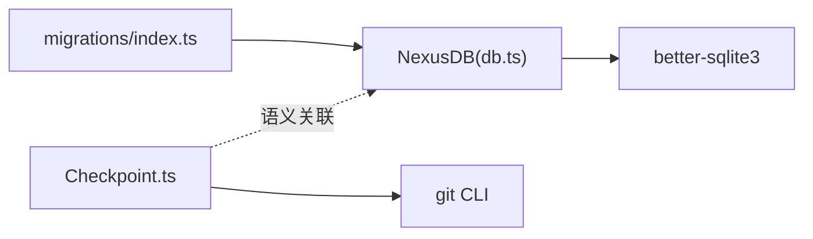
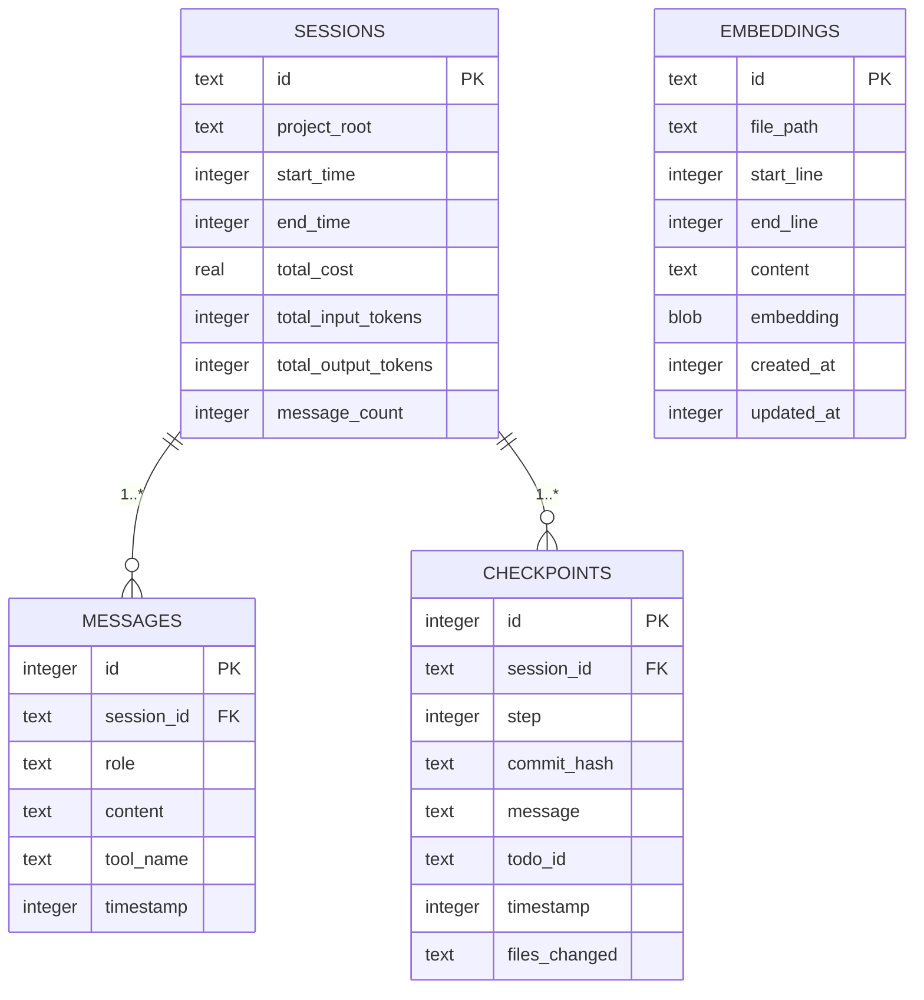

# 数据存储架构

<cite>
**本文引用的文件**   
- [src/storage/db.ts](file://src/storage/db.ts)
- [src/storage/migrations/index.ts](file://src/storage/migrations/index.ts)
- [src/sandbox/Checkpoint.ts](file://src/sandbox/Checkpoint.ts)
- [src/agent/types.ts](file://src/agent/types.ts)
- [DESIGN.md](file://DESIGN.md)
- [.nexus/config.toml](file://.nexus/config.toml)
</cite>

## 目录
1. [简介](#简介)
2. [项目结构](#项目结构)
3. [核心组件](#核心组件)
4. [架构总览](#架构总览)
5. [详细组件分析](#详细组件分析)
6. [依赖关系分析](#依赖关系分析)
7. [性能与优化](#性能与优化)
8. [故障排查指南](#故障排查指南)
9. [结论](#结论)
10. [附录](#附录)

## 简介
本文件面向 Nexus 的数据存储子系统，聚焦 SQLite 数据库设计模式与本地持久化策略。文档涵盖：
- 数据表结构与索引（会话历史、消息记录、检查点信息）
- 迁移机制与版本管理
- 备份恢复方案与性能优化建议
- 数据库 Schema 图与迁移流程图
- 自定义存储后端扩展与数据导出能力指南

## 项目结构
存储相关代码集中在 src/storage 与 src/sandbox/Checkpoint.ts：
- src/storage/db.ts：SQLite 存储层实现（连接、Schema 初始化、CRUD 接口）
- src/storage/migrations/index.ts：迁移定义与执行器（版本化 schema 演进）
- src/sandbox/Checkpoint.ts：Git 检查点管理（与存储层配合，提供可回滚的变更历史）
- src/agent/types.ts：检查点数据结构定义（被 Checkpoint 模块使用）
- DESIGN.md：总体设计与技术选型说明（包含持久化选型）
- .nexus/config.toml：运行时配置（含 checkpoint 分支名等）

图表来源
- [src/storage/db.ts:30-41](file://src/storage/db.ts#L30-L41)
- [src/sandbox/Checkpoint.ts:37-70](file://src/sandbox/Checkpoint.ts#L37-L70)

章节来源
- [DESIGN.md:111-113](file://DESIGN.md#L111-L113)
- [.nexus/config.toml:57-62](file://.nexus/config.toml#L57-L62)

## 核心组件
- NexusDB：封装 better-sqlite3，提供会话创建/结束、消息写入与查询、最近会话列表、检查点写入等接口；启用 WAL 提升并发读写性能。
- 迁移系统：集中维护 schema 版本与 up/down SQL，启动时自动检测并执行未应用的迁移。
- CheckpointManager：基于 Git 的检查点管理，支持创建、回滚、跳转、合并到工作分支，并与存储层协同记录关键步骤。

章节来源
- [src/storage/db.ts:30-146](file://src/storage/db.ts#L30-L146)
- [src/storage/migrations/index.ts:1-118](file://src/storage/migrations/index.ts#L1-L118)
- [src/sandbox/Checkpoint.ts:30-181](file://src/sandbox/Checkpoint.ts#L30-L181)

## 架构总览
Nexus 采用“单进程 + 单文件 SQLite”的轻量持久化方案，结合 Git 检查点形成“逻辑+物理”双重可回滚能力。

图表来源
- [src/storage/db.ts:30-146](file://src/storage/db.ts#L30-L146)
- [src/storage/migrations/index.ts:6-12](file://src/storage/migrations/index.ts#L6-L12)
- [src/sandbox/Checkpoint.ts:30-181](file://src/sandbox/Checkpoint.ts#L30-L181)
- [src/agent/types.ts:188-195](file://src/agent/types.ts#L188-L195)

## 详细组件分析

### 数据库 Schema 与索引
- sessions：会话元数据（id、project_root、时间戳、成本、token 计数、消息数）
- messages：会话消息（session_id、role、content、tool_name、timestamp），按 id 自增排序
- checkpoints：检查点记录（session_id、step、commit_hash、message、todo_id、timestamp、files_changed）
- 索引：messages.session_id、checkpoints.session_id，加速按会话查询

图表来源
- [src/storage/db.ts:45-81](file://src/storage/db.ts#L45-L81)

章节来源
- [src/storage/db.ts:45-81](file://src/storage/db.ts#L45-L81)

### 迁移机制与版本管理
- 迁移定义：统一在 migrations/index.ts 中以 version/name/up/down 形式声明
- 版本追踪：_migrations 表记录已应用迁移（version、name、applied_at）
- 执行流程：启动时读取当前版本，顺序执行未应用的 up SQL，并写入 _migrations

图表来源
- [src/storage/migrations/index.ts:84-117](file://src/storage/migrations/index.ts#L84-L117)

章节来源
- [src/storage/migrations/index.ts:14-82](file://src/storage/migrations/index.ts#L14-L82)
- [src/storage/migrations/index.ts:84-117](file://src/storage/migrations/index.ts#L84-L117)

### 检查点管理与回滚
- 初始化：确保处于 Git 仓库，必要时 init；保证有初始提交；创建或切换到 nexus/checkpoints 分支
- 创建检查点：暂存变更 → 判断是否有差异 → 提交 → 记录 commit hash、变更文件列表、时间戳
- 回滚与跳转：支持 undo（回到上一步）与 jumpTo（跳转到指定步骤），内部通过 git reset --hard 实现
- 合并：会话结束时可将检查点分支合并到目标工作分支

图表来源
- [src/sandbox/Checkpoint.ts:72-116](file://src/sandbox/Checkpoint.ts#L72-L116)

章节来源
- [src/sandbox/Checkpoint.ts:42-70](file://src/sandbox/Checkpoint.ts#L42-L70)
- [src/sandbox/Checkpoint.ts:72-116](file://src/sandbox/Checkpoint.ts#L72-L116)
- [src/sandbox/Checkpoint.ts:118-155](file://src/sandbox/Checkpoint.ts#L118-L155)
- [src/sandbox/Checkpoint.ts:167-180](file://src/sandbox/Checkpoint.ts#L167-L180)
- [src/agent/types.ts:188-195](file://src/agent/types.ts#L188-L195)

### 数据模型与类型
- Checkpoint：step、commitHash、message、todoId、timestamp、filesChanged
- SessionRecord / MessageRecord：用于会话与消息的持久化结构

章节来源
- [src/agent/types.ts:188-195](file://src/agent/types.ts#L188-L195)
- [src/storage/db.ts:10-28](file://src/storage/db.ts#L10-L28)

## 依赖关系分析
- NexusDB 依赖 better-sqlite3，负责 SQLite 连接、WAL 模式、Schema 初始化与 CRUD
- 迁移系统独立于业务逻辑，仅依赖 db.prepare/exec 抽象
- CheckpointManager 依赖 Git CLI，与存储层解耦，但语义上与 sessions/checkpoints 表对应

图表来源
- [src/storage/db.ts:6-41](file://src/storage/db.ts#L6-L41)
- [src/storage/migrations/index.ts:94-117](file://src/storage/migrations/index.ts#L94-L117)
- [src/sandbox/Checkpoint.ts:11-28](file://src/sandbox/Checkpoint.ts#L11-L28)

章节来源
- [src/storage/db.ts:6-41](file://src/storage/db.ts#L6-L41)
- [src/storage/migrations/index.ts:94-117](file://src/storage/migrations/index.ts#L94-L117)
- [src/sandbox/Checkpoint.ts:11-28](file://src/sandbox/Checkpoint.ts#L11-L28)

## 性能与优化
- WAL 模式：启用 journal_mode=WAL，提升并发读写的稳定性与性能
- 索引优化：对 messages.session_id、checkpoints.session_id 建立索引，加速按会话查询
- 批量写入：在高吞吐场景下，建议使用事务包裹多条插入，减少磁盘同步开销
- 查询分页：getRecentSessions 支持 limit，避免一次性拉取过多数据
- 大字段处理：messages.content 可能较大，建议按需查询与压缩（例如摘要化旧消息）
- 检查点频率：频繁 git commit 会带来 I/O 压力，可按步长合并提交或在内存中聚合后批量提交

章节来源
- [src/storage/db.ts:39-41](file://src/storage/db.ts#L39-L41)
- [src/storage/db.ts:79-81](file://src/storage/db.ts#L79-L81)
- [src/storage/db.ts:117-121](file://src/storage/db.ts#L117-L121)
- [src/sandbox/Checkpoint.ts:72-116](file://src/sandbox/Checkpoint.ts#L72-L116)

## 故障排查指南
- 无法连接数据库：确认 .nexus 目录存在且可写，nexus.db 未被占用
- 迁移失败：检查 _migrations 表状态与 up SQL 语法；必要时手动清理 _migrations 重试
- 回滚失败：确认 Git 仓库状态与权限；检查目标分支是否存在及是否可 reset
- 查询缓慢：确认索引是否存在；检查是否缺少 WHERE 条件导致全表扫描
- 磁盘空间不足：清理旧会话与消息；归档历史检查点到外部存储

章节来源
- [src/storage/db.ts:34-41](file://src/storage/db.ts#L34-L41)
- [src/storage/migrations/index.ts:84-117](file://src/storage/migrations/index.ts#L84-L117)
- [src/sandbox/Checkpoint.ts:118-155](file://src/sandbox/Checkpoint.ts#L118-L155)

## 结论
Nexus 的数据存储以 SQLite 为核心，结合 Git 检查点实现“逻辑+物理”双重可回滚能力。通过迁移系统与索引优化，保障 schema 演进与查询性能。未来可扩展为多后端存储与更丰富的导出能力，满足生产级需求。

## 附录

### 备份与恢复方案
- 冷备份：直接复制 .nexus/nexus.db 文件（建议在停止应用后进行）
- 热备份：启用 WAL 后可在线拷贝，或使用 sqlite3 的 backup API（若后续引入）
- 恢复流程：替换 nexus.db 后重启应用；如迁移版本不一致，启动时将自动执行迁移
- 增量备份：结合 Git 检查点分支进行增量保存，便于快速定位问题

章节来源
- [src/storage/db.ts:34-41](file://src/storage/db.ts#L34-L41)
- [src/storage/migrations/index.ts:84-117](file://src/storage/migrations/index.ts#L84-L117)

### 数据导出功能
- 会话导出：按 session_id 导出 messages 与 checkpoints 为 JSON/CSV
- 统计导出：sessions 表的成本、token 计数、消息数汇总
- 工具调用导出：从 messages.tool_name 与 content 中提取结构化日志
- 建议：提供命令行导出工具，支持过滤时间范围与会话 ID

章节来源
- [src/storage/db.ts:102-114](file://src/storage/db.ts#L102-L114)
- [src/storage/db.ts:117-121](file://src/storage/db.ts#L117-L121)
- [src/storage/db.ts:124-136](file://src/storage/db.ts#L124-L136)

### 自定义存储后端扩展指南
- 抽象接口：定义统一的 StorageProvider 接口（createSession/endSession/addMessage/getMessages/getRecentSessions/addCheckpoint/close）
- 适配器模式：为 SQLite、PostgreSQL、MongoDB 等实现具体适配器
- 迁移适配：不同后端需实现各自的 schema 迁移与版本管理
- 配置注入：通过 .nexus/config.toml 选择后端类型与连接参数

章节来源
- [src/storage/db.ts:30-146](file://src/storage/db.ts#L30-L146)
- [src/storage/migrations/index.ts:1-118](file://src/storage/migrations/index.ts#L1-L118)
- [.nexus/config.toml:1-62](file://.nexus/config.toml#L1-L62)

### 数据库 Schema 图（完整）

图表来源
- [src/storage/db.ts:45-81](file://src/storage/db.ts#L45-L81)
- [src/storage/migrations/index.ts:63-81](file://src/storage/migrations/index.ts#L63-L81)