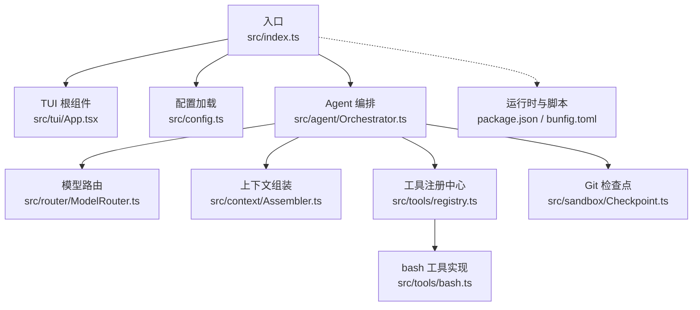
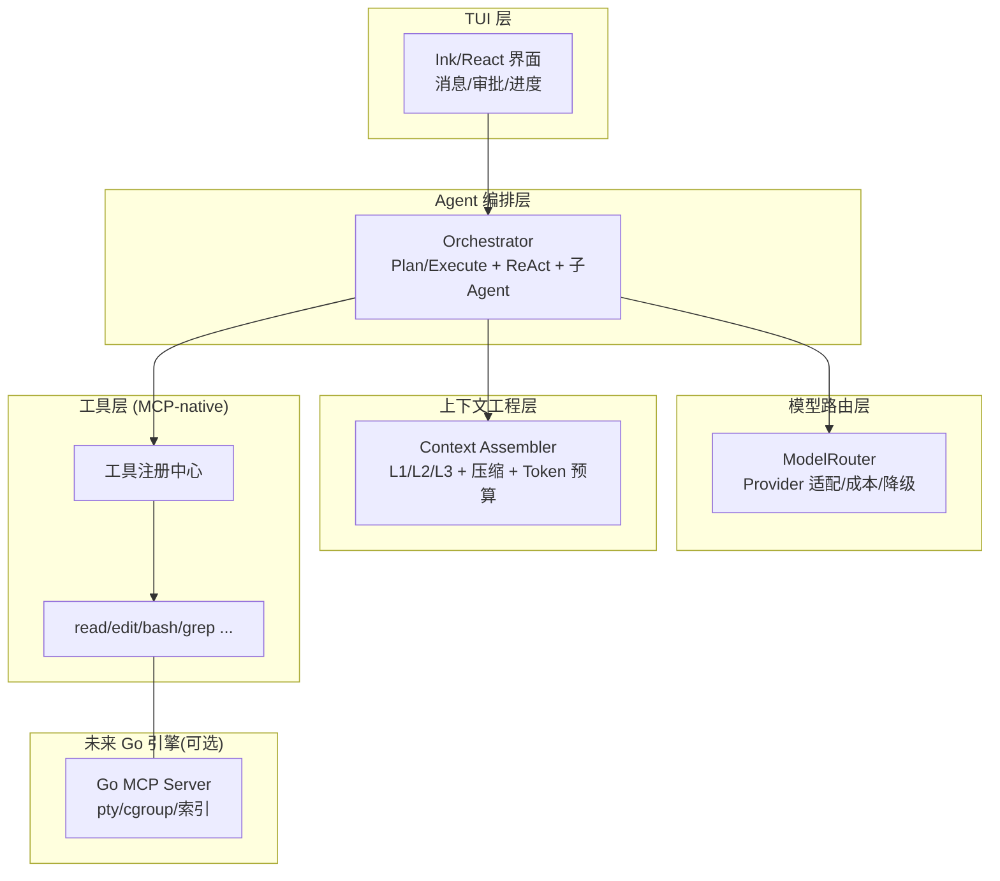
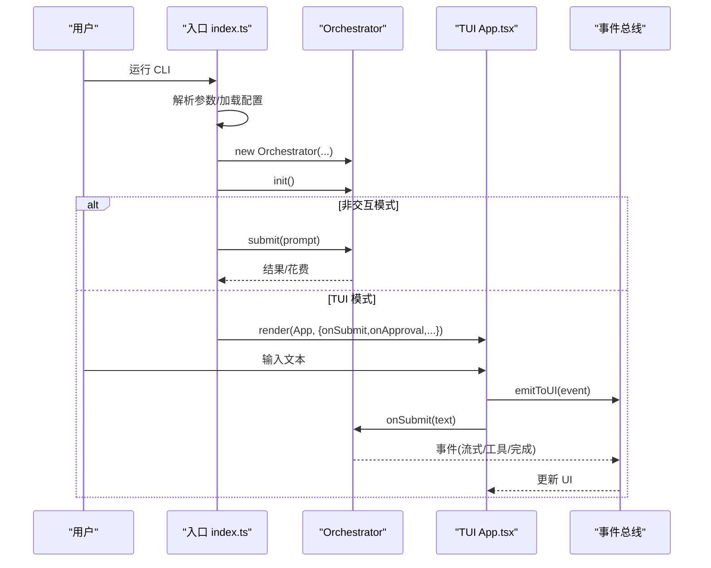
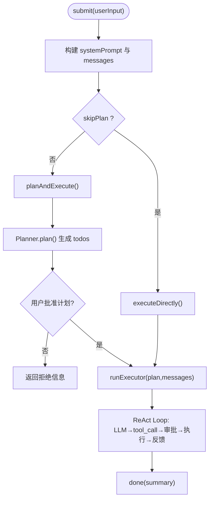
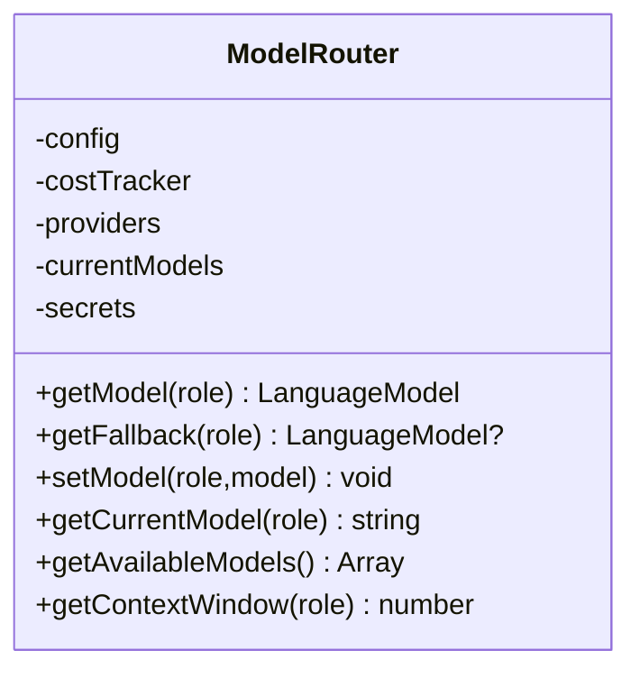
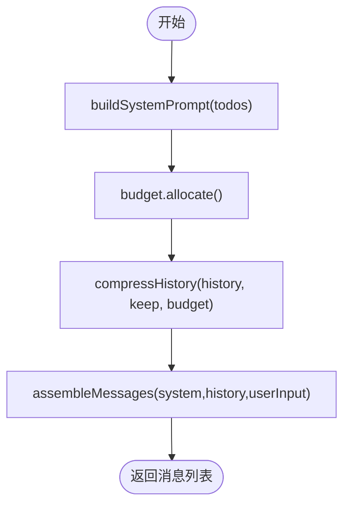
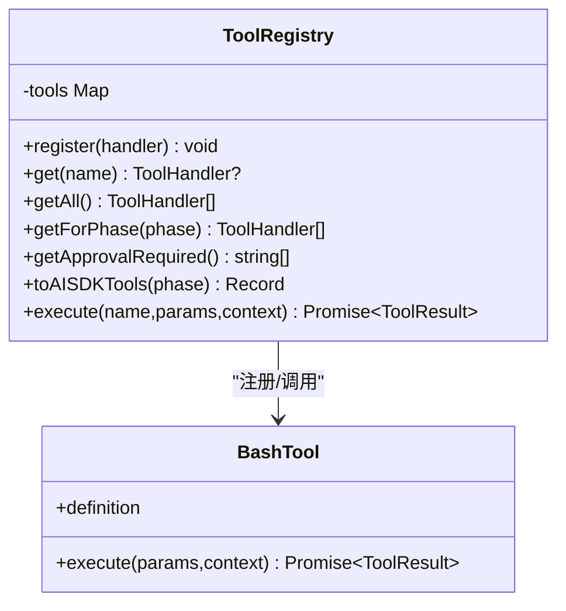
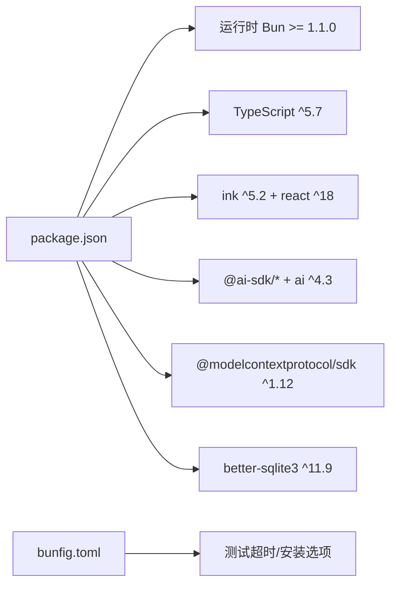
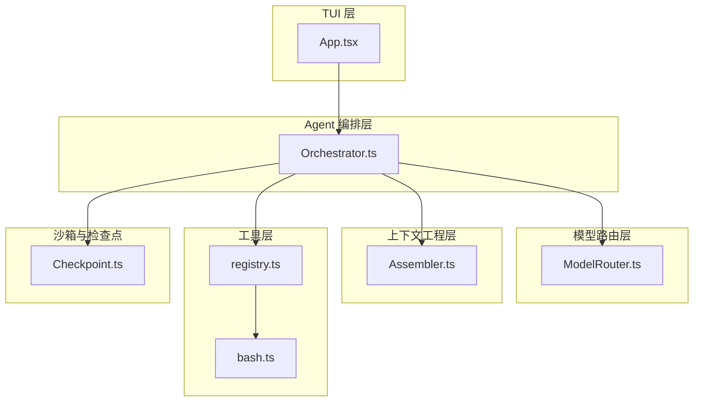

# 整体架构

<cite>
**本文引用的文件**   
- [src/index.ts](file://src/index.ts)
- [package.json](file://package.json)
- [README.md](file://README.md)
- [DESIGN.md](file://DESIGN.md)
- [bunfig.toml](file://bunfig.toml)
- [src/agent/Orchestrator.ts](file://src/agent/Orchestrator.ts)
- [src/tui/App.tsx](file://src/tui/App.tsx)
- [src/router/ModelRouter.ts](file://src/router/ModelRouter.ts)
- [src/context/Assembler.ts](file://src/context/Assembler.ts)
- [src/tools/registry.ts](file://src/tools/registry.ts)
- [src/config.ts](file://src/config.ts)
- [src/agent/types.ts](file://src/agent/types.ts)
- [src/tools/bash.ts](file://src/tools/bash.ts)
- [src/sandbox/Checkpoint.ts](file://src/sandbox/Checkpoint.ts)
</cite>

## 目录
1. [引言](#引言)
2. [项目结构](#项目结构)
3. [核心组件](#核心组件)
4. [架构总览](#架构总览)
5. [详细组件分析](#详细组件分析)
6. [依赖分析](#依赖分析)
7. [性能考虑](#性能考虑)
8. [故障排查指南](#故障排查指南)
9. [结论](#结论)
10. [附录](#附录)

## 引言
本文件为 Nexus 系统的整体架构文档，面向终端编程 Agent。系统采用分层设计：TUI 层（Ink/React for terminal）、Agent 编排层（Orchestrator + Plan/Execute 双阶段）、模型路由层、上下文工程层、工具层（MCP-native）。文档阐述各层职责边界与组件交互关系，解释单体架构决策（Bun + TypeScript）及未来向 Go 引擎迁移的触发条件，并提供系统上下文图与分层架构图，说明技术栈选型与版本兼容性要求。

## 项目结构
Nexus 采用单仓多模块组织方式，入口位于 src/index.ts，通过 CLI 参数解析、配置加载后启动 TUI 或非交互模式；Agent 编排层协调计划与执行；模型路由层负责 Provider 适配与成本追踪；上下文工程层负责三层上下文组装与压缩；工具层以 MCP 协议暴露 read/edit/bash/grep 等能力；沙箱与检查点提供安全与回滚保障。

图表来源
- [src/index.ts:1-119](file://src/index.ts#L1-L119)
- [src/tui/App.tsx:1-284](file://src/tui/App.tsx#L1-L284)
- [src/config.ts:1-132](file://src/config.ts#L1-L132)
- [src/agent/Orchestrator.ts:1-260](file://src/agent/Orchestrator.ts#L1-L260)
- [src/router/ModelRouter.ts:1-308](file://src/router/ModelRouter.ts#L1-L308)
- [src/context/Assembler.ts:1-184](file://src/context/Assembler.ts#L1-L184)
- [src/tools/registry.ts:1-96](file://src/tools/registry.ts#L1-L96)
- [src/tools/bash.ts:1-186](file://src/tools/bash.ts#L1-L186)
- [src/sandbox/Checkpoint.ts:1-182](file://src/sandbox/Checkpoint.ts#L1-L182)
- [package.json:1-43](file://package.json#L1-L43)
- [bunfig.toml:1-9](file://bunfig.toml#L1-L9)

章节来源
- [src/index.ts:1-119](file://src/index.ts#L1-L119)
- [package.json:1-43](file://package.json#L1-L43)
- [bunfig.toml:1-9](file://bunfig.toml#L1-L9)

## 核心组件
- 入口与生命周期：解析参数、加载配置、创建 Orchestrator、渲染 TUI 或执行非交互任务。
- TUI 层：基于 Ink/React 的消息列表、流式输出、工具卡片、审批面板、进度条与输入框。
- Agent 编排层：Plan/Execute 双阶段、子 Agent 分派、检查点管理、事件驱动。
- 模型路由层：Provider 抽象、角色化模型选择、降级与重试、成本追踪。
- 上下文工程层：三层上下文组装（静态/任务/检索）、历史压缩、Token 预算控制。
- 工具层：MCP 原生工具注册与调用，read/edit/bash/grep 等，支持权限与阶段限制。
- 沙箱与检查点：危险命令检测、进程组管理、Git 检查点与回滚。

章节来源
- [src/index.ts:1-119](file://src/index.ts#L1-L119)
- [src/tui/App.tsx:1-284](file://src/tui/App.tsx#L1-L284)
- [src/agent/Orchestrator.ts:1-260](file://src/agent/Orchestrator.ts#L1-L260)
- [src/router/ModelRouter.ts:1-308](file://src/router/ModelRouter.ts#L1-L308)
- [src/context/Assembler.ts:1-184](file://src/context/Assembler.ts#L1-L184)
- [src/tools/registry.ts:1-96](file://src/tools/registry.ts#L1-L96)
- [src/tools/bash.ts:1-186](file://src/tools/bash.ts#L1-L186)
- [src/sandbox/Checkpoint.ts:1-182](file://src/sandbox/Checkpoint.ts#L1-L182)

## 架构总览
分层视图与职责边界如下：
- TUI 层：用户交互、流式渲染、审批 UI、状态展示。
- Agent 编排层：ReAct Loop、Plan/Execute 双阶段、子 Agent 调度、检查点。
- 模型路由层：Provider 无关抽象、角色化模型选择、降级与成本统计。
- 上下文工程层：L1/L2/L3 上下文组装、压缩策略、Token 预算。
- 工具层：MCP-native 工具集，权限与阶段约束，可被外部 IDE 反向挂载。
- 未来 Go 引擎：作为可选后端，通过 MCP stdio JSON-RPC 接入，Agent loop 零改动。

图表来源
- [src/index.ts:1-119](file://src/index.ts#L1-L119)
- [src/agent/Orchestrator.ts:1-260](file://src/agent/Orchestrator.ts#L1-L260)
- [src/router/ModelRouter.ts:1-308](file://src/router/ModelRouter.ts#L1-L308)
- [src/context/Assembler.ts:1-184](file://src/context/Assembler.ts#L1-L184)
- [src/tools/registry.ts:1-96](file://src/tools/registry.ts#L1-L96)
- [DESIGN.md:54-85](file://DESIGN.md#L54-L85)

## 详细组件分析

### 入口与 TUI 集成
- 入口流程：解析参数 → 加载配置 → 创建 Orchestrator → 初始化 → 非交互模式直接提交 → TUI 模式渲染 App → 事件驱动更新 UI。
- TUI 事件分发：全局事件总线将 Orchestrator 事件转发到 App 组件，驱动消息、工具卡片、审批与进度更新。

图表来源
- [src/index.ts:1-119](file://src/index.ts#L1-L119)
- [src/tui/App.tsx:1-284](file://src/tui/App.tsx#L1-L284)

章节来源
- [src/index.ts:1-119](file://src/index.ts#L1-L119)
- [src/tui/App.tsx:1-284](file://src/tui/App.tsx#L1-L284)

### Agent 编排层（Orchestrator）
- 双阶段：Plan 阶段只读探索并生成结构化 TodoList，用户审批后进入 Execute 阶段逐步执行。
- ReAct Loop：在 Execute 中循环调用 LLM，处理 tool_call、权限检查、审批、工具执行与结果反馈。
- 子 Agent：复杂任务拆分子任务，独立上下文与权限，深度限制一层，结果汇总回主 Agent。
- 检查点：每次编辑自动 Git checkpoint，支持 undo/jump/merge。

图表来源
- [src/agent/Orchestrator.ts:1-260](file://src/agent/Orchestrator.ts#L1-L260)
- [src/sandbox/Checkpoint.ts:1-182](file://src/sandbox/Checkpoint.ts#L1-L182)

章节来源
- [src/agent/Orchestrator.ts:1-260](file://src/agent/Orchestrator.ts#L1-L260)
- [src/sandbox/Checkpoint.ts:1-182](file://src/sandbox/Checkpoint.ts#L1-L182)

### 模型路由层（ModelRouter）
- Provider 抽象：Anthropic/OpenAI/Ollama/DeepSeek/Custom 统一接入。
- 角色化模型：planner/executor/summarizer/verifier 不同档位，auto 模式按可用 provider 选择最佳。
- 降级与重试：高档不可用时自动降档，区分可重试与不可重试错误。
- 成本追踪：记录 token 数与估算成本，会话结束汇总显示。

图表来源
- [src/router/ModelRouter.ts:1-308](file://src/router/ModelRouter.ts#L1-L308)

章节来源
- [src/router/ModelRouter.ts:1-308](file://src/router/ModelRouter.ts#L1-L308)

### 上下文工程层（ContextAssembler）
- 三层上下文：L1 静态（system prompt、规则、git 状态、项目骨架）、L2 任务（本轮请求、todos、压缩历史）、L3 检索（grep/read 主动拉取）。
- 压缩策略：近期完整保留，早期摘要，工具结果分级丢弃，Token 预算管理。
- 组装流程：先计算 systemPrompt 与历史压缩，再按预算裁剪，最终组装 messages。

图表来源
- [src/context/Assembler.ts:1-184](file://src/context/Assembler.ts#L1-L184)

章节来源
- [src/context/Assembler.ts:1-184](file://src/context/Assembler.ts#L1-L184)

### 工具层（MCP-native）
- 注册中心：集中管理工具定义、阶段可见性、审批需求、AI SDK 兼容导出与执行。
- bash 工具：危险命令检测、超时、输出截断、工作目录锁定、进程组管理。
- 扩展性：所有工具实现 MCP Server 接口，可被外部 IDE 反向挂载；未来可将 bash 等工具迁移至 Go MCP Server，Agent 无感知。

图表来源
- [src/tools/registry.ts:1-96](file://src/tools/registry.ts#L1-L96)
- [src/tools/bash.ts:1-186](file://src/tools/bash.ts#L1-L186)

章节来源
- [src/tools/registry.ts:1-96](file://src/tools/registry.ts#L1-L96)
- [src/tools/bash.ts:1-186](file://src/tools/bash.ts#L1-L186)

### 配置与类型契约
- 配置加载：从 .nexus/config.toml 合并默认值，支持 models/providers/permissions/limits/context/checkpoint 等。
- 类型契约：NexusEvent、AgentPhase、PermissionMode、ToolDefinition、ModelRoute、SandboxProvider、GraphProvider 等贯穿各层，保证解耦与可插拔。

章节来源
- [src/config.ts:1-132](file://src/config.ts#L1-L132)
- [src/agent/types.ts:1-269](file://src/agent/types.ts#L1-L269)

## 依赖分析
- 运行时与脚本：Bun 作为运行时与包管理器，内置 TS/测试/打包；package.json 声明 bin 入口与依赖；bunfig.toml 设置测试超时与安装行为。
- 关键依赖：ink/react（TUI）、ai/@ai-sdk/*（Vercel AI SDK 与 Provider）、@modelcontextprotocol/sdk（MCP）、better-sqlite3（持久化）、zod（校验）、diff/chalk 等。
- 版本兼容性：engines.bun >= 1.1.0；TypeScript 5.7；React 18；Ink 5.x；MCP SDK 1.12.x；AI SDK 4.x。

图表来源
- [package.json:1-43](file://package.json#L1-L43)
- [bunfig.toml:1-9](file://bunfig.toml#L1-L9)

章节来源
- [package.json:1-43](file://package.json#L1-L43)
- [bunfig.toml:1-9](file://bunfig.toml#L1-L9)

## 性能考虑
- LLM 延迟主导：Agent loop 主要等待 LLM 响应，过早优化工具层收益有限。
- 上下文压缩：通过历史摘要与工具结果分级减少 token 消耗，避免长会话爆窗口。
- 模型路由与降级：根据角色选择合适模型，降低整体成本与延迟。
- 工具执行：bash 输出截断与超时控制，防止阻塞与内存膨胀。

[本节为通用指导，不直接分析具体文件]

## 故障排查指南
- 启动失败：检查入口错误捕获与退出码；确认环境变量与 API Key 配置。
- 工具执行异常：查看 bash 工具的超时、截断与错误信息；确认危险命令是否被拦截。
- 审批卡住：确认 TUI 事件总线是否正确分发；在非交互模式下应自动批准。
- 回滚失败：检查 Git 仓库状态与分支；确保检查点已初始化。

章节来源
- [src/index.ts:115-119](file://src/index.ts#L115-L119)
- [src/tools/bash.ts:123-186](file://src/tools/bash.ts#L123-L186)
- [src/tui/App.tsx:178-184](file://src/tui/App.tsx#L178-L184)
- [src/sandbox/Checkpoint.ts:42-70](file://src/sandbox/Checkpoint.ts#L42-L70)

## 结论
Nexus 采用清晰的四层架构与 MCP-native 工具层，兼顾用户体验与工程可靠性。单体起步（Bun + TypeScript）降低 IPC 与分发复杂度，同时通过 MCP 与可插拔接口为未来迁移至 Go 引擎预留空间。明确触发条件（真沙箱、常驻索引、P95 瓶颈）后再引入 Go 后端，确保 Agent loop 零改动平滑过渡。

[本节为总结，不直接分析具体文件]

## 附录

### 分层架构图（代码级映射）

图表来源
- [src/tui/App.tsx:1-284](file://src/tui/App.tsx#L1-L284)
- [src/agent/Orchestrator.ts:1-260](file://src/agent/Orchestrator.ts#L1-L260)
- [src/router/ModelRouter.ts:1-308](file://src/router/ModelRouter.ts#L1-L308)
- [src/context/Assembler.ts:1-184](file://src/context/Assembler.ts#L1-L184)
- [src/tools/registry.ts:1-96](file://src/tools/registry.ts#L1-L96)
- [src/tools/bash.ts:1-186](file://src/tools/bash.ts#L1-L186)
- [src/sandbox/Checkpoint.ts:1-182](file://src/sandbox/Checkpoint.ts#L1-L182)

### 技术栈选型与版本兼容性
- 运行时：Bun（>= 1.1.0），内置 TS/测试/打包，单二进制分发。
- TUI：Ink（^5.2）+ React（^18），流式友好、生态成熟。
- LLM SDK：Vercel AI SDK（ai ^4.3）+ @ai-sdk/*，Provider 无关、流式与 tool calling 统一。
- MCP：@modelcontextprotocol/sdk（^1.12），官方 TS SDK，双向支持。
- 其他：better-sqlite3（^11.9）、zod（^3.24）、diff/chalk 等。

章节来源
- [package.json:1-43](file://package.json#L1-L43)
- [README.md:19-25](file://README.md#L19-L25)

### 单体架构决策与迁移触发条件
- 单体理由：LLM 延迟主导、IPC 调试成本高、分发地狱；MCP 解耦使未来抽离零成本。
- 迁移信号：需要真沙箱（pty/cgroup/syscall 过滤）、常驻后台索引守护进程、实测某工具成为 P95 延迟瓶颈。

章节来源
- [DESIGN.md:87-100](file://DESIGN.md#L87-L100)