# 架构设计

<cite>
**本文引用的文件**   
- [README.md](file://README.md)
- [DESIGN.md](file://DESIGN.md)
- [package.json](file://package.json)
- [src/index.ts](file://src/index.ts)
- [src/config.ts](file://src/config.ts)
- [src/agent/Orchestrator.ts](file://src/agent/Orchestrator.ts)
- [src/agent/Planner.ts](file://src/agent/Planner.ts)
- [src/agent/Executor.ts](file://src/agent/Executor.ts)
- [src/agent/SubAgent.ts](file://src/agent/SubAgent.ts)
- [src/agent/types.ts](file://src/agent/types.ts)
- [src/router/ModelRouter.ts](file://src/router/ModelRouter.ts)
- [src/context/Assembler.ts](file://src/context/Assembler.ts)
- [src/tools/registry.ts](file://src/tools/registry.ts)
- [src/tui/App.tsx](file://src/tui/App.tsx)
- [src/sandbox/Checkpoint.ts](file://src/sandbox/Checkpoint.ts)
</cite>

## 目录
1. [引言](#引言)
2. [项目结构](#项目结构)
3. [核心组件](#核心组件)
4. [架构总览](#架构总览)
5. [详细组件分析](#详细组件分析)
6. [依赖关系分析](#依赖关系分析)
7. [性能与可扩展性](#性能与可扩展性)
8. [故障排查指南](#故障排查指南)
9. [结论](#结论)
10. [附录](#附录)

## 引言
Nexus 是一个面向生产级的终端 Coding Agent，核心理念为“上下文为王、工具为先、人在环中”。系统采用分层架构：TUI 层（Ink + React）、Agent 编排层（Plan/Execute + ReAct + 子 Agent）、模型路由层、上下文工程层、工具层（MCP-native），并预留未来可插拔的 Go 引擎作为执行后端。本架构文档旨在阐明高层设计原则、分层职责、组件交互、数据流向、集成模式、技术决策与权衡、约束条件、基础设施要求、部署拓扑、技术栈与版本兼容性等。

## 项目结构
- 顶层入口负责参数解析、配置加载、启动 TUI 或非交互模式，并创建 Orchestrator 实例。
- Agent 编排层包含 Planner（规划阶段）、Executor（执行阶段）和 SubAgent（子任务分派）。
- 模型路由层提供多 Provider 适配、角色化模型选择、降级与成本追踪。
- 上下文工程层负责三层上下文组装、压缩策略与 Token 预算管理。
- 工具层以 MCP 原生方式注册与调用内置工具（read/edit/bash/grep），支持外部 MCP Server 接入。
- TUI 层基于 Ink/React 实现流式渲染、审批卡片、Diff 展示与进度条。
- 沙箱与检查点管理提供危险命令检测与 Git Checkpoint 回滚能力。

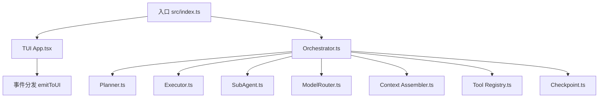

图表来源
- [src/index.ts:1-118](file://src/index.ts#L1-L118)
- [src/tui/App.tsx:1-284](file://src/tui/App.tsx#L1-L284)
- [src/agent/Orchestrator.ts:1-255](file://src/agent/Orchestrator.ts#L1-L255)
- [src/agent/Planner.ts:1-176](file://src/agent/Planner.ts#L1-L176)
- [src/agent/Executor.ts:1-234](file://src/agent/Executor.ts#L1-L234)
- [src/agent/SubAgent.ts:1-148](file://src/agent/SubAgent.ts#L1-L148)
- [src/router/ModelRouter.ts:1-290](file://src/router/ModelRouter.ts#L1-L290)
- [src/context/Assembler.ts:1-184](file://src/context/Assembler.ts#L1-L184)
- [src/tools/registry.ts:1-96](file://src/tools/registry.ts#L1-L96)
- [src/sandbox/Checkpoint.ts:1-182](file://src/sandbox/Checkpoint.ts#L1-L182)

章节来源
- [README.md:1-174](file://README.md#L1-L174)
- [DESIGN.md:54-114](file://DESIGN.md#L54-L114)
- [package.json:1-43](file://package.json#L1-L43)

## 核心组件
- 入口与运行期装配：解析 CLI 参数、加载配置、初始化 Orchestrator、启动 TUI 或批处理模式。
- Orchestrator：协调 Plan/Execute 双阶段、ReAct Loop、子 Agent 分派、检查点管理与事件广播。
- Planner：只读工具探索代码库，生成结构化计划（TodoList），供用户审批。
- Executor：按批准计划逐步执行，权限校验、工具调用、结果注入、迭代上限控制。
- SubAgent：独立上下文窗口的子任务执行，限制深度与写权限，仅返回摘要。
- ModelRouter：Provider 无关抽象、角色化模型选择、降级链、成本追踪。
- ContextAssembler：三层上下文组装（静态/任务/检索）、历史压缩、Token 预算裁剪。
- ToolRegistry：MCP 原生工具注册、阶段过滤、AI SDK 兼容定义、统一执行接口。
- CheckpointManager：Git 分支检查点、自动提交、回滚与跳转。
- TUI App：流式消息、工具卡片、审批交互、进度条、斜杠命令。

章节来源
- [src/index.ts:1-118](file://src/index.ts#L1-L118)
- [src/agent/Orchestrator.ts:1-255](file://src/agent/Orchestrator.ts#L1-L255)
- [src/agent/Planner.ts:1-176](file://src/agent/Planner.ts#L1-L176)
- [src/agent/Executor.ts:1-234](file://src/agent/Executor.ts#L1-L234)
- [src/agent/SubAgent.ts:1-148](file://src/agent/SubAgent.ts#L1-L148)
- [src/router/ModelRouter.ts:1-290](file://src/router/ModelRouter.ts#L1-L290)
- [src/context/Assembler.ts:1-184](file://src/context/Assembler.ts#L1-L184)
- [src/tools/registry.ts:1-96](file://src/tools/registry.ts#L1-L96)
- [src/sandbox/Checkpoint.ts:1-182](file://src/sandbox/Checkpoint.ts#L1-L182)
- [src/tui/App.tsx:1-284](file://src/tui/App.tsx#L1-L284)

## 架构总览
Nexus 采用清晰的分层与解耦设计：
- TUI 层通过事件系统与 Orchestrator 通信，呈现流式输出、审批卡片与进度。
- Orchestrator 驱动 Plan/Execute 双阶段，结合 ReAct Loop 与子 Agent 分派。
- 模型路由层根据角色与可用性选择模型，并提供降级与成本统计。
- 上下文工程层在每次 LLM 调用前组装系统提示、历史与检索内容，并进行预算裁剪。
- 工具层以 MCP 协议暴露能力，支持本地 in-process 与外部 stdio 传输。
- 沙箱与检查点保障安全与可回滚。

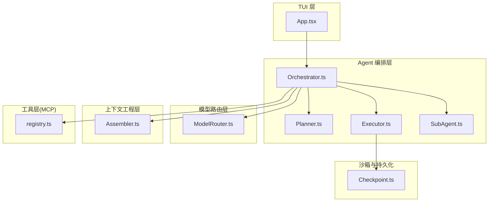

图表来源
- [src/tui/App.tsx:1-284](file://src/tui/App.tsx#L1-L284)
- [src/agent/Orchestrator.ts:1-255](file://src/agent/Orchestrator.ts#L1-L255)
- [src/agent/Planner.ts:1-176](file://src/agent/Planner.ts#L1-L176)
- [src/agent/Executor.ts:1-234](file://src/agent/Executor.ts#L1-L234)
- [src/agent/SubAgent.ts:1-148](file://src/agent/SubAgent.ts#L1-L148)
- [src/router/ModelRouter.ts:1-290](file://src/router/ModelRouter.ts#L1-L290)
- [src/context/Assembler.ts:1-184](file://src/context/Assembler.ts#L1-L184)
- [src/tools/registry.ts:1-96](file://src/tools/registry.ts#L1-L96)
- [src/sandbox/Checkpoint.ts:1-182](file://src/sandbox/Checkpoint.ts#L1-L182)

## 详细组件分析

### 入口与运行期装配
- 解析 CLI 参数（版本、帮助、权限模式、最大迭代、非交互模式等）。
- 加载项目配置（默认值 + TOML 覆盖），合并到运行时配置。
- 创建 Orchestrator，注入 onEvent 回调与 requestApproval 桥接。
- 在非交互模式下直接提交任务并打印花费；在 TUI 模式下渲染 App 组件。

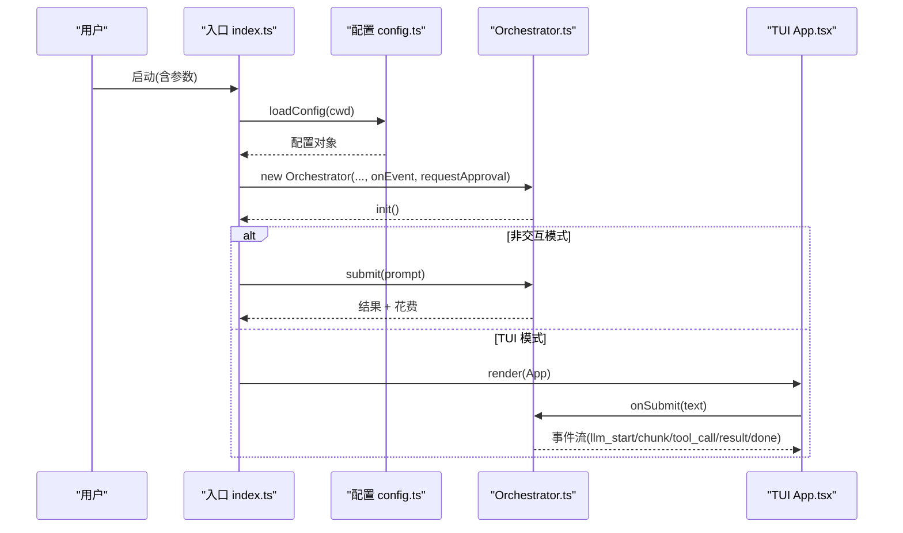

图表来源
- [src/index.ts:1-118](file://src/index.ts#L1-L118)
- [src/config.ts:1-132](file://src/config.ts#L1-L132)
- [src/agent/Orchestrator.ts:1-255](file://src/agent/Orchestrator.ts#L1-L255)
- [src/tui/App.tsx:1-284](file://src/tui/App.tsx#L1-L284)

章节来源
- [src/index.ts:1-118](file://src/index.ts#L1-L118)
- [src/config.ts:1-132](file://src/config.ts#L1-L132)

### Agent 编排层（Orchestrator/Planner/Executor/SubAgent）
- Orchestrator：维护会话状态、阶段切换、事件广播、工具上下文、成本追踪、检查点。
- Planner：只读工具（read/grep）探索，生成结构化计划（JSON TodoList），等待用户审批。
- Executor：ReAct Loop，权限检查（含危险命令强制审批）、工具执行、结果注入、迭代上限、todo 状态推进。
- SubAgent：独立上下文窗口、受限工具集、仅返回摘要，防止递归爆炸。

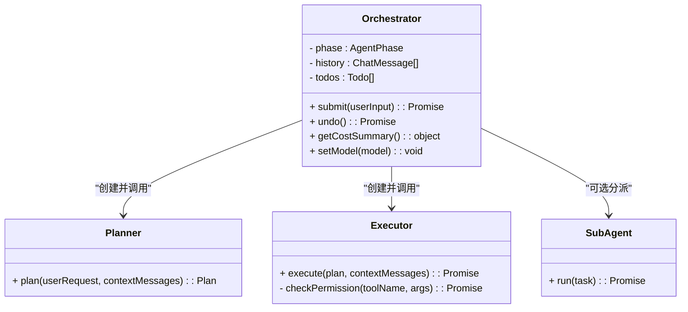

图表来源
- [src/agent/Orchestrator.ts:1-255](file://src/agent/Orchestrator.ts#L1-L255)
- [src/agent/Planner.ts:1-176](file://src/agent/Planner.ts#L1-L176)
- [src/agent/Executor.ts:1-234](file://src/agent/Executor.ts#L1-L234)
- [src/agent/SubAgent.ts:1-148](file://src/agent/SubAgent.ts#L1-L148)

章节来源
- [src/agent/Orchestrator.ts:1-255](file://src/agent/Orchestrator.ts#L1-L255)
- [src/agent/Planner.ts:1-176](file://src/agent/Planner.ts#L1-L176)
- [src/agent/Executor.ts:1-234](file://src/agent/Executor.ts#L1-L234)
- [src/agent/SubAgent.ts:1-148](file://src/agent/SubAgent.ts#L1-L148)

### 模型路由层（ModelRouter）
- Provider 抽象：Anthropic/OpenAI/Ollama/DeepSeek/Custom，统一 LanguageModel 获取。
- 角色化模型选择：planner/executor/summarizer/verifier，支持 auto 模式按可用 Provider 择优。
- 降级链：高档不可用时自动降档，保证可用性。
- 成本追踪：记录 token 用量与估算费用，供 TUI 显示。

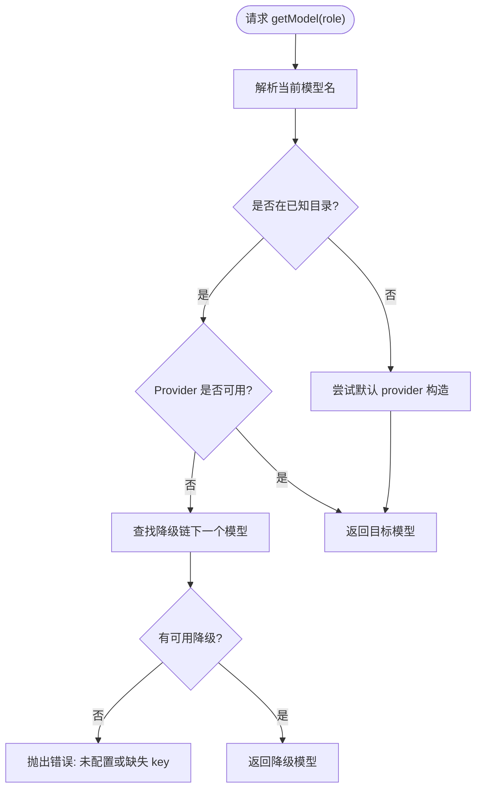

图表来源
- [src/router/ModelRouter.ts:1-290](file://src/router/ModelRouter.ts#L1-L290)

章节来源
- [src/router/ModelRouter.ts:1-290](file://src/router/ModelRouter.ts#L1-L290)

### 上下文工程层（ContextAssembler）
- 三层上下文：L1 静态（system prompt、规则、git 状态、项目骨架）、L2 任务（本轮输入、todos、压缩历史）、L3 检索（按需拉取）。
- 历史压缩：保留近期完整轮次，早期摘要；工具结果分级丢弃。
- Token 预算：超预算时按优先级裁剪，确保不爆窗口。

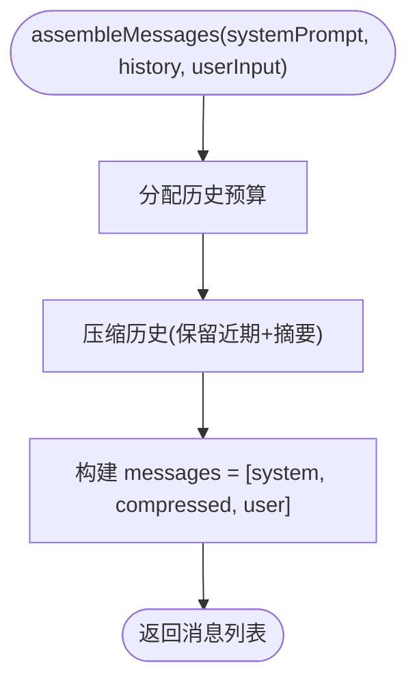

图表来源
- [src/context/Assembler.ts:1-184](file://src/context/Assembler.ts#L1-L184)

章节来源
- [src/context/Assembler.ts:1-184](file://src/context/Assembler.ts#L1-L184)

### 工具层（MCP-native）
- 注册中心：集中注册 read/edit/bash/grep，支持阶段过滤（plan/execute）与 AI SDK 兼容定义。
- 执行路径：Orchestrator → ToolRegistry.execute → 具体工具实现（in-process）。
- 扩展点：外部 MCP Server 可通过 stdio transport 接入，Agent loop 零改动。

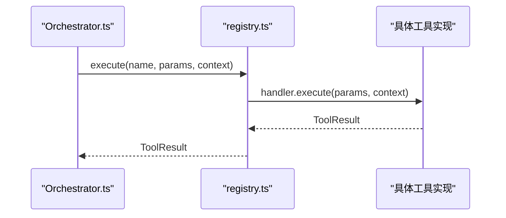

图表来源
- [src/tools/registry.ts:1-96](file://src/tools/registry.ts#L1-L96)
- [src/agent/Orchestrator.ts:1-255](file://src/agent/Orchestrator.ts#L1-L255)

章节来源
- [src/tools/registry.ts:1-96](file://src/tools/registry.ts#L1-L96)

### TUI 层（Ink + React）
- 事件驱动：接收 llm_start/chunk/tool_call/tool_result/todo_update/done/error 等事件，更新 UI。
- 审批交互：将 requestApproval 桥接到 UI，支持批准/拒绝/查看 diff。
- 斜杠命令：/model /cost /clear /undo /history /help 等快捷操作。

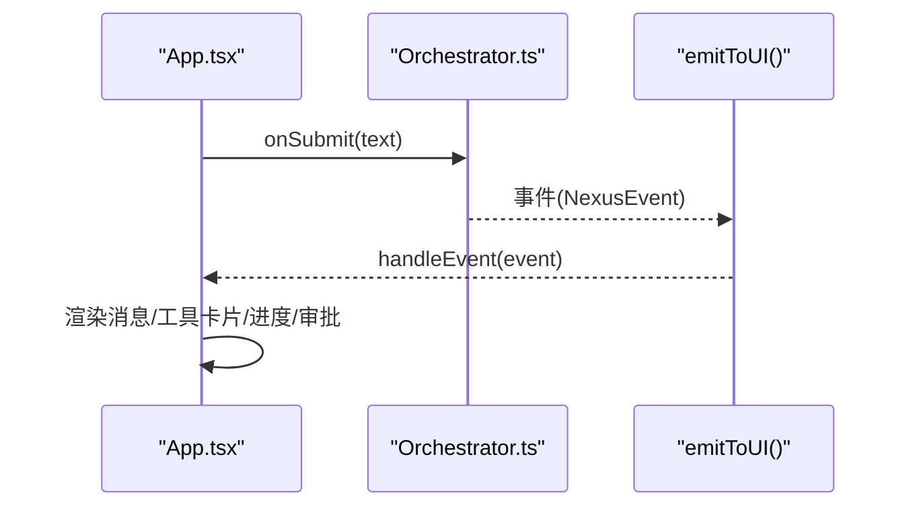

图表来源
- [src/tui/App.tsx:1-284](file://src/tui/App.tsx#L1-L284)
- [src/agent/Orchestrator.ts:1-255](file://src/agent/Orchestrator.ts#L1-L255)

章节来源
- [src/tui/App.tsx:1-284](file://src/tui/App.tsx#L1-L284)

### 检查点与回滚（Checkpoint）
- 每个 edit 成功后自动提交到 checkpoint 分支，记录步骤、commit hash、变更文件。
- 支持 undo/jumpTo/mergeToWorkBranch，让 agent 犯错变为“一键回滚”。

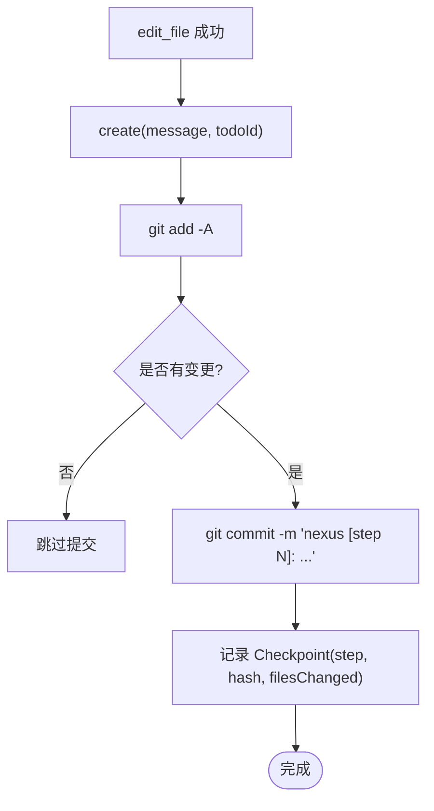

图表来源
- [src/sandbox/Checkpoint.ts:1-182](file://src/sandbox/Checkpoint.ts#L1-L182)

章节来源
- [src/sandbox/Checkpoint.ts:1-182](file://src/sandbox/Checkpoint.ts#L1-L182)

## 依赖关系分析
- 运行时与包管理：Bun 作为运行时，TypeScript 编译，Ink/React 用于 TUI，Vercel AI SDK 与 @ai-sdk/* 用于多 Provider 抽象，@modelcontextprotocol/sdk 用于 MCP，better-sqlite3 用于持久化，smol-toml 用于配置解析，zod 用于类型校验。
- 模块耦合：Orchestrator 聚合 Router、Assembler、ToolRegistry、Checkpoint；Planner/Executor/SubAgent 依赖 ToolRegistry 与 Router；TUI 通过事件总线与 Orchestrator 松耦合。

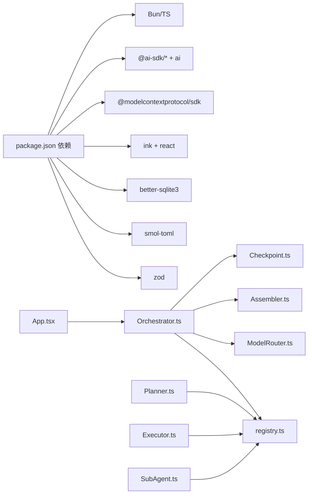

图表来源
- [package.json:1-43](file://package.json#L1-L43)
- [src/agent/Orchestrator.ts:1-255](file://src/agent/Orchestrator.ts#L1-L255)
- [src/router/ModelRouter.ts:1-290](file://src/router/ModelRouter.ts#L1-L290)
- [src/context/Assembler.ts:1-184](file://src/context/Assembler.ts#L1-L184)
- [src/tools/registry.ts:1-96](file://src/tools/registry.ts#L1-L96)
- [src/sandbox/Checkpoint.ts:1-182](file://src/sandbox/Checkpoint.ts#L1-L182)
- [src/tui/App.tsx:1-284](file://src/tui/App.tsx#L1-L284)

章节来源
- [package.json:1-43](file://package.json#L1-L43)

## 性能与可扩展性
- 性能特征：LLM 延迟主导，工具层尽量轻量；read_file 大文件截断、bash 超时与输出截断、grep 使用 ripgrep 子进程；上下文压缩避免长会话爆窗口。
- 可扩展性：
  - 工具层 MCP 原生，支持外部 MCP Server 接入与未来抽离至 Go 引擎（bash 等）零改动迁移。
  - 子 Agent 限一层，避免递归爆炸；独立上下文窗口节省主 Agent 资源。
  - 模型路由支持多 Provider 与降级链，提升鲁棒性与成本可控性。
- 部署拓扑：单进程 CLI/TUI 应用，依赖 git、ripgrep；SQLite 本地存储；可选 Ollama 本地推理。

[本节为通用指导，无需特定文件引用]

## 故障排查指南
- 流式与 tool calling 边界：不同 Provider 对流式返回 tool_call 的方式存在差异，需在 Phase 1 用真实 Provider 测试透。
- Ink 全屏 vs 行模式：审批卡片需要全屏交互，流式输出适合行模式，混用需谨慎。
- Windows 路径与换行符：内部统一 POSIX，bash 工具锁定 Git Bash。
- 大文件读取：read_file 默认截断，提示使用 grep 定位具体内容。
- 僵尸进程：bash 超时后需 kill 整个进程组，避免残留。
- MCP SDK 版本：锁定版本，升级时跑评估用例。
- 成本失控：设置每会话成本上限，超限暂停并询问用户。

章节来源
- [DESIGN.md:729-746](file://DESIGN.md#L729-L746)

## 结论
Nexus 以分层架构与 MCP 原生工具为核心，结合 Plan/Execute 双阶段、ReAct Loop 与子 Agent 编排，实现了高可靠、可回滚、可观测的终端编程助手。通过模型路由与上下文工程，系统在能力与成本之间取得平衡，并为未来引入 Go 引擎与语义检索预留了平滑迁移路径。

[本节为总结，无需特定文件引用]

## 附录

### 技术栈与版本兼容性
- 运行时：Bun >= 1.1.0
- 语言：TypeScript
- TUI：Ink + React
- LLM SDK：Vercel AI SDK + @ai-sdk/*
- MCP：@modelcontextprotocol/sdk
- 数据库：better-sqlite3
- 配置：smol-toml
- 其他：chalk、diff、zod

章节来源
- [package.json:1-43](file://package.json#L1-L43)
- [README.md:19-63](file://README.md#L19-L63)

### 系统上下文图（概念）
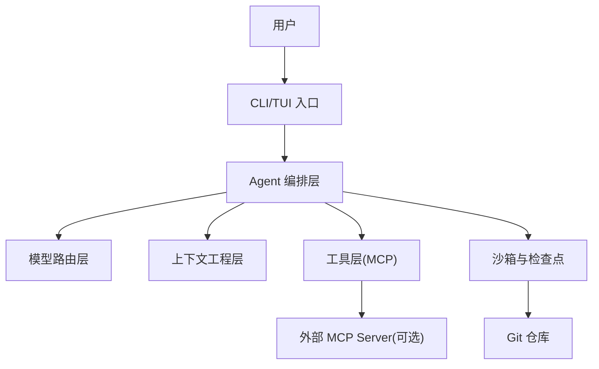

[此图为概念示意，不映射具体源码文件]