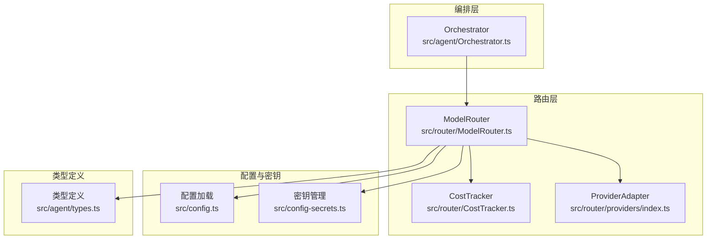
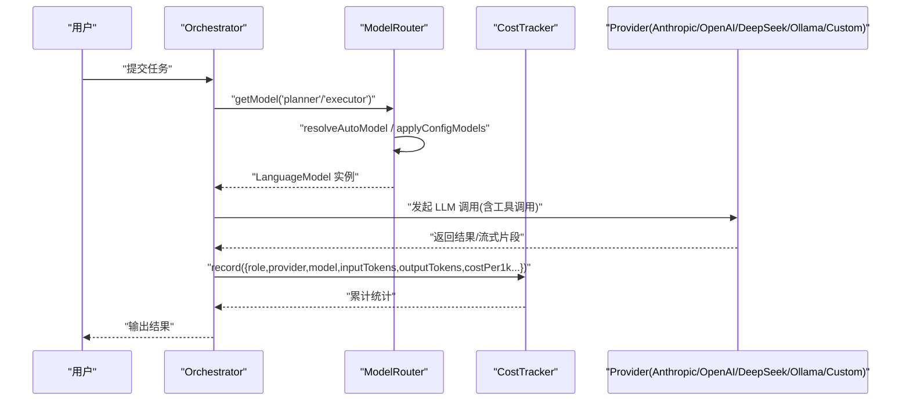
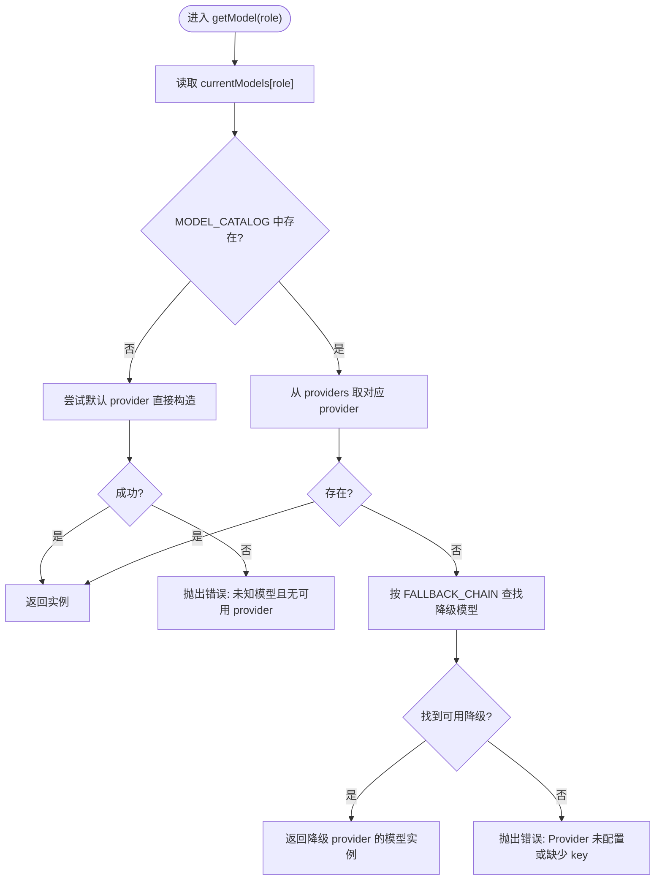
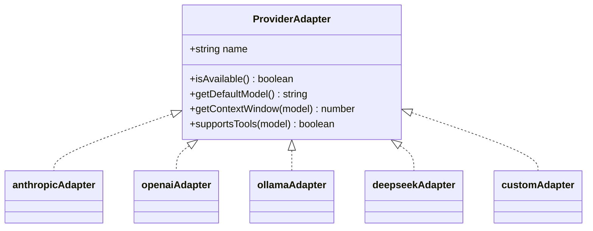
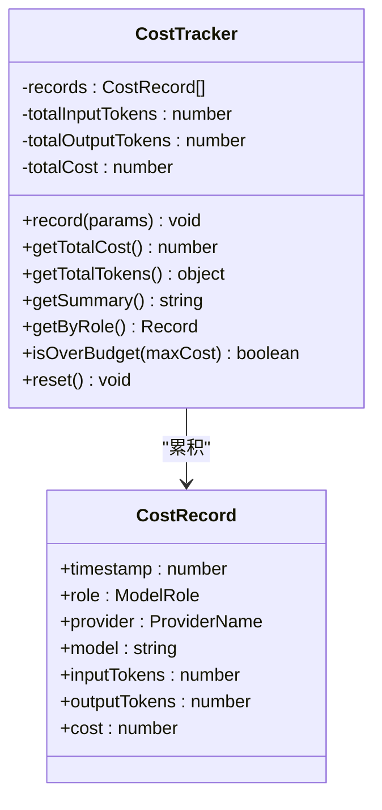
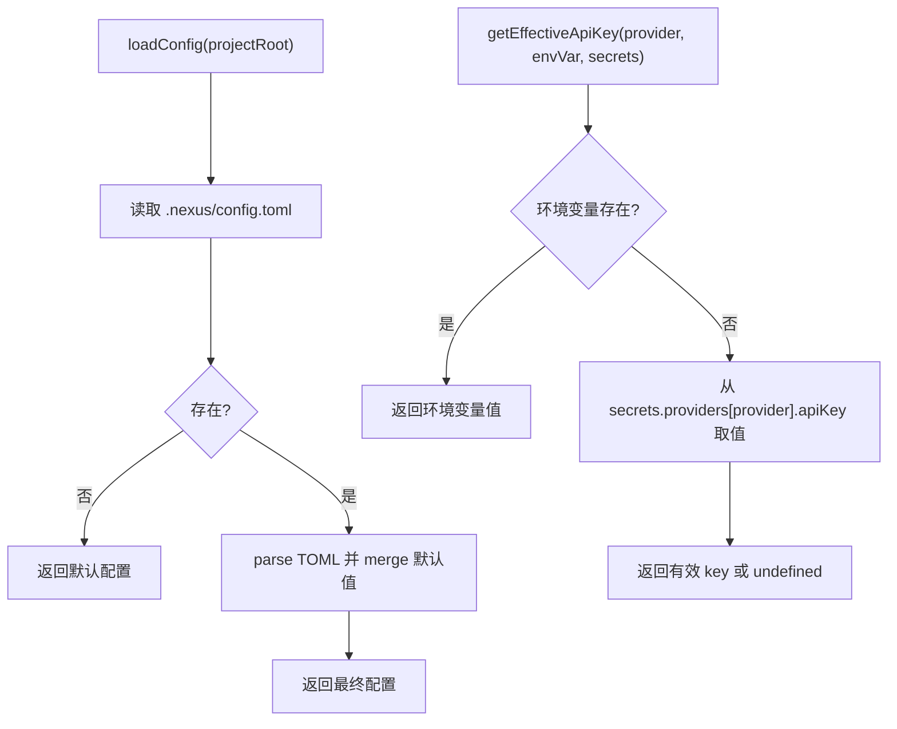
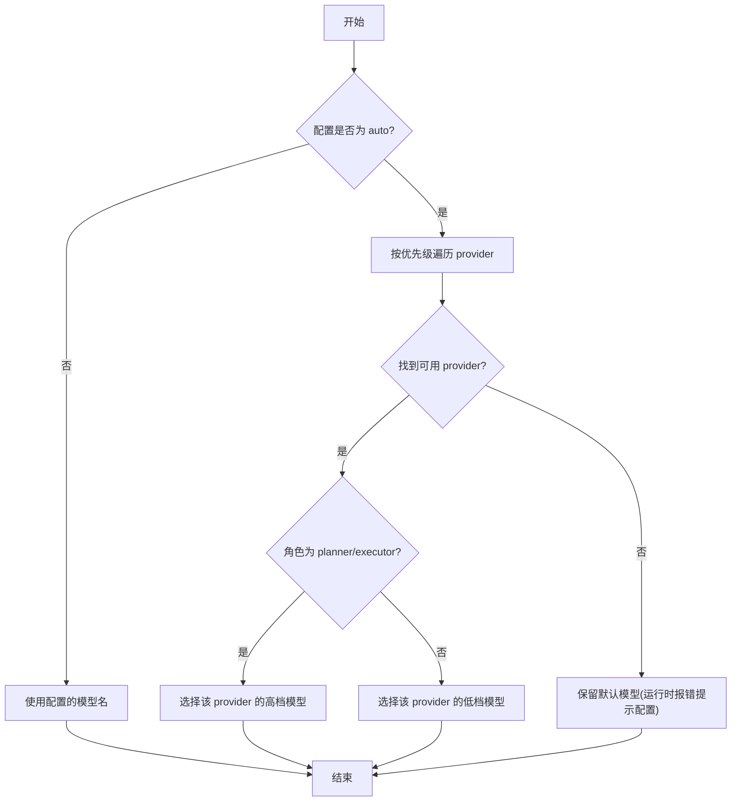
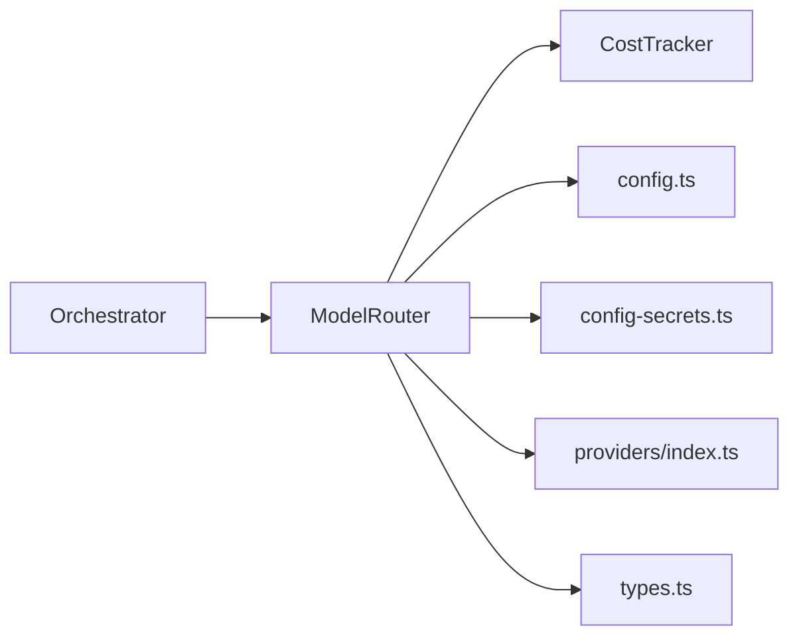

# 模型路由架构

<cite>
**本文引用的文件**   
- [ModelRouter.ts](file://src/router/ModelRouter.ts)
- [CostTracker.ts](file://src/router/CostTracker.ts)
- [providers/index.ts](file://src/router/providers/index.ts)
- [config.ts](file://src/config.ts)
- [config-secrets.ts](file://src/config-secrets.ts)
- [types.ts](file://src/agent/types.ts)
- [Orchestrator.ts](file://src/agent/Orchestrator.ts)
- [README.md](file://README.md)
</cite>

## 目录
1. [简介](#简介)
2. [项目结构](#项目结构)
3. [核心组件](#核心组件)
4. [架构总览](#架构总览)
5. [详细组件分析](#详细组件分析)
6. [依赖关系分析](#依赖关系分析)
7. [性能与成本考量](#性能与成本考量)
8. [故障排查指南](#故障排查指南)
9. [结论](#结论)
10. [附录：自定义 Provider 实现指南](#附录自定义-provider-实现指南)

## 简介
本架构文档聚焦于 Nexus 的“模型路由系统”，围绕以下目标展开：
- Provider 抽象层设计与多提供商支持策略（Anthropic、OpenAI、DeepSeek、Ollama，以及通用 OpenAI 兼容 Custom）
- 路由策略：按任务阶段选择不同模型档位，兼顾能力与成本
- 降级与重试机制：在 Provider 不可用或失败时自动回退到备选模型
- 成本追踪系统：记录每次调用的 token 用量与估算费用，提供会话级汇总
- Vercel AI SDK 集成方式与 tool calling 格式适配
- 路由决策流程图与错误处理策略
- 自定义 Provider 的实现指南与配置示例

## 项目结构
模型路由相关代码集中在 router 子模块，配合配置加载与密钥管理模块，由编排器 Orchestrator 注入使用。

图表来源
- [ModelRouter.ts:101-165](file://src/router/ModelRouter.ts#L101-L165)
- [CostTracker.ts:8-42](file://src/router/CostTracker.ts#L8-L42)
- [providers/index.ts:9-70](file://src/router/providers/index.ts#L9-L70)
- [config.ts:11-60](file://src/config.ts#L11-L60)
- [config-secrets.ts:117-131](file://src/config-secrets.ts#L117-L131)
- [types.ts:84-107](file://src/agent/types.ts#L84-L107)
- [Orchestrator.ts:60-86](file://src/agent/Orchestrator.ts#L60-L86)

章节来源
- [README.md:12-16](file://README.md#L12-L16)
- [Orchestrator.ts:60-86](file://src/agent/Orchestrator.ts#L60-L86)

## 核心组件
- ModelRouter：负责根据角色（planner/executor/summarizer/verifier）选择具体模型实例，维护 provider 映射、默认模型、降级链、上下文窗口查询等。
- CostTracker：记录每次 LLM 调用的输入/输出 token 数与估算成本，提供会话级统计与预算检查。
- ProviderAdapter：对 Anthropic/OpenAI/Ollama/DeepSeek/Custom 的能力元数据与可用性进行统一抽象。
- 配置与密钥：从 .nexus/config.toml 加载配置，结合全局 ~/.nexus/secrets.toml 与环境变量解析有效 API Key。
- Orchestrator：在 Plan/Execute 双阶段中通过 ModelRouter 获取对应角色的 LanguageModel 实例并驱动调用。

章节来源
- [ModelRouter.ts:101-227](file://src/router/ModelRouter.ts#L101-L227)
- [CostTracker.ts:8-42](file://src/router/CostTracker.ts#L8-L42)
- [providers/index.ts:21-70](file://src/router/providers/index.ts#L21-L70)
- [config.ts:62-98](file://src/config.ts#L62-L98)
- [config-secrets.ts:42-59](file://src/config-secrets.ts#L42-L59)
- [types.ts:84-107](file://src/agent/types.ts#L84-L107)
- [Orchestrator.ts:120-148](file://src/agent/Orchestrator.ts#L120-L148)

## 架构总览
下图展示了从编排器到模型路由、再到各 Provider 的调用路径，以及成本追踪的接入点。

图表来源
- [Orchestrator.ts:120-148](file://src/agent/Orchestrator.ts#L120-L148)
- [ModelRouter.ts:167-227](file://src/router/ModelRouter.ts#L167-L227)
- [CostTracker.ts:14-42](file://src/router/CostTracker.ts#L14-L42)

## 详细组件分析

### ModelRouter：多提供商路由与降级
- 初始化 Provider：根据配置与密钥，动态创建 Anthropic、OpenAI、Ollama（OpenAI 兼容）、DeepSeek（OpenAI 兼容）、Custom（任意 OpenAI 兼容）客户端。
- 角色模型选择：支持显式指定或 auto 模式；auto 模式下按优先级选择第一个可用 provider 的高/低档模型（planner/executor 选高档，summarizer/verifier 选低档）。
- 降级链：当首选 provider 不可用时，按预设顺序回退至备选模型。
- 未知模型兜底：若模型不在已知目录，尝试以默认 provider 直接构造；否则抛出明确错误。
- 上下文窗口与能力查询：暴露 getContextWindow、getAvailableProviders、getAvailableModels 等接口供上层使用。

图表来源
- [ModelRouter.ts:204-243](file://src/router/ModelRouter.ts#L204-L243)
- [ModelRouter.ts:93-100](file://src/router/ModelRouter.ts#L93-L100)
- [ModelRouter.ts:15-83](file://src/router/ModelRouter.ts#L15-L83)

章节来源
- [ModelRouter.ts:101-227](file://src/router/ModelRouter.ts#L101-L227)
- [ModelRouter.ts:181-202](file://src/router/ModelRouter.ts#L181-L202)
- [ModelRouter.ts:245-263](file://src/router/ModelRouter.ts#L245-L263)

### Provider 抽象层与多提供商支持
- 适配器职责：声明 name、isAvailable、getDefaultModel、getContextWindow、supportsTools 等元信息，屏蔽厂商差异。
- 内置适配器：
  - Anthropic：原生 SDK 集成，默认高窗长，支持工具调用。
  - OpenAI：原生 SDK 集成，默认高窗长，支持工具调用。
  - Ollama：本地服务，假设可用，默认不支持工具调用。
  - DeepSeek：OpenAI 兼容接口，部分模型不支持工具调用。
  - Custom：任意 OpenAI 兼容端点，需同时提供 base URL 与 API Key。
- 路由层通过 createAnthropic/createOpenAI 构建实际客户端，并在 initProviders 中完成注册。

图表来源
- [providers/index.ts:9-70](file://src/router/providers/index.ts#L9-L70)

章节来源
- [providers/index.ts:21-70](file://src/router/providers/index.ts#L21-L70)
- [ModelRouter.ts:118-165](file://src/router/ModelRouter.ts#L118-L165)

### 成本追踪系统
- 记录维度：角色、provider、模型、输入/输出 token、单价、计算出的单次成本。
- 聚合能力：总花费、总 token、按角色分组统计、是否超预算、重置。
- 集成点：在编排层或调用封装处，依据路由信息传入 costPer1kInput/costPer1kOutput 进行记录。

图表来源
- [CostTracker.ts:8-42](file://src/router/CostTracker.ts#L8-L42)
- [types.ts:99-107](file://src/agent/types.ts#L99-L107)

章节来源
- [CostTracker.ts:8-96](file://src/router/CostTracker.ts#L8-L96)
- [types.ts:99-107](file://src/agent/types.ts#L99-L107)

### 配置与密钥管理
- 配置加载：从 .nexus/config.toml 合并默认值，支持为每个角色指定模型或 auto；可配置各 provider 的 apiKeyEnv/baseUrl/defaultModel。
- 密钥管理：优先环境变量，其次全局 ~/.nexus/secrets.toml，最后项目级 secrets（兼容旧版）；提供 getEffectiveApiKey 统一解析。
- 状态检测：提供 hasAnyApiKey、getProviderStatus 等辅助方法用于 UI 展示与引导。

图表来源
- [config.ts:62-98](file://src/config.ts#L62-L98)
- [config-secrets.ts:117-131](file://src/config-secrets.ts#L117-L131)

章节来源
- [config.ts:11-60](file://src/config.ts#L11-L60)
- [config.ts:62-98](file://src/config.ts#L62-L98)
- [config-secrets.ts:42-59](file://src/config-secrets.ts#L42-L59)
- [config-secrets.ts:117-131](file://src/config-secrets.ts#L117-L131)

### Vercel AI SDK 集成与 Tool Calling 适配
- 集成方式：通过 @ai-sdk/anthropic 与 @ai-sdk/openai 提供的 createAnthropic/createOpenAI 工厂函数创建语言模型客户端；Ollama/DeepSeek/Custom 均通过 OpenAI 兼容接口接入。
- Tool Calling 适配：
  - 路由层在 MODEL_CATALOG 中标注 supportsTools 能力，便于上层决定是否启用工具调用。
  - 适配器层针对特定模型（如 DeepSeek reasoner）限制 supportsTools，避免不兼容调用。
  - 编排层在计划/执行阶段通过工具注册表与工具上下文组织消息，交由 LanguageModel 处理工具调用。
- 注意：当前路由层未包含具体的 tool calling 协议转换逻辑，主要依赖 Vercel AI SDK 的统一抽象；如需扩展非 OpenAI 兼容协议，可在 ProviderAdapter 层补充适配。

章节来源
- [ModelRouter.ts:15-83](file://src/router/ModelRouter.ts#L15-L83)
- [providers/index.ts:21-70](file://src/router/providers/index.ts#L21-L70)
- [Orchestrator.ts:120-148](file://src/agent/Orchestrator.ts#L120-L148)

### 路由决策流程（按任务阶段选择模型档位）
- 显式模式：用户在配置中为 planner/executor/summarizer/verifier 指定具体模型名。
- Auto 模式：按 provider 优先级（anthropic > deepseek > openai > custom > ollama）选择首个可用的 provider，并根据角色选择高档或低档模型。
- 降级链：当首选 provider 不可用时，按预置顺序回退到备选模型，直至成功或全部失败。

图表来源
- [ModelRouter.ts:167-202](file://src/router/ModelRouter.ts#L167-L202)
- [ModelRouter.ts:85-91](file://src/router/ModelRouter.ts#L85-L91)

章节来源
- [ModelRouter.ts:167-202](file://src/router/ModelRouter.ts#L167-L202)

### 错误处理策略
- 未知模型：若模型不在已知目录且无可用 provider，抛出明确错误，提示配置缺失。
- Provider 不可用：当所选 provider 未配置或缺少 API Key，尝试降级；若无降级路径，抛出错误。
- 预算控制：CostTracker 提供 isOverBudget 判断，上层可根据阈值中断或切换更便宜的模型。
- 建议增强：在调用封装层增加指数退避重试、超时控制与熔断开关，以提升鲁棒性。

章节来源
- [ModelRouter.ts:209-227](file://src/router/ModelRouter.ts#L209-L227)
- [CostTracker.ts:78-81](file://src/router/CostTracker.ts#L78-L81)

## 依赖关系分析
- Orchestrator 依赖 ModelRouter 获取角色对应的 LanguageModel 实例，并通过 CostTracker 记录成本。
- ModelRouter 依赖配置加载与密钥管理，动态初始化各 provider 客户端。
- ProviderAdapter 提供能力元数据，辅助路由决策与兼容性判断。
- 类型定义集中管理路由与成本相关的共享类型，保证一致性。

图表来源
- [Orchestrator.ts:60-86](file://src/agent/Orchestrator.ts#L60-L86)
- [ModelRouter.ts:101-165](file://src/router/ModelRouter.ts#L101-L165)
- [config.ts:62-98](file://src/config.ts#L62-L98)
- [config-secrets.ts:117-131](file://src/config-secrets.ts#L117-L131)
- [providers/index.ts:72-83](file://src/router/providers/index.ts#L72-L83)
- [types.ts:84-107](file://src/agent/types.ts#L84-L107)

章节来源
- [Orchestrator.ts:60-86](file://src/agent/Orchestrator.ts#L60-L86)
- [ModelRouter.ts:101-165](file://src/router/ModelRouter.ts#L101-L165)

## 性能与成本考量
- 模型档位选择：planner/executor 使用更强模型，summarizer/verifier 使用轻量模型，平衡质量与成本。
- 上下文窗口：通过 getContextWindow 控制上下文组装预算，避免超出模型限制。
- 成本预估：基于 costPer1kInput/costPer1kOutput 估算费用，结合 isOverBudget 进行预算保护。
- 优化建议：
  - 引入缓存与复用：对相同 prompt 的响应进行缓存，减少重复调用。
  - 批量与批处理：将多个小请求合并，降低网络开销。
  - 自适应降级：根据实时错误率与延迟动态调整降级链顺序。

## 故障排查指南
- 现象：提示“模型不在已知目录中，且无可用 provider”
  - 排查：确认 MODEL_CATALOG 是否包含该模型名，或检查是否有可用 provider。
  - 参考：[ModelRouter.ts:209-216](file://src/router/ModelRouter.ts#L209-L216)
- 现象：提示“Provider 未配置或 API key 缺失”
  - 排查：检查环境变量或 secrets 文件中对应 provider 的 api_key；确认 baseUrl 是否正确。
  - 参考：[ModelRouter.ts:218-224](file://src/router/ModelRouter.ts#L218-L224)
- 现象：成本超预算
  - 排查：查看 CostTracker 的 isOverBudget 返回值，必要时切换到更便宜模型或缩短上下文。
  - 参考：[CostTracker.ts:78-81](file://src/router/CostTracker.ts#L78-L81)
- 现象：Tool Calling 失败
  - 排查：确认模型 supportsTools 为 true；对于 DeepSeek reasoner 等不支持工具调用的模型，应切换至支持的模型。
  - 参考：[providers/index.ts:52-61](file://src/router/providers/index.ts#L52-L61)

章节来源
- [ModelRouter.ts:209-224](file://src/router/ModelRouter.ts#L209-L224)
- [CostTracker.ts:78-81](file://src/router/CostTracker.ts#L78-L81)
- [providers/index.ts:52-61](file://src/router/providers/index.ts#L52-L61)

## 结论
Nexus 的模型路由系统通过清晰的 Provider 抽象、灵活的角色模型选择与降级链、完善的成本追踪与配置管理，实现了多提供商的统一接入与稳定运行。结合 Vercel AI SDK 的标准化抽象，系统在保持可扩展性的同时，提供了良好的用户体验与成本控制能力。未来可在重试、熔断、缓存等方面进一步增强鲁棒性与效率。

## 附录：自定义 Provider 实现指南

### 步骤一：实现 ProviderAdapter
- 新增一个适配器对象，实现 name、isAvailable、getDefaultModel、getContextWindow、supportsTools。
- 在 getAvailableProviders/getProvider 中注册新适配器。

章节来源
- [providers/index.ts:9-20](file://src/router/providers/index.ts#L9-L20)
- [providers/index.ts:72-83](file://src/router/providers/index.ts#L72-L83)

### 步骤二：在路由层注册客户端
- 在 ModelRouter.initProviders 中添加对新 provider 的客户端创建逻辑（例如 createOpenAI 或 createAnthropic），并从配置/密钥中读取 apiKey 与 baseUrl。
- 在 MODEL_CATALOG 中登记新模型的 provider、model、成本与能力信息。

章节来源
- [ModelRouter.ts:118-165](file://src/router/ModelRouter.ts#L118-L165)
- [ModelRouter.ts:15-83](file://src/router/ModelRouter.ts#L15-L83)

### 步骤三：配置与密钥
- 在 .nexus/config.toml 中为新 provider 添加 providers 条目（apiKeyEnv/baseUrl/defaultModel）。
- 在全局 ~/.nexus/secrets.toml 中保存 api_key、base_url、default_model，或通过环境变量覆盖。

章节来源
- [config.ts:88-98](file://src/config.ts#L88-L98)
- [config-secrets.ts:62-91](file://src/config-secrets.ts#L62-L91)

### 步骤四：验证与测试
- 使用 getAvailableProviders/getAvailableModels 验证新 provider 是否被识别。
- 通过 setModel/getCurrentModel 切换模型，确保路由正确。
- 使用 CostTracker.record 模拟调用，验证成本统计正常。

章节来源
- [ModelRouter.ts:275-296](file://src/router/ModelRouter.ts#L275-L296)
- [CostTracker.ts:14-42](file://src/router/CostTracker.ts#L14-L42)