# Agent 编排器

<cite>
**本文引用的文件**   
- [Orchestrator.ts](file://src/agent/Orchestrator.ts)
- [Planner.ts](file://src/agent/Planner.ts)
- [Executor.ts](file://src/agent/Executor.ts)
- [SubAgent.ts](file://src/agent/SubAgent.ts)
- [types.ts](file://src/agent/types.ts)
- [registry.ts](file://src/tools/registry.ts)
- [Assembler.ts](file://src/context/Assembler.ts)
- [ModelRouter.ts](file://src/router/ModelRouter.ts)
- [Checkpoint.ts](file://src/sandbox/Checkpoint.ts)
- [config-secrets.ts](file://src/config-secrets.ts)
- [schemas.ts](file://src/tools/schemas.ts)
- [README.md](file://README.md)
- [DESIGN.md](file://DESIGN.md)
</cite>

## 目录
1. [简介](#简介)
2. [项目结构](#项目结构)
3. [核心组件](#核心组件)
4. [架构总览](#架构总览)
5. [详细组件分析](#详细组件分析)
6. [依赖关系分析](#依赖关系分析)
7. [性能考量](#性能考量)
8. [故障排查指南](#故障排查指南)
9. [结论](#结论)
10. [附录：API 使用示例与最佳实践](#附录api-使用示例与最佳实践)

## 简介
本技术文档聚焦 Nexus 的 Agent 编排器，围绕 Orchestrator 类的设计模式、生命周期管理、状态机与事件驱动架构展开。文档深入解释 Plan/Execute 双阶段工作流、子 Agent 分派机制（Planner、Executor、SubAgent），以及与模型路由、上下文工程、工具系统的集成方式。同时提供常见问题的解决方案与性能优化建议，兼顾初学者友好与资深开发者的技术深度。

## 项目结构
Nexus 采用分层模块化设计：
- 编排层：Orchestrator、Planner、Executor、SubAgent
- 工具层：MCP 工具注册与执行（read_file、edit_file、bash、grep）
- 上下文工程：三层上下文组装、Token 预算、历史压缩
- 模型路由：多 Provider、成本追踪、降级策略
- 沙箱与检查点：Git Checkpoint、命令安全守卫
- 配置与密钥：secrets.toml、环境变量优先级

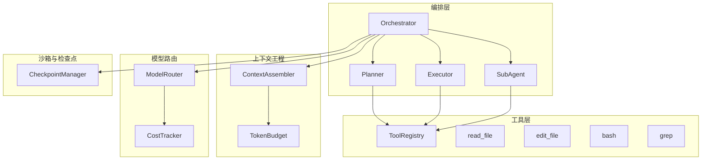

图表来源
- [Orchestrator.ts:1-260](file://src/agent/Orchestrator.ts#L1-L260)
- [Planner.ts:1-176](file://src/agent/Planner.ts#L1-L176)
- [Executor.ts:1-234](file://src/agent/Executor.ts#L1-L234)
- [SubAgent.ts:1-148](file://src/agent/SubAgent.ts#L1-L148)
- [registry.ts:1-96](file://src/tools/registry.ts#L1-L96)
- [Assembler.ts:1-184](file://src/context/Assembler.ts#L1-L184)
- [ModelRouter.ts:1-308](file://src/router/ModelRouter.ts#L1-L308)
- [Checkpoint.ts:1-182](file://src/sandbox/Checkpoint.ts#L1-L182)

章节来源
- [README.md:1-174](file://README.md#L1-L174)
- [DESIGN.md:1-774](file://DESIGN.md#L1-L774)

## 核心组件
- Orchestrator：编排核心，负责初始化、Plan/Execute 双阶段调度、事件分发、权限与审批、成本与模型切换、检查点回滚等。
- Planner：Plan 阶段 ReAct 循环，只读工具探索代码库并生成结构化计划（summary、todos、filesToModify、estimatedSteps）。
- Executor：Execute 阶段 ReAct 循环，逐步执行计划，权限校验、编辑后创建检查点、更新 todo 进度、错误与上限处理。
- SubAgent：子 Agent 分派，独立上下文窗口与工具集，限制写权限与递归深度，返回结果摘要与变更文件列表。
- ToolRegistry：工具注册中心，按阶段过滤工具、执行调用、生成 AI SDK 兼容的工具定义。
- ContextAssembler：三层上下文组装（系统提示、规则、工具说明、Git 状态、项目树、任务进度），带 Token 预算与历史压缩。
- ModelRouter：多 Provider 适配、角色化模型选择、自动降级、成本追踪、可用模型查询。
- CheckpointManager：Git 检查点管理，每次 edit 提交、支持 undo/jump/merge。

章节来源
- [Orchestrator.ts:1-260](file://src/agent/Orchestrator.ts#L1-L260)
- [Planner.ts:1-176](file://src/agent/Planner.ts#L1-L176)
- [Executor.ts:1-234](file://src/agent/Executor.ts#L1-L234)
- [SubAgent.ts:1-148](file://src/agent/SubAgent.ts#L1-L148)
- [registry.ts:1-96](file://src/tools/registry.ts#L1-L96)
- [Assembler.ts:1-184](file://src/context/Assembler.ts#L1-L184)
- [ModelRouter.ts:1-308](file://src/router/ModelRouter.ts#L1-L308)
- [Checkpoint.ts:1-182](file://src/sandbox/Checkpoint.ts#L1-L182)

## 架构总览
Nexus 以 Orchestrator 为中心，协调 Plan/Execute 双阶段与子 Agent 分派；通过 ModelRouter 进行多 Provider 路由与成本跟踪；借助 ContextAssembler 构建高质量上下文；依托 ToolRegistry 统一工具调用；利用 CheckpointManager 实现可回滚的执行历史。

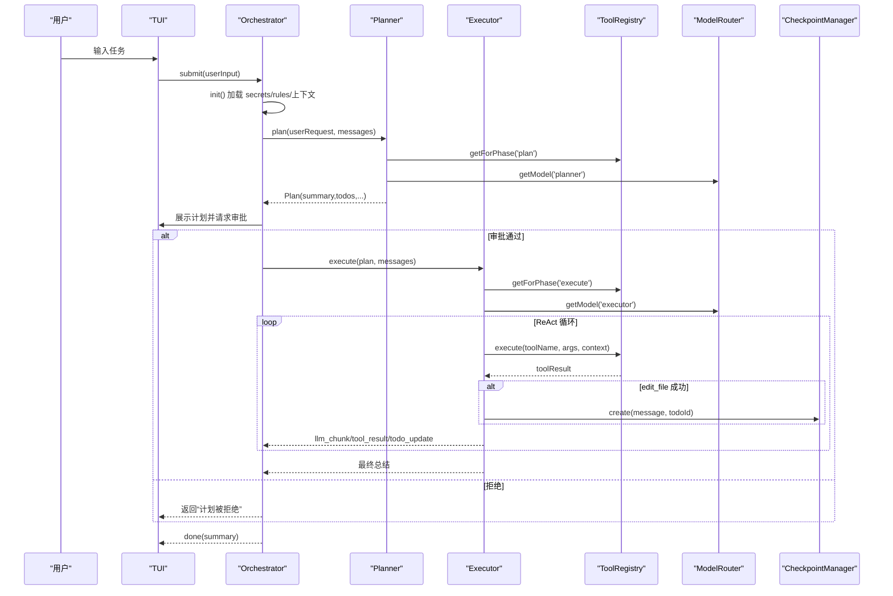

图表来源
- [Orchestrator.ts:88-180](file://src/agent/Orchestrator.ts#L88-L180)
- [Planner.ts:56-137](file://src/agent/Planner.ts#L56-L137)
- [Executor.ts:51-165](file://src/agent/Executor.ts#L51-L165)
- [registry.ts:44-82](file://src/tools/registry.ts#L44-L82)
- [ModelRouter.ts:205-227](file://src/router/ModelRouter.ts#L205-L227)
- [Checkpoint.ts:73-116](file://src/sandbox/Checkpoint.ts#L73-L116)

## 详细组件分析

### Orchestrator：编排核心与生命周期
- 初始化流程：加载 secrets、初始化 ModelRouter、加载项目规则、构建 ContextAssembler、可选初始化 Git Checkpoint。
- 主入口 submit：构建系统提示与消息，根据 skipPlan 决定直接执行或 Plan→Execute；记录历史、发射事件、设置阶段为 done。
- Plan→Execute：创建 Planner，生成计划，等待用户审批；通过后创建 Executor 执行计划，更新 todos 并返回结果。
- 中断与回滚：abort 标记中断；undo 调用 CheckpointManager 回滚到上一个检查点。
- 模型与成本：getCurrentModel/setModel/getAvailableModels；getCostSummary 汇总 token 与成本。
- 上下文清理：clearContext 清空历史与 todos；getHistory 获取用户历史摘要。

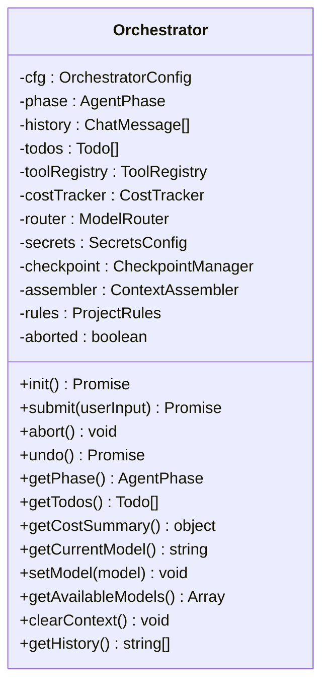

图表来源
- [Orchestrator.ts:38-259](file://src/agent/Orchestrator.ts#L38-L259)

章节来源
- [Orchestrator.ts:1-260](file://src/agent/Orchestrator.ts#L1-L260)

### Planner：Plan 阶段与只读工具
- ReAct 循环：仅暴露只读工具（read/grep），通过 generateText 迭代调用工具，收集结果并继续推理。
- 输出解析：尝试从 JSON 代码块提取结构化计划；失败则回退为简单三步计划。
- 事件与审计：llm_start/llm_done、tool_call/tool_result 事件上报。

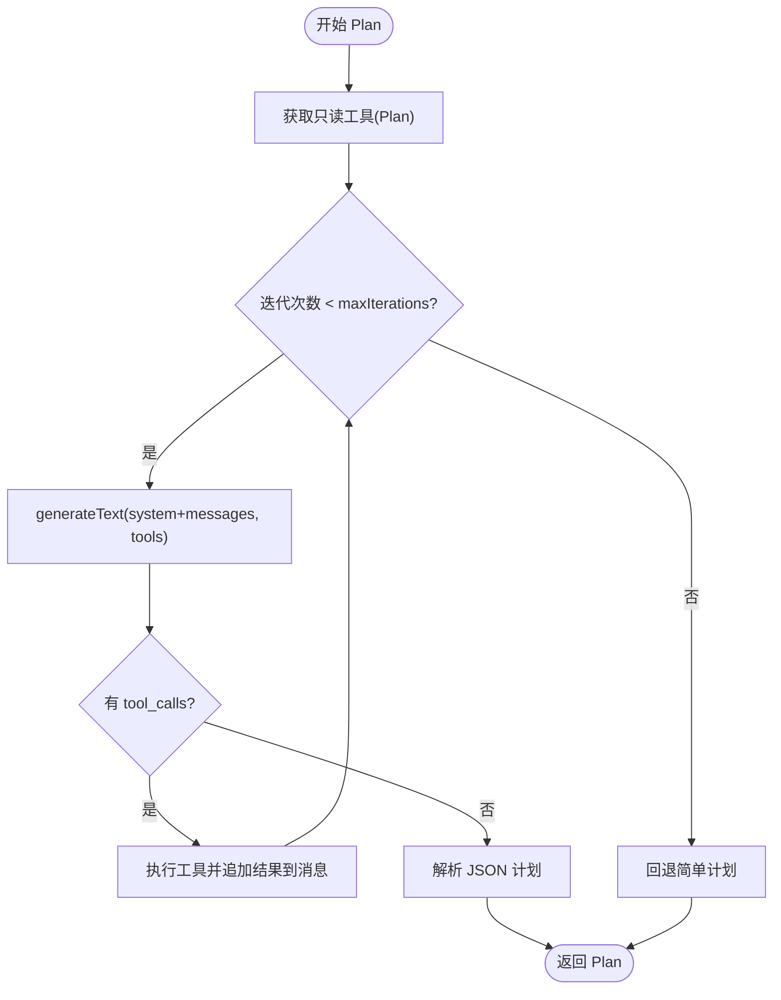

图表来源
- [Planner.ts:56-137](file://src/agent/Planner.ts#L56-L137)
- [Planner.ts:140-174](file://src/agent/Planner.ts#L140-L174)

章节来源
- [Planner.ts:1-176](file://src/agent/Planner.ts#L1-L176)

### Executor：Execute 阶段与权限控制
- ReAct 循环：暴露全部工具，逐轮调用 LLM，处理 tool_calls；无 tool_calls 时结束并输出总结。
- 权限检查：根据 permissionMode 与危险命令强制审批策略决定是否允许执行。
- 检查点：edit_file 成功后创建 Git checkpoint，便于回滚。
- Todo 进度：edit_file 将 pending 转为 in_progress；非测试 bash 成功后标记 complete。
- 上限处理：达到最大迭代次数时输出当前进度并上报 error 事件。

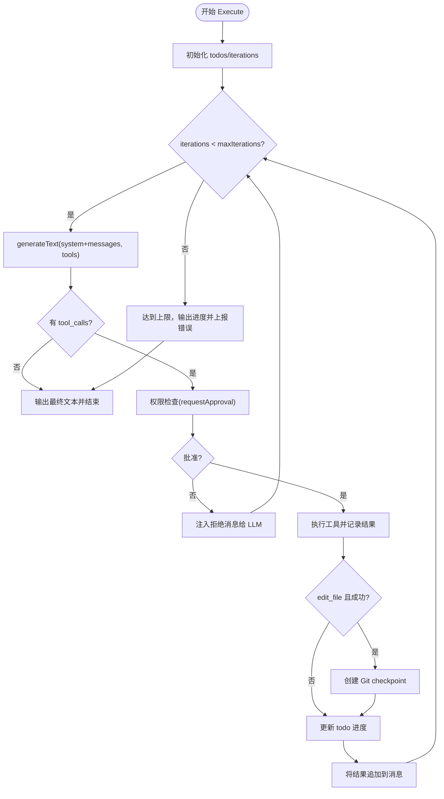

图表来源
- [Executor.ts:51-165](file://src/agent/Executor.ts#L51-L165)
- [Executor.ts:168-196](file://src/agent/Executor.ts#L168-L196)
- [Executor.ts:199-215](file://src/agent/Executor.ts#L199-L215)

章节来源
- [Executor.ts:1-234](file://src/agent/Executor.ts#L1-L234)

### SubAgent：子 Agent 分派与约束
- 工具集选择：根据 writable 决定 phase（plan/execute），可按 tools 列表进一步过滤。
- 独立上下文：子 Agent 拥有独立消息历史与上下文窗口，仅返回最终摘要与变更文件列表。
- 约束：默认关闭写权限，需显式授权；深度限制 1 层，避免递归爆炸。
- 工具定义：dispatch_subagent 作为特殊工具暴露给主 Agent 的 LLM。

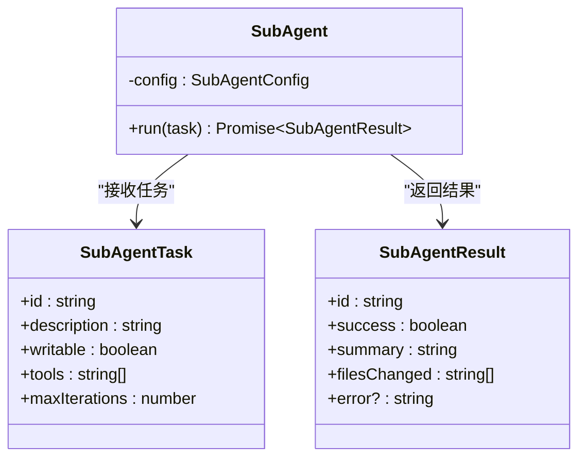

图表来源
- [SubAgent.ts:20-118](file://src/agent/SubAgent.ts#L20-L118)
- [SubAgent.ts:122-148](file://src/agent/SubAgent.ts#L122-L148)

章节来源
- [SubAgent.ts:1-148](file://src/agent/SubAgent.ts#L1-L148)

### 工具系统与 MCP 集成
- ToolRegistry：注册内置工具（read/edit/bash/grep），按阶段过滤，生成 AI SDK 兼容参数定义，执行工具调用。
- Schema：Zod schema 定义工具输入参数，确保类型安全与一致性。
- 工具上下文：projectRoot、callId、maxReadLines、maxOutputBytes、bashTimeout 等限制。

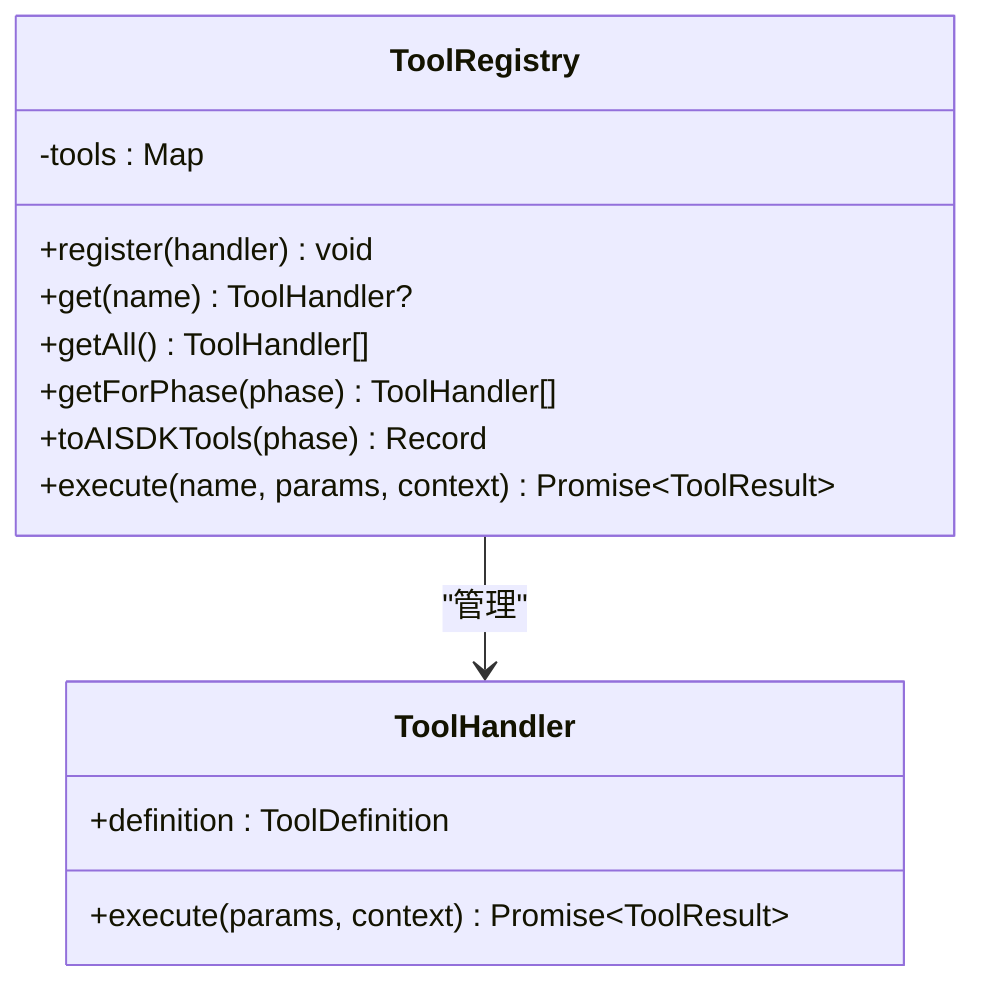

图表来源
- [registry.ts:25-82](file://src/tools/registry.ts#L25-L82)
- [schemas.ts:1-40](file://src/tools/schemas.ts#L1-L40)

章节来源
- [registry.ts:1-96](file://src/tools/registry.ts#L1-L96)
- [schemas.ts:1-40](file://src/tools/schemas.ts#L1-L40)

### 上下文工程与 Token 预算
- ContextAssembler：构建 system prompt（系统原则、项目规则、工具说明、Git 状态、项目树、任务进度），组装消息并压缩历史。
- TokenBudget：基于模型上下文窗口与预算比例分配历史长度，超预算裁剪。
- 历史压缩：保留近期完整对话，早期内容摘要化；工具结果分级保留策略。

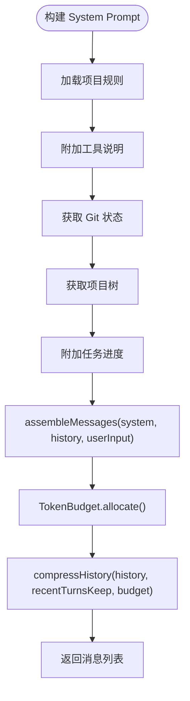

图表来源
- [Assembler.ts:56-116](file://src/context/Assembler.ts#L56-L116)

章节来源
- [Assembler.ts:1-184](file://src/context/Assembler.ts#L1-L184)

### 模型路由与成本追踪
- ModelRouter：初始化各 Provider（Anthropic/OpenAI/Ollama/DeepSeek/Custom），应用配置模型或自动选择；getModel(role) 返回 LanguageModel；支持降级链与重试。
- CostTracker：记录每次调用的 token 数与估算成本，会话结束时汇总。
- 能力与上下文窗口：不同模型支持工具与流式能力不同，影响工具调用与交互体验。

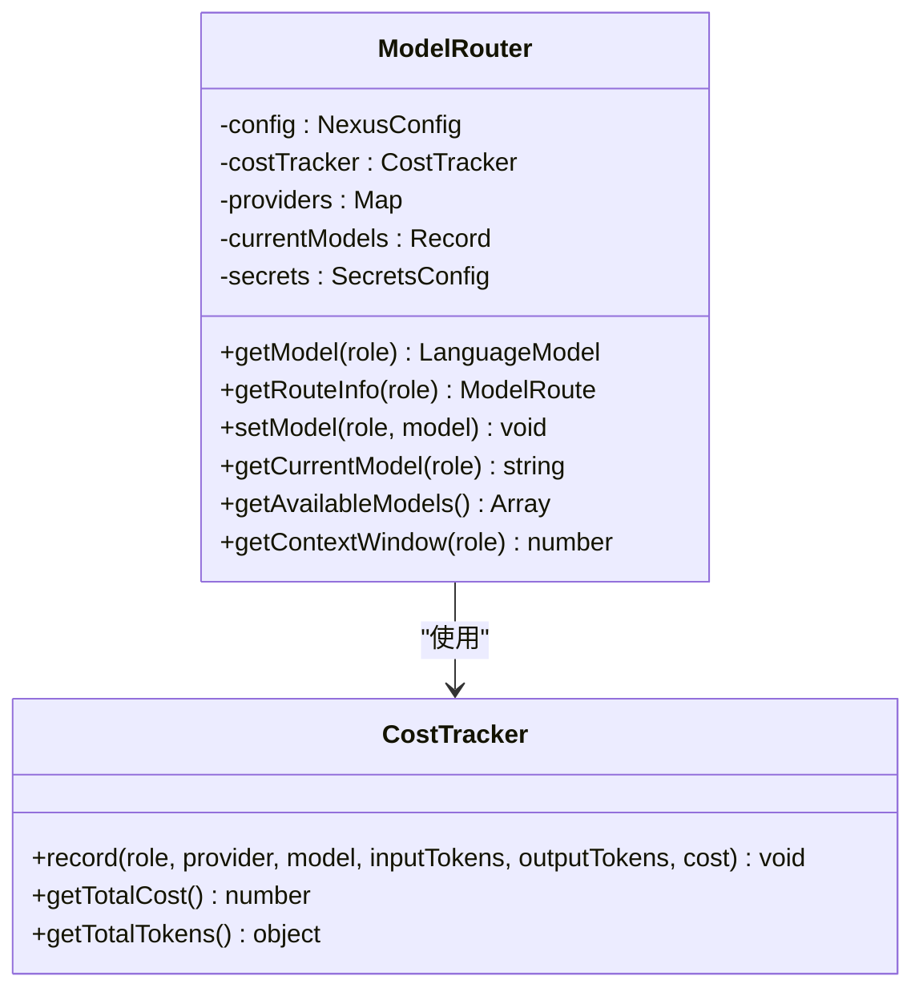

图表来源
- [ModelRouter.ts:101-227](file://src/router/ModelRouter.ts#L101-L227)
- [ModelRouter.ts:245-302](file://src/router/ModelRouter.ts#L245-L302)

章节来源
- [ModelRouter.ts:1-308](file://src/router/ModelRouter.ts#L1-L308)

### 检查点与回滚
- CheckpointManager：初始化 git 仓库与分支，每次 edit 成功后提交并记录步骤、commitHash、变更文件；支持 undo/jump/merge。
- 与 Executor 集成：edit_file 成功后创建 checkpoint，便于一键回滚。

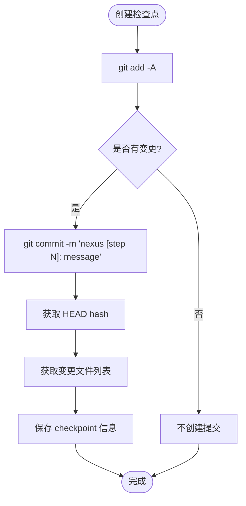

图表来源
- [Checkpoint.ts:73-116](file://src/sandbox/Checkpoint.ts#L73-L116)

章节来源
- [Checkpoint.ts:1-182](file://src/sandbox/Checkpoint.ts#L1-L182)

## 依赖关系分析
- Orchestrator 依赖 Planner、Executor、SubAgent、ToolRegistry、ContextAssembler、ModelRouter、CheckpointManager、SecretsLoader。
- Planner/Executor/SubAgent 依赖 ToolRegistry 与 AI SDK（generateText）。
- ModelRouter 依赖 CostTracker 与 SecretsLoader。
- Assembler 依赖 TokenBudget、Compressor、RulesLoader。
- CheckpointManager 依赖 Git CLI。

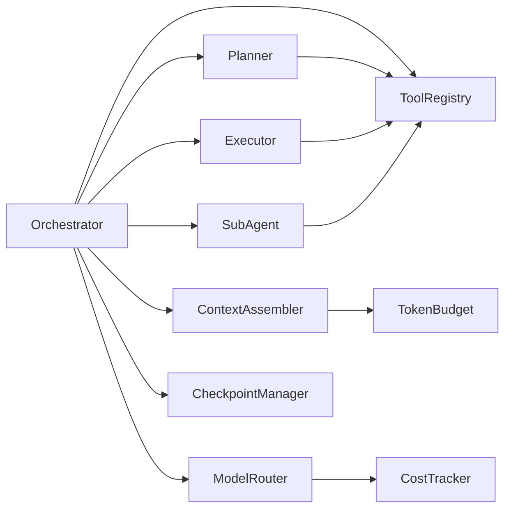

图表来源
- [Orchestrator.ts:1-260](file://src/agent/Orchestrator.ts#L1-L260)
- [Planner.ts:1-176](file://src/agent/Planner.ts#L1-L176)
- [Executor.ts:1-234](file://src/agent/Executor.ts#L1-L234)
- [SubAgent.ts:1-148](file://src/agent/SubAgent.ts#L1-L148)
- [registry.ts:1-96](file://src/tools/registry.ts#L1-L96)
- [Assembler.ts:1-184](file://src/context/Assembler.ts#L1-L184)
- [ModelRouter.ts:1-308](file://src/router/ModelRouter.ts#L1-L308)
- [Checkpoint.ts:1-182](file://src/sandbox/Checkpoint.ts#L1-L182)

章节来源
- [DESIGN.md:1-774](file://DESIGN.md#L1-L774)

## 性能考量
- 上下文压缩：历史压缩与工具结果分级减少 token 消耗，避免长会话爆窗口。
- 模型路由：按角色选择合适模型，自动降级与重试降低延迟与成本。
- 工具执行限制：read_file 行数截断、bash 超时与输出大小限制，防止资源耗尽。
- 检查点频率：仅在 edit_file 成功后创建 checkpoint，减少 git 操作开销。
- 事件流：流式渲染与增量事件减少 UI 阻塞，提升用户体验。

[本节为通用指导，不直接分析具体文件]

## 故障排查指南
- 计划被拒绝：检查 requestApproval 回调逻辑与权限模式；确认用户是否明确拒绝。
- 工具调用失败：查看 tool_result 事件中的 error 字段；确认工具参数是否符合 Zod schema。
- 权限问题：permissionMode 设置为 ask/auto-edit/auto-all/yolo；危险命令始终需要审批。
- 检查点回滚失败：确认 git 仓库状态与分支存在；检查权限与磁盘空间。
- 模型不可用：检查 Provider API Key 与环境变量；确认 ModelRouter 已正确初始化。
- 上下文过长：调整 TokenBudget.budgetRatio 与 recentTurnsKeep；启用更激进的压缩策略。

章节来源
- [Executor.ts:168-196](file://src/agent/Executor.ts#L168-L196)
- [registry.ts:71-82](file://src/tools/registry.ts#L71-L82)
- [Checkpoint.ts:119-155](file://src/sandbox/Checkpoint.ts#L119-L155)
- [ModelRouter.ts:118-165](file://src/router/ModelRouter.ts#L118-L165)
- [Assembler.ts:93-116](file://src/context/Assembler.ts#L93-L116)

## 结论
Nexus Agent 编排器以 Orchestrator 为核心，通过 Plan/Execute 双阶段与 ReAct 循环实现稳健的自动化编程流程；结合子 Agent 分派、上下文工程、多模型路由与检查点回滚，形成高可靠、可追溯、可扩展的 Agent 系统。该设计在 MVP 阶段即具备生产级可用性，并为未来扩展（语义检索、Go 引擎）预留了清晰的接口与迁移路径。

[本节为总结性内容，不直接分析具体文件]

## 附录：API 使用示例与最佳实践
- 初始化与提交
  - 构造 Orchestrator 配置（projectRoot、config、permissionMode、skipPlan、maxIterations、onEvent、requestApproval）。
  - 调用 submit(userInput) 启动任务；若未初始化，内部会先 init()。
  - 参考路径：[Orchestrator.ts:88-118](file://src/agent/Orchestrator.ts#L88-L118)

- 中断与回滚
  - 调用 abort() 标记中断当前操作。
  - 调用 undo() 回滚到上一个检查点。
  - 参考路径：[Orchestrator.ts:183-190](file://src/agent/Orchestrator.ts#L183-L190)

- 模型与成本
  - getCurrentModel()/setModel()/getAvailableModels() 管理与切换模型。
  - getCostSummary() 获取 token 与成本摘要。
  - 参考路径：[Orchestrator.ts:203-226](file://src/agent/Orchestrator.ts#L203-L226)

- 上下文清理与历史
  - clearContext() 清空历史与 todos；getHistory() 获取用户历史摘要。
  - 参考路径：[Orchestrator.ts:229-239](file://src/agent/Orchestrator.ts#L229-L239)

- 工具与权限
  - ToolRegistry.getForPhase(phase) 获取阶段可用工具；execute(name, params, context) 执行工具。
  - 权限模式与危险命令审批逻辑在 Executor.checkPermission。
  - 参考路径：[registry.ts:44-82](file://src/tools/registry.ts#L44-L82)、[Executor.ts:168-196](file://src/agent/Executor.ts#L168-L196)

- 子 Agent 分派
  - 使用 dispatch_subagent 工具描述子任务，指定 writable、tools、maxIterations。
  - 参考路径：[SubAgent.ts:122-148](file://src/agent/SubAgent.ts#L122-L148)

- 最佳实践
  - 合理设置 maxIterations 与 TokenBudget.budgetRatio，避免失控与爆窗口。
  - 使用 auto-edit 模式平衡效率与安全；危险命令始终审批。
  - 充分利用 Git Checkpoint，及时回滚错误修改。
  - 通过 ModelRouter 自动选择合适模型，降低成本与延迟。

章节来源
- [Orchestrator.ts:88-239](file://src/agent/Orchestrator.ts#L88-L239)
- [registry.ts:44-82](file://src/tools/registry.ts#L44-L82)
- [Executor.ts:168-196](file://src/agent/Executor.ts#L168-L196)
- [SubAgent.ts:122-148](file://src/agent/SubAgent.ts#L122-L148)