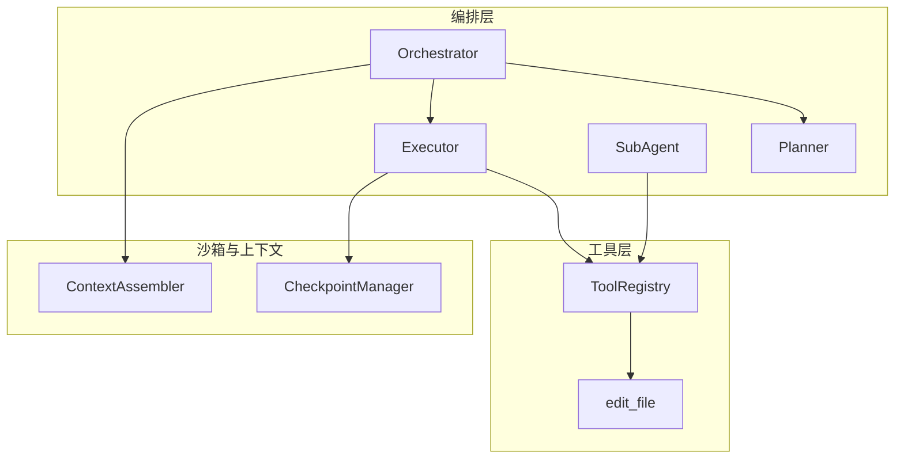
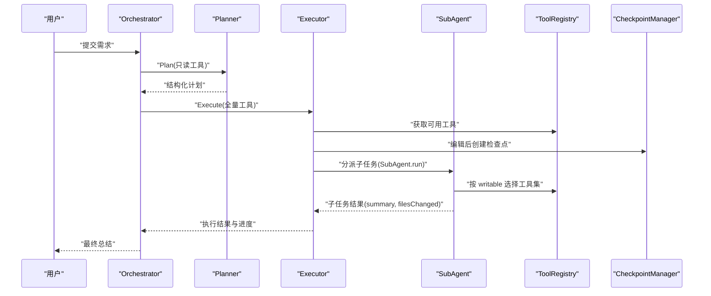
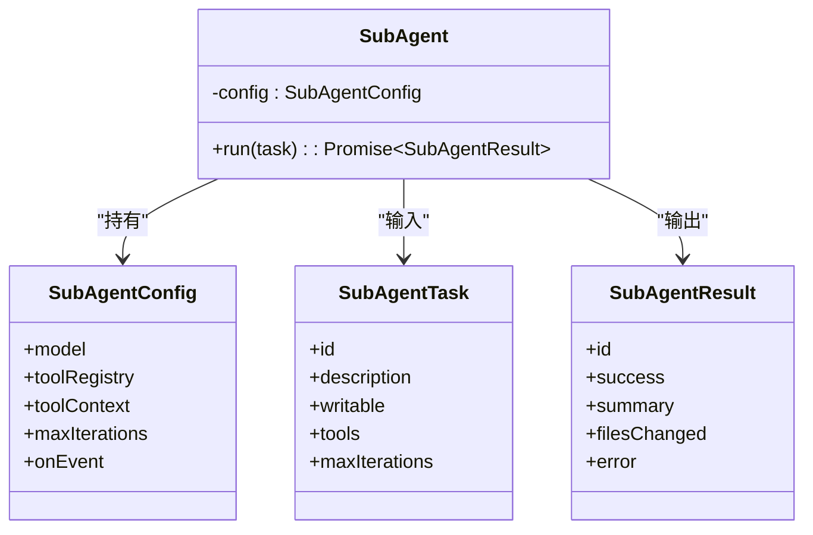
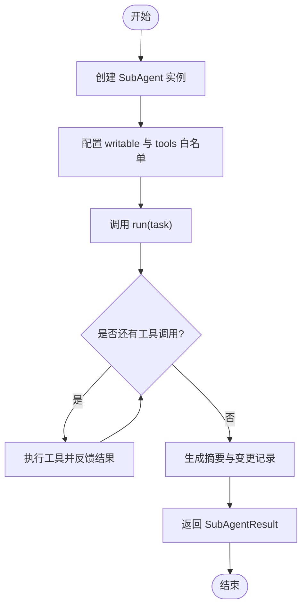
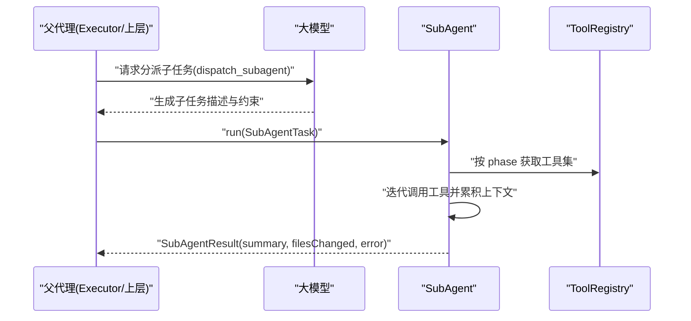
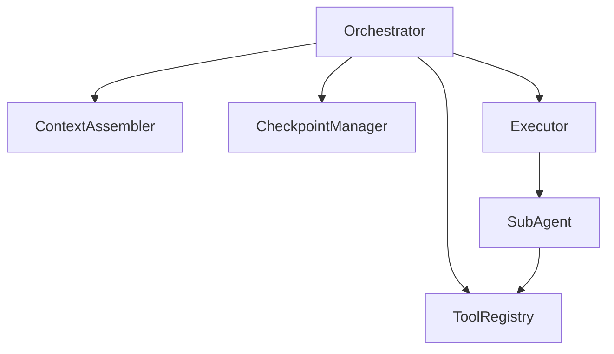
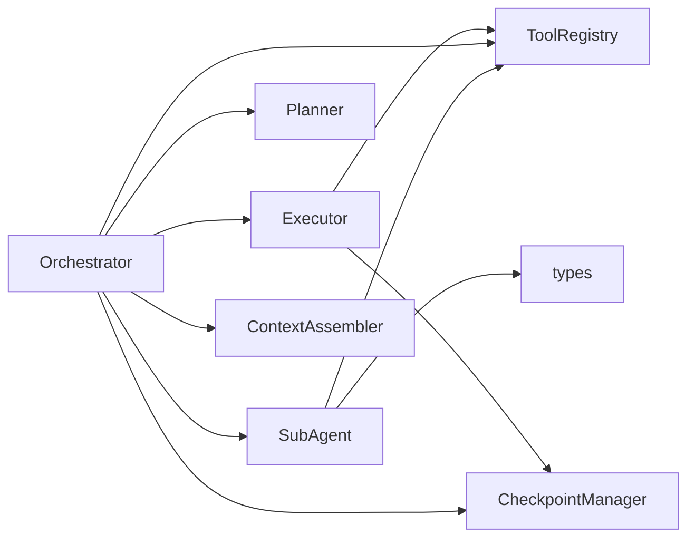

# 子代理模块

<cite>
**本文引用的文件**   
- [SubAgent.ts](file://src/agent/SubAgent.ts)
- [Orchestrator.ts](file://src/agent/Orchestrator.ts)
- [Executor.ts](file://src/agent/Executor.ts)
- [Planner.ts](file://src/agent/Planner.ts)
- [types.ts](file://src/agent/types.ts)
- [registry.ts](file://src/tools/registry.ts)
- [editFile.ts](file://src/tools/editFile.ts)
- [Checkpoint.ts](file://src/sandbox/Checkpoint.ts)
- [Assembler.ts](file://src/context/Assembler.ts)
</cite>

## 目录
1. [简介](#简介)
2. [项目结构](#项目结构)
3. [核心组件](#核心组件)
4. [架构总览](#架构总览)
5. [详细组件分析](#详细组件分析)
6. [依赖分析](#依赖分析)
7. [性能考虑](#性能考虑)
8. [故障排查指南](#故障排查指南)
9. [结论](#结论)
10. [附录](#附录)

## 简介
本章节面向 Nexus 的子代理（SubAgent）模块，系统性阐述其设计目标、职责边界与实现要点。子代理用于将复杂任务拆解为可独立执行的子任务，每个子代理拥有独立的上下文窗口与工具集，从而提升并行处理能力与隔离性。主编排器 Orchestrator 负责整体流程控制、计划生成与执行调度；子代理通过统一的工具注册中心访问文件系统、搜索与命令执行等能力，并以结构化结果回传至父代理。

## 项目结构
围绕子代理的关键代码分布在 agent、tools、sandbox 与 context 四个层次：
- agent: SubAgent、Orchestrator、Executor、Planner 以及共享类型定义
- tools: 工具注册表与具体工具实现（如 edit_file）
- sandbox: 检查点管理（基于 Git），支持回滚与步骤追踪
- context: 上下文组装器，负责系统提示、历史压缩与预算控制

图表来源
- [Orchestrator.ts:1-260](file://src/agent/Orchestrator.ts#L1-L260)
- [Planner.ts:1-176](file://src/agent/Planner.ts#L1-L176)
- [Executor.ts:1-234](file://src/agent/Executor.ts#L1-L234)
- [SubAgent.ts:1-148](file://src/agent/SubAgent.ts#L1-L148)
- [registry.ts:1-96](file://src/tools/registry.ts#L1-L96)
- [editFile.ts:1-170](file://src/tools/editFile.ts#L1-L170)
- [Checkpoint.ts:1-182](file://src/sandbox/Checkpoint.ts#L1-L182)
- [Assembler.ts:1-184](file://src/context/Assembler.ts#L1-L184)

章节来源
- [Orchestrator.ts:1-260](file://src/agent/Orchestrator.ts#L1-L260)
- [SubAgent.ts:1-148](file://src/agent/SubAgent.ts#L1-L148)
- [Executor.ts:1-234](file://src/agent/Executor.ts#L1-L234)
- [Planner.ts:1-176](file://src/agent/Planner.ts#L1-L176)
- [registry.ts:1-96](file://src/tools/registry.ts#L1-L96)
- [editFile.ts:1-170](file://src/tools/editFile.ts#L1-L170)
- [Checkpoint.ts:1-182](file://src/sandbox/Checkpoint.ts#L1-L182)
- [Assembler.ts:1-184](file://src/context/Assembler.ts#L1-L184)

## 核心组件
- SubAgent: 子代理执行体，负责根据任务描述、权限与工具集进行迭代式推理与工具调用，最终产出摘要与变更文件列表。
- Orchestrator: 主编排器，协调 Plan/Execute 双阶段、审批流、检查点与事件上报，并持有全局配置与资源。
- Executor: 执行阶段 ReAct 循环，驱动工具调用、权限校验、检查点创建与进度更新。
- Planner: 规划阶段只读探索，输出结构化计划（todo、待修改文件、预估步数）。
- ToolRegistry: 工具注册与分发中心，按阶段过滤工具并提供统一执行接口。
- CheckpointManager: 基于 Git 的检查点管理，提供自动提交、回滚与跳转。
- ContextAssembler: 构建系统提示与消息序列，结合 Token 预算进行历史压缩与裁剪。

章节来源
- [SubAgent.ts:1-148](file://src/agent/SubAgent.ts#L1-L148)
- [Orchestrator.ts:1-260](file://src/agent/Orchestrator.ts#L1-L260)
- [Executor.ts:1-234](file://src/agent/Executor.ts#L1-L234)
- [Planner.ts:1-176](file://src/agent/Planner.ts#L1-L176)
- [registry.ts:1-96](file://src/tools/registry.ts#L1-L96)
- [Checkpoint.ts:1-182](file://src/sandbox/Checkpoint.ts#L1-L182)
- [Assembler.ts:1-184](file://src/context/Assembler.ts#L1-L184)

## 架构总览
子代理在整体架构中的角色与交互如下：
- 主编排器 Orchestrator 负责初始化模型路由、规则加载、上下文组装与检查点系统。
- 规划阶段由 Planner 完成，仅使用只读工具探索代码库并生成计划。
- 执行阶段由 Executor 驱动，包含权限校验、工具执行与检查点创建。
- 子代理 SubAgent 作为独立执行单元，具备独立上下文窗口与受限工具集，返回结构化结果供父代理汇总。

图表来源
- [Orchestrator.ts:1-260](file://src/agent/Orchestrator.ts#L1-L260)
- [Planner.ts:1-176](file://src/agent/Planner.ts#L1-L176)
- [Executor.ts:1-234](file://src/agent/Executor.ts#L1-L234)
- [SubAgent.ts:1-148](file://src/agent/SubAgent.ts#L1-L148)
- [registry.ts:1-96](file://src/tools/registry.ts#L1-L96)
- [Checkpoint.ts:1-182](file://src/sandbox/Checkpoint.ts#L1-L182)

## 详细组件分析

### SubAgent 设计与实现
- 构造与配置
  - 接收 model、toolRegistry、toolContext、maxIterations、onEvent 等配置项，封装为内部配置对象。
- 任务执行 run(task)
  - 依据 task.writable 决定 phase（plan 或 execute），从工具注册表中筛选可用工具。
  - 若指定 tools 列表，则进一步过滤。
  - 构建初始 user 消息，进入 while 循环，每次调用 LLM 一次（maxSteps=1），处理工具调用与结果反馈。
  - 对 edit_file 的变更进行追踪，记录 filesChanged。
  - 达到迭代上限时给出提示，返回 SubAgentResult（success、summary、filesChanged、error）。
- 错误处理
  - 捕获异常并返回失败结果，包含错误信息。
- 暴露给主 Agent 的工具定义
  - dispatch_subagent 工具定义，允许主 Agent 在 Execute 阶段分派子任务，参数包括 description、writable、tools。

图表来源
- [SubAgent.ts:1-148](file://src/agent/SubAgent.ts#L1-L148)
- [types.ts:198-213](file://src/agent/types.ts#L198-L213)

章节来源
- [SubAgent.ts:1-148](file://src/agent/SubAgent.ts#L1-L148)
- [types.ts:198-213](file://src/agent/types.ts#L198-L213)

### 子代理生命周期管理
- 创建
  - 由父代理（通常是 Executor 或上层逻辑）构造 SubAgent 实例，注入模型、工具注册表、上下文与回调。
- 配置
  - 根据任务描述设置 writable 与 tools 白名单，限制子代理的能力范围。
- 执行
  - 调用 run(task)，内部以 ReAct 模式迭代，逐步调用工具并累积上下文。
- 销毁
  - 当前实现中未显式释放资源；可通过外部引用置空或结束事件回调来清理状态。

图表来源
- [SubAgent.ts:27-118](file://src/agent/SubAgent.ts#L27-L118)

章节来源
- [SubAgent.ts:27-118](file://src/agent/SubAgent.ts#L27-L118)

### 父子代理通信机制
- 任务分发
  - 主 Agent 通过 dispatch_subagent 工具定义向 LLM 暴露子代理能力，LLM 据此生成子任务描述与约束。
- 结果收集
  - 子代理返回 summary 与 filesChanged，父代理将其合并到总体结果与变更追踪中。
- 错误传播
  - 子代理捕获异常并返回 error 字段，父代理可根据 success 标志决定是否重试或降级。

图表来源
- [SubAgent.ts:121-147](file://src/agent/SubAgent.ts#L121-L147)
- [SubAgent.ts:27-118](file://src/agent/SubAgent.ts#L27-L118)
- [registry.ts:44-68](file://src/tools/registry.ts#L44-L68)

章节来源
- [SubAgent.ts:121-147](file://src/agent/SubAgent.ts#L121-L147)
- [SubAgent.ts:27-118](file://src/agent/SubAgent.ts#L27-L118)
- [registry.ts:44-68](file://src/tools/registry.ts#L44-L68)

### 与主 Orchestrator 的协作关系
- Orchestrator 负责初始化模型路由、规则加载、上下文组装与检查点系统。
- 在 Execute 阶段，Orchestrator 创建 Executor 并传入工具注册表、上下文与审批回调。
- 子代理作为 Executor 的扩展能力，可在需要时由 Executor 触发，利用独立上下文窗口处理复杂子任务。

图表来源
- [Orchestrator.ts:60-86](file://src/agent/Orchestrator.ts#L60-L86)
- [Orchestrator.ts:162-180](file://src/agent/Orchestrator.ts#L162-L180)
- [SubAgent.ts:1-148](file://src/agent/SubAgent.ts#L1-L148)

章节来源
- [Orchestrator.ts:60-86](file://src/agent/Orchestrator.ts#L60-L86)
- [Orchestrator.ts:162-180](file://src/agent/Orchestrator.ts#L162-L180)
- [SubAgent.ts:1-148](file://src/agent/SubAgent.ts#L1-L148)

### 资源隔离机制
- 上下文隔离
  - 子代理拥有独立的 messages 历史与工具集，避免与父代理上下文互相污染。
- 工具权限隔离
  - 通过 writable 与 tools 白名单限制子代理能力，默认关闭写权限，降低风险面。
- 变更追踪
  - 子代理对 edit_file 的变更进行记录，便于父代理汇总与审计。

章节来源
- [SubAgent.ts:27-118](file://src/agent/SubAgent.ts#L27-L118)
- [types.ts:198-213](file://src/agent/types.ts#L198-L213)

### 并行任务与依赖管理示例
- 并行任务
  - 父代理可同时发起多个 SubAgent.run 调用，各自独立运行，互不阻塞。
- 依赖管理
  - 对于存在顺序依赖的子任务，父代理应串行调度，确保前置任务完成后才启动后续任务。
- 结果聚合
  - 父代理汇总各子任务的 summary 与 filesChanged，形成最终报告与变更清单。

章节来源
- [SubAgent.ts:27-118](file://src/agent/SubAgent.ts#L27-L118)
- [types.ts:198-213](file://src/agent/types.ts#L198-L213)

### 最佳实践与性能考虑
- 明确任务边界
  - 子任务描述要具体且可验证，避免模糊指令导致多次迭代。
- 最小化工具集
  - 使用 tools 白名单限制子代理能力，减少不必要的工具调用与副作用。
- 合理设置 maxIterations
  - 防止无限循环，结合 onEvent 监控与超时策略。
- 变更审计
  - 关注 filesChanged，必要时结合检查点进行回滚。
- 成本与延迟
  - 控制子代理上下文长度与工具调用次数，避免高成本与大延迟。

章节来源
- [SubAgent.ts:27-118](file://src/agent/SubAgent.ts#L27-L118)
- [Executor.ts:167-196](file://src/agent/Executor.ts#L167-L196)
- [Checkpoint.ts:72-116](file://src/sandbox/Checkpoint.ts#L72-L116)

## 依赖分析
- 组件耦合
  - SubAgent 依赖 ToolRegistry 与 types 定义，低耦合于具体工具实现。
  - Orchestrator 组合 Planner、Executor、SubAgent、ToolRegistry、CheckpointManager 与 ContextAssembler。
- 直接依赖
  - SubAgent → ToolRegistry、types
  - Orchestrator → Planner、Executor、SubAgent、ToolRegistry、CheckpointManager、ContextAssembler
- 潜在循环依赖
  - 当前未发现循环导入；各模块职责清晰，分层明确。

图表来源
- [SubAgent.ts:1-148](file://src/agent/SubAgent.ts#L1-L148)
- [Orchestrator.ts:1-260](file://src/agent/Orchestrator.ts#L1-L260)
- [Executor.ts:1-234](file://src/agent/Executor.ts#L1-L234)
- [registry.ts:1-96](file://src/tools/registry.ts#L1-L96)
- [Checkpoint.ts:1-182](file://src/sandbox/Checkpoint.ts#L1-L182)
- [Assembler.ts:1-184](file://src/context/Assembler.ts#L1-L184)
- [types.ts:1-269](file://src/agent/types.ts#L1-L269)

章节来源
- [SubAgent.ts:1-148](file://src/agent/SubAgent.ts#L1-L148)
- [Orchestrator.ts:1-260](file://src/agent/Orchestrator.ts#L1-L260)
- [Executor.ts:1-234](file://src/agent/Executor.ts#L1-L234)
- [registry.ts:1-96](file://src/tools/registry.ts#L1-L96)
- [Checkpoint.ts:1-182](file://src/sandbox/Checkpoint.ts#L1-L182)
- [Assembler.ts:1-184](file://src/context/Assembler.ts#L1-L184)
- [types.ts:1-269](file://src/agent/types.ts#L1-L269)

## 性能考虑
- 迭代控制
  - 子代理与执行器均使用 maxIterations 限制循环次数，避免长时间占用资源。
- 工具调用批量化
  - 单次 LLM 调用可能产生多个工具调用，需批量执行并汇总结果，减少往返开销。
- 上下文压缩
  - 通过 ContextAssembler 的历史压缩与预算分配，控制消息规模，降低 token 消耗。
- 检查点频率
  - 仅在关键写入操作后创建检查点，避免频繁 git 操作带来的 I/O 压力。

[本节为通用指导，无需列出具体文件来源]

## 故障排查指南
- 子代理未完成任务
  - 检查 maxIterations 是否过小，查看 onEvent 日志确认工具调用链路与错误信息。
- 工具被拒绝
  - 父代理的权限检查可能导致工具调用被拒，调整 permissionMode 或补充审批逻辑。
- 文件编辑失败
  - edit_file 要求 old_string 唯一匹配，若失败需重新读取文件内容并更新上下文。
- 检查点回滚
  - 使用 CheckpointManager.undo 或 jumpTo 恢复到稳定状态，再重试子任务。

章节来源
- [Executor.ts:167-196](file://src/agent/Executor.ts#L167-L196)
- [editFile.ts:61-156](file://src/tools/editFile.ts#L61-L156)
- [Checkpoint.ts:118-155](file://src/sandbox/Checkpoint.ts#L118-L155)

## 结论
子代理模块通过独立上下文与受限工具集，有效提升了复杂任务的并行处理能力与安全性。配合 Orchestrator 的双阶段编排、权限校验与检查点机制，形成了稳健的执行闭环。实践中应注重任务边界清晰、工具集最小化与变更审计，以获得更好的性能与可靠性。

[本节为总结性内容，无需列出具体文件来源]

## 附录
- 相关类型定义
  - SubAgentTask、SubAgentResult、NexusEvent、Plan、Todo 等详见 types.ts。
- 工具注册与执行
  - ToolRegistry 提供 getForPhase、execute 等方法，edit_file 工具实现位于 editFile.ts。
- 检查点管理
  - CheckpointManager 提供 create、undo、jumpTo 等方法，基于 Git 分支管理步骤。

章节来源
- [types.ts:1-269](file://src/agent/types.ts#L1-L269)
- [registry.ts:1-96](file://src/tools/registry.ts#L1-L96)
- [editFile.ts:1-170](file://src/tools/editFile.ts#L1-L170)
- [Checkpoint.ts:1-182](file://src/sandbox/Checkpoint.ts#L1-L182)