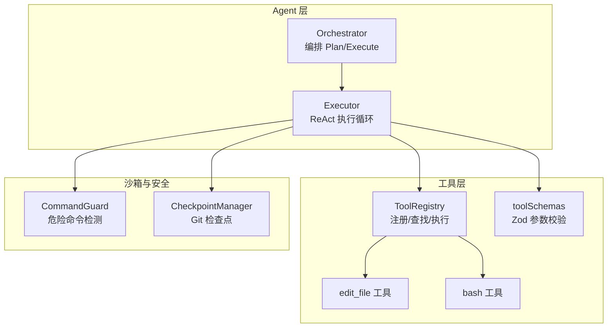
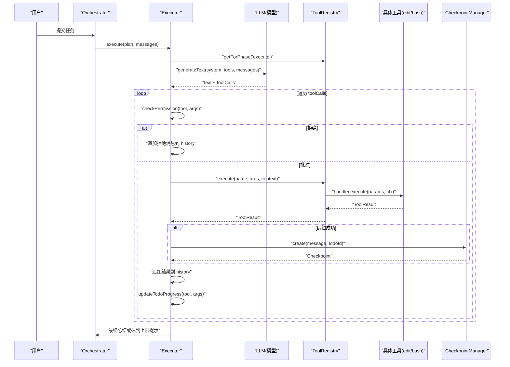
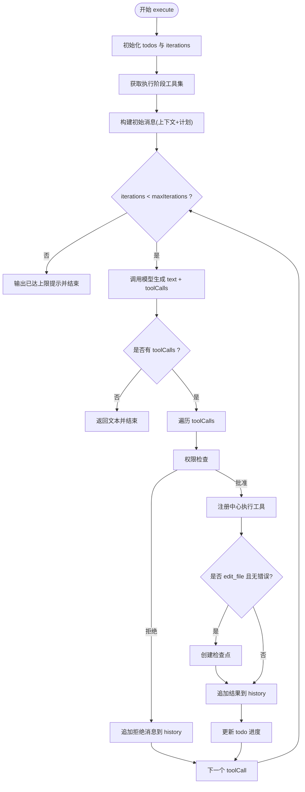
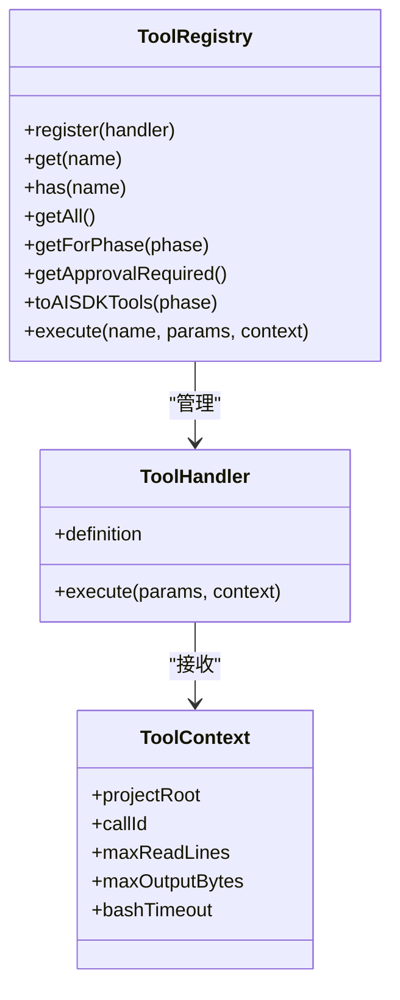
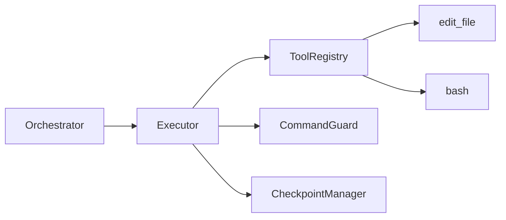

# 执行器模块

<cite>
**本文引用的文件**   
- [src/agent/Executor.ts](file://src/agent/Executor.ts)
- [src/tools/registry.ts](file://src/tools/registry.ts)
- [src/sandbox/Checkpoint.ts](file://src/sandbox/Checkpoint.ts)
- [src/agent/types.ts](file://src/agent/types.ts)
- [src/tools/schemas.ts](file://src/tools/schemas.ts)
- [src/sandbox/CommandGuard.ts](file://src/sandbox/CommandGuard.ts)
- [src/agent/Orchestrator.ts](file://src/agent/Orchestrator.ts)
- [src/tools/editFile.ts](file://src/tools/editFile.ts)
- [src/tools/bash.ts](file://src/tools/bash.ts)
- [README.md](file://README.md)
</cite>

## 目录
1. [简介](#简介)
2. [项目结构](#项目结构)
3. [核心组件](#核心组件)
4. [架构总览](#架构总览)
5. [详细组件分析](#详细组件分析)
6. [依赖关系分析](#依赖关系分析)
7. [性能与优化](#性能与优化)
8. [故障排查指南](#故障排查指南)
9. [结论](#结论)
10. [附录：示例与最佳实践](#附录示例与最佳实践)

## 简介
本章节聚焦于 Nexus 的执行器模块，围绕 Executor 类的设计与实现展开。文档将解释执行循环如何逐步推进计划中的任务、工具调用管理与权限校验机制、错误处理策略、与工具注册中心的集成方式（发现、参数验证、结果处理）、以及与检查点系统的协作（自动保存与回滚）。同时提供面向初学者的渐进式说明与面向资深开发者的技术细节，并给出调试与性能优化建议。

## 项目结构
执行器模块位于 agent 层，负责在“执行阶段”驱动 LLM 进行 ReAct 循环，协调工具调用、权限审批、状态更新与检查点创建。其关键依赖包括：
- 工具注册中心：集中管理工具定义、按阶段过滤、统一执行入口
- 工具 Schema：为 AI SDK 提供参数校验与描述
- 命令安全守卫：危险命令检测与强制审批判定
- 检查点管理器：基于 Git 的自动提交与回滚能力
- Orchestrator：编排 Plan/Execute 双阶段，注入配置与事件流

图表来源
- [src/agent/Orchestrator.ts:162-180](file://src/agent/Orchestrator.ts#L162-L180)
- [src/agent/Executor.ts:50-165](file://src/agent/Executor.ts#L50-L165)
- [src/tools/registry.ts:25-83](file://src/tools/registry.ts#L25-L83)
- [src/tools/schemas.ts:33-40](file://src/tools/schemas.ts#L33-L40)
- [src/sandbox/CommandGuard.ts:71-98](file://src/sandbox/CommandGuard.ts#L71-L98)
- [src/sandbox/Checkpoint.ts:30-116](file://src/sandbox/Checkpoint.ts#L30-L116)

章节来源
- [src/agent/Orchestrator.ts:162-180](file://src/agent/Orchestrator.ts#L162-L180)
- [src/agent/Executor.ts:50-165](file://src/agent/Executor.ts#L50-L165)
- [src/tools/registry.ts:25-83](file://src/tools/registry.ts#L25-L83)
- [src/tools/schemas.ts:33-40](file://src/tools/schemas.ts#L33-L40)
- [src/sandbox/CommandGuard.ts:71-98](file://src/sandbox/CommandGuard.ts#L71-L98)
- [src/sandbox/Checkpoint.ts:30-116](file://src/sandbox/Checkpoint.ts#L30-L116)

## 核心组件
- Executor：执行阶段的核心控制器，维护 todo 列表、迭代计数、消息历史，驱动 ReAct 循环，负责权限检查、工具执行、结果回灌、todo 进度更新与检查点创建。
- ToolRegistry：工具注册中心，提供按阶段筛选、AI SDK 兼容的工具定义生成、统一执行入口。
- CheckpointManager：基于 Git 的检查点系统，支持初始化、创建检查点、回滚与跳转。
- CommandGuard：危险命令检测与强制审批判定。
- toolSchemas：Zod Schema 映射，用于 AI SDK 的参数校验与提示。

章节来源
- [src/agent/Executor.ts:41-233](file://src/agent/Executor.ts#L41-L233)
- [src/tools/registry.ts:25-96](file://src/tools/registry.ts#L25-L96)
- [src/sandbox/Checkpoint.ts:30-182](file://src/sandbox/Checkpoint.ts#L30-L182)
- [src/sandbox/CommandGuard.ts:71-98](file://src/sandbox/CommandGuard.ts#L71-L98)
- [src/tools/schemas.ts:33-40](file://src/tools/schemas.ts#L33-L40)

## 架构总览
执行器在 Orchestrator 的调度下启动，加载当前阶段的可用工具，构建初始消息，进入 ReAct 循环。每次循环中：
- 调用模型生成文本与可能的工具调用
- 对每个工具调用进行权限检查（含危险命令强制审批）
- 通过注册中心执行工具，记录事件
- 根据工具类型触发检查点创建（如 edit_file 成功）
- 将结果写回消息历史，驱动下一步决策
- 更新 todo 状态（pending → in_progress → complete）

图表来源
- [src/agent/Orchestrator.ts:162-180](file://src/agent/Orchestrator.ts#L162-L180)
- [src/agent/Executor.ts:50-165](file://src/agent/Executor.ts#L50-L165)
- [src/tools/registry.ts:70-83](file://src/tools/registry.ts#L70-L83)
- [src/sandbox/Checkpoint.ts:72-116](file://src/sandbox/Checkpoint.ts#L72-L116)

## 详细组件分析

### Executor 设计与实现
- 执行入口 execute(plan, contextMessages)
  - 初始化 todos 与迭代计数器
  - 获取执行阶段可用工具集，并为 AI SDK 构造 description 与 parameters（优先使用 Zod schema）
  - 构建初始消息：上下文消息 + 计划摘要
  - ReAct 循环：
    - 调用模型生成文本与工具调用
    - 若无工具调用，结束循环并返回文本
    - 若有工具调用：
      - 权限检查：依据工具定义 requiresApproval、permissionMode、危险命令强制审批
      - 执行工具：通过注册中心执行，记录事件
      - 检查点：edit_file 成功后创建 checkpoint
      - 结果回灌：将错误或结果写入消息历史
      - 更新 todo 进度：edit_file 标记 in_progress；非测试 bash 完成 in_progress 项
  - 达到最大迭代次数时，输出进度并上报可恢复错误
- 权限检查 checkPermission
  - 若工具不需要审批则直接通过
  - bash 危险命令无论模式均强制审批
  - 按 permissionMode 分支：yolo/auto-all/auto-edit/ask
- Todo 进度 updateTodoProgress
  - 首次 edit_file 将 pending 转为 in_progress
  - 非测试 bash 完成后将 in_progress 转为 complete
- 辅助方法
  - getCurrentTodoId：定位当前进行中的 todo id，用于关联检查点
  - formatTodos：格式化展示 todo 状态

图表来源
- [src/agent/Executor.ts:50-165](file://src/agent/Executor.ts#L50-L165)
- [src/agent/Executor.ts:167-215](file://src/agent/Executor.ts#L167-L215)
- [src/sandbox/Checkpoint.ts:72-116](file://src/sandbox/Checkpoint.ts#L72-L116)

章节来源
- [src/agent/Executor.ts:50-165](file://src/agent/Executor.ts#L50-L165)
- [src/agent/Executor.ts:167-215](file://src/agent/Executor.ts#L167-L215)

### 工具注册中心集成
- 工具发现与过滤
  - getForPhase(phase)：仅暴露 plan/execute/both 阶段允许的工具
  - toAISDKTools(phase)：生成 Vercel AI SDK 兼容的描述与参数 schema
- 参数验证
  - 优先使用 toolSchemas（Zod），否则回退到工具定义的 inputSchema
- 执行流程
  - execute(name, params, context)：根据名称查找处理器并调用，未找到返回“未知工具”错误
- 默认注册
  - createToolRegistry()：注册 read_file、edit_file、bash、grep

图表来源
- [src/tools/registry.ts:25-83](file://src/tools/registry.ts#L25-L83)
- [src/tools/registry.ts:85-96](file://src/tools/registry.ts#L85-L96)

章节来源
- [src/tools/registry.ts:25-83](file://src/tools/registry.ts#L25-L83)
- [src/tools/registry.ts:85-96](file://src/tools/registry.ts#L85-L96)
- [src/tools/schemas.ts:33-40](file://src/tools/schemas.ts#L33-L40)

### 权限检查与危险命令防护
- 权限模式
  - ask：所有写操作均需审批
  - auto-edit：edit_file 自动批准，其他需审批
  - auto-all：全部自动（危险命令仍强制问）
  - yolo：全部自动（自负责任）
- 危险命令强制审批
  - 针对 bash 命令，使用 CommandGuard 的正则黑名单判断是否为 dangerous
  - 一旦命中，无论权限模式都要求人工审批
- 拒绝处理
  - 向 LLM 注入拒绝消息，引导其换一种方式完成任务

章节来源
- [src/agent/Executor.ts:167-196](file://src/agent/Executor.ts#L167-L196)
- [src/sandbox/CommandGuard.ts:71-98](file://src/sandbox/CommandGuard.ts#L71-L98)

### 检查点系统与协作
- 初始化
  - 确保在 git 仓库内，必要时 init
  - 确保有初始提交，避免空仓库无法创建分支
  - 创建或切换到专用分支（默认 nexus/checkpoints）
- 创建检查点
  - add -A 暂存变更
  - diff --cached --quiet 判断是否有变更
  - commit 并记录 step、commitHash、message、filesChanged
- 回滚与跳转
  - undo：回滚到上一个检查点
  - jumpTo(step)：跳转到指定步骤并清理后续检查点
- 与执行器的协作
  - edit_file 成功后自动创建检查点，并将 step 与 message 事件上报

章节来源
- [src/sandbox/Checkpoint.ts:42-116](file://src/sandbox/Checkpoint.ts#L42-L116)
- [src/sandbox/Checkpoint.ts:118-155](file://src/sandbox/Checkpoint.ts#L118-L155)
- [src/agent/Executor.ts:135-144](file://src/agent/Executor.ts#L135-L144)

### 工具实现要点（edit_file 与 bash）
- edit_file
  - 路径越界保护：不允许编辑项目外文件
  - 唯一匹配：old_string 必须精确匹配一次，否则报错
  - 原子写入：临时文件 + rename，保证一致性
  - 格式保留：BOM 与行尾处理，diff 输出便于 LLM 理解变更
- bash
  - 超时控制：进程组级别 kill，跨平台适配
  - 输出截断：二进制清洗与尾部截断，防止大输出阻塞
  - 危险命令标注：即使通过审批也在结果中标注风险原因

章节来源
- [src/tools/editFile.ts:61-156](file://src/tools/editFile.ts#L61-L156)
- [src/tools/bash.ts:123-183](file://src/tools/bash.ts#L123-L183)

## 依赖关系分析
- Orchestrator 负责生命周期与阶段切换，注入 Executor 所需配置与事件回调
- Executor 依赖 ToolRegistry 获取工具、执行工具、生成 AI SDK 兼容定义
- ToolRegistry 聚合各工具处理器，提供统一的执行接口
- CommandGuard 作为安全前置条件，影响权限检查分支
- CheckpointManager 在特定工具成功后被触发，形成“编辑即快照”的安全网

图表来源
- [src/agent/Orchestrator.ts:162-180](file://src/agent/Orchestrator.ts#L162-L180)
- [src/agent/Executor.ts:50-165](file://src/agent/Executor.ts#L50-L165)
- [src/tools/registry.ts:25-83](file://src/tools/registry.ts#L25-L83)
- [src/sandbox/CommandGuard.ts:71-98](file://src/sandbox/CommandGuard.ts#L71-L98)
- [src/sandbox/Checkpoint.ts:30-116](file://src/sandbox/Checkpoint.ts#L30-L116)

章节来源
- [src/agent/Orchestrator.ts:162-180](file://src/agent/Orchestrator.ts#L162-L180)
- [src/agent/Executor.ts:50-165](file://src/agent/Executor.ts#L50-L165)
- [src/tools/registry.ts:25-83](file://src/tools/registry.ts#L25-L83)
- [src/sandbox/CommandGuard.ts:71-98](file://src/sandbox/CommandGuard.ts#L71-L98)
- [src/sandbox/Checkpoint.ts:30-116](file://src/sandbox/Checkpoint.ts#L30-L116)

## 性能与优化
- 减少不必要的检查点创建
  - 仅在 edit_file 成功时创建，避免频繁 I/O
  - 对于批量编辑场景，可在业务层合并多次修改后再触发检查点
- 控制迭代上限与消息长度
  - 合理设置 maxIterations，避免过长循环导致成本飙升
  - 利用上下文工程层压缩近期对话，保持窗口预算
- 工具输出截断与缓存
  - bash 输出采用尾部截断，避免大响应阻塞
  - 对只读工具（read_file/grep）结果可考虑短期缓存，减少重复 IO
- 并行与子 Agent
  - 复杂任务可拆分为子任务，由 SubAgent 并行执行，缩短整体耗时
- 模型路由与成本追踪
  - 不同阶段使用不同模型，平衡能力与成本
  - 实时统计 token 消耗，动态调整策略

[本节为通用指导，不直接分析具体文件]

## 故障排查指南
- 常见错误与定位
  - 未知工具：检查 ToolRegistry 是否正确注册，名称是否一致
  - 参数校验失败：核对 toolSchemas 与工具定义 inputSchema 的一致性
  - 权限拒绝：确认 permissionMode 与危险命令规则，必要时调整审批策略
  - 编辑失败：检查 old_string 唯一性、文件是否存在、路径是否越界
  - 检查点失败：确认 git 环境、分支存在性与权限
- 日志与事件
  - 关注 tool_call、tool_result、checkpoint、error 等事件，快速定位问题
- 回滚与恢复
  - 使用 /undo 或 CheckpointManager.undo/jumpTo 恢复到稳定状态
  - 结合 diff 输出与变更记录，评估影响范围

章节来源
- [src/tools/registry.ts:70-83](file://src/tools/registry.ts#L70-L83)
- [src/tools/schemas.ts:33-40](file://src/tools/schemas.ts#L33-L40)
- [src/agent/Executor.ts:167-196](file://src/agent/Executor.ts#L167-L196)
- [src/tools/editFile.ts:61-156](file://src/tools/editFile.ts#L61-L156)
- [src/sandbox/Checkpoint.ts:118-155](file://src/sandbox/Checkpoint.ts#L118-L155)

## 结论
执行器模块以 ReAct 循环为核心，结合工具注册中心、权限检查与检查点系统，实现了“计划驱动、人在环中、可回滚”的生产级执行体验。通过清晰的职责划分与可扩展的接口设计，既保证了安全性与可靠性，也为后续的性能优化与功能扩展提供了良好基础。

[本节为总结，不直接分析具体文件]

## 附录：示例与最佳实践

### 多步骤任务处理示例（思路）
- 规划阶段
  - 使用 Planner 探索代码库，生成结构化计划与 todo 列表
  - 用户审批计划后进入执行阶段
- 执行阶段
  - 对每个 todo，依次进行编辑与测试验证
  - 遇到失败时，利用 diff 与错误信息修正 old_string 或调整命令
  - 每步成功后自动创建检查点，便于回滚
- 异常恢复
  - 若某步失败，可回滚到最近检查点，重新尝试
  - 对危险命令，务必走审批流程并在 UI 中展示风险原因

章节来源
- [src/agent/Planner.ts:56-137](file://src/agent/Planner.ts#L56-L137)
- [src/agent/Executor.ts:50-165](file://src/agent/Executor.ts#L50-L165)
- [src/sandbox/Checkpoint.ts:72-116](file://src/sandbox/Checkpoint.ts#L72-L116)

### 调试技巧
- 启用详细事件监听
  - 订阅 tool_call、tool_result、checkpoint、error 等事件，观察每一步行为
- 限制迭代与输出大小
  - 降低 maxIterations 与 maxOutputBytes，快速定位问题
- 使用最小复现用例
  - 将复杂任务拆解为单步操作，逐步验证工具行为与权限策略

章节来源
- [src/agent/Executor.ts:105-154](file://src/agent/Executor.ts#L105-L154)
- [src/tools/bash.ts:123-183](file://src/tools/bash.ts#L123-L183)

### 参考与背景
- 项目特性与运行方式参见 README，了解权限模式、斜杠命令与模型配置

章节来源
- [README.md:1-174](file://README.md#L1-L174)