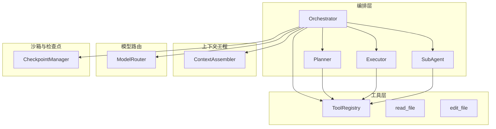
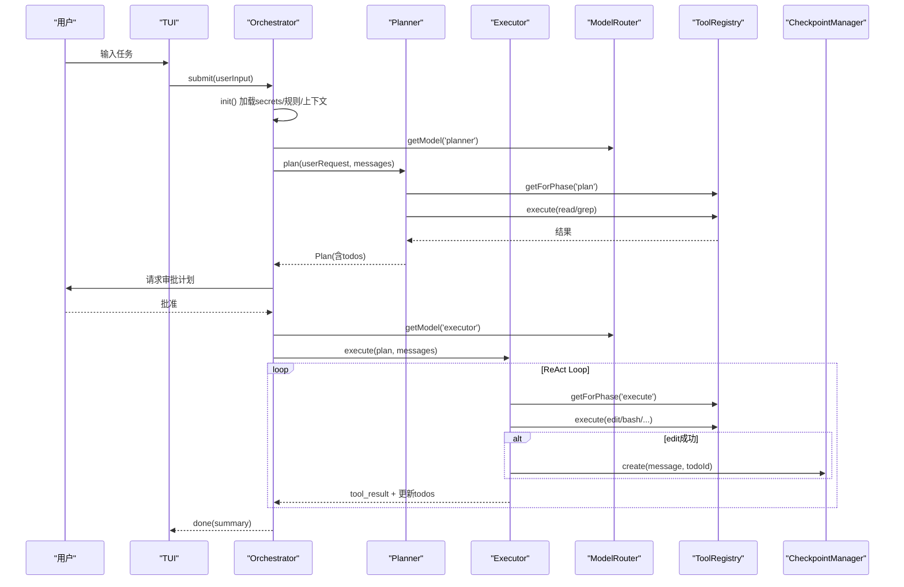
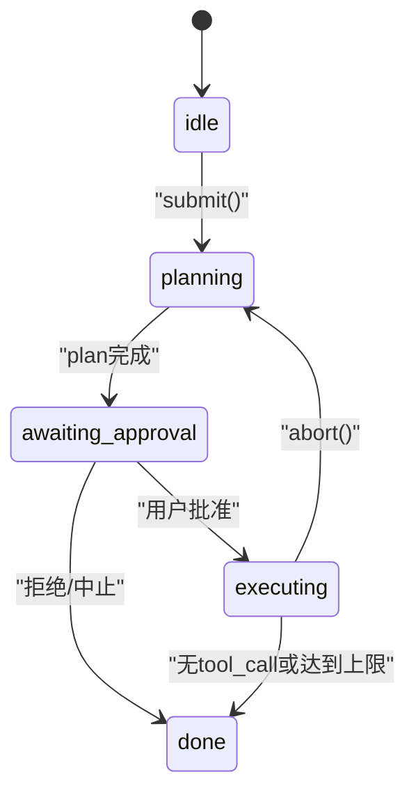
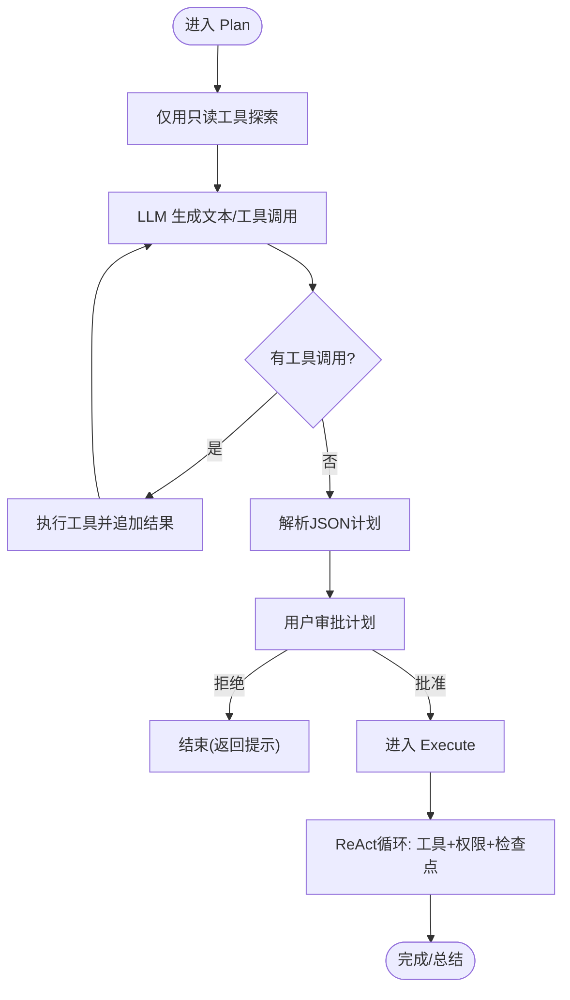
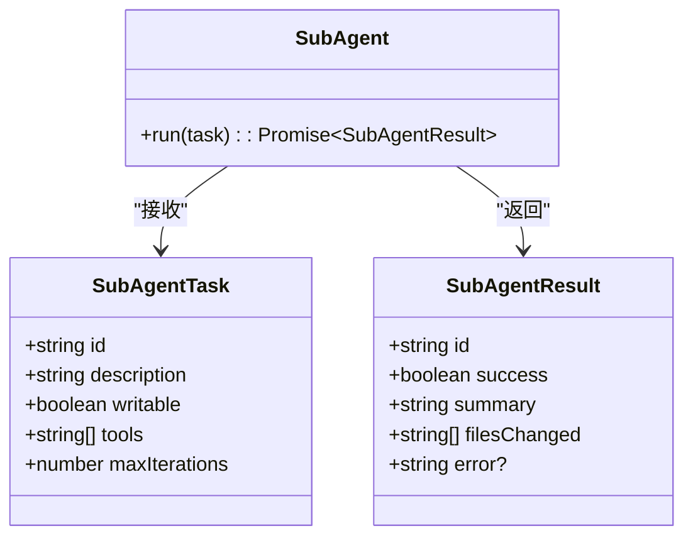
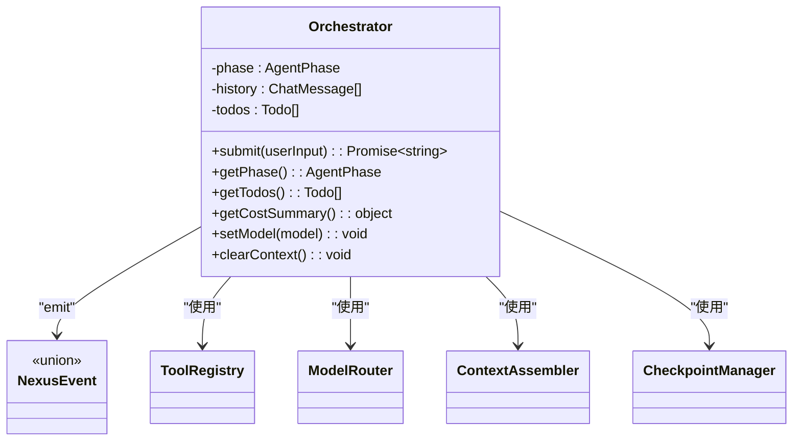
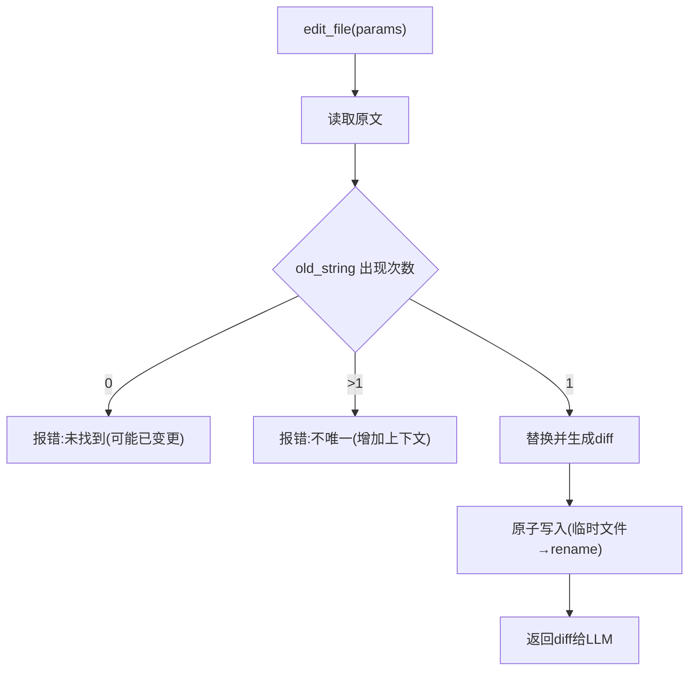
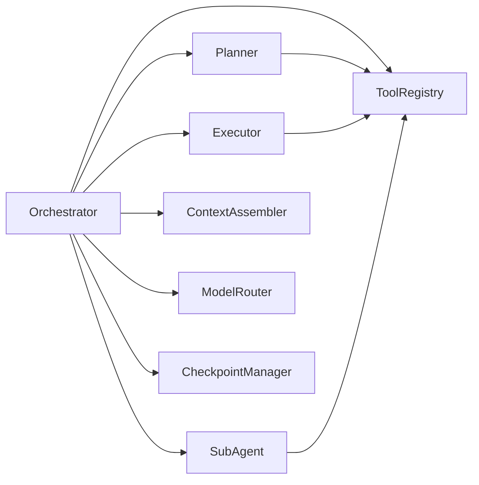

# 核心模块

<cite>
**本文引用的文件**   
- [Orchestrator.ts](file://src/agent/Orchestrator.ts)
- [Planner.ts](file://src/agent/Planner.ts)
- [Executor.ts](file://src/agent/Executor.ts)
- [SubAgent.ts](file://src/agent/SubAgent.ts)
- [types.ts](file://src/agent/types.ts)
- [registry.ts](file://src/tools/registry.ts)
- [Assembler.ts](file://src/context/Assembler.ts)
- [ModelRouter.ts](file://src/router/ModelRouter.ts)
- [Checkpoint.ts](file://src/sandbox/Checkpoint.ts)
- [readFile.ts](file://src/tools/readFile.ts)
- [editFile.ts](file://src/tools/editFile.ts)
- [config.ts](file://src/config.ts)
- [README.md](file://README.md)
- [DESIGN.md](file://DESIGN.md)
</cite>

## 目录
1. [简介](#简介)
2. [项目结构](#项目结构)
3. [核心组件](#核心组件)
4. [架构总览](#架构总览)
5. [详细组件分析](#详细组件分析)
6. [依赖关系分析](#依赖关系分析)
7. [性能考量](#性能考量)
8. [故障排查指南](#故障排查指南)
9. [结论](#结论)
10. [附录：API 使用示例与最佳实践](#附录api-使用示例与最佳实践)

## 简介
本技术文档聚焦 Nexus 的核心 Agent 编排系统，围绕 Orchestrator 类的设计模式与生命周期管理、Plan/Execute 双阶段工作流、子 Agent 分派机制、状态机设计、事件驱动架构与组件间通信进行系统化解析。同时给出与其他模块（模型路由、上下文工程、工具系统）的集成方式，并提供常见问题解决方案与性能优化建议。内容兼顾初学者友好与资深开发者的深度需求。

## 项目结构
Nexus 采用分层模块化组织：
- 编排层：Orchestrator、Planner、Executor、SubAgent
- 工具层：MCP 风格工具注册中心与具体实现
- 上下文工程：三层上下文组装与压缩策略
- 模型路由：多 Provider 适配、成本追踪与降级
- 沙箱与检查点：Git Checkpoint 管理
- 配置加载：TOML 配置合并默认值

图表来源
- [Orchestrator.ts:1-255](file://src/agent/Orchestrator.ts#L1-L255)
- [Planner.ts:1-176](file://src/agent/Planner.ts#L1-L176)
- [Executor.ts:1-234](file://src/agent/Executor.ts#L1-L234)
- [SubAgent.ts:1-148](file://src/agent/SubAgent.ts#L1-L148)
- [registry.ts:1-96](file://src/tools/registry.ts#L1-L96)
- [Assembler.ts:1-184](file://src/context/Assembler.ts#L1-L184)
- [ModelRouter.ts:1-308](file://src/router/ModelRouter.ts#L1-L308)
- [Checkpoint.ts:1-182](file://src/sandbox/Checkpoint.ts#L1-L182)

章节来源
- [README.md:1-174](file://README.md#L1-L174)
- [DESIGN.md:1-774](file://DESIGN.md#L1-L774)

## 核心组件
- Orchestrator：编排核心，负责初始化、Plan/Execute 双阶段调度、事件分发、权限审批回调、检查点与上下文装配、模型切换与成本摘要等。
- Planner：Plan 阶段 ReAct 循环，仅允许只读工具，输出结构化 Plan（含 todos）。
- Executor：Execute 阶段 ReAct 循环，执行计划步骤，支持权限检查、编辑后自动创建检查点、更新 todo 进度。
- SubAgent：子 Agent 分派，独立上下文窗口，按 writable 决定可用工具集，限制深度为 1 层。
- ToolRegistry：工具注册中心，提供阶段过滤、AI SDK 兼容定义生成与统一执行入口。
- ContextAssembler：三层上下文组装（L1/L2/L3），预算控制与历史压缩。
- ModelRouter：Provider 抽象、角色化模型选择、降级链、成本追踪。
- CheckpointManager：基于 Git 的检查点管理，支持创建、回滚、跳转与合并。

章节来源
- [Orchestrator.ts:1-255](file://src/agent/Orchestrator.ts#L1-L255)
- [Planner.ts:1-176](file://src/agent/Planner.ts#L1-L176)
- [Executor.ts:1-234](file://src/agent/Executor.ts#L1-L234)
- [SubAgent.ts:1-148](file://src/agent/SubAgent.ts#L1-L148)
- [registry.ts:1-96](file://src/tools/registry.ts#L1-L96)
- [Assembler.ts:1-184](file://src/context/Assembler.ts#L1-L184)
- [ModelRouter.ts:1-308](file://src/router/ModelRouter.ts#L1-L308)
- [Checkpoint.ts:1-182](file://src/sandbox/Checkpoint.ts#L1-L182)

## 架构总览
Nexus 以 Orchestrator 为中心，协调 Planner/Executor/SubAgent 完成“理解→规划→执行→验证”的闭环；通过 ModelRouter 动态选择模型并跟踪成本；借助 ContextAssembler 构建高质量上下文；在关键写操作后由 CheckpointManager 创建检查点，确保可回滚。

图表来源
- [Orchestrator.ts:88-180](file://src/agent/Orchestrator.ts#L88-L180)
- [Planner.ts:55-137](file://src/agent/Planner.ts#L55-L137)
- [Executor.ts:50-165](file://src/agent/Executor.ts#L50-L165)
- [registry.ts:44-82](file://src/tools/registry.ts#L44-L82)
- [Checkpoint.ts:72-116](file://src/sandbox/Checkpoint.ts#L72-L116)

## 详细组件分析

### Orchestrator 设计与生命周期
- 职责边界
  - 初始化：加载 secrets、规则、构建上下文组装器、可选初始化 git checkpoint。
  - 主入口 submit：根据 skipPlan 走直接执行或 Plan→Execute 流程。
  - 事件驱动：统一 emit 事件给上层 UI/日志。
  - 权限与审批：将 requestApproval 回调注入到执行阶段。
  - 模型与成本：持有 ModelRouter 与 CostTracker，暴露 getCurrentModel/setModel/getCostSummary。
  - 检查点：封装 undo 能力。
- 状态机
  - 阶段类型：idle → planning → awaiting_approval → executing → done（以及 error 分支）。
  - setPhase 内部触发 phase_change 事件，便于 UI 渲染与审计。
- 上下文与工具
  - 通过 ContextAssembler 构建 systemPrompt 与消息列表，结合 TokenBudget 控制窗口。
  - 通过 ToolRegistry 获取阶段相关工具，构造 AI SDK 兼容的工具描述。
- 错误与中断
  - abort 设置中止标志；达到最大迭代次数时发出 recoverable 错误事件。

图表来源
- [Orchestrator.ts:38-118](file://src/agent/Orchestrator.ts#L38-L118)
- [types.ts:25](file://src/agent/types.ts#L25-L25)

章节来源
- [Orchestrator.ts:1-255](file://src/agent/Orchestrator.ts#L1-L255)
- [types.ts:1-269](file://src/agent/types.ts#L1-L269)

### Plan/Execute 双阶段工作流
- Plan 阶段
  - 仅开放只读工具（read_file、grep），避免误改代码。
  - ReAct 循环：LLM 调用工具探索代码库，最终输出 JSON 结构的 Plan（summary、todos、filesToModify、estimatedSteps）。
  - 失败回退：若 JSON 解析失败，生成简单三步计划。
- Execute 阶段
  - 解锁读写工具（edit_file、bash 等），每步执行后更新 todos 状态。
  - 权限检查：依据 permissionMode 与危险命令强制审批策略决定是否放行。
  - 检查点：每次 edit_file 成功后创建 Git 检查点，支持后续回滚。
  - 终止条件：无 tool_call 或达到 maxIterations。

图表来源
- [Planner.ts:55-137](file://src/agent/Planner.ts#L55-L137)
- [Executor.ts:50-165](file://src/agent/Executor.ts#L50-L165)

章节来源
- [Planner.ts:1-176](file://src/agent/Planner.ts#L1-L176)
- [Executor.ts:1-234](file://src/agent/Executor.ts#L1-L234)

### 子 Agent 分派机制
- 触发方式：通过 dispatch_subagent 工具暴露给主 Agent 的 LLM。
- 能力约束
  - 深度限制：最多一层，防止递归爆炸。
  - 写权限默认关闭，需显式指定 writable=true。
  - 工具集按 writable 自动选择（plan 或 execute），也可手动指定 tools 列表进一步过滤。
- 运行模型：与主 Agent 相同的 ReAct 循环，但拥有独立上下文窗口，仅回传最终摘要。
- 结果追踪：记录变更文件列表 filesChanged，便于主 Agent 汇总。

图表来源
- [SubAgent.ts:20-118](file://src/agent/SubAgent.ts#L20-L118)
- [types.ts:199-213](file://src/agent/types.ts#L199-L213)

章节来源
- [SubAgent.ts:1-148](file://src/agent/SubAgent.ts#L1-L148)
- [types.ts:199-213](file://src/agent/types.ts#L199-L213)

### 状态机设计、事件驱动与组件通信
- 状态机
  - AgentPhase 枚举定义了完整生命周期阶段，Orchestrator 在关键节点切换并广播 phase_change。
- 事件驱动
  - NexusEvent 统一了用户输入、LLM 开始/片段/完成、工具调用/结果、todo 更新、检查点、成本更新、阶段变化、完成与错误等事件。
  - Orchestrator 通过 onEvent 回调将事件推送给 TUI/日志/监控。
- 组件通信
  - Orchestrator 作为中枢，组合 Planner/Executor/SubAgent，并通过 ToolRegistry 与工具交互。
  - ModelRouter 提供 LanguageModel 实例与成本信息；ContextAssembler 负责消息组装；CheckpointManager 提供版本回溯。

图表来源
- [Orchestrator.ts:38-255](file://src/agent/Orchestrator.ts#L38-L255)
- [types.ts:8-22](file://src/agent/types.ts#L8-L22)
- [registry.ts:25-82](file://src/tools/registry.ts#L25-L82)
- [ModelRouter.ts:101-308](file://src/router/ModelRouter.ts#L101-L308)
- [Assembler.ts:48-116](file://src/context/Assembler.ts#L48-L116)
- [Checkpoint.ts:30-116](file://src/sandbox/Checkpoint.ts#L30-L116)

章节来源
- [types.ts:1-269](file://src/agent/types.ts#L1-L269)
- [Orchestrator.ts:1-255](file://src/agent/Orchestrator.ts#L1-L255)

### 工具系统与可靠性设计
- 工具注册中心
  - 提供阶段过滤（plan/execute）、AI SDK 兼容定义生成、统一执行接口。
- read_file
  - 二进制检测、行数截断、行号格式化、路径越界保护。
- edit_file
  - 唯一匹配校验、原子写入、BOM/换行符保留、diff 输出。
- bash/grep
  - 危险命令检测、超时与输出截断、ripgrep 封装。

图表来源
- [editFile.ts:61-156](file://src/tools/editFile.ts#L61-L156)

章节来源
- [registry.ts:1-96](file://src/tools/registry.ts#L1-L96)
- [readFile.ts:1-150](file://src/tools/readFile.ts#L1-L150)
- [editFile.ts:1-170](file://src/tools/editFile.ts#L1-L170)

### 上下文工程与模型路由集成
- 上下文工程
  - L1 静态上下文：system prompt、项目规则、git 状态、项目骨架树、当前 todos。
  - L2 任务上下文：本轮用户请求、压缩后的历史。
  - L3 检索上下文：按需拉取（read/grep/语义检索）。
  - Token 预算：按 budgetRatio 分配历史空间，超预算裁剪。
- 模型路由
  - Provider 初始化（Anthropic/OpenAI/Ollama/DeepSeek/Custom）。
  - 角色化模型选择（planner/executor/summarizer/verifier），auto 模式按优先级选择。
  - 降级链：当首选 provider 不可用时自动降级。
  - 成本追踪：记录 token 数与估算费用。

章节来源
- [Assembler.ts:1-184](file://src/context/Assembler.ts#L1-L184)
- [ModelRouter.ts:1-308](file://src/router/ModelRouter.ts#L1-L308)
- [config.ts:1-132](file://src/config.ts#L1-L132)

## 依赖关系分析
- 耦合与内聚
  - Orchestrator 高内聚地管理生命周期与事件，低耦合地依赖各子系统接口。
  - Planner/Executor/SubAgent 各自专注单一阶段，通过 ToolRegistry 与外部世界交互。
- 外部依赖
  - Vercel AI SDK（LanguageModel、generateText/streamText）。
  - 文件系统与子进程（fs/promises、child_process）。
  - Git 子进程用于检查点。
- 潜在循环依赖
  - 当前模块划分清晰，未见循环导入；Orchestrator 聚合其他模块但不被反向依赖。

图表来源
- [Orchestrator.ts:1-255](file://src/agent/Orchestrator.ts#L1-L255)
- [Planner.ts:1-176](file://src/agent/Planner.ts#L1-L176)
- [Executor.ts:1-234](file://src/agent/Executor.ts#L1-L234)
- [SubAgent.ts:1-148](file://src/agent/SubAgent.ts#L1-L148)
- [registry.ts:1-96](file://src/tools/registry.ts#L1-L96)
- [Assembler.ts:1-184](file://src/context/Assembler.ts#L1-L184)
- [ModelRouter.ts:1-308](file://src/router/ModelRouter.ts#L1-L308)
- [Checkpoint.ts:1-182](file://src/sandbox/Checkpoint.ts#L1-L182)

## 性能考量
- 模型选择与降级
  - 使用更经济的模型执行非关键步骤（如 summarizer/verifier），降低整体成本。
  - 启用 auto 模式让 Router 按可用 provider 选择最优模型，减少人工配置成本。
- 上下文压缩
  - 合理设置 recentTurnsKeep 与 budgetRatio，避免长会话爆窗口。
  - 对工具结果分级压缩（read/grep 摘要、bash 错误保留全文）。
- 工具执行
  - 限制 read_file 行数、bash 超时与输出大小，避免 I/O 阻塞与内存膨胀。
  - edit_file 的唯一匹配与原子写入减少重试与回滚开销。
- 检查点
  - 仅在 edit_file 成功后创建检查点，避免频繁 git 提交带来的延迟。

[本节为通用指导，无需特定文件引用]

## 故障排查指南
- 常见错误与定位
  - 未知工具：ToolRegistry.execute 返回“未知工具”，检查工具是否注册且名称正确。
  - 路径越界：read_file/edit_file 报路径越界，确认相对路径在项目根内。
  - 匹配不唯一：edit_file 报不唯一，补充更多上下文行或使用 grep 定位。
  - 达到迭代上限：Executor 发出 recoverable 错误，检查任务复杂度与 maxIterations。
  - Provider 未配置：ModelRouter 抛出 provider 缺失错误，检查环境变量或 secrets。
- 调试建议
  - 订阅 NexusEvent，关注 llm_start/tool_call/tool_result/checkpoint/cost_update/done/error 事件。
  - 使用 /cost 查看会话花费，/undo 回滚最近一步，/history 查看历史摘要。
  - 调整权限模式（ask/auto-edit/auto-all/yolo）平衡效率与安全。

章节来源
- [registry.ts:70-82](file://src/tools/registry.ts#L70-L82)
- [readFile.ts:60-96](file://src/tools/readFile.ts#L60-L96)
- [editFile.ts:113-129](file://src/tools/editFile.ts#L113-L129)
- [Executor.ts:157-165](file://src/agent/Executor.ts#L157-L165)
- [ModelRouter.ts:218-227](file://src/router/ModelRouter.ts#L218-L227)
- [types.ts:8-22](file://src/agent/types.ts#L8-L22)

## 结论
Nexus 的核心编排系统以 Orchestrator 为中心，通过 Plan/Execute 双阶段与 ReAct 循环实现稳健的任务执行；子 Agent 分派扩展了复杂任务的并行处理能力；事件驱动与状态机设计提升了可观测性与可控性；上下文工程与模型路由保障了质量与成本平衡；工具层的可靠性设计（唯一匹配、原子写入、危险命令拦截）与 Git 检查点共同构建了“可回滚”的安全基线。该架构既适合初学者上手，也为高级用户提供充分的扩展点与调优空间。

[本节为总结性内容，无需特定文件引用]

## 附录：API 使用示例与最佳实践
- 初始化与提交任务
  - 创建 Orchestrator 实例，传入 projectRoot、config、permissionMode、skipPlan、maxIterations、onEvent、requestApproval。
  - 调用 submit(userInput) 启动一次对话；内部会按需 init()。
- 模型与成本
  - getCurrentModel()/setModel(model) 切换 executor/planner 模型。
  - getCostSummary() 获取本次会话的总成本与 token 统计。
- 上下文与规则
  - 通过 loadConfig 加载 .nexus/config.toml，合并默认值。
  - ContextAssembler 自动注入 rules、git 状态、项目骨架树与工具说明。
- 工具使用
  - read_file：path、start_line、end_line；大文件自动截断。
  - edit_file：path、old_string（必须唯一）、new_string；成功后自动创建检查点。
  - bash：command、timeout；危险命令强制审批。
  - grep：正则搜索，支持文件过滤与上下文行。
- 子 Agent
  - 通过 dispatch_subagent(description, writable, tools, maxIterations) 分派子任务。
  - 子 Agent 仅返回摘要与变更文件列表，不占用主 Agent 上下文。
- 权限模式
  - ask：每个写操作都问。
  - auto-edit：edit 自动批准，bash 仍问。
  - auto-all：全部自动（危险命令仍强制问）。
  - yolo：全部自动（自负责任）。
- 检查点
  - undo() 回滚到上一个检查点；CheckpointManager 支持 jumpTo(step)/mergeToWorkBranch(targetBranch)。

章节来源
- [Orchestrator.ts:28-86](file://src/agent/Orchestrator.ts#L28-L86)
- [Orchestrator.ts:88-180](file://src/agent/Orchestrator.ts#L88-L180)
- [Orchestrator.ts:202-221](file://src/agent/Orchestrator.ts#L202-L221)
- [config.ts:62-132](file://src/config.ts#L62-L132)
- [readFile.ts:11-35](file://src/tools/readFile.ts#L11-L35)
- [editFile.ts:14-38](file://src/tools/editFile.ts#L14-L38)
- [SubAgent.ts:122-148](file://src/agent/SubAgent.ts#L122-L148)
- [Checkpoint.ts:118-180](file://src/sandbox/Checkpoint.ts#L118-L180)