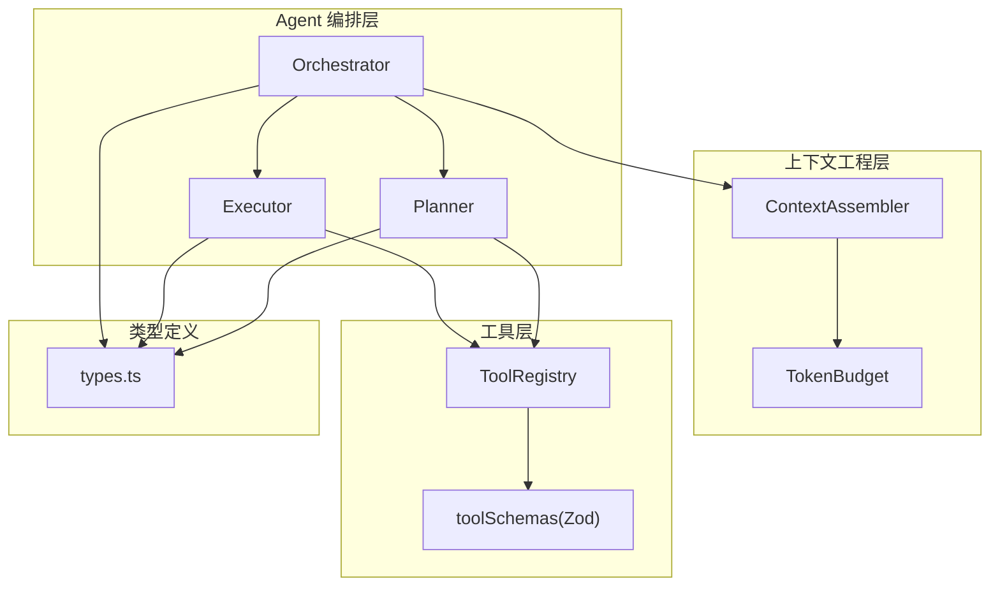
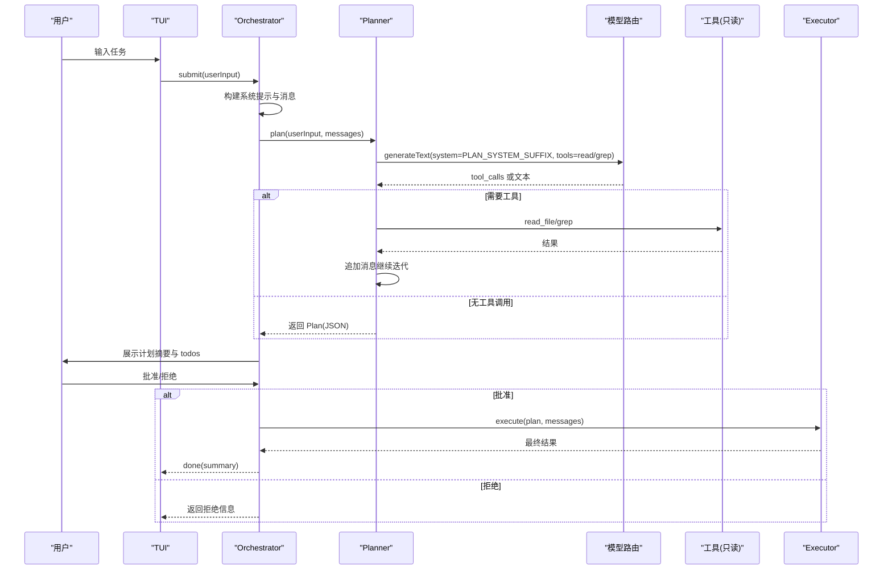
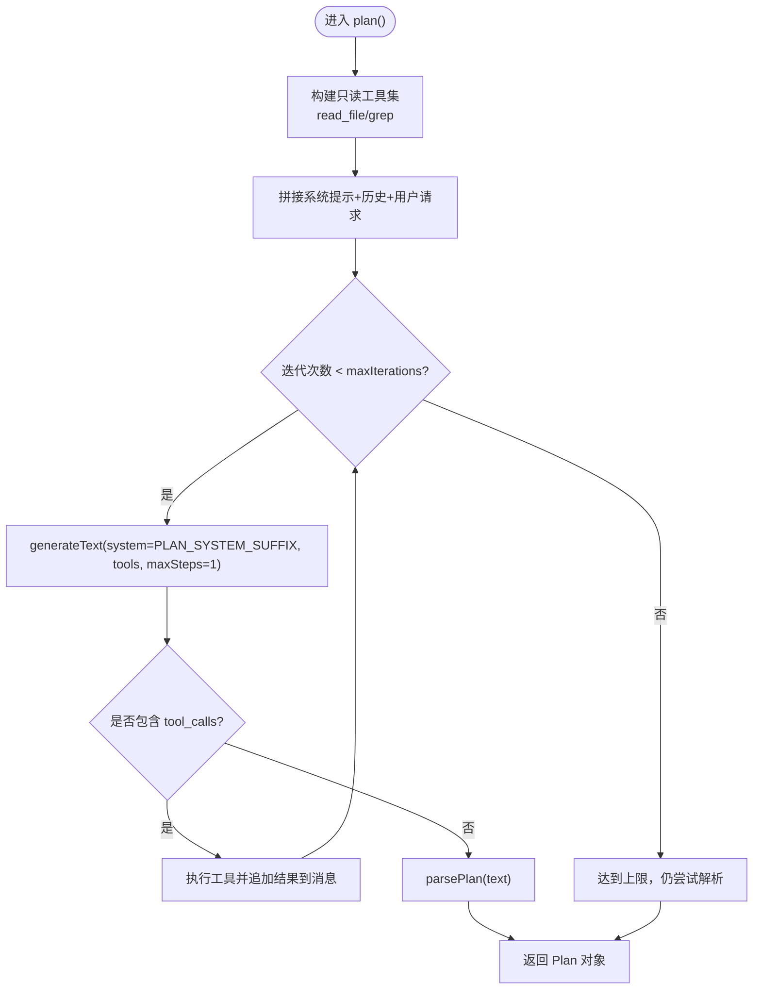
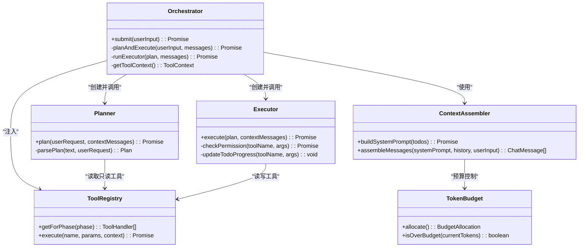
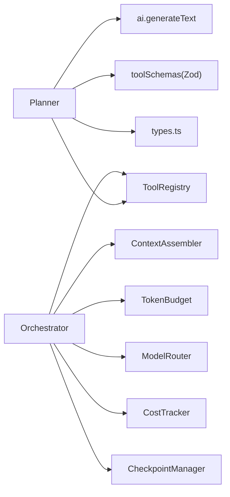

# 规划器模块

<cite>
**本文引用的文件**   
- [Planner.ts](file://src/agent/Planner.ts)
- [Orchestrator.ts](file://src/agent/Orchestrator.ts)
- [Executor.ts](file://src/agent/Executor.ts)
- [types.ts](file://src/agent/types.ts)
- [registry.ts](file://src/tools/registry.ts)
- [schemas.ts](file://src/tools/schemas.ts)
- [Assembler.ts](file://src/context/Assembler.ts)
- [TokenBudget.ts](file://src/context/TokenBudget.ts)
- [DESIGN.md](file://DESIGN.md)
- [README.md](file://README.md)
</cite>

## 目录
1. [简介](#简介)
2. [项目结构](#项目结构)
3. [核心组件](#核心组件)
4. [架构总览](#架构总览)
5. [详细组件分析](#详细组件分析)
6. [依赖关系分析](#依赖关系分析)
7. [性能考量](#性能考量)
8. [故障排查指南](#故障排查指南)
9. [结论](#结论)
10. [附录](#附录)

## 简介
本章节聚焦 Nexus 的“规划器模块”，围绕 Planner 类的设计与实现，解释其如何分析用户输入、生成结构化执行计划与任务分解策略；阐述 Plan 对象的构建过程（Todo 列表、文件修改预测、步骤估算）；说明与 LLM 模型的交互方式（提示词工程、参数配置、响应解析）；并给出自定义规划逻辑与异常处理的示例路径。同时，梳理与 Orchestrator 的协作关系和数据传递机制，提供规划质量评估与优化建议，兼顾初学者友好与资深开发者的技术深度。

## 项目结构
Nexus 采用分层架构：TUI 层 → Agent 编排层（Plan/Execute + ReAct + 子 Agent）→ 模型路由层与上下文工程层 → 工具层（MCP-native）。规划器位于 Agent 编排层的 Plan 阶段，负责在只读工具约束下探索代码库并产出结构化计划。



图表来源
- [Orchestrator.ts:1-260](file://src/agent/Orchestrator.ts#L1-L260)
- [Planner.ts:1-176](file://src/agent/Planner.ts#L1-L176)
- [Executor.ts:1-234](file://src/agent/Executor.ts#L1-L234)
- [Assembler.ts:1-184](file://src/context/Assembler.ts#L1-L184)
- [TokenBudget.ts:1-79](file://src/context/TokenBudget.ts#L1-L79)
- [registry.ts:1-96](file://src/tools/registry.ts#L1-L96)
- [schemas.ts:1-40](file://src/tools/schemas.ts#L1-L40)
- [types.ts:1-269](file://src/agent/types.ts#L1-L269)

章节来源
- [README.md:1-174](file://README.md#L1-L174)
- [DESIGN.md:1-774](file://DESIGN.md#L1-L774)

## 核心组件
- Planner：Plan 阶段的唯一入口，使用只读工具（read_file/grep）进行探索，调用 LLM 生成结构化计划，并解析为 Plan 对象。
- Orchestrator：编排 Plan/Execute 双阶段，负责上下文组装、审批流、检查点、成本追踪等。
- Executor：Execute 阶段 ReAct Loop，按批准的计划逐步执行，维护 Todo 状态与检查点。
- ToolRegistry：统一注册、筛选、执行工具，并提供 AI SDK 兼容的工具定义。
- ContextAssembler：三层上下文组装（L1/L2/L3），预算控制与历史压缩。
- TokenBudget：token 预算分配与裁剪策略。
- types.ts：全局共享类型（事件、Plan/Todo、权限模式、模型路由等）。

章节来源
- [Planner.ts:1-176](file://src/agent/Planner.ts#L1-L176)
- [Orchestrator.ts:1-260](file://src/agent/Orchestrator.ts#L1-L260)
- [Executor.ts:1-234](file://src/agent/Executor.ts#L1-L234)
- [registry.ts:1-96](file://src/tools/registry.ts#L1-L96)
- [Assembler.ts:1-184](file://src/context/Assembler.ts#L1-L184)
- [TokenBudget.ts:1-79](file://src/context/TokenBudget.ts#L1-L79)
- [types.ts:1-269](file://src/agent/types.ts#L1-L269)

## 架构总览
下图展示一次完整任务的时序，重点体现 Plan 阶段与 Execute 阶段的衔接、审批流程以及数据传递。



图表来源
- [Orchestrator.ts:88-148](file://src/agent/Orchestrator.ts#L88-L148)
- [Planner.ts:55-137](file://src/agent/Planner.ts#L55-L137)
- [Executor.ts:50-165](file://src/agent/Executor.ts#L50-L165)

## 详细组件分析

### Planner 设计与实现
- 目标：在只读工具约束下，通过 ReAct 循环让 LLM 自主探索代码库，最终输出结构化 JSON 计划。
- 关键流程：
  - 初始化：从 ToolRegistry 获取 plan 阶段可用工具（read_file/grep），构造 AI SDK 兼容的工具描述与参数 schema。
  - 消息构建：将上下文消息与用户请求拼接，注入 PLAN_SYSTEM_SUFFIX 作为 system prompt。
  - ReAct 循环：每次调用 generateText(maxSteps=1)，若出现 tool_calls，则执行工具并将结果以 user 消息追加到历史，继续下一轮；若无 tool_calls，则认为规划完成。
  - 计划解析：尝试从 LLM 输出的 JSON 代码块中解析 Plan；失败时回退为简单计划。
- 数据结构：
  - Plan：包含 summary、todos、filesToModify、estimatedSteps。
  - Todo：id、content、status。
- 错误处理：
  - JSON 解析失败时降级为默认计划。
  - 工具执行错误会被包装为 user 消息反馈给 LLM，引导其调整策略。
- 可扩展性：
  - 可通过替换 PLAN_SYSTEM_SUFFIX 和 parsePlan 逻辑定制规划风格与输出格式。
  - 可注入 onEvent 回调用于 UI 渲染与审计。



图表来源
- [Planner.ts:55-137](file://src/agent/Planner.ts#L55-L137)
- [Planner.ts:139-174](file://src/agent/Planner.ts#L139-L174)

章节来源
- [Planner.ts:1-176](file://src/agent/Planner.ts#L1-L176)
- [types.ts:29-40](file://src/agent/types.ts#L29-L40)

### Plan 对象构建过程
- Todo 列表生成：来自 LLM 输出的 JSON todos 字段；若缺失，则按顺序补全 id 与 content，初始 status 为 pending。
- 文件修改预测：filesToModify 直接取自 LLM 输出；若为空数组，表示未明确指定。
- 步骤估算：estimatedSteps 取 todos 的长度，便于 UI 进度条与资源预估。
- 回退策略：当 JSON 解析失败或结构不完整时，生成一个最小可行计划（3 步：分析需求、实施修改、验证正确性）。

章节来源
- [Planner.ts:139-174](file://src/agent/Planner.ts#L139-L174)
- [types.ts:35-40](file://src/agent/types.ts#L35-L40)

### 与 LLM 模型的交互方式
- 提示词工程：
  - PLAN_SYSTEM_SUFFIX 明确当前阶段为 Plan，限定只读工具，要求输出 JSON 格式的结构化计划，强调“先理解再规划”。
  - 对 LLM 的行为约束包括：每步对应明确文件操作、步骤数量合理（通常 3-10）、禁止凭空猜测。
- 参数配置：
  - model：由 Orchestrator 通过 ModelRouter 选择 planner 角色对应的模型。
  - tools：仅暴露 plan 阶段可用的只读工具及其 schema。
  - maxSteps：设为 1，确保单步决策，避免一次性多工具调用导致失控。
- 响应解析：
  - 优先匹配 ```json ... ``` 代码块中的 JSON 内容。
  - 校验 todos 是否为数组，否则回退到默认计划。
  - 将 LLM 的 text 作为 llm_done 事件上报，供 UI 与审计使用。

章节来源
- [Planner.ts:12-38](file://src/agent/Planner.ts#L12-L38)
- [Planner.ts:80-131](file://src/agent/Planner.ts#L80-L131)
- [Planner.ts:139-174](file://src/agent/Planner.ts#L139-L174)

### 与 Orchestrator 的协作关系与数据传递
- Orchestrator 负责：
  - 构建系统提示与消息（ContextAssembler）。
  - 创建 Planner 实例并传入模型、工具注册表、工具上下文、最大迭代次数与事件回调。
  - 接收 Plan 后更新 todos，触发 todo_update 事件，并向用户展示计划摘要。
  - 发起审批流程，批准后进入 Execute 阶段。
- 数据传递：
  - 输入：userInput + 上下文消息（含系统提示、历史、规则、Git 状态、项目骨架等）。
  - 输出：Plan 对象（summary、todos、filesToModify、estimatedSteps）。
  - 事件：llm_start、tool_call、tool_result、llm_done、todo_update、phase_change、done 等。



图表来源
- [Orchestrator.ts:120-180](file://src/agent/Orchestrator.ts#L120-L180)
- [Planner.ts:55-137](file://src/agent/Planner.ts#L55-L137)
- [Executor.ts:50-165](file://src/agent/Executor.ts#L50-L165)
- [registry.ts:44-82](file://src/tools/registry.ts#L44-L82)
- [Assembler.ts:55-116](file://src/context/Assembler.ts#L55-L116)
- [TokenBudget.ts:47-68](file://src/context/TokenBudget.ts#L47-L68)

章节来源
- [Orchestrator.ts:88-180](file://src/agent/Orchestrator.ts#L88-L180)
- [types.ts:8-22](file://src/agent/types.ts#L8-L22)

### 自定义规划逻辑与异常处理示例路径
- 自定义提示词工程：
  - 修改 PLAN_SYSTEM_SUFFIX 以适配特定领域或团队规范（如强制列出依赖变更、测试策略等）。
  - 参考路径：[Planner.ts:12-38](file://src/agent/Planner.ts#L12-L38)
- 自定义计划解析：
  - 重写 parsePlan 方法，支持更严格的 JSON Schema 校验、扩展字段（如风险等级、影响范围）。
  - 参考路径：[Planner.ts:139-174](file://src/agent/Planner.ts#L139-L174)
- 自定义工具集：
  - 在 ToolRegistry 中注册新的只读工具（如 semantic_search），并在 getForPhase('plan') 中生效。
  - 参考路径：[registry.ts:44-68](file://src/tools/registry.ts#L44-L68)
- 异常处理：
  - 工具执行错误会作为 user 消息注入历史，引导 LLM 自我修正。
  - JSON 解析失败自动降级为默认计划，保证流程不中断。
  - 参考路径：[Planner.ts:92-131](file://src/agent/Planner.ts#L92-L131)

章节来源
- [Planner.ts:92-131](file://src/agent/Planner.ts#L92-L131)
- [Planner.ts:139-174](file://src/agent/Planner.ts#L139-L174)
- [registry.ts:44-68](file://src/tools/registry.ts#L44-L68)

### 与 Executor 的协作与数据一致性
- Plan 完成后，Orchestrator 将 Plan.todos 同步到自身状态，并通过 todo_update 事件通知 UI。
- Executor 在执行过程中根据工具调用更新 Todo 状态（pending → in_progress → complete），并在 edit_file 成功后创建 Git Checkpoint。
- 两者共享同一份 Plan 与消息上下文，确保计划与执行的一致性。

章节来源
- [Orchestrator.ts:133-148](file://src/agent/Orchestrator.ts#L133-L148)
- [Executor.ts:198-215](file://src/agent/Executor.ts#L198-L215)
- [Executor.ts:135-144](file://src/agent/Executor.ts#L135-L144)

## 依赖关系分析
- Planner 依赖：
  - ai.generateText：与 LLM 交互的核心接口。
  - ToolRegistry：获取只读工具与执行工具调用。
  - toolSchemas：Zod schema 用于 AI SDK 的参数校验。
  - types.ts：Plan、Todo、NexusEvent 等类型。
- Orchestrator 依赖：
  - ContextAssembler：构建系统提示与消息。
  - TokenBudget：预算控制。
  - ToolRegistry：统一工具访问。
  - ModelRouter/CostTracker：模型选择与成本追踪。
  - CheckpointManager：Git 检查点管理。
- 工具层依赖：
  - readFile/editFile/bash/grep 工具实现，遵循 MCP 协议。
  - schemas.ts 提供 Zod schema 映射。



图表来源
- [Planner.ts:6-10](file://src/agent/Planner.ts#L6-L10)
- [registry.ts:1-96](file://src/tools/registry.ts#L1-L96)
- [schemas.ts:1-40](file://src/tools/schemas.ts#L1-L40)
- [types.ts:1-269](file://src/agent/types.ts#L1-L269)
- [Orchestrator.ts:1-26](file://src/agent/Orchestrator.ts#L1-L26)
- [Assembler.ts:1-184](file://src/context/Assembler.ts#L1-L184)
- [TokenBudget.ts:1-79](file://src/context/TokenBudget.ts#L1-L79)

章节来源
- [Planner.ts:1-176](file://src/agent/Planner.ts#L1-L176)
- [Orchestrator.ts:1-260](file://src/agent/Orchestrator.ts#L1-L260)
- [registry.ts:1-96](file://src/tools/registry.ts#L1-L96)
- [schemas.ts:1-40](file://src/tools/schemas.ts#L1-L40)
- [types.ts:1-269](file://src/agent/types.ts#L1-L269)

## 性能考量
- 只读工具限制：Plan 阶段仅允许 read_file/grep，减少副作用与 I/O 开销。
- 迭代上限：maxIterations 控制探索深度，防止无限循环。
- 上下文预算：TokenBudget 按比例分配 system/history/toolResults，超预算时裁剪，避免窗口溢出。
- 工具结果分级：大文件截断、grep 结果精简，降低 token 消耗。
- 模型路由：planner 可使用更高档模型提升规划质量，executor 使用性价比更高的模型。

章节来源
- [Planner.ts:76-131](file://src/agent/Planner.ts#L76-L131)
- [TokenBudget.ts:47-68](file://src/context/TokenBudget.ts#L47-L68)
- [Assembler.ts:92-116](file://src/context/Assembler.ts#L92-L116)

## 故障排查指南
- 计划解析失败：
  - 现象：LLM 未输出标准 JSON 代码块或结构不完整。
  - 处理：自动降级为默认计划，检查 PLAN_SYSTEM_SUFFIX 与提示词约束。
  - 参考路径：[Planner.ts:139-174](file://src/agent/Planner.ts#L139-L174)
- 工具调用错误：
  - 现象：read_file/grep 报错或返回空结果。
  - 处理：错误被包装为 user 消息注入历史，引导 LLM 调整搜索策略或重试。
  - 参考路径：[Planner.ts:92-131](file://src/agent/Planner.ts#L92-L131)
- 迭代超限：
  - 现象：达到 maxIterations 仍未产出计划。
  - 处理：强制结束并尝试解析，必要时缩短探索范围或放宽正则。
  - 参考路径：[Planner.ts:76-131](file://src/agent/Planner.ts#L76-L131)
- 审批拒绝：
  - 现象：用户拒绝计划或工具调用。
  - 处理：Orchestrator 返回拒绝信息，Planner/Executor 需重新规划或改道。
  - 参考路径：[Orchestrator.ts:138-142](file://src/agent/Orchestrator.ts#L138-L142)

章节来源
- [Planner.ts:92-131](file://src/agent/Planner.ts#L92-L131)
- [Planner.ts:139-174](file://src/agent/Planner.ts#L139-L174)
- [Orchestrator.ts:138-142](file://src/agent/Orchestrator.ts#L138-L142)

## 结论
Planner 模块通过只读工具驱动的 ReAct 循环与结构化提示词工程，实现了稳健的计划生成与任务分解。其与 Orchestrator 的紧密协作确保了从计划到执行的无缝衔接，并通过事件流与 Todo 状态保持 UI 与后端一致。结合 TokenBudget 与模型路由，系统在规划质量与成本之间取得平衡。未来可通过扩展只读工具、增强 JSON 解析与校验、引入语义检索等手段进一步提升规划准确性与效率。

## 附录

### 规划质量评估指标与建议
- 指标：
  - 计划完整性：todos 覆盖用户需求的关键点。
  - 文件命中准确率：filesToModify 与实际修改文件的重合度。
  - 步骤合理性：estimatedSteps 与真实执行步数的偏差。
  - 解析成功率：JSON 解析成功比例。
- 建议：
  - 强化提示词约束：明确要求列出依赖变更、测试策略、回滚方案。
  - 引入语义检索：在 Plan 阶段增加 semantic_search 工具，提高跨词面匹配能力。
  - 增加校验层：对 LLM 输出的 JSON 进行严格 Schema 校验，失败时要求重生成。
  - 监控与回溯：记录每次计划的 key metrics，持续优化提示词与工具集。

章节来源
- [Planner.ts:12-38](file://src/agent/Planner.ts#L12-L38)
- [Planner.ts:139-174](file://src/agent/Planner.ts#L139-L174)
- [DESIGN.md:284-337](file://DESIGN.md#L284-L337)