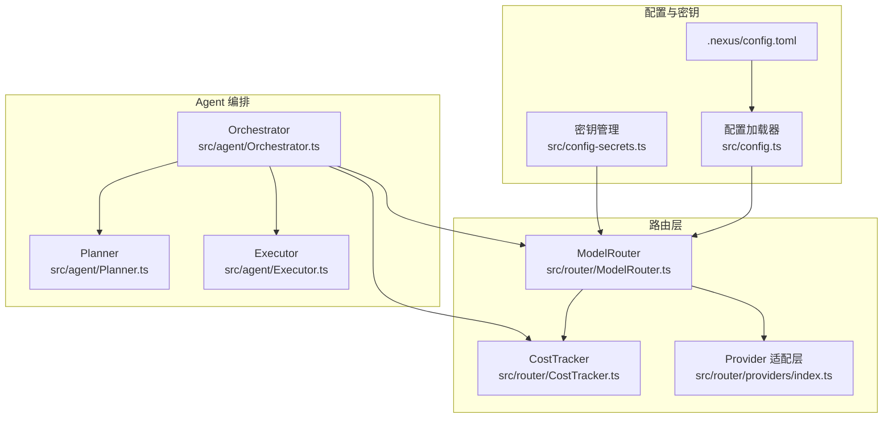
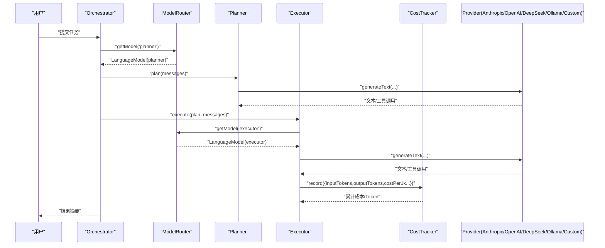
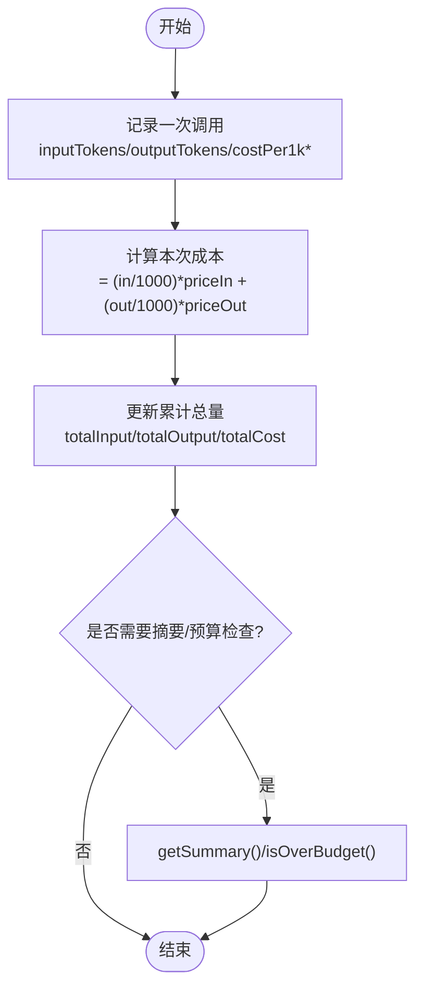
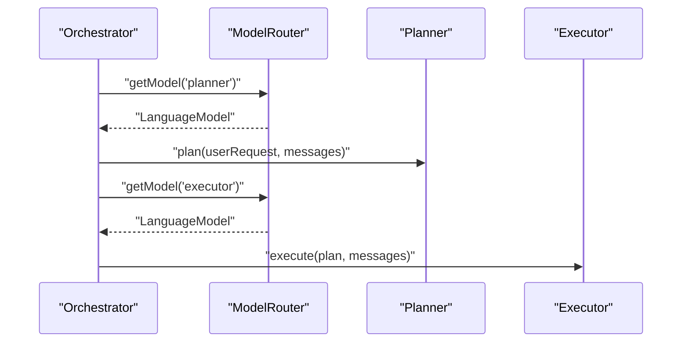
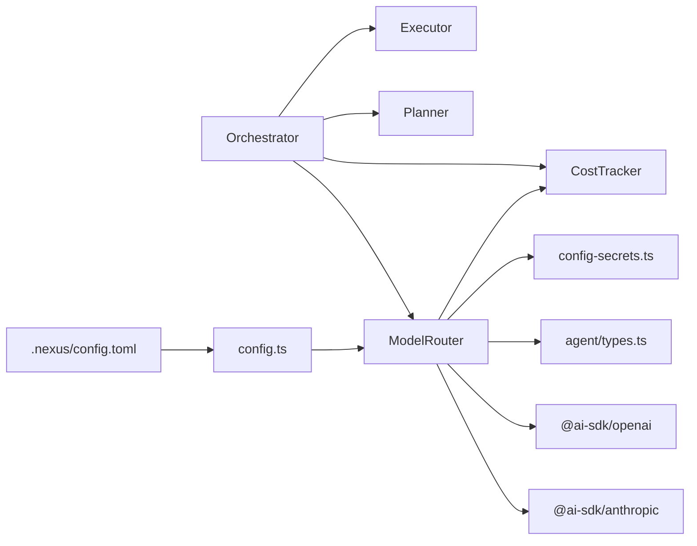

# 模型路由系统

<cite>
**本文引用的文件**   
- [src/router/ModelRouter.ts](file://src/router/ModelRouter.ts)
- [src/router/CostTracker.ts](file://src/router/CostTracker.ts)
- [src/router/providers/index.ts](file://src/router/providers/index.ts)
- [src/config.ts](file://src/config.ts)
- [src/config-secrets.ts](file://src/config-secrets.ts)
- [src/agent/types.ts](file://src/agent/types.ts)
- [.nexus/config.toml](file://.nexus/config.toml)
- [src/agent/Orchestrator.ts](file://src/agent/Orchestrator.ts)
- [src/agent/Planner.ts](file://src/agent/Planner.ts)
- [src/agent/Executor.ts](file://src/agent/Executor.ts)
- [tests/unit/costTracker.test.ts](file://tests/unit/costTracker.test.ts)
</cite>

## 目录
1. [简介](#简介)
2. [项目结构](#项目结构)
3. [核心组件](#核心组件)
4. [架构总览](#架构总览)
5. [详细组件分析](#详细组件分析)
6. [依赖关系分析](#依赖关系分析)
7. [性能与成本优化](#性能与成本优化)
8. [故障排查指南](#故障排查指南)
9. [结论](#结论)
10. [附录：配置与集成示例](#附录配置与集成示例)

## 简介
本技术文档聚焦 Nexus 的多模型路由系统，系统性阐述 ModelRouter 的实现原理、支持的 AI 提供商（Anthropic、OpenAI、DeepSeek、Ollama、Custom）的配置与使用方式、成本追踪机制（token 统计与费用计算）、降级策略与错误处理方案，以及在不同任务阶段选择合适模型的最佳实践。同时说明与 Agent 编排系统的集成方式，并给出并发请求与资源管理的建议。

## 项目结构
围绕模型路由的核心代码位于 router 目录，配合配置加载器与密钥管理模块，为 Orchestrator 提供按角色分派的模型实例与成本追踪能力。



图表来源
- [src/router/ModelRouter.ts:1-308](file://src/router/ModelRouter.ts#L1-L308)
- [src/router/CostTracker.ts:1-96](file://src/router/CostTracker.ts#L1-L96)
- [src/router/providers/index.ts:1-83](file://src/router/providers/index.ts#L1-L83)
- [src/config.ts:1-132](file://src/config.ts#L1-L132)
- [src/config-secrets.ts:1-171](file://src/config-secrets.ts#L1-L171)
- [.nexus/config.toml:1-62](file://.nexus/config.toml#L1-L62)
- [src/agent/Orchestrator.ts:1-200](file://src/agent/Orchestrator.ts#L1-L200)
- [src/agent/Planner.ts:1-176](file://src/agent/Planner.ts#L1-L176)
- [src/agent/Executor.ts:1-200](file://src/agent/Executor.ts#L1-L200)

章节来源
- [src/router/ModelRouter.ts:1-308](file://src/router/ModelRouter.ts#L1-L308)
- [src/config.ts:1-132](file://src/config.ts#L1-L132)
- [src/config-secrets.ts:1-171](file://src/config-secrets.ts#L1-L171)
- [.nexus/config.toml:1-62](file://.nexus/config.toml#L1-L62)
- [src/agent/Orchestrator.ts:1-200](file://src/agent/Orchestrator.ts#L1-L200)

## 核心组件
- ModelRouter：负责按角色（planner/executor/summarizer/verifier）解析当前模型、初始化各 Provider、自动模式选择、降级链回退、暴露上下文窗口与成本信息。
- CostTracker：记录每次 LLM 调用的 token 数与估算成本，支持汇总、分组统计、预算检查与重置。
- Provider 适配层：定义各 Provider 的可用性、默认模型、上下文窗口与工具调用支持等元数据。
- 配置与密钥：从 .nexus/config.toml 加载配置，结合全局或项目级 secrets.toml 与环境变量，统一解析 API Key 与 base URL。
- Orchestrator：在 Plan/Execute 两阶段中通过 ModelRouter 获取对应角色的 LanguageModel 实例，驱动 Planner/Executor 执行。

章节来源
- [src/router/ModelRouter.ts:101-308](file://src/router/ModelRouter.ts#L101-L308)
- [src/router/CostTracker.ts:8-96](file://src/router/CostTracker.ts#L8-L96)
- [src/router/providers/index.ts:9-83](file://src/router/providers/index.ts#L9-L83)
- [src/config.ts:11-132](file://src/config.ts#L11-L132)
- [src/config-secrets.ts:12-171](file://src/config-secrets.ts#L12-L171)
- [src/agent/Orchestrator.ts:38-86](file://src/agent/Orchestrator.ts#L38-L86)

## 架构总览
下图展示了从 Orchestrator 到 ModelRouter 再到具体 Provider 的调用路径，以及与 CostTracker 的成本记录闭环。



图表来源
- [src/agent/Orchestrator.ts:120-180](file://src/agent/Orchestrator.ts#L120-L180)
- [src/agent/Planner.ts:56-137](file://src/agent/Planner.ts#L56-L137)
- [src/agent/Executor.ts:51-165](file://src/agent/Executor.ts#L51-L165)
- [src/router/ModelRouter.ts:204-243](file://src/router/ModelRouter.ts#L204-L243)
- [src/router/CostTracker.ts:14-42](file://src/router/CostTracker.ts#L14-L42)

## 详细组件分析

### ModelRouter 实现原理
- 模型目录与角色映射
  - 内置 MODEL_CATALOG 维护已知模型的 provider、价格、上下文窗口、是否支持工具与流式输出等元数据。
  - DEFAULT_ROLE_MODELS 为 planner/executor/summarizer/verifier 指定默认模型；当配置为 auto 时，根据可用 Provider 优先级选择最佳模型。
- Provider 初始化
  - initProviders 依据配置与密钥，创建 Anthropic、OpenAI、Ollama（OpenAI 兼容）、DeepSeek（OpenAI 兼容）、Custom（通用 OpenAI 兼容）的客户端实例。
  - 密钥来源优先级：环境变量 > secrets.toml（全局优先，项目级兼容）。
- 自动模式与降级
  - resolveAutoModel 按优先级 anthropic > deepseek > openai > custom > ollama 选择高/低档模型（planner/executor 用高档，summarizer/verifier 用低档）。
  - getFallback 基于 FALLBACK_CHAIN 进行降级：如 claude-sonnet → deepseek-chat → gpt-4o-mini → claude-haiku。
- 模型获取与路由信息
  - getModel(role) 返回对应角色的 LanguageModel 实例；若未知模型则尝试默认 Provider 动态构造；若 Provider 不可用则触发降级或报错。
  - getRouteInfo(role) 返回包含 costPer1kInput/costPer1kOutput/contextWindow 等的路由信息，供上层用于成本估算与上下文控制。
- 其他能力
  - setModel/getCurrentModel 支持运行时切换与查询。
  - getAvailableModels/getAvailableProviders 暴露当前可用的模型与 Provider 列表。
  - getContextWindow 返回所选模型的上下文窗口大小。

```mermaid
classDiagram
class ModelRouter {
-config
-costTracker
-providers
-currentModels
-secrets
+constructor(config, costTracker, secrets)
-initProviders()
-applyConfigModels()
-resolveAutoModel(role) string
+getModel(role) LanguageModel
-getFallback(role) LanguageModel?
+getRouteInfo(role) ModelRoute
+setModel(role, modelName) void
+getCurrentModel(role) string
+getAvailableProviders() ProviderName[]
+getAvailableModels() {name,provider,current}[]
+getContextWindow(role) number
+getCostTracker() CostTracker
}
class CostTracker {
-records
-totalInputTokens
-totalOutputTokens
-totalCost
+record(params) void
+getTotalCost() number
+getTotalTokens() {input,output,total}
+getSummary() string
+getByRole() Record~string,{calls,cost,tokens}~
+isOverBudget(maxCost) boolean
+getRecords() CostRecord[]
+reset() void
}
ModelRouter --> CostTracker : "记录成本"
```

图表来源
- [src/router/ModelRouter.ts:101-308](file://src/router/ModelRouter.ts#L101-L308)
- [src/router/CostTracker.ts:8-96](file://src/router/CostTracker.ts#L8-L96)

章节来源
- [src/router/ModelRouter.ts:14-100](file://src/router/ModelRouter.ts#L14-L100)
- [src/router/ModelRouter.ts:118-179](file://src/router/ModelRouter.ts#L118-L179)
- [src/router/ModelRouter.ts:181-202](file://src/router/ModelRouter.ts#L181-L202)
- [src/router/ModelRouter.ts:204-243](file://src/router/ModelRouter.ts#L204-L243)
- [src/router/ModelRouter.ts:245-308](file://src/router/ModelRouter.ts#L245-L308)

### 成本追踪机制（CostTracker）
- 记录一次调用：输入/输出 token 数与单价，计算本次成本并累加总计。
- 聚合统计：提供总花费、总 token、按角色分组统计、会话预算检查、原始记录导出与重置。
- 典型用法：在 Orchestrator/Planner/Executor 完成一次 LLM 调用后，将 token 与路由信息传入 record 以更新成本。



图表来源
- [src/router/CostTracker.ts:14-42](file://src/router/CostTracker.ts#L14-L42)
- [src/router/CostTracker.ts:44-81](file://src/router/CostTracker.ts#L44-L81)

章节来源
- [src/router/CostTracker.ts:14-96](file://src/router/CostTracker.ts#L14-L96)
- [tests/unit/costTracker.test.ts:15-76](file://tests/unit/costTracker.test.ts#L15-L76)

### 多 Provider 支持与配置
- Anthropic：通过 createAnthropic 初始化，需设置 ANTHROPIC_API_KEY。
- OpenAI：通过 createOpenAI 初始化，需设置 OPENAI_API_KEY。
- Ollama：使用 OpenAI 兼容接口，baseURL 指向本地服务（默认 http://localhost:11434/v1），apiKey 占位即可。
- DeepSeek：OpenAI 兼容接口，可自定义 baseUrl（默认 https://api.deepseek.com），需 DEEPSEEK_API_KEY。
- Custom：通用 OpenAI 兼容接口，需 CUSTOM_API_KEY 与 CUSTOM_BASE_URL，适合 Moonshot/智谱/硅基流动等任意厂商。

密钥优先级与来源
- 环境变量优先于 secrets.toml；全局 ~/.nexus/secrets.toml 优先于项目级 .nexus/secrets.toml。
- getEffectiveApiKey 统一解析 apiKeyEnv 指定的环境变量名，并在缺失时回退到 secrets.providers[name].apiKey。

章节来源
- [src/router/ModelRouter.ts:118-165](file://src/router/ModelRouter.ts#L118-L165)
- [src/config-secrets.ts:117-131](file://src/config-secrets.ts#L117-L131)
- [src/config-secrets.ts:41-59](file://src/config-secrets.ts#L41-L59)
- [.nexus/config.toml:11-34](file://.nexus/config.toml#L11-L34)

### 降级策略与重试机制
- 降级链：FALLBACK_CHAIN 定义了从高档到低档的候选模型顺序，当首选 Provider 不可用时，依次尝试降级目标。
- 错误处理：
  - 未知模型且无可用 Provider：抛出明确错误提示。
  - Provider 未配置或 API key 缺失：先尝试降级，若无降级目标则抛出错误。
- 重试机制：当前实现未内置自动重试逻辑；可在上层（如 Orchestrator/Executor）对网络异常或限流错误进行指数退避重试，并结合 CostTracker 的 isOverBudget 做熔断保护。

章节来源
- [src/router/ModelRouter.ts:93-99](file://src/router/ModelRouter.ts#L93-L99)
- [src/router/ModelRouter.ts:218-243](file://src/router/ModelRouter.ts#L218-L243)

### 不同任务阶段的模型选择最佳实践
- planner/executor：建议使用强推理与工具调用能力更强的模型（如 claude-sonnet-4-20250514 或 gpt-4o），以保证计划质量与执行稳定性。
- summarizer/verifier：可使用更轻量、低成本的模型（如 claude-haiku-3-5 或 gpt-4o-mini），降低总体成本。
- 自动模式：当配置为 auto 时，系统会按 Provider 优先级与角色需求选择最合适的模型；建议在具备多个 Provider 的环境下启用 auto，以获得更好的鲁棒性与性价比。

章节来源
- [src/router/ModelRouter.ts:85-91](file://src/router/ModelRouter.ts#L85-L91)
- [src/router/ModelRouter.ts:181-202](file://src/router/ModelRouter.ts#L181-L202)

### 与 Agent 编排系统的集成
- Orchestrator 在 init 时加载 secrets 并构建 ModelRouter，随后在 planAndExecute 与 runExecutor 中分别通过 getModel('planner') 与 getModel('executor') 获取模型实例。
- Planner 与 Executor 内部通过 ai SDK 的 generateText/streamText 调用语言模型，并在完成后由上层（或未来扩展）将 token 与路由信息写入 CostTracker。



图表来源
- [src/agent/Orchestrator.ts:60-86](file://src/agent/Orchestrator.ts#L60-L86)
- [src/agent/Orchestrator.ts:120-180](file://src/agent/Orchestrator.ts#L120-L180)
- [src/agent/Planner.ts:56-137](file://src/agent/Planner.ts#L56-L137)
- [src/agent/Executor.ts:51-165](file://src/agent/Executor.ts#L51-L165)

章节来源
- [src/agent/Orchestrator.ts:60-86](file://src/agent/Orchestrator.ts#L60-L86)
- [src/agent/Orchestrator.ts:120-180](file://src/agent/Orchestrator.ts#L120-L180)
- [src/agent/Planner.ts:56-137](file://src/agent/Planner.ts#L56-L137)
- [src/agent/Executor.ts:51-165](file://src/agent/Executor.ts#L51-L165)

## 依赖关系分析
- ModelRouter 依赖：
  - @ai-sdk/anthropic、@ai-sdk/openai 创建 Provider 客户端。
  - config-secrets 解析有效 API Key。
  - agent/types 中的类型定义（ModelRole、ProviderName、NexusConfig 等）。
  - CostTracker 用于成本记录。
- 配置与密钥：
  - config.ts 从 .nexus/config.toml 合并默认值。
  - config-secrets.ts 管理全局/项目级 secrets 与环境变量优先级。
- Orchestrator 作为编排中心，组合 ModelRouter、CostTracker、Planner、Executor 完成端到端流程。



图表来源
- [src/router/ModelRouter.ts:7-12](file://src/router/ModelRouter.ts#L7-L12)
- [src/router/ModelRouter.ts:101-116](file://src/router/ModelRouter.ts#L101-L116)
- [src/config.ts:63-74](file://src/config.ts#L63-L74)
- [src/config-secrets.ts:41-59](file://src/config-secrets.ts#L41-L59)
- [src/agent/Orchestrator.ts:60-86](file://src/agent/Orchestrator.ts#L60-L86)

章节来源
- [src/router/ModelRouter.ts:7-12](file://src/router/ModelRouter.ts#L7-L12)
- [src/config.ts:63-74](file://src/config.ts#L63-L74)
- [src/config-secrets.ts:41-59](file://src/config-secrets.ts#L41-L59)
- [src/agent/Orchestrator.ts:60-86](file://src/agent/Orchestrator.ts#L60-L86)

## 性能与成本优化
- 模型选择
  - 在高价值任务（规划/执行）使用更强模型，在总结/验证阶段使用低成本模型，平衡效果与费用。
  - 开启 auto 模式，让系统根据可用 Provider 自动选择最优模型。
- 上下文窗口与 Token 预算
  - 使用 getContextWindow 与 TokenBudget 控制消息长度，避免超出窗口导致失败或额外压缩开销。
- 成本监控
  - 通过 CostTracker 实时统计与分组统计，结合 isOverBudget 在达到预算上限时暂停或降级。
- 降级与容错
  - 利用 FALLBACK_CHAIN 快速切换到次优但可用的模型，提高成功率。
  - 在上层增加重试与熔断策略，避免雪崩效应。

[本节为通用指导，不直接分析具体文件]

## 故障排查指南
- 常见错误
  - “模型不在已知目录中，且无可用 provider”：检查 MODEL_CATALOG 是否包含该模型，或确保至少有一个 Provider 已正确初始化。
  - “Provider 未配置或 API key 缺失”：确认环境变量或 secrets.toml 中已配置对应 provider 的 apiKeyEnv/baseUrl/defaultModel。
- 调试步骤
  - 使用 getAvailableProviders/getAvailableModels 查看当前可用的 Provider 与模型。
  - 使用 getRouteInfo 检查所选模型的 costPer1kInput/costPer1kOutput/contextWindow 是否符合预期。
  - 使用 CostTracker.getSummary/isOverBudget 检查成本与预算状态。
- 日志与事件
  - Orchestrator/Planner/Executor 通过 onEvent 发出 llm_start/llm_chunk/llm_done/tool_call/tool_result 等事件，便于定位问题。

章节来源
- [src/router/ModelRouter.ts:209-226](file://src/router/ModelRouter.ts#L209-L226)
- [src/router/ModelRouter.ts:245-263](file://src/router/ModelRouter.ts#L245-L263)
- [src/router/CostTracker.ts:58-81](file://src/router/CostTracker.ts#L58-L81)
- [src/agent/Planner.ts:56-137](file://src/agent/Planner.ts#L56-L137)
- [src/agent/Executor.ts:51-165](file://src/agent/Executor.ts#L51-L165)

## 结论
Nexus 的多模型路由系统通过 ModelRouter 实现了按角色分派、自动选择与降级回退，结合 CostTracker 提供了完整的成本追踪能力。配合配置与密钥管理，系统能够灵活接入多种 AI 提供商，并在 Orchestrator 的统一编排下完成 Plan/Execute 双阶段工作流。通过合理的模型选择、上下文预算与降级策略，可以在保证质量的同时有效控制成本与风险。

[本节为总结性内容，不直接分析具体文件]

## 附录：配置与集成示例

### 配置文件示例（.nexus/config.toml）
- 模型路由与 Provider 配置
  - models.planner/executor/summarizer/verifier 设为 "auto" 或固定模型名。
  - models.providers.anthropic/openai/deepseek/custom 配置 api_key_env/base_url/default_model。
  - 可选启用 ollama（OpenAI 兼容）并设置 base_url。

章节来源
- [.nexus/config.toml:4-34](file://.nexus/config.toml#L4-L34)

### 密钥管理（secrets.toml）
- 全局路径 ~/.nexus/secrets.toml，支持 providers.anthropic/api_key、providers.openai/api_key、providers.deepseek/api_key、providers.custom/api_key 与 base_url/default_model。
- 优先级：环境变量 > secrets.toml。

章节来源
- [src/config-secrets.ts:41-59](file://src/config-secrets.ts#L41-L59)
- [src/config-secrets.ts:117-131](file://src/config-secrets.ts#L117-L131)

### 集成代码要点（Orchestrator）
- 初始化阶段加载 secrets 并创建 ModelRouter，随后在 planAndExecute/runExecutor 中分别获取 planner/executor 的 LanguageModel。
- 通过 ContextAssembler 与 TokenBudget 控制上下文长度，避免超出模型窗口。

章节来源
- [src/agent/Orchestrator.ts:60-86](file://src/agent/Orchestrator.ts#L60-L86)
- [src/agent/Orchestrator.ts:120-180](file://src/agent/Orchestrator.ts#L120-L180)

### 成本记录与预算检查
- 在每次 LLM 调用完成后，将 inputTokens/outputTokens 与路由信息传入 CostTracker.record。
- 使用 isOverBudget 检查是否超过 maxSessionCost，必要时中断或降级。

章节来源
- [src/router/CostTracker.ts:14-42](file://src/router/CostTracker.ts#L14-L42)
- [src/router/CostTracker.ts:78-81](file://src/router/CostTracker.ts#L78-L81)
- [tests/unit/costTracker.test.ts:61-76](file://tests/unit/costTracker.test.ts#L61-L76)

### 并发请求与资源管理建议
- 并发控制
  - 在 Orchestrator 层引入队列或信号量限制并行 LLM 调用数量，避免瞬时峰值导致限流或成本飙升。
- 超时与重试
  - 为每个 LLM 调用设置合理超时；对瞬态错误（网络抖动、限流）实施指数退避重试。
- 成本熔断
  - 在每次 record 后检查 isOverBudget，达到阈值时停止新调用或切换到更低成本模型。
- 上下文压缩
  - 使用 TokenBudget 与 ContextAssembler 的动态压缩策略，减少不必要的历史消息占用。

[本节为通用指导，不直接分析具体文件]