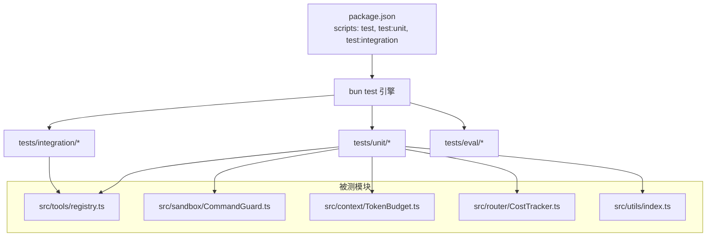
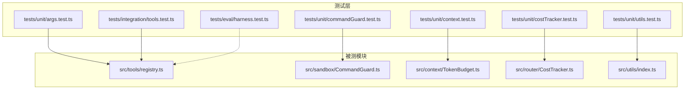
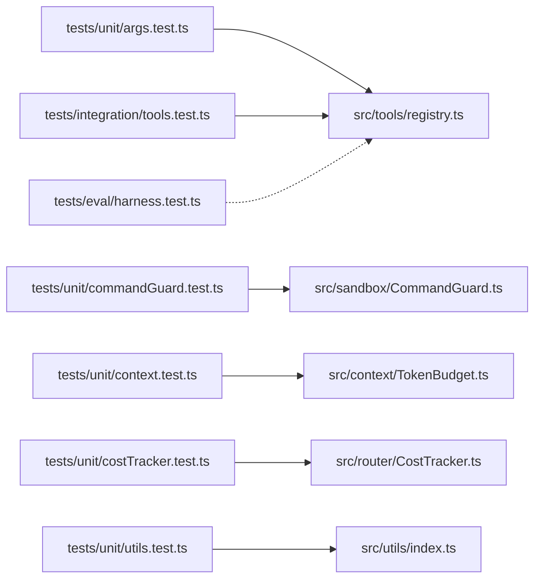

# 测试指南

<cite>
**本文引用的文件**   
- [package.json](file://package.json)
- [bunfig.toml](file://bunfig.toml)
- [tests/unit/args.test.ts](file://tests/unit/args.test.ts)
- [tests/integration/tools.test.ts](file://tests/integration/tools.test.ts)
- [tests/eval/harness.test.ts](file://tests/eval/harness.test.ts)
- [tests/unit/commandGuard.test.ts](file://tests/unit/commandGuard.test.ts)
- [tests/unit/context.test.ts](file://tests/unit/context.test.ts)
- [tests/unit/costTracker.test.ts](file://tests/unit/costTracker.test.ts)
- [tests/unit/utils.test.ts](file://tests/unit/utils.test.ts)
- [src/tools/registry.ts](file://src/tools/registry.ts)
- [src/sandbox/CommandGuard.ts](file://src/sandbox/CommandGuard.ts)
- [src/context/TokenBudget.ts](file://src/context/TokenBudget.ts)
- [src/router/CostTracker.ts](file://src/router/CostTracker.ts)
- [src/utils/index.ts](file://src/utils/index.ts)
</cite>

## 目录
1. [简介](#简介)
2. [项目结构](#项目结构)
3. [核心组件](#核心组件)
4. [架构总览](#架构总览)
5. [详细组件分析](#详细组件分析)
6. [依赖分析](#依赖分析)
7. [性能考虑](#性能考虑)
8. [故障排查指南](#故障排查指南)
9. [结论](#结论)
10. [附录](#附录)

## 简介
本指南面向 Nexus 项目的开发者与质量保障人员，系统化阐述测试策略、框架选择、用例编写规范、工具 Mock 策略（特别是 MCP 工具与服务）、性能与压力测试方法、持续集成与自动化流程、覆盖率要求与质量门禁，并提供常见测试场景示例与最佳实践。目标是帮助团队在保持快速迭代的同时，确保代码质量、安全性与可维护性。

## 项目结构
Nexus 使用 Bun 作为运行时与测试执行器，测试脚本通过 package.json 的 scripts 暴露，统一由 bun test 驱动。测试目录按类型分层：
- tests/unit：单元测试，覆盖 CLI 参数解析、命令安全检测、上下文预算与压缩、成本追踪、通用工具函数等。
- tests/integration：集成测试，围绕工具注册表与文件系统交互进行端到端验证。
- tests/eval：评估测试（Eval Harness），用于 SWE-bench 风格任务评估的骨架与占位用例。

图表来源
- [package.json:10-17](file://package.json#L10-L17)
- [bunfig.toml:1-3](file://bunfig.toml#L1-L3)

章节来源
- [package.json:10-17](file://package.json#L10-L17)
- [bunfig.toml:1-3](file://bunfig.toml#L1-L3)

## 核心组件
本节聚焦测试相关的核心能力与现有实现，包括测试运行配置、工具注册表、命令安全检测、Token 预算与压缩、成本追踪以及通用工具函数。这些组件既是被测对象，也是构建高质量测试的基础设施。

- 测试运行与超时
  - 通过 bunfig.toml 设置测试默认超时，避免长耗时测试被误杀。
- 工具注册表与阶段过滤
  - 提供 createToolRegistry 工厂与 ToolRegistry 类，支持按阶段（plan/execute）过滤工具、生成 AI SDK 兼容定义、执行工具调用。
- 危险命令检测
  - CommandGuard 基于正则黑名单与启发式规则，返回危险等级并判断是否需要强制审批。
- Token 预算与历史压缩
  - TokenBudget 计算输入预算、分配各层预算、判断超预算与溢出量；Compressor 对长历史与工具结果进行压缩。
- 成本追踪
  - CostTracker 记录每次 LLM 调用的 token 数与估算成本，支持汇总、分组统计与重置。
- 通用工具函数
  - Result 类型、截断策略（head/tail）、二进制输出清理、行尾处理与 BOM 去除。

章节来源
- [bunfig.toml:1-3](file://bunfig.toml#L1-L3)
- [src/tools/registry.ts:25-96](file://src/tools/registry.ts#L25-L96)
- [src/sandbox/CommandGuard.ts:1-98](file://src/sandbox/CommandGuard.ts#L1-L98)
- [src/context/TokenBudget.ts:1-79](file://src/context/TokenBudget.ts#L1-L79)
- [src/router/CostTracker.ts:1-96](file://src/router/CostTracker.ts#L1-L96)
- [src/utils/index.ts:1-211](file://src/utils/index.ts#L1-L211)

## 架构总览
下图展示测试与核心模块之间的交互关系，体现从测试入口到被测模块的调用路径与数据流。

图表来源
- [tests/unit/args.test.ts:1-82](file://tests/unit/args.test.ts#L1-L82)
- [tests/unit/commandGuard.test.ts:1-88](file://tests/unit/commandGuard.test.ts#L1-L88)
- [tests/unit/context.test.ts:1-115](file://tests/unit/context.test.ts#L1-L115)
- [tests/unit/costTracker.test.ts:1-138](file://tests/unit/costTracker.test.ts#L1-L138)
- [tests/unit/utils.test.ts:1-145](file://tests/unit/utils.test.ts#L1-L145)
- [tests/integration/tools.test.ts:1-100](file://tests/integration/tools.test.ts#L1-L100)
- [tests/eval/harness.test.ts:1-80](file://tests/eval/harness.test.ts#L1-L80)
- [src/tools/registry.ts:1-96](file://src/tools/registry.ts#L1-L96)
- [src/sandbox/CommandGuard.ts:1-98](file://src/sandbox/CommandGuard.ts#L1-L98)
- [src/context/TokenBudget.ts:1-79](file://src/context/TokenBudget.ts#L1-L79)
- [src/router/CostTracker.ts:1-96](file://src/router/CostTracker.ts#L1-L96)
- [src/utils/index.ts:1-211](file://src/utils/index.ts#L1-L211)

## 详细组件分析

### 单元测试：CLI 参数解析
- 目标：验证 parseArgs 对不同命令行参数的解析行为，包括布尔开关、短选项、长选项、位置参数与组合场景。
- 设计要点：
  - 使用 describe/it 组织用例，每个用例聚焦单一职责。
  - 断言覆盖默认值、单选项、多选项混合与边界情况。
- 建议扩展：
  - 增加非法参数与冲突参数的错误路径测试。
  - 针对 --cwd 的路径规范化与跨平台差异补充断言。

章节来源
- [tests/unit/args.test.ts:1-82](file://tests/unit/args.test.ts#L1-L82)

### 单元测试：危险命令检测（CommandGuard）
- 目标：验证 isDangerousCommand 与 requiresForcedApproval 在不同命令下的判定逻辑。
- 设计要点：
  - 覆盖危险模式（如 rm -rf /、fork bomb、curl|bash、格式化磁盘等）。
  - 覆盖 caution 级别（如 rm -f、git push）与安全命令。
  - 断言 dangerous 标志、level 与强制审批判定。
- 建议扩展：
  - 增加大小写变体、多余空白与引号包裹的命令变体。
  - 针对 Windows 与 Unix 双平台的命令差异补充用例。

章节来源
- [tests/unit/commandGuard.test.ts:1-88](file://tests/unit/commandGuard.test.ts#L1-L88)
- [src/sandbox/CommandGuard.ts:1-98](file://src/sandbox/CommandGuard.ts#L1-L98)

### 单元测试：Token 预算与历史压缩（TokenBudget & Compressor）
- 目标：验证 estimateTokens 的估算合理性、TokenBudget 的预算分配与越界判断，以及 compressHistory/compressSingleToolResult 的压缩效果。
- 设计要点：
  - 空串与中英文文本的 token 估算范围断言。
  - 输入预算计算、各层分配之和接近预算、溢出量计算。
  - 长历史触发压缩、错误结果保留、read_file/bash 结果压缩策略。
- 建议扩展：
  - 增加极端长度与超大输出的性能回归用例。
  - 针对不同模型上下文窗口切换的场景补充 setContextWindow 的用例。

章节来源
- [tests/unit/context.test.ts:1-115](file://tests/unit/context.test.ts#L1-L115)
- [src/context/TokenBudget.ts:1-79](file://src/context/TokenBudget.ts#L1-L79)

### 单元测试：成本追踪（CostTracker）
- 目标：验证单次与多次记录的累计成本、token 统计、按角色分组统计、预算超限判断与重置行为。
- 设计要点：
  - 精确计算 cost = (input/1000)*costPer1kInput + (output/1000)*costPer1kOutput。
  - 多 provider/model 组合的累加与分组聚合。
  - getSummary 格式包含金额与 in/out token 信息。
- 建议扩展：
  - 增加浮点精度边界用例与负数输入防御。
  - 模拟高并发写入场景的线程安全假设说明（当前为单进程同步记录）。

章节来源
- [tests/unit/costTracker.test.ts:1-138](file://tests/unit/costTracker.test.ts#L1-L138)
- [src/router/CostTracker.ts:1-96](file://src/router/CostTracker.ts#L1-L96)

### 单元测试：通用工具函数（utils）
- 目标：验证 Result 类型、截断策略（head/tail）、二进制输出清理、行尾处理与 BOM 去除。
- 设计要点：
  - ok/err/getOrThrow/toError 的行为与异常抛出。
  - truncateHead/truncateTail 的行数与字节限制、truncatedBy 标记。
  - sanitizeBinaryOutput 控制字符过滤与 tab/newline 保留。
  - detectLineEnding/normalizeToLF/restoreLineEndings/stripBom 的跨平台一致性。
- 建议扩展：
  - 增加超长字符串与特殊编码（UTF-16/UTF-32）的鲁棒性用例。
  - 针对不同操作系统换行符差异的断言。

章节来源
- [tests/unit/utils.test.ts:1-145](file://tests/unit/utils.test.ts#L1-L145)
- [src/utils/index.ts:1-211](file://src/utils/index.ts#L1-L211)

### 集成测试：工具注册表与工作流
- 目标：端到端验证 read_file/edit_file/grep 在真实文件系统上的工作流，以及工具注册表的阶段过滤与权限控制。
- 设计要点：
  - 使用临时目录与 fs/promises 创建测试文件，beforeAll/afterAll 管理生命周期。
  - 通过 registry.execute 调用工具，断言 result/error 与文件内容变更。
  - 校验 plan 阶段仅只读工具可用，execute 阶段开放全部工具。
- 建议扩展：
  - 增加并发编辑与锁竞争场景。
  - 增加大文件读取与内存上限保护用例。

章节来源
- [tests/integration/tools.test.ts:1-100](file://tests/integration/tools.test.ts#L1-L100)
- [src/tools/registry.ts:1-96](file://src/tools/registry.ts#L1-L96)

### 评估测试：Eval Harness（SWE-bench 风格）
- 目标：搭建任务评估骨架，定义任务元数据（id/name/category/difficulty/description），预留执行与断言逻辑。
- 设计要点：
  - 使用 EvalTask 接口描述任务，EVAL_TASKS 数组集中管理。
  - 占位用例便于逐步接入真实 Orchestrator 提交与结果验证。
- 建议扩展：
  - 实现 setup/teardown/assert 钩子，自动创建临时仓库与初始文件。
  - 引入 diff 干净度检查与 token 消耗统计，形成评估报告。

章节来源
- [tests/eval/harness.test.ts:1-80](file://tests/eval/harness.test.ts#L1-L80)

### 工具测试的 Mock 策略（MCP 工具与服务）
- 原则：
  - 隔离外部依赖：对网络请求、文件系统、系统命令进行 Mock 或沙箱化。
  - 最小可行环境：使用临时目录与受控上下文（ToolContext）限定作用域。
  - 确定性输出：固定时间戳、随机种子与输入，保证可重复性。
- 具体实践：
  - 文件系统：使用 mkdtemp 与 tmpdir 创建隔离目录，afterAll 清理。
  - 工具注册表：通过 createToolRegistry 注入上下文，避免全局状态污染。
  - 命令执行：在 bash 工具中设置 bashTimeout，防止阻塞测试。
  - MCP 服务：若涉及远程服务，采用本地桩或服务虚拟化（例如 mock server）替代真实 API。
- 推荐工具：
  - Bun 内置测试框架的 spyOn/mock 能力（如需）。
  - 自定义工厂函数替换依赖（如 createToolRegistry 已提供）。

[本节为概念性指导，不直接分析具体文件]

### 性能测试与压力测试
- 目标：评估在高负载与大数据量场景下的稳定性与资源占用。
- 方法：
  - 基准测试：对关键函数（estimateTokens、truncateHead/truncateTail、compressHistory）进行微基准，比较不同输入规模的性能。
  - 压力测试：批量执行工具注册表调用，观察内存增长与 GC 行为。
  - 超时与熔断：结合 bunfig.toml 的 timeout 与业务层预算（TokenBudget/CostTracker）进行熔断保护。
- 指标：
  - 响应时间 P95/P99、吞吐（ops/sec）、CPU/内存峰值、错误率。
- 建议：
  - 将性能回归纳入 CI，失败时阻断合并。
  - 使用采样与采样窗口，避免偶发抖动影响结果。

[本节为通用指导，不直接分析具体文件]

### 持续集成与自动化测试流程
- 本地脚本：
  - npm/bun scripts 提供 test、test:unit、test:integration，便于分场景执行。
- CI 建议：
  - 并行执行 unit 与 integration，缩短反馈时间。
  - 缓存依赖与临时目录，提升构建速度。
  - 收集测试报告与覆盖率，生成可视化报表。
- 质量门禁：
  - 所有测试必须通过。
  - 覆盖率阈值（见下节）。
  - 静态检查（tsc --noEmit）与 lint 通过。

章节来源
- [package.json:10-17](file://package.json#L10-L17)

### 测试覆盖率要求与质量门禁
- 覆盖率基线：
  - 语句覆盖率 ≥ 80%
  - 分支覆盖率 ≥ 75%
  - 函数覆盖率 ≥ 85%
  - 行覆盖率 ≥ 80%
- 门禁策略：
  - 新增代码覆盖率不得低于基线。
  - 整体覆盖率低于阈值则 CI 失败。
- 工具建议：
  - 使用 bun test 的覆盖率插件或第三方工具（如 c8/v8）生成报告。
  - 在 CI 中上传覆盖率报告并与 PR 关联。

[本节为通用指导，不直接分析具体文件]

### 常见测试场景示例与最佳实践
- 测试数据准备：
  - 使用 beforeAll/afterAll 管理临时资源，避免泄漏。
  - 构造最小数据集，覆盖正常、边界与异常路径。
- 断言方法：
  - 优先断言最终状态（文件内容、返回值、错误信息）。
  - 对数值型断言使用近似比较（如 toBeCloseTo）。
- 模拟对象：
  - 使用工厂函数替换依赖（createToolRegistry）。
  - 对异步操作使用 Promise 与 async/await，避免竞态条件。
- 可读性与可维护性：
  - 用例命名清晰表达意图。
  - 每个用例只断言一个方面，必要时拆分为多个 it。

[本节为通用指导，不直接分析具体文件]

## 依赖分析
下图展示测试与核心模块的依赖关系，突出耦合点与潜在风险。

图表来源
- [tests/unit/args.test.ts:1-82](file://tests/unit/args.test.ts#L1-L82)
- [tests/unit/commandGuard.test.ts:1-88](file://tests/unit/commandGuard.test.ts#L1-L88)
- [tests/unit/context.test.ts:1-115](file://tests/unit/context.test.ts#L1-L115)
- [tests/unit/costTracker.test.ts:1-138](file://tests/unit/costTracker.test.ts#L1-L138)
- [tests/unit/utils.test.ts:1-145](file://tests/unit/utils.test.ts#L1-L145)
- [tests/integration/tools.test.ts:1-100](file://tests/integration/tools.test.ts#L1-L100)
- [tests/eval/harness.test.ts:1-80](file://tests/eval/harness.test.ts#L1-L80)
- [src/tools/registry.ts:1-96](file://src/tools/registry.ts#L1-L96)
- [src/sandbox/CommandGuard.ts:1-98](file://src/sandbox/CommandGuard.ts#L1-L98)
- [src/context/TokenBudget.ts:1-79](file://src/context/TokenBudget.ts#L1-L79)
- [src/router/CostTracker.ts:1-96](file://src/router/CostTracker.ts#L1-L96)
- [src/utils/index.ts:1-211](file://src/utils/index.ts#L1-L211)

章节来源
- [src/tools/registry.ts:1-96](file://src/tools/registry.ts#L1-L96)
- [src/sandbox/CommandGuard.ts:1-98](file://src/sandbox/CommandGuard.ts#L1-L98)
- [src/context/TokenBudget.ts:1-79](file://src/context/TokenBudget.ts#L1-L79)
- [src/router/CostTracker.ts:1-96](file://src/router/CostTracker.ts#L1-L96)
- [src/utils/index.ts:1-211](file://src/utils/index.ts#L1-L211)

## 性能考虑
- 测试执行效率：
  - 拆分 unit 与 integration，减少 IO 密集型测试对 CI 的影响。
  - 使用并行执行与缓存策略，缩短反馈周期。
- 被测模块性能：
  - 对高频函数（estimateTokens、truncate*、compress*）进行基准测试。
  - 关注内存分配与字符串拼接开销，避免不必要的中间对象。
- 资源限制：
  - 利用 TokenBudget 与 CostTracker 进行预算与熔断，防止无限增长。
  - 在集成测试中设置 bashTimeout 与 maxReadLines/maxOutputBytes。

[本节为通用指导，不直接分析具体文件]

## 故障排查指南
- 测试超时：
  - 调整 bunfig.toml 的 test.timeout，确认是否存在阻塞调用。
- 文件系统权限：
  - 检查临时目录创建与删除是否成功，确保 afterAll 清理。
- 工具执行失败：
  - 查看 ToolRegistry.execute 的错误返回，定位未知工具或参数错误。
- 危险命令误判：
  - 审查 CommandGuard 的正则模式，必要时添加白名单或细化规则。
- 成本统计异常：
  - 核对 CostTracker.record 的参数与价格系数，确认浮点精度。

章节来源
- [bunfig.toml:1-3](file://bunfig.toml#L1-L3)
- [src/tools/registry.ts:70-82](file://src/tools/registry.ts#L70-L82)
- [src/sandbox/CommandGuard.ts:71-98](file://src/sandbox/CommandGuard.ts#L71-L98)
- [src/router/CostTracker.ts:14-42](file://src/router/CostTracker.ts#L14-L42)

## 结论
Nexus 的测试体系以 Bun 为核心，分层覆盖单元、集成与评估场景。通过清晰的测试策略、严格的 Mock 与沙箱化、完善的预算与熔断机制，以及合理的覆盖率与质量门禁，能够在保证开发效率的同时，持续提升代码质量与系统稳定性。建议持续完善评估测试的执行与报告，并将性能回归纳入常规 CI 流程。

## 附录
- 常用命令：
  - 运行全部测试：bun test
  - 仅运行单元测试：bun run test:unit
  - 仅运行集成测试：bun run test:integration
- 配置文件：
  - 测试超时：bunfig.toml 的 [test] 段
  - 脚本入口：package.json 的 scripts

章节来源
- [package.json:10-17](file://package.json#L10-L17)
- [bunfig.toml:1-3](file://bunfig.toml#L1-L3)