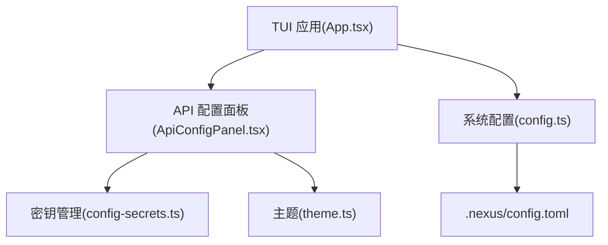
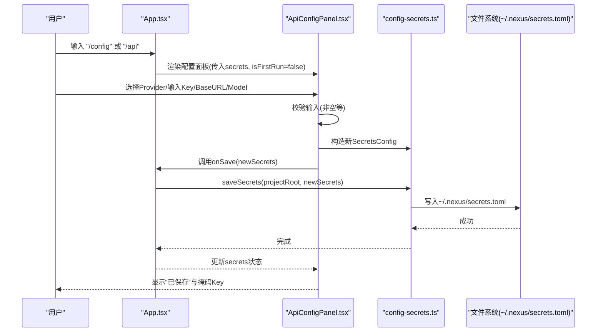
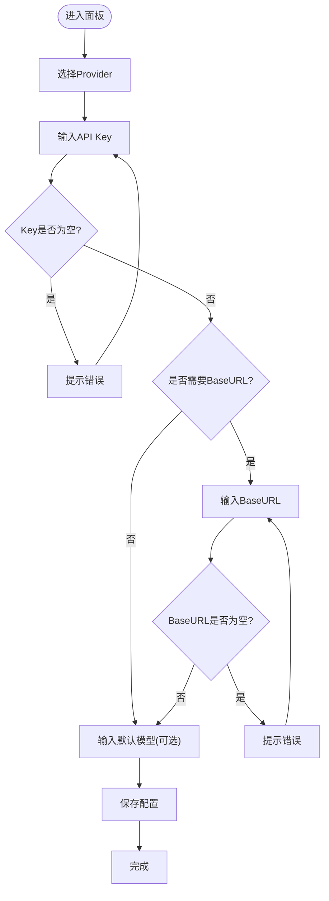
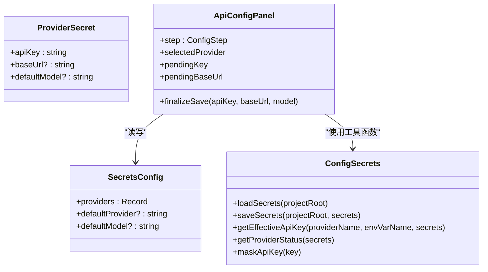
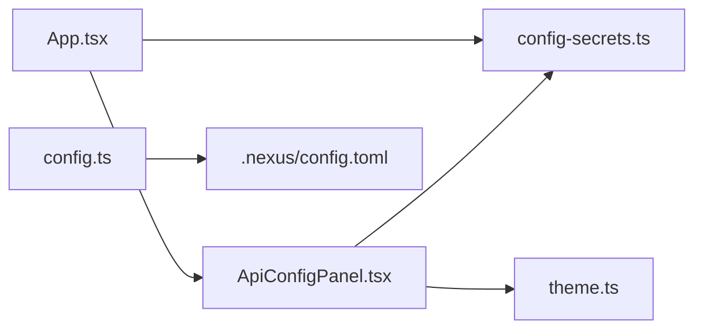

# API 配置面板组件

<cite>
**本文引用的文件**   
- [ApiConfigPanel.tsx](file://src/tui/components/ApiConfigPanel.tsx)
- [config-secrets.ts](file://src/config-secrets.ts)
- [App.tsx](file://src/tui/App.tsx)
- [config.ts](file://src/config.ts)
- [config.toml](file://.nexus/config.toml)
- [theme.ts](file://src/tui/theme.ts)
- [types.ts](file://src/agent/types.ts)
</cite>

## 目录
1. [简介](#简介)
2. [项目结构](#项目结构)
3. [核心组件](#核心组件)
4. [架构总览](#架构总览)
5. [详细组件分析](#详细组件分析)
6. [依赖关系分析](#依赖关系分析)
7. [性能考量](#性能考量)
8. [故障诊断指南](#故障诊断指南)
9. [结论](#结论)
10. [附录](#附录)

## 简介
本文件为 ApiConfigPanel 组件的权威文档，聚焦以下目标：
- API 密钥管理：多提供商支持、环境变量与本地持久化优先级、掩码显示。
- 配置验证：必填校验、URL 与模型名提示、错误反馈。
- 持久化存储：全局 secrets.toml 写入与读取、兼容旧项目级路径。
- 多提供商配置：Anthropic、OpenAI、DeepSeek、自定义 OpenAI 兼容端点。
- 连接测试与故障诊断：当前未实现自动连通性检测，提供排查步骤与常见问题定位。
- 配置导入导出、模板管理与版本控制：通过 TOML 文件进行手动导入导出；建议结合 Git 进行版本控制。
- 安全加密与权限控制：当前以明文存储于用户主目录，环境变量优先；权限由上层权限模式控制。
- 与配置系统集成与环境变量管理：与 .nexus/config.toml 和进程环境变量协同工作。

## 项目结构
ApiConfigPanel 位于 TUI 层，负责交互式配置 Provider 与 API Key，并通过 App 根组件挂载。配置与密钥管理由 config-secrets.ts 提供，系统默认配置由 config.ts 加载，TOML 示例在 .nexus/config.toml。

图表来源
- [App.tsx:13-18](file://src/tui/App.tsx#L13-L18)
- [ApiConfigPanel.tsx:10-12](file://src/tui/components/ApiConfigPanel.tsx#L10-L12)
- [config-secrets.ts:1-10](file://src/config-secrets.ts#L1-L10)
- [config.ts:1-10](file://src/config.ts#L1-L10)
- [config.toml:1-10](file://.nexus/config.toml#L1-L10)
- [theme.ts:1-10](file://src/tui/theme.ts#L1-L10)

章节来源
- [App.tsx:1-284](file://src/tui/App.tsx#L1-L284)
- [ApiConfigPanel.tsx:1-249](file://src/tui/components/ApiConfigPanel.tsx#L1-L249)
- [config-secrets.ts:1-171](file://src/config-secrets.ts#L1-L171)
- [config.ts:1-132](file://src/config.ts#L1-L132)
- [config.toml:1-62](file://.nexus/config.toml#L1-L62)
- [theme.ts:1-41](file://src/tui/theme.ts#L1-L41)

## 核心组件
- ApiConfigPanel：交互式向导，引导用户选择 Provider、输入 API Key、可选 Base URL 与默认模型，保存后返回完成状态。
- config-secrets：提供 SecretsConfig 类型、加载/保存 secrets、获取有效 API Key、Provider 状态检测、掩码显示等能力。
- App：集成首次启动检测、斜杠命令 /config 或 /api 打开配置面板、调用 saveSecrets 并更新状态。

章节来源
- [ApiConfigPanel.tsx:15-21](file://src/tui/components/ApiConfigPanel.tsx#L15-L21)
- [config-secrets.ts:12-24](file://src/config-secrets.ts#L12-L24)
- [App.tsx:55-69](file://src/tui/App.tsx#L55-L69)

## 架构总览
ApiConfigPanel 作为 TUI 子组件，通过 props 接收 secrets 与回调 onSave/onClose，内部维护步骤状态机（select_provider → input_key → input_base_url → input_model → done）。保存时调用 saveSecrets 写入全局 ~/.nexus/secrets.toml，并在 UI 中展示成功与掩码后的 Key。

图表来源
- [App.tsx:80-86](file://src/tui/App.tsx#L80-L86)
- [ApiConfigPanel.tsx:92-119](file://src/tui/components/ApiConfigPanel.tsx#L92-L119)
- [config-secrets.ts:62-91](file://src/config-secrets.ts#L62-L91)

## 详细组件分析

### ApiConfigPanel 交互流程与状态机
- 步骤定义：select_provider、input_key、input_base_url、input_model、done。
- 键盘交互：上下键选择 Provider，Enter 确认，Backspace/Delete 编辑，Esc 关闭（首次引导不允许跳过）。
- 输入校验：Key 不能为空；自定义 Provider 需要 Base URL；Model 可选。
- 保存逻辑：合并现有 secrets.providers，设置 defaultProvider/defaultModel，调用 onSave。

图表来源
- [ApiConfigPanel.tsx:42-62](file://src/tui/components/ApiConfigPanel.tsx#L42-L62)
- [ApiConfigPanel.tsx:92-119](file://src/tui/components/ApiConfigPanel.tsx#L92-L119)

章节来源
- [ApiConfigPanel.tsx:13-38](file://src/tui/components/ApiConfigPanel.tsx#L13-L38)
- [ApiConfigPanel.tsx:64-119](file://src/tui/components/ApiConfigPanel.tsx#L64-L119)

### 多提供商支持与状态检测
- 内置 Provider：anthropic、openai、deepseek、custom（OpenAI 兼容）。
- getProviderStatus：按 envVar 与 secrets.providers.apiKey 判断是否可用及来源（env/secrets/none）。
- maskApiKey：用于 UI 显示时隐藏敏感信息。

图表来源
- [config-secrets.ts:12-24](file://src/config-secrets.ts#L12-L24)
- [config-secrets.ts:140-164](file://src/config-secrets.ts#L140-L164)
- [ApiConfigPanel.tsx:121-145](file://src/tui/components/ApiConfigPanel.tsx#L121-L145)

章节来源
- [config-secrets.ts:140-171](file://src/config-secrets.ts#L140-L171)
- [ApiConfigPanel.tsx:23-28](file://src/tui/components/ApiConfigPanel.tsx#L23-L28)

### 配置验证规则
- 必填项：API Key 不可为空；自定义 Provider 的 Base URL 不可为空。
- 可选项：默认模型名称可留空。
- 错误处理：在输入阶段即时提示错误，保存失败捕获异常并显示消息。

章节来源
- [ApiConfigPanel.tsx:92-119](file://src/tui/components/ApiConfigPanel.tsx#L92-L119)
- [ApiConfigPanel.tsx:138-145](file://src/tui/components/ApiConfigPanel.tsx#L138-L145)

### 持久化存储与优先级
- 存储位置：全局 ~/.nexus/secrets.toml（所有项目共享），兼容旧项目级 .nexus/secrets.toml。
- 优先级：环境变量 > secrets.toml。
- 写入格式：TOML 嵌套对象 providers.<name>.api_key/base_url/default_model。

章节来源
- [config-secrets.ts:32-59](file://src/config-secrets.ts#L32-L59)
- [config-secrets.ts:62-91](file://src/config-secrets.ts#L62-L91)
- [config-secrets.ts:94-115](file://src/config-secrets.ts#L94-L115)

### 与配置系统的集成与环境变量管理
- 系统配置：.nexus/config.toml 定义各 Provider 的 apiKeyEnv、base_url、default_model。
- 环境变量：ANTHROPIC_API_KEY、OPENAI_API_KEY、DEEPSEEK_API_KEY、CUSTOM_API_KEY。
- 生效顺序：getEffectiveApiKey 先读环境变量，再回退到 secrets.providers[provider].apiKey。

章节来源
- [config.ts:11-41](file://src/config.ts#L11-L41)
- [config.toml:11-34](file://.nexus/config.toml#L11-L34)
- [config-secrets.ts:120-131](file://src/config-secrets.ts#L120-L131)

### 连接测试与故障诊断
- 当前未实现自动连通性检测。
- 建议诊断步骤：
  - 检查环境变量是否正确设置且可见。
  - 检查 secrets.toml 中对应 provider 的 api_key/base_url/default_model。
  - 使用 curl 或厂商 CLI 验证端点可达性与鉴权。
  - 查看 UI 错误提示与保存日志。

章节来源
- [ApiConfigPanel.tsx:138-145](file://src/tui/components/ApiConfigPanel.tsx#L138-L145)
- [config-secrets.ts:120-131](file://src/config-secrets.ts#L120-L131)

### 配置导入导出、模板管理与版本控制
- 导入导出：直接编辑 ~/.nexus/secrets.toml 或 .nexus/config.toml 进行导入导出。
- 模板管理：可在项目中维护示例模板（如 .nexus/config.example.toml）供团队复用。
- 版本控制：secrets.toml 应排除在版本控制之外（避免泄露密钥）；config.toml 可纳入版本控制。

章节来源
- [config-secrets.ts:62-91](file://src/config-secrets.ts#L62-L91)
- [config.ts:63-74](file://src/config.ts#L63-L74)

### 安全加密与权限控制
- 安全现状：secrets.toml 明文存储于用户主目录；环境变量优先。
- 权限控制：由上层权限模式（ask/auto-edit/auto-all/yolo）控制写操作审批，不直接影响密钥访问。
- 建议增强：引入加密存储（如 OS 钥匙串）、最小权限原则、审计日志。

章节来源
- [config-secrets.ts:62-91](file://src/config-secrets.ts#L62-L91)
- [types.ts:134-160](file://src/agent/types.ts#L134-L160)

## 依赖关系分析
- App.tsx 依赖 ApiConfigPanel 与 config-secrets 提供的 loadSecrets/saveSecrets/hasAnyApiKey。
- ApiConfigPanel 依赖 config-secrets 的 getProviderStatus/maskApiKey。
- config.ts 解析 .nexus/config.toml 并合并默认值。
- theme.ts 提供 UI 颜色与符号。

图表来源
- [App.tsx:13-18](file://src/tui/App.tsx#L13-L18)
- [ApiConfigPanel.tsx:10-12](file://src/tui/components/ApiConfigPanel.tsx#L10-L12)
- [config.ts:63-74](file://src/config.ts#L63-L74)
- [theme.ts:1-10](file://src/tui/theme.ts#L1-L10)

章节来源
- [App.tsx:1-284](file://src/tui/App.tsx#L1-L284)
- [ApiConfigPanel.tsx:1-249](file://src/tui/components/ApiConfigPanel.tsx#L1-L249)
- [config-secrets.ts:1-171](file://src/config-secrets.ts#L1-L171)
- [config.ts:1-132](file://src/config.ts#L1-L132)
- [theme.ts:1-41](file://src/tui/theme.ts#L1-L41)

## 性能考量
- 文件 I/O：saveSecrets 每次保存都会写入全局 secrets.toml，建议批量保存或缓存差异。
- 状态更新：React state 频繁切换可能引起重渲染，注意减少不必要的 setState。
- 输入处理：useInput 事件处理轻量，避免复杂计算放在键盘回调中。

[本节为通用指导，不直接分析具体文件]

## 故障诊断指南
- 常见问题：
  - 环境变量未设置或命名不一致导致无法识别。
  - secrets.toml 格式错误或字段缺失。
  - Base URL 不正确导致自定义 Provider 无法连接。
- 排查步骤：
  - 打印 hasAnyApiKey 结果确认是否有可用 Key。
  - 检查 getProviderStatus 输出确认 source 与 hasKey。
  - 查看 UI 错误提示与保存异常信息。
  - 手动验证端点连通性与鉴权。

章节来源
- [config-secrets.ts:134-138](file://src/config-secrets.ts#L134-L138)
- [config-secrets.ts:140-164](file://src/config-secrets.ts#L140-L164)
- [ApiConfigPanel.tsx:138-145](file://src/tui/components/ApiConfigPanel.tsx#L138-L145)

## 结论
ApiConfigPanel 提供了直观的多 Provider 配置体验，结合 config-secrets 实现了环境变量与本地文件的优先级管理。当前缺少自动连接测试与加密存储，但可通过外部工具与后续增强实现。建议结合 Git 对配置文件进行版本控制，并对 secrets.toml 严格保密。

[本节为总结，不直接分析具体文件]

## 附录

### 支持的 Provider 与环境变量映射
- Anthropic：ANTHROPIC_API_KEY
- OpenAI：OPENAI_API_KEY
- DeepSeek：DEEPSEEK_API_KEY
- Custom：CUSTOM_API_KEY（可选 CUSTOM_BASE_URL、CUSTOM_DEFAULT_MODEL）

章节来源
- [config-secrets.ts:148-153](file://src/config-secrets.ts#L148-L153)
- [config.toml:11-34](file://.nexus/config.toml#L11-L34)

### 配置示例（TOML）
- .nexus/config.toml：定义 models.providers.* 的 apiKeyEnv、base_url、default_model。
- ~/.nexus/secrets.toml：存储 providers.<name>.api_key/base_url/default_model。

章节来源
- [config.toml:11-34](file://.nexus/config.toml#L11-L34)
- [config-secrets.ts:62-91](file://src/config-secrets.ts#L62-L91)