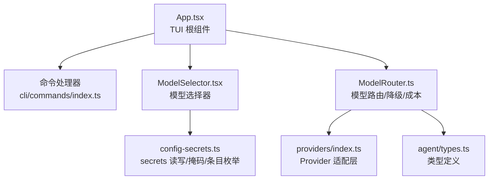
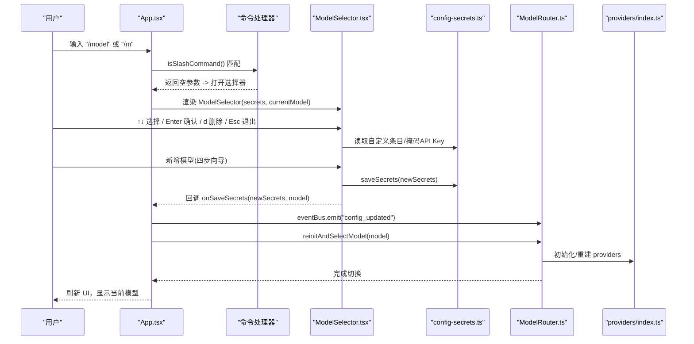
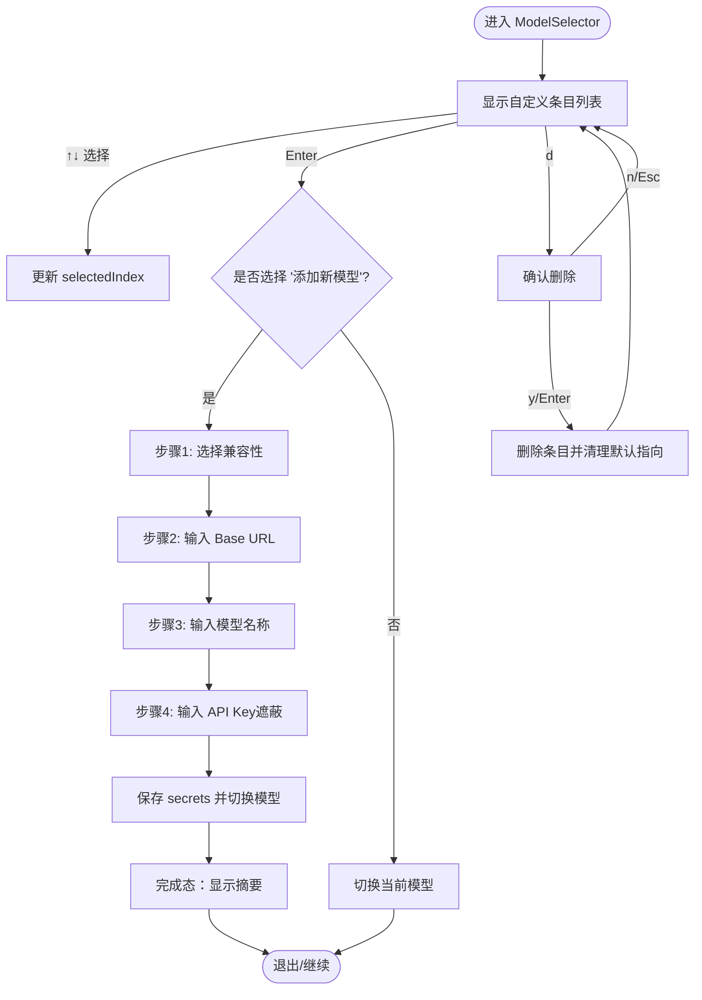
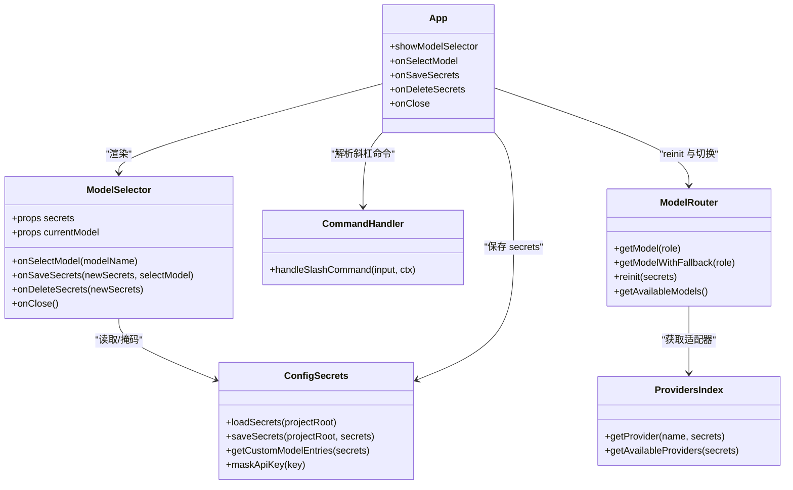

# ModelSelector 模型选择器组件

<cite>
**本文引用的文件**   
- [ModelSelector.tsx](file://src/tui/components/ModelSelector.tsx)
- [App.tsx](file://src/tui/App.tsx)
- [index.ts（命令处理）](file://src/cli/commands/index.ts)
- [ModelRouter.ts](file://src/router/ModelRouter.ts)
- [providers/index.ts](file://src/router/providers/index.ts)
- [config-secrets.ts](file://src/config-secrets.ts)
- [types.ts](file://src/agent/types.ts)
- [README.md](file://README.md)
</cite>

## 目录
1. [简介](#简介)
2. [项目结构](#项目结构)
3. [核心组件](#核心组件)
4. [架构总览](#架构总览)
5. [详细组件分析](#详细组件分析)
6. [依赖关系分析](#依赖关系分析)
7. [性能考量](#性能考量)
8. [故障排查指南](#故障排查指南)
9. [结论](#结论)
10. [附录](#附录)

## 简介
ModelSelector 是 Nexus TUI 中的交互式“模型选择器”组件，用于在终端中以键盘驱动的方式浏览、添加、删除与切换 AI 模型。它支持 OpenAI 兼容与 Anthropic 两种协议，通过分步向导引导用户输入 Base URL、模型名称与 API Key，并将配置持久化到全局 secrets 文件；保存后自动触发系统重新初始化并切换到新模型。该组件由斜杠命令 /model（无参数）或 /m 触发，与 App 根组件、命令处理器、模型路由器与 Provider 适配层紧密协作。

## 项目结构
- 交互入口：App.tsx 中监听斜杠命令，当输入为 /model 或 /m 时显示 ModelSelector。
- 交互实现：ModelSelector.tsx 使用 Ink + React 构建状态机驱动的界面，包含选择列表、兼容性选择、多步输入与确认删除等流程。
- 配置与密钥：config-secrets.ts 负责 secrets.toml 的加载、保存、掩码显示与自定义条目枚举。
- 路由与适配器：ModelRouter.ts 与 providers/index.ts 负责根据 secrets 初始化各 provider、选择默认模型、降级链与工具能力判断。
- 类型定义：agent/types.ts 定义了事件、角色、模型路由等核心类型。

图表来源
- [App.tsx:85-119](file://src/tui/App.tsx#L85-L119)
- [index.ts（命令处理）:36-66](file://src/cli/commands/index.ts#L36-L66)
- [ModelSelector.tsx:73-143](file://src/tui/components/ModelSelector.tsx#L73-L143)
- [config-secrets.ts:48-105](file://src/config-secrets.ts#L48-L105)
- [ModelRouter.ts:53-110](file://src/router/ModelRouter.ts#L53-L110)
- [providers/index.ts:102-127](file://src/router/providers/index.ts#L102-L127)
- [types.ts:85-101](file://src/agent/types.ts#L85-L101)

章节来源
- [App.tsx:85-119](file://src/tui/App.tsx#L85-L119)
- [index.ts（命令处理）:36-66](file://src/cli/commands/index.ts#L36-L66)
- [ModelSelector.tsx:1-143](file://src/tui/components/ModelSelector.tsx#L1-L143)
- [config-secrets.ts:48-105](file://src/config-secrets.ts#L48-L105)
- [ModelRouter.ts:53-110](file://src/router/ModelRouter.ts#L53-L110)
- [providers/index.ts:102-127](file://src/router/providers/index.ts#L102-L127)
- [types.ts:85-101](file://src/agent/types.ts#L85-L101)

## 核心组件
- ModelSelector 组件
  - 功能：列出所有自定义模型条目，支持上下导航、Enter 切换、d 删除、Esc 退出；新增模型时进入四步向导（兼容性 → Base URL → 模型名 → API Key），完成后保存并切换。
  - 状态机：select_model → select_compatibility → input_base_url → input_model_name → input_api_key → confirm_delete → done。
  - 数据源：从 config-secrets.ts 获取自定义条目列表与掩码函数。
  - 副作用：调用 onSaveSecrets 与 onDeleteSecrets 回调，由 App 层完成持久化与 reinit。

- App 根组件
  - 拦截 /model 与 /m 打开 ModelSelector。
  - 提供 onSelectModel、onSaveSecrets、onDeleteSecrets、onClose 回调，负责更新上下文、保存 secrets、触发 eventBus 通知 Orchestrator 重新初始化。

- 命令处理器
  - 将 /model 与 /m 映射到 TUI 层的交互逻辑；带参数的 /model <name> 走非交互切换路径。

- 模型路由器与 Provider 适配层
  - ModelRouter 根据 secrets.providers 初始化各 provider，按角色选择默认模型，维护降级链，暴露 getAvailableModels、getFallbackModelName、reinit 等方法。
  - providers/index.ts 提供内置与动态自定义适配器，按 compatibility 决定使用 OpenAI 或 Anthropic 客户端。

章节来源
- [ModelSelector.tsx:73-143](file://src/tui/components/ModelSelector.tsx#L73-L143)
- [App.tsx:279-313](file://src/tui/App.tsx#L279-L313)
- [index.ts（命令处理）:36-66](file://src/cli/commands/index.ts#L36-L66)
- [ModelRouter.ts:112-158](file://src/router/ModelRouter.ts#L112-L158)
- [providers/index.ts:73-100](file://src/router/providers/index.ts#L73-L100)

## 架构总览
下图展示了从用户输入 /model 到 ModelSelector 渲染、保存配置并触发 reinit 的完整流程。

图表来源
- [App.tsx:85-119](file://src/tui/App.tsx#L85-L119)
- [index.ts（命令处理）:36-66](file://src/cli/commands/index.ts#L36-L66)
- [ModelSelector.tsx:232-297](file://src/tui/components/ModelSelector.tsx#L232-L297)
- [config-secrets.ts:67-105](file://src/config-secrets.ts#L67-L105)
- [ModelRouter.ts:384-391](file://src/router/ModelRouter.ts#L384-L391)
- [providers/index.ts:102-127](file://src/router/providers/index.ts#L102-L127)

## 详细组件分析

### ModelSelector 组件
- 交互流程
  - 列表页：展示所有自定义条目（含 label/defaultModel/compatibility），末尾固定“添加新模型”。
  - 新增向导：步骤1 选择兼容性（OpenAI/Anthropic），步骤2 输入 Base URL，步骤3 输入模型名称，步骤4 输入 API Key（遮蔽）。
  - 删除流程：选中条目按 d 进入确认页，y/Enter 删除，n/Esc 取消。
  - 完成态：保存成功后显示摘要（掩码 Key），Enter 关闭。

- 关键数据结构
  - SelectorStep：状态机阶段枚举。
  - CustomEntry/AddNewEntry：列表项类型。
  - Compatibility：openai | anthropic。

- 错误处理
  - 必填校验：Base URL、模型名、API Key 为空时提示错误。
  - 保存失败：捕获异常并回退到上一步，显示错误信息。
  - 删除失败：捕获异常并回到列表页。

- 与外部集成
  - 通过 props 注入 secrets、currentModel、onSelectModel、onSaveSecrets、onDeleteSecrets、onClose。
  - 使用 config-secrets.ts 的 getCustomModelEntries、maskApiKey。

图表来源
- [ModelSelector.tsx:145-297](file://src/tui/components/ModelSelector.tsx#L145-L297)

章节来源
- [ModelSelector.tsx:1-516](file://src/tui/components/ModelSelector.tsx#L1-L516)

### App 根组件集成
- 斜杠命令拦截：/model 或 /m 无参数时打开 ModelSelector；带参数则走非交互切换。
- 回调职责：
  - onSelectModel：设置当前模型并持久化 lastModel，强制重渲染。
  - onSaveSecrets：保存 secrets，emit 配置更新事件，调用 reinitAndSelectModel 等待 reinit 完成再切换。
  - onDeleteSecrets：保存 secrets，emit 配置更新事件，调用 reinitProviders 以回退 auto 选择。

章节来源
- [App.tsx:85-119](file://src/tui/App.tsx#L85-L119)
- [App.tsx:279-313](file://src/tui/App.tsx#L279-L313)

### 命令处理器
- /model 与 /m 的 handler：无参时返回提示文本（实际交互由 TUI 层接管）；有参时校验模型是否存在、provider 是否已配置，然后 setModel 并保存 lastModel。

章节来源
- [index.ts（命令处理）:36-66](file://src/cli/commands/index.ts#L36-L66)

### 模型路由器与 Provider 适配层
- ModelRouter
  - initProviders：根据内置与 secrets.providers 初始化各 provider（OpenAI/Anthropic），支持自定义 baseUrl。
  - applyConfigModels：按角色应用配置，auto 模式委托 resolveAutoModel。
  - getModelWithFallback：主模型不可用时沿 FALLBACK_CHAIN 降级。
  - reinit：接收新的 secrets 并重建 providers，重新应用配置。

- providers/index.ts
  - 内置适配器：anthropic/openai/deepseek。
  - 动态自定义适配器：按 compatibility 区分协议，支持任意命名键。
  - getProvider/getAvailableProviders：按名称或可用性收集适配器。

章节来源
- [ModelRouter.ts:70-110](file://src/router/ModelRouter.ts#L70-L110)
- [ModelRouter.ts:112-158](file://src/router/ModelRouter.ts#L112-L158)
- [ModelRouter.ts:242-265](file://src/router/ModelRouter.ts#L242-L265)
- [ModelRouter.ts:384-391](file://src/router/ModelRouter.ts#L384-L391)
- [providers/index.ts:24-71](file://src/router/providers/index.ts#L24-L71)
- [providers/index.ts:73-100](file://src/router/providers/index.ts#L73-L100)

## 依赖关系分析
- ModelSelector 依赖：
  - Ink + React（UI 框架）
  - config-secrets（secrets 读写、掩码、条目枚举）
  - App 提供的回调（保存/删除/切换）

- App 依赖：
  - 命令处理器（斜杠命令解析）
  - config-secrets（secrets 持久化）
  - eventBus（通知 Orchestrator 重新初始化）
  - ModelRouter（通过 commandContext.reinitAndSelectModel/reinitProviders）

- ModelRouter 依赖：
  - @ai-sdk/openai、@ai-sdk/anthropic（创建客户端）
  - providers/index.ts（适配器）
  - config-secrets（secrets 与有效 key 获取）

图表来源
- [ModelSelector.tsx:73-143](file://src/tui/components/ModelSelector.tsx#L73-L143)
- [App.tsx:279-313](file://src/tui/App.tsx#L279-L313)
- [index.ts（命令处理）:191-210](file://src/cli/commands/index.ts#L191-L210)
- [config-secrets.ts:48-105](file://src/config-secrets.ts#L48-L105)
- [ModelRouter.ts:384-391](file://src/router/ModelRouter.ts#L384-L391)
- [providers/index.ts:102-127](file://src/router/providers/index.ts#L102-L127)

章节来源
- [ModelSelector.tsx:73-143](file://src/tui/components/ModelSelector.tsx#L73-L143)
- [App.tsx:279-313](file://src/tui/App.tsx#L279-L313)
- [index.ts（命令处理）:191-210](file://src/cli/commands/index.ts#L191-L210)
- [config-secrets.ts:48-105](file://src/config-secrets.ts#L48-L105)
- [ModelRouter.ts:384-391](file://src/router/ModelRouter.ts#L384-L391)
- [providers/index.ts:102-127](file://src/router/providers/index.ts#L102-L127)

## 性能考量
- 渲染性能：ModelSelector 使用 Ink + React，状态变更仅影响局部 UI；避免不必要的重渲染可通过合理拆分回调与减少 renderTick 触发次数。
- I/O 操作：secrets 写入采用原子写入（临时文件 + rename）与权限控制（0600），避免并发损坏与泄露风险。
- Provider 初始化：reinit 会清空 Map 并重建，建议在批量保存后统一触发一次，避免频繁重建。
- 网络请求：组件本身不发起网络请求，实际 LLM 调用由上层 Orchestrator 与 ModelRouter 管理。

[本节为通用指导，无需具体文件引用]

## 故障排查指南
- 无法切换到新模型
  - 检查 onSaveSecrets 是否正确保存 secrets 并触发 eventBus.config_updated。
  - 确认 reinitAndSelectModel 执行成功，查看 ModelRouter.reinit 是否重建了 providers。

- 删除自定义条目后未回退
  - 确认 onDeleteSecrets 正确清理 defaultProvider/defaultModel 指向，并调用 reinitProviders。

- 新增模型向导报错
  - 检查 Base URL、模型名、API Key 是否为空。
  - 查看 finalizeSave 的 try/catch 分支，确认错误消息来源。

- 提供商不可用
  - 检查环境变量或 secrets.providers 中对应 apiKey 与 baseUrl 是否配置。
  - 使用 getAvailableProviders 与 isProviderConfigured 进行诊断。

章节来源
- [ModelSelector.tsx:232-297](file://src/tui/components/ModelSelector.tsx#L232-L297)
- [App.tsx:279-313](file://src/tui/App.tsx#L279-L313)
- [config-secrets.ts:67-105](file://src/config-secrets.ts#L67-L105)
- [ModelRouter.ts:384-391](file://src/router/ModelRouter.ts#L384-L391)
- [providers/index.ts:102-127](file://src/router/providers/index.ts#L102-L127)

## 结论
ModelSelector 提供了直观、健壮的终端模型管理能力，覆盖新增、删除、切换与配置持久化全流程。通过与 App、命令处理器、secrets 管理与模型路由器的协同，实现了开箱即用的多 Provider 支持与自动降级机制。建议在生产使用中结合 costTracker 与日志输出，监控模型切换与降级行为，确保稳定性与成本可控。

[本节为总结性内容，无需具体文件引用]

## 附录
- 快速开始与支持的厂商参考 README 文档，了解环境变量与示例用法。

章节来源
- [README.md:1-174](file://README.md#L1-L174)