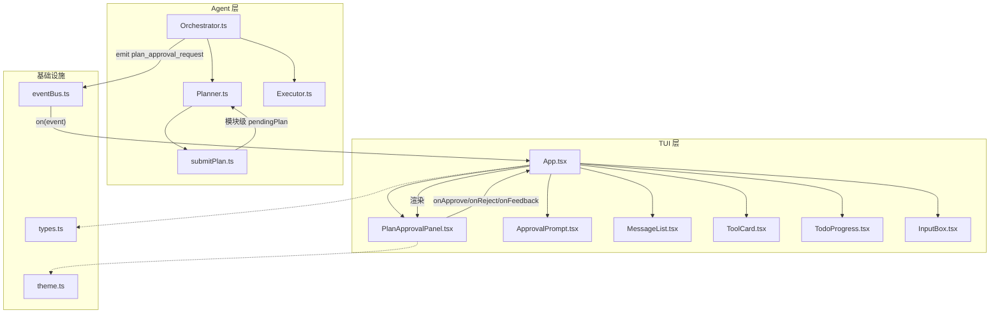
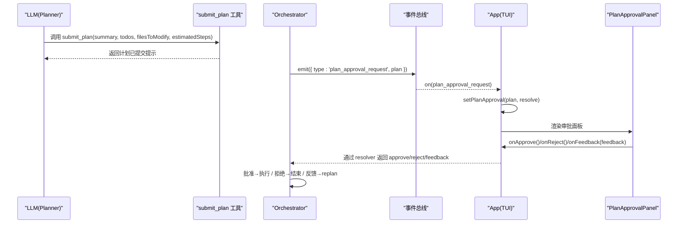
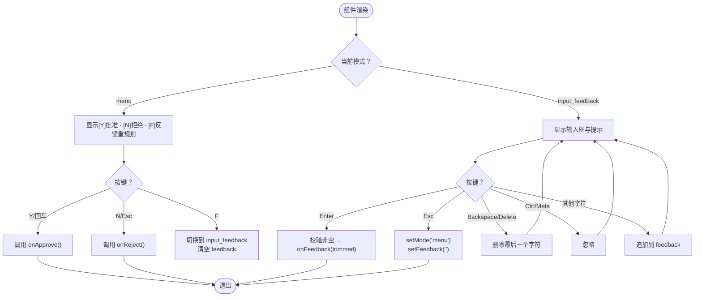
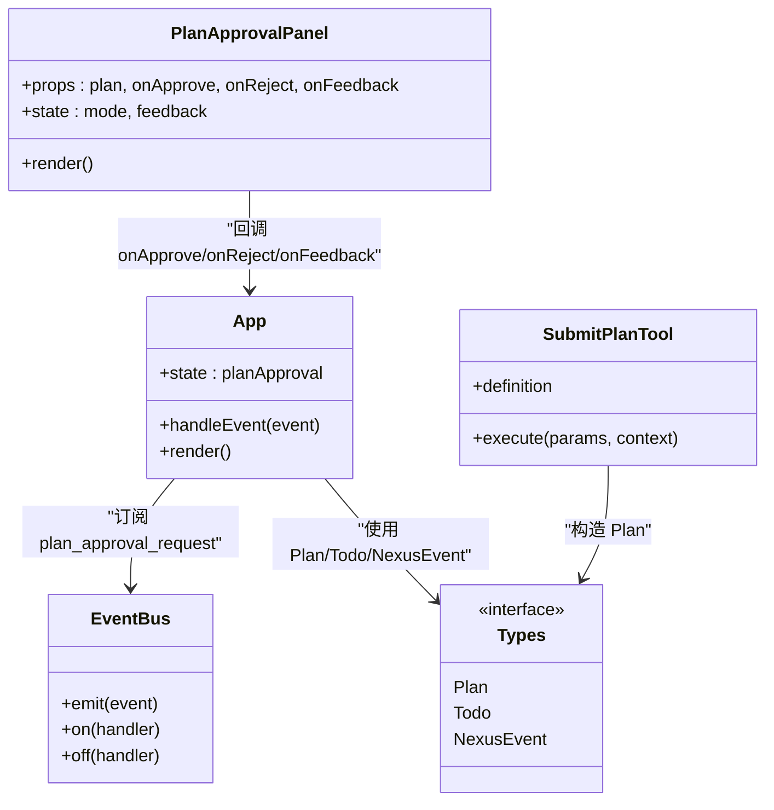

# PlanApprovalPanel 计划审批面板组件

<cite>
**本文引用的文件**   
- [PlanApprovalPanel.tsx](file://src/tui/components/PlanApprovalPanel.tsx)
- [App.tsx](file://src/tui/App.tsx)
- [types.ts](file://src/agent/types.ts)
- [submitPlan.ts](file://src/tools/submitPlan.ts)
- [eventBus.ts](file://src/core/eventBus.ts)
- [theme.ts](file://src/tui/theme.ts)
</cite>

## 目录
1. [简介](#简介)
2. [项目结构](#项目结构)
3. [核心组件](#核心组件)
4. [架构总览](#架构总览)
5. [详细组件分析](#详细组件分析)
6. [依赖分析](#依赖分析)
7. [性能考虑](#性能考虑)
8. [故障排查指南](#故障排查指南)
9. [结论](#结论)

## 简介
PlanApprovalPanel 是 Nexus TUI（终端用户界面）中的“计划审批面板”组件，用于在规划阶段向用户展示完整的执行计划（摘要、步骤列表、涉及文件、预估步数），并提供批准、拒绝与反馈重规划的交互能力。该组件由 plan_approval_request 事件触发，通过 App 根组件的事件处理流程接入 Orchestrator 的审批流，形成“计划生成 → 审批 → 执行/重规划”的闭环。

## 项目结构
PlanApprovalPanel 位于 TUI 组件层，与 App 根组件协作，通过事件总线接收来自 Agent 编排层的计划审批请求。其关键关联文件如下：
- 组件实现：PlanApprovalPanel.tsx
- 事件监听与状态管理：App.tsx
- 类型定义（Plan、Todo、NexusEvent）：types.ts
- 计划提交工具（LLM 调用 submit_plan 后进入审批）：submitPlan.ts
- 事件总线封装：eventBus.ts
- 主题样式：theme.ts

图表来源 
- [App.tsx:1-200](file://src/tui/App.tsx#L1-L200)
- [PlanApprovalPanel.tsx:1-138](file://src/tui/components/PlanApprovalPanel.tsx#L1-L138)
- [types.ts:1-274](file://src/agent/types.ts#L1-L274)
- [submitPlan.ts:1-103](file://src/tools/submitPlan.ts#L1-L103)
- [eventBus.ts:1-46](file://src/core/eventBus.ts#L1-L46)
- [theme.ts:1-57](file://src/tui/theme.ts#L1-L57)

章节来源
- [App.tsx:1-200](file://src/tui/App.tsx#L1-L200)
- [PlanApprovalPanel.tsx:1-138](file://src/tui/components/PlanApprovalPanel.tsx#L1-L138)
- [types.ts:1-274](file://src/agent/types.ts#L1-L274)
- [submitPlan.ts:1-103](file://src/tools/submitPlan.ts#L1-L103)
- [eventBus.ts:1-46](file://src/core/eventBus.ts#L1-L46)
- [theme.ts:1-57](file://src/tui/theme.ts#L1-L57)

## 核心组件
- PlanApprovalPanel：负责展示计划详情与操作菜单，支持三种模式：
  - 菜单模式：显示[Y]批准、[N]拒绝、[F]反馈重规划
  - 反馈输入模式：Enter 提交反馈文本触发重规划；Esc 取消返回菜单
  - 数据展示：摘要、步骤列表、涉及文件、预估步数
- 与 App 的集成：
  - App 监听 plan_approval_request 事件，设置 planApproval 状态并切换 phase 为 awaiting_approval
  - PlanApprovalPanel 通过 onApprove/onReject/onFeedback 回调将结果回传给 App，再由 App 通过全局 resolver 机制通知上游 Orchestrator

章节来源
- [PlanApprovalPanel.tsx:1-138](file://src/tui/components/PlanApprovalPanel.tsx#L1-L138)
- [App.tsx:1-200](file://src/tui/App.tsx#L1-L200)

## 架构总览
PlanApprovalPanel 处于 TUI 层，作为 Orchestrator 计划审批流程的前端入口。整体交互流程如下：
- Planner 通过 submit_plan 工具提交结构化计划（summary、todos、filesToModify、estimatedSteps）
- Orchestrator 收到计划后，发出 plan_approval_request 事件
- App 接收到事件后，设置 planApproval 状态并渲染 PlanApprovalPanel
- 用户在 Panel 中执行批准/拒绝/反馈操作，App 通过全局 resolver 返回结果给 Orchestrator
- Orchestrator 根据结果决定继续执行或进入重规划循环

图表来源 
- [submitPlan.ts:1-103](file://src/tools/submitPlan.ts#L1-L103)
- [types.ts:1-274](file://src/agent/types.ts#L1-L274)
- [eventBus.ts:1-46](file://src/core/eventBus.ts#L1-L46)
- [App.tsx:1-200](file://src/tui/App.tsx#L1-L200)
- [PlanApprovalPanel.tsx:1-138](file://src/tui/components/PlanApprovalPanel.tsx#L1-L138)

## 详细组件分析

### PlanApprovalPanel 组件
- 职责
  - 展示完整计划信息（摘要、步骤、文件、预估步数）
  - 提供键盘快捷键交互（Y/N/F、Enter/Esc）
  - 维护两种模式：menu 与 input_feedback
- 数据结构
  - Props：plan（Plan）、onApprove、onReject、onFeedback
  - 内部状态：mode（'menu' | 'input_feedback'）、feedback（string）
- 交互逻辑
  - 菜单模式：Y/回车→批准；N/Esc→拒绝；F→进入反馈输入模式
  - 反馈输入模式：Enter→提交非空反馈；Esc→取消并清空；Backspace/Delete→删除字符；Ctrl/Meta→忽略
- 渲染要点
  - 使用 ink Box/Text 构建布局
  - 主题色通过 theme.colors 引用（warning/success/error/accent/muted/primary）
  - 条件渲染：当 plan.todos 为空时显示提示；当 filesToModify 存在时列出文件；当 estimatedSteps > 0 时显示预估步数

图表来源 
- [PlanApprovalPanel.tsx:1-138](file://src/tui/components/PlanApprovalPanel.tsx#L1-L138)

章节来源
- [PlanApprovalPanel.tsx:1-138](file://src/tui/components/PlanApprovalPanel.tsx#L1-L138)

### App 根组件集成
- 事件监听
  - 监听 plan_approval_request，从 globalThis.__nexusPlanApprovalResolve 获取 resolver，设置 planApproval 状态并切换 phase 为 awaiting_approval
- 状态管理
  - planApproval: { plan, resolve } 控制是否渲染 PlanApprovalPanel
  - 与 tool 审批并行，互不干扰
- 回调处理
  - 接收 Panel 的 onApprove/onReject/onFeedback，调用对应的 resolver 返回结果

章节来源
- [App.tsx:1-200](file://src/tui/App.tsx#L1-L200)

### 类型与事件
- Plan/Todo：Plan 包含 summary、todos、filesToModify、estimatedSteps；Todo 包含 id、content、status
- NexusEvent：新增 plan_approval_request 事件，携带完整 Plan
- ModelRole/AgentPhase：用于阶段标识与模型路由

章节来源
- [types.ts:1-274](file://src/agent/types.ts#L1-L274)

### 计划提交工具（submit_plan）
- 作用：LLM 在规划阶段通过工具提交结构化计划，替代旧的 JSON 代码块解析
- 输入 Schema：summary（必填）、todos（必填数组，每项含 id/content）、filesToModify（可选）、estimatedSteps（可选）
- 执行逻辑：校验参数、构造 Plan、写入模块级 pendingPlan，返回提示信息
- 与审批的关系：Planner 读取 pendingPlan 后进入 Orchestrator 的审批流程

章节来源
- [submitPlan.ts:1-103](file://src/tools/submitPlan.ts#L1-L103)

### 事件总线
- 提供类型安全的事件发射与监听接口
- App 通过 eventBus.on 订阅 plan_approval_request，解耦 Orchestrator 与 UI

章节来源
- [eventBus.ts:1-46](file://src/core/eventBus.ts#L1-L46)

## 依赖分析
- 组件依赖
  - PlanApprovalPanel 依赖 Ink UI 库（Box/Text/useInput）与 theme 主题
  - App 依赖 eventBus、types、各子组件（包括 PlanApprovalPanel）
- 运行时依赖
  - globalThis.__nexusPlanApprovalResolve：用于跨进程/模块传递审批结果
  - Orchestrator/Planner/Executor：通过事件与工具调用驱动审批与执行
- 耦合度
  - PlanApprovalPanel 与 App 松耦合（仅通过 props 回调通信）
  - App 与 Orchestrator 通过事件总线与 resolver 机制解耦

图表来源 
- [PlanApprovalPanel.tsx:1-138](file://src/tui/components/PlanApprovalPanel.tsx#L1-L138)
- [App.tsx:1-200](file://src/tui/App.tsx#L1-L200)
- [types.ts:1-274](file://src/agent/types.ts#L1-L274)
- [eventBus.ts:1-46](file://src/core/eventBus.ts#L1-L46)
- [submitPlan.ts:1-103](file://src/tools/submitPlan.ts#L1-L103)

章节来源
- [PlanApprovalPanel.tsx:1-138](file://src/tui/components/PlanApprovalPanel.tsx#L1-L138)
- [App.tsx:1-200](file://src/tui/App.tsx#L1-L200)
- [types.ts:1-274](file://src/agent/types.ts#L1-L274)
- [eventBus.ts:1-46](file://src/core/eventBus.ts#L1-L46)
- [submitPlan.ts:1-103](file://src/tools/submitPlan.ts#L1-L103)

## 性能考虑
- 渲染优化
  - PlanApprovalPanel 使用局部状态（mode、feedback）最小化重渲染范围
  - 列表渲染基于 plan.todos/filesToModify 的长度进行条件渲染，避免不必要的 DOM 节点
- 事件处理
  - useInput 在所有分支前调用，符合 React Hooks 规则，避免额外计算
  - 事件总线采用 EventEmitter，默认最大监听器数量设置为 50，防止内存泄漏警告
- 交互体验
  - 反馈输入模式对 Ctrl/Meta 键进行忽略，减少无效更新
  - Backspace/Delete 仅修改最后一个字符，降低状态变更频率

[本节为通用指导，不直接分析具体文件]

## 故障排查指南
- 常见问题
  - 未显示审批面板：检查 plan_approval_request 事件是否被 App 正确订阅与处理
  - 批准/拒绝无响应：确认 onApprove/onReject 回调是否正确传递给 App，且 resolver 可用
  - 反馈无法提交：确保输入非空（trim 后），Enter 键触发 onFeedback
  - 主题颜色异常：检查 theme.colors 配置是否与组件引用一致
- 调试建议
  - 在 App.handleEvent 中添加日志，观察 plan_approval_request 事件到达与状态更新
  - 在 PlanApprovalPanel.useInput 中打印按键事件，验证交互路径
  - 检查 globalThis.__nexusPlanApprovalResolve 是否存在且可调用

章节来源
- [App.tsx:1-200](file://src/tui/App.tsx#L1-L200)
- [PlanApprovalPanel.tsx:1-138](file://src/tui/components/PlanApprovalPanel.tsx#L1-L138)
- [eventBus.ts:1-46](file://src/core/eventBus.ts#L1-L46)
- [theme.ts:1-57](file://src/tui/theme.ts#L1-L57)

## 结论
PlanApprovalPanel 作为 Nexus TUI 的计划审批入口，提供了直观、健壮的交互能力，支撑了“计划生成 → 审批 → 执行/重规划”的核心工作流。通过与 App、事件总线、类型系统与工具层的紧密协作，实现了高内聚、低耦合的设计。建议在后续迭代中持续优化输入体验与错误提示，并确保与 Orchestrator 的 resolver 机制稳定对接。