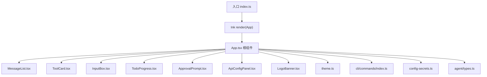
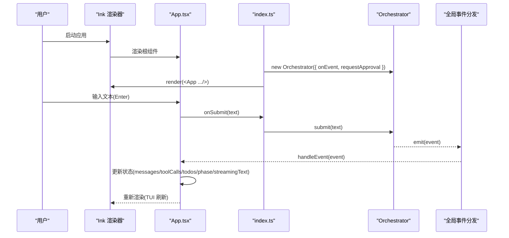
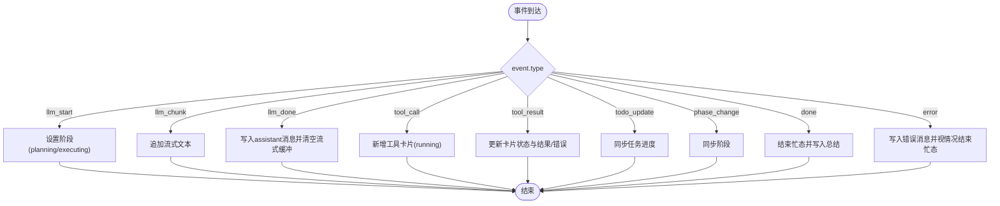
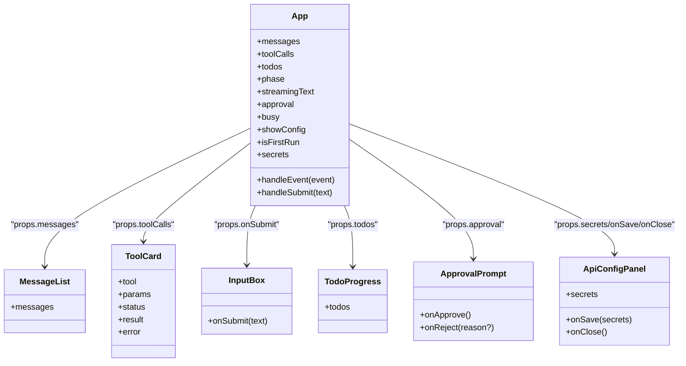
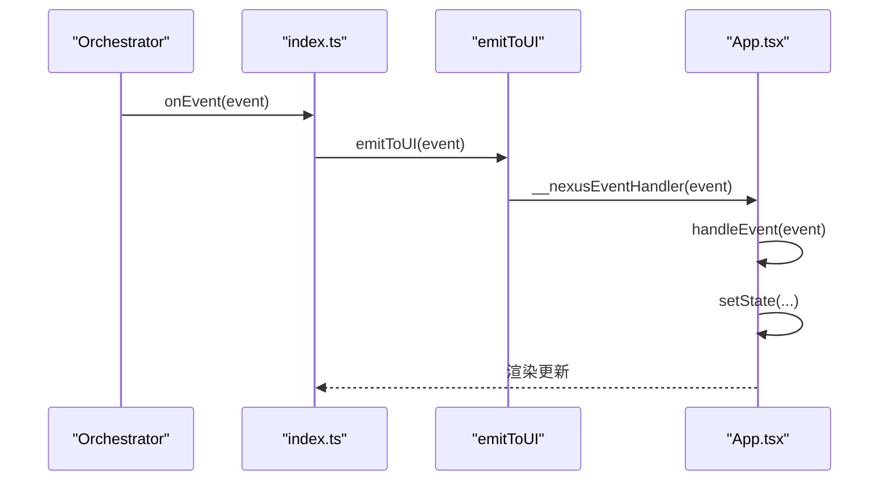
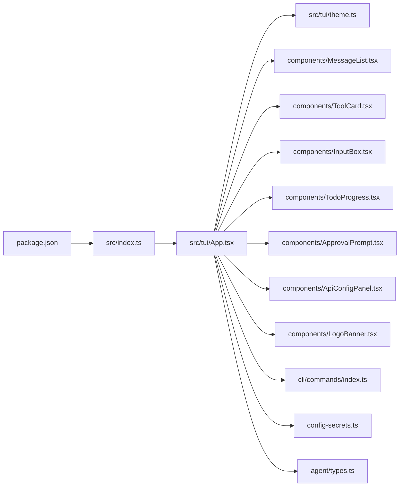

# TUI 架构设计

<cite>
**本文引用的文件**   
- [src/index.ts](file://src/index.ts)
- [src/tui/App.tsx](file://src/tui/App.tsx)
- [src/tui/theme.ts](file://src/tui/theme.ts)
- [src/tui/components/MessageList.tsx](file://src/tui/components/MessageList.tsx)
- [src/tui/components/ToolCard.tsx](file://src/tui/components/ToolCard.tsx)
- [src/tui/components/InputBox.tsx](file://src/tui/components/InputBox.tsx)
- [src/tui/components/TodoProgress.tsx](file://src/tui/components/TodoProgress.tsx)
- [src/tui/components/ApprovalPrompt.tsx](file://src/tui/components/ApprovalPrompt.tsx)
- [src/tui/components/ApiConfigPanel.tsx](file://src/tui/components/ApiConfigPanel.tsx)
- [src/tui/components/LogoBanner.tsx](file://src/tui/components/LogoBanner.tsx)
- [src/cli/commands/index.ts](file://src/cli/commands/index.ts)
- [src/config-secrets.ts](file://src/config-secrets.ts)
- [src/agent/types.ts](file://src/agent/types.ts)
- [package.json](file://package.json)
- [DESIGN.md](file://DESIGN.md)
</cite>

## 目录
1. [简介](#简介)
2. [项目结构](#项目结构)
3. [核心组件](#核心组件)
4. [架构总览](#架构总览)
5. [详细组件分析](#详细组件分析)
6. [依赖分析](#依赖分析)
7. [性能考虑](#性能考虑)
8. [故障排查指南](#故障排查指南)
9. [结论](#结论)
10. [附录](#附录)

## 简介
本文件聚焦 Nexus TUI 的架构设计与实现细节，围绕基于 Ink（React for CLI）的组件化体系、根组件 App.tsx 的状态管理与事件处理流程、流式渲染与实时交互模式、全局事件分发机制、状态同步策略与性能优化展开。同时给出组件通信模式、数据流向图、扩展点说明以及主题系统的使用与自定义指南，帮助读者快速理解并扩展 TUI 层。

## 项目结构
TUI 层位于 src/tui 目录，采用“根组件 + 功能子组件”的组织方式：
- 根组件 App.tsx：整合消息列表、工具卡片、审批提示、进度条、输入框、配置面板与启动横幅；负责状态管理、事件分发与用户交互入口。
- 子组件：MessageList、ToolCard、InputBox、TodoProgress、ApprovalPrompt、ApiConfigPanel、LogoBanner，分别承担消息展示、工具调用可视化、输入控制、任务进度、审批交互、API 配置引导与品牌展示。
- 主题 theme.ts：集中定义颜色、符号与标签映射，供各组件统一使用。
- 命令与上下文：cli/commands 提供斜杠命令解析与处理；App.tsx 通过 commandContext 访问 Orchestrator 能力。
- 类型与事件：agent/types.ts 定义 NexusEvent、AgentPhase、Todo 等共享类型，贯穿 TUI 与编排层。
- 入口与渲染：src/index.ts 负责参数解析、配置加载、Orchestrator 初始化、TUI 渲染与事件桥接。

图表来源
- [src/index.ts:88-101](file://src/index.ts#L88-L101)
- [src/tui/App.tsx:195-275](file://src/tui/App.tsx#L195-L275)
- [src/tui/theme.ts:5-38](file://src/tui/theme.ts#L5-L38)

章节来源
- [src/index.ts:1-119](file://src/index.ts#L1-L119)
- [src/tui/App.tsx:1-284](file://src/tui/App.tsx#L1-L284)
- [src/tui/theme.ts:1-41](file://src/tui/theme.ts#L1-L41)
- [src/agent/types.ts:1-269](file://src/agent/types.ts#L1-L269)

## 核心组件
- App.tsx
  - 职责：聚合 UI 子组件、维护会话消息、工具调用状态、待办进度、阶段状态、流式文本、审批态、忙态、配置面板显隐、首次运行检测与 API Key 持久化。
  - 关键状态：messages、toolCalls、todos、phase、streamingText、approval、busy、showConfig、isFirstRun、secrets。
  - 事件处理：handleEvent 根据 NexusEvent 类型更新状态；emitToUI 作为全局事件分发器。
  - 用户输入：handleSubmit 支持斜杠命令与常规消息提交；useInput 监听 Ctrl+C 退出。
- MessageList.tsx
  - 职责：按角色渲染用户、助手与系统消息，支持流式标记。
- ToolCard.tsx
  - 职责：以卡片形式展示工具名、参数摘要、状态与结果/错误信息。
- InputBox.tsx
  - 职责：多行输入、回车发送、退格删除、Esc 清空、禁用态控制。
- TodoProgress.tsx
  - 职责：计算完成数与总数，渲染进度条与逐项状态。
- ApprovalPrompt.tsx
  - 职责：审批弹窗，支持批准/拒绝与 diff 预览。
- ApiConfigPanel.tsx
  - 职责：交互式选择 Provider、输入 API Key/Base URL/默认模型，保存至 secrets.toml，支持首次引导与 /config 触发。
- LogoBanner.tsx
  - 职责：像素风启动横幅，无消息时显示。

章节来源
- [src/tui/App.tsx:46-183](file://src/tui/App.tsx#L46-L183)
- [src/tui/components/MessageList.tsx:10-56](file://src/tui/components/MessageList.tsx#L10-L56)
- [src/tui/components/ToolCard.tsx:10-85](file://src/tui/components/ToolCard.tsx#L10-L85)
- [src/tui/components/InputBox.tsx:10-65](file://src/tui/components/InputBox.tsx#L10-L65)
- [src/tui/components/TodoProgress.tsx:11-72](file://src/tui/components/TodoProgress.tsx#L11-L72)
- [src/tui/components/ApprovalPrompt.tsx:10-57](file://src/tui/components/ApprovalPrompt.tsx#L10-L57)
- [src/tui/components/ApiConfigPanel.tsx:15-249](file://src/tui/components/ApiConfigPanel.tsx#L15-L249)
- [src/tui/components/LogoBanner.tsx:1-62](file://src/tui/components/LogoBanner.tsx#L1-L62)

## 架构总览
TUI 层通过 Ink 渲染 React 组件树，根组件 App.tsx 订阅来自 Orchestrator 的事件流，将业务状态映射为 UI 状态，并通过全局事件分发器 emitToUI 暴露给外部模块。入口 index.ts 负责创建 Orchestrator、注入 onEvent 回调、在 TUI 模式下渲染 App 并将用户输入转发到 orchestrator.submit。

图表来源
- [src/index.ts:45-101](file://src/index.ts#L45-L101)
- [src/tui/App.tsx:107-183](file://src/tui/App.tsx#L107-L183)
- [src/tui/App.tsx:278-284](file://src/tui/App.tsx#L278-L284)

章节来源
- [src/index.ts:1-119](file://src/index.ts#L1-L119)
- [src/tui/App.tsx:1-284](file://src/tui/App.tsx#L1-L284)

## 详细组件分析

### 根组件 App.tsx 状态机与事件处理
- 状态字段与用途
  - messages：会话消息队列，用于 MessageList 渲染。
  - toolCalls：活跃工具调用卡片集合，用于 ToolCard 渲染。
  - todos：任务清单，用于 TodoProgress 渲染。
  - phase：Agent 阶段（idle/planning/executing/done/error 等），用于状态栏显示。
  - streamingText：LLM 流式输出缓冲，用于“思考中...”区域。
  - approval：当前审批请求（工具、描述、diff、resolve）。
  - busy：是否处于忙碌态，用于禁用输入框。
  - showConfig/isFirstRun/secrets：API 配置面板与首次引导控制。
- 事件处理 handleEvent
  - llm_start：切换 planning/executing 阶段。
  - llm_chunk：追加流式文本。
  - llm_done：将累积文本写入 assistant 消息，清空流式缓冲。
  - tool_call：新增工具调用卡片（running）。
  - tool_result：更新对应卡片状态（done/error）与结果/错误。
  - todo_update：同步任务进度。
  - phase_change：同步阶段状态。
  - done：结束忙态，写入总结消息。
  - error：写入系统错误消息，不可恢复时结束忙态。
- 全局事件分发
  - 通过 globalThis.__nexusEventHandler 注册 handleEvent，并提供 emitToUI 对外发布事件。
- 用户输入与斜杠命令
  - handleSubmit 先判断是否为斜杠命令，若是则调用 cli/commands 处理并插入 system 消息；否则添加 user 消息并调用 onSubmit 触发 Orchestrator。
- 首次运行与配置面板
  - useEffect 加载 secrets，若无任何 API Key 则进入首次引导并打开配置面板。

图表来源
- [src/tui/App.tsx:107-176](file://src/tui/App.tsx#L107-L176)

章节来源
- [src/tui/App.tsx:46-183](file://src/tui/App.tsx#L46-L183)
- [src/tui/App.tsx:195-275](file://src/tui/App.tsx#L195-L275)
- [src/tui/App.tsx:278-284](file://src/tui/App.tsx#L278-L284)

### 组件通信模式与数据流
- 父传子：App.tsx 通过 props 向子组件传递数据（如 messages、todos、toolCalls、secrets、onSave/onClose 等）。
- 子传父：子组件通过回调函数向上汇报（如 InputBox.onSubmit、ApprovalPrompt.onApprove/onReject、ApiConfigPanel.onSave）。
- 全局事件总线：Orchestrator 通过 onEvent 回调触发 emitToUI，App.tsx 注册 __nexusEventHandler 接收事件，形成跨模块解耦的事件通道。
- 命令上下文：commandContext 由 index.ts 注入，App.tsx 在斜杠命令处理中读取模型、成本、历史等能力。

图表来源
- [src/tui/App.tsx:195-275](file://src/tui/App.tsx#L195-L275)
- [src/tui/components/MessageList.tsx:17-29](file://src/tui/components/MessageList.tsx#L17-L29)
- [src/tui/components/ToolCard.tsx:12-18](file://src/tui/components/ToolCard.tsx#L12-L18)
- [src/tui/components/InputBox.tsx:10-14](file://src/tui/components/InputBox.tsx#L10-L14)
- [src/tui/components/TodoProgress.tsx:11-13](file://src/tui/components/TodoProgress.tsx#L11-L13)
- [src/tui/components/ApprovalPrompt.tsx:10-16](file://src/tui/components/ApprovalPrompt.tsx#L10-L16)
- [src/tui/components/ApiConfigPanel.tsx:15-21](file://src/tui/components/ApiConfigPanel.tsx#L15-L21)

章节来源
- [src/tui/App.tsx:195-275](file://src/tui/App.tsx#L195-L275)
- [src/tui/components/MessageList.tsx:1-56](file://src/tui/components/MessageList.tsx#L1-L56)
- [src/tui/components/ToolCard.tsx:1-85](file://src/tui/components/ToolCard.tsx#L1-L85)
- [src/tui/components/InputBox.tsx:1-65](file://src/tui/components/InputBox.tsx#L1-L65)
- [src/tui/components/TodoProgress.tsx:1-72](file://src/tui/components/TodoProgress.tsx#L1-L72)
- [src/tui/components/ApprovalPrompt.tsx:1-57](file://src/tui/components/ApprovalPrompt.tsx#L1-L57)
- [src/tui/components/ApiConfigPanel.tsx:1-249](file://src/tui/components/ApiConfigPanel.tsx#L1-L249)

### 流式渲染原理与实时交互
- 流式渲染
  - Orchestrator 发出 llm_chunk 事件，App.tsx 将 text 追加到 streamingText，UI 即时渲染“思考中...”区域，形成打字机效果。
  - llm_done 时将累积文本写入 assistant 消息，清空流式缓冲，保证最终一致性。
- 实时交互
  - InputBox 捕获键盘事件，回车发送、退格删除、Esc 清空，并在 busy 或审批/配置面板开启时禁用输入。
  - useInput 在 App 层监听 Ctrl+C 退出应用。
- 用户反馈设计
  - 工具调用卡片以不同状态色与图标反馈执行进度与结果。
  - TodoProgress 实时显示完成比例与明细项状态。
  - 审批提示提供 diff 高亮与快捷键（Y/N/回车/ESC）。

章节来源
- [src/tui/App.tsx:107-176](file://src/tui/App.tsx#L107-L176)
- [src/tui/components/InputBox.tsx:16-65](file://src/tui/components/InputBox.tsx#L16-L65)
- [src/tui/components/ToolCard.tsx:27-64](file://src/tui/components/ToolCard.tsx#L27-L64)
- [src/tui/components/TodoProgress.tsx:15-72](file://src/tui/components/TodoProgress.tsx#L15-L72)
- [src/tui/components/ApprovalPrompt.tsx:18-57](file://src/tui/components/ApprovalPrompt.tsx#L18-L57)

### 全局事件分发机制与状态同步
- 分发机制
  - index.ts 创建 Orchestrator 时注入 onEvent，内部调用 emitToUI(event)。
  - App.tsx 在 useEffect 中将 handleEvent 挂载到 globalThis.__nexusEventHandler，emitToUI 查找并调用该处理器。
- 状态同步策略
  - 事件驱动：所有 UI 状态变更均由 handleEvent 分支处理，避免分散 setState 导致不一致。
  - 幂等性：tool_result 通过 callId 精准定位卡片进行更新；llm_chunk 仅追加文本，llm_done 再落盘为正式消息。
  - 可恢复性：error 事件包含 recoverable 标志，决定是否结束忙态。

图表来源
- [src/index.ts:51-53](file://src/index.ts#L51-L53)
- [src/tui/App.tsx:178-183](file://src/tui/App.tsx#L178-L183)
- [src/tui/App.tsx:278-284](file://src/tui/App.tsx#L278-L284)

章节来源
- [src/index.ts:45-101](file://src/index.ts#L45-L101)
- [src/tui/App.tsx:178-183](file://src/tui/App.tsx#L178-L183)
- [src/tui/App.tsx:278-284](file://src/tui/App.tsx#L278-L284)

### 斜杠命令与命令上下文
- 命令注册与处理
  - cli/commands/index.ts 定义 /model、/cost、/clear、/undo、/history、/help 等命令及其 handler。
  - App.tsx 在 handleSubmit 中识别斜杠命令并调用 handleSlashCommand，将返回的系统消息插入消息列表。
- 命令上下文
  - index.ts 构造 commandContext，封装 getModel/setModel/getAvailableModels/getCost/clearContext/undo/getHistory 等方法，供斜杠命令访问 Orchestrator 能力。

章节来源
- [src/cli/commands/index.ts:23-116](file://src/cli/commands/index.ts#L23-L116)
- [src/tui/App.tsx:78-105](file://src/tui/App.tsx#L78-L105)
- [src/index.ts:67-76](file://src/index.ts#L67-L76)

### 主题系统与自定义指南
- 主题结构
  - colors：主色、辅色、强调、警告、错误、弱化、成功、边框、用户/助手/工具等语义色。
  - symbols：用户/助手/工具/审批/成功/错误/等待/进行中/完成/旋转动画帧等符号。
  - labels：工具名称的友好标签映射。
- 使用方法
  - 各组件通过 import { theme } from '../theme' 引入，统一渲染样式与文案。
- 自定义指南
  - 修改 theme.ts 中的 colors/symbols/labels 即可全局生效。
  - 若需扩展新工具标签，可在 labels 中添加映射，或在 ToolCard 的本地映射中补充。
  - 建议保持 const 约束与类型导出 Theme，确保类型安全。

章节来源
- [src/tui/theme.ts:5-41](file://src/tui/theme.ts#L5-L41)
- [src/tui/components/ToolCard.tsx:20-25](file://src/tui/components/ToolCard.tsx#L20-L25)

### 配置面板与首次引导
- 首次引导
  - App.tsx 启动时加载 secrets，若无任何 API Key，则设置 isFirstRun=true 并打开 ApiConfigPanel。
- 配置流程
  - ApiConfigPanel 支持选择 Provider、输入 API Key/Base URL/默认模型，保存到 ~/.nexus/secrets.toml，并回写 secrets 状态。
  - 支持 Esc 关闭（首次引导不允许跳过）、上下箭头选择、回车确认。
- 持久化与优先级
  - config-secrets.ts 优先从全局路径加载，回退到项目级；保存时写入全局路径；环境变量优先级高于 secrets 文件。

章节来源
- [src/tui/App.tsx:60-69](file://src/tui/App.tsx#L60-L69)
- [src/tui/components/ApiConfigPanel.tsx:30-145](file://src/tui/components/ApiConfigPanel.tsx#L30-L145)
- [src/config-secrets.ts:42-91](file://src/config-secrets.ts#L42-L91)
- [src/config-secrets.ts:117-138](file://src/config-secrets.ts#L117-L138)

## 依赖分析
- 运行时与框架
  - package.json 声明 main 与 bin 指向 src/index.ts，依赖 ink、react、bun 环境。
- 模块耦合
  - index.ts 依赖 Orchestrator、App、CLI 参数与配置加载。
  - App.tsx 依赖 Ink 组件、子组件、主题、命令处理、配置持久化与 Agent 类型。
  - 子组件仅依赖 Ink 基础组件与主题，低耦合、高内聚。
- 外部集成点
  - Orchestrator 通过 onEvent 与 TUI 解耦；requestApproval 支持非交互模式与 TUI 审批两种路径。
  - 配置与密钥通过 config-secrets.ts 抽象，屏蔽存储位置差异。

图表来源
- [package.json:1-43](file://package.json#L1-L43)
- [src/index.ts:1-119](file://src/index.ts#L1-L119)
- [src/tui/App.tsx:1-284](file://src/tui/App.tsx#L1-L284)

章节来源
- [package.json:1-43](file://package.json#L1-L43)
- [src/index.ts:1-119](file://src/index.ts#L1-L119)
- [src/tui/App.tsx:1-284](file://src/tui/App.tsx#L1-L284)

## 性能考虑
- 渲染粒度
  - 流式文本仅在 streamingText 变化时局部更新，避免整屏重绘。
  - 工具卡片通过 callId 精准定位更新，减少无关节点重排。
- 状态合并
  - llm_chunk 仅追加文本，llm_done 才落盘为正式消息，降低频繁写入消息数组的开销。
- 输入节流
  - InputBox 忽略控制字符与修饰键组合，减少无效状态更新。
- 资源限制
  - ToolCard 对长文本进行截断显示，避免终端渲染压力。
- 事件分发
  - 当前使用全局对象作为事件总线，简单高效；生产环境建议替换为 EventEmitter 以提升健壮性与可测试性。

[本节为通用指导，不直接分析具体文件]

## 故障排查指南
- 无法收到事件
  - 检查 index.ts 是否正确注入 onEvent 并调用 emitToUI。
  - 检查 App.tsx 是否在 useEffect 中正确注册 __nexusEventHandler。
- 审批阻塞
  - 非交互模式下 requestApproval 应直接返回 true；TUI 模式下需确保 onApproval 的 resolve 被调用。
- 配置未生效
  - 确认 secrets 文件路径与权限；环境变量优先级高于 secrets 文件。
- 命令无效
  - 确认输入以 / 开头且命令名存在；查看 cli/commands/index.ts 的命令注册。

章节来源
- [src/index.ts:51-63](file://src/index.ts#L51-L63)
- [src/tui/App.tsx:178-183](file://src/tui/App.tsx#L178-L183)
- [src/config-secrets.ts:117-138](file://src/config-secrets.ts#L117-L138)
- [src/cli/commands/index.ts:92-111](file://src/cli/commands/index.ts#L92-L111)

## 结论
Nexus TUI 采用基于 Ink 的组件化架构，根组件 App.tsx 作为状态中枢与事件汇聚点，配合全局事件分发机制实现与 Orchestrator 的松耦合通信。流式渲染、实时交互与清晰的反馈设计共同构建了良好的用户体验。主题系统提供了统一的视觉规范与扩展点。整体架构清晰、可扩展性强，适合在生产环境中持续演进。

[本节为总结性内容，不直接分析具体文件]

## 附录
- 参考设计文档
  - DESIGN.md 提供了总体架构、分层视图、Agent 编排、工具层、上下文工程、模型路由、TUI 布局与交互设计等系统性说明，可作为本 TUI 设计的背景与延伸阅读。

章节来源
- [DESIGN.md:54-114](file://DESIGN.md#L54-L114)
- [DESIGN.md:413-473](file://DESIGN.md#L413-L473)