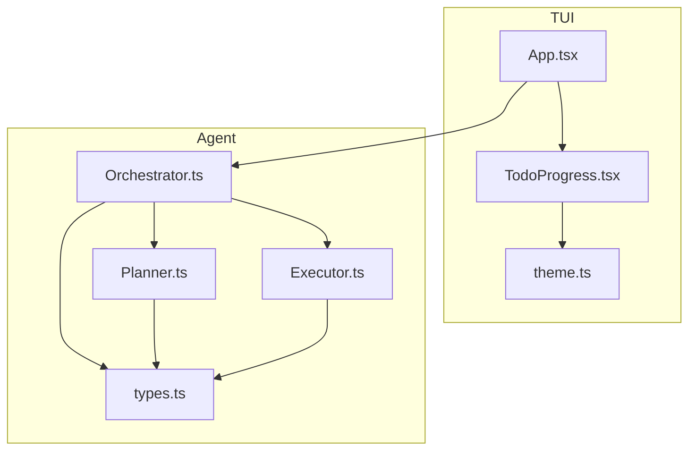
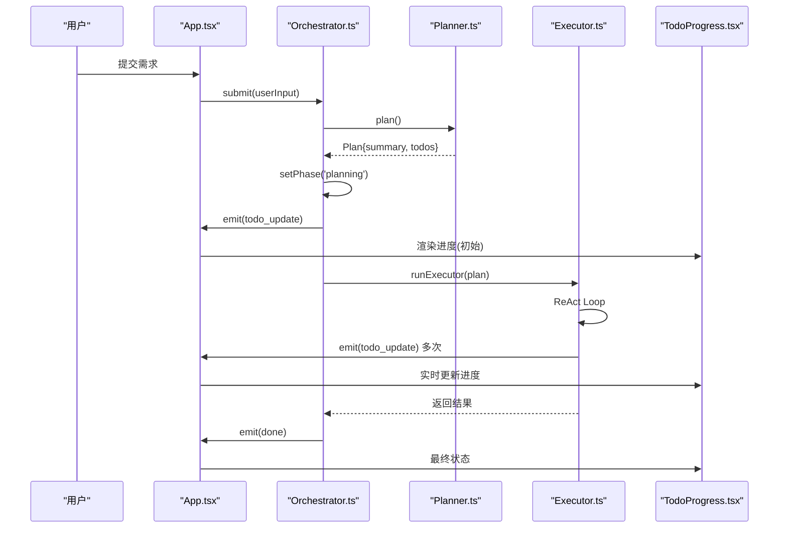
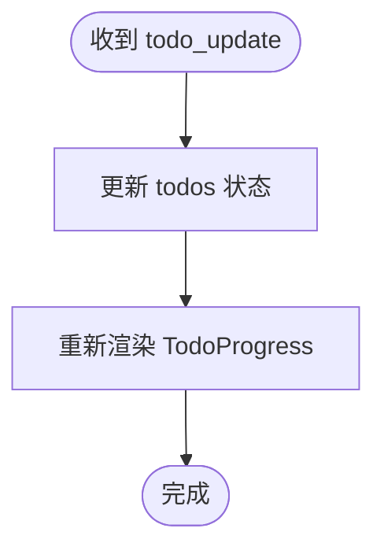
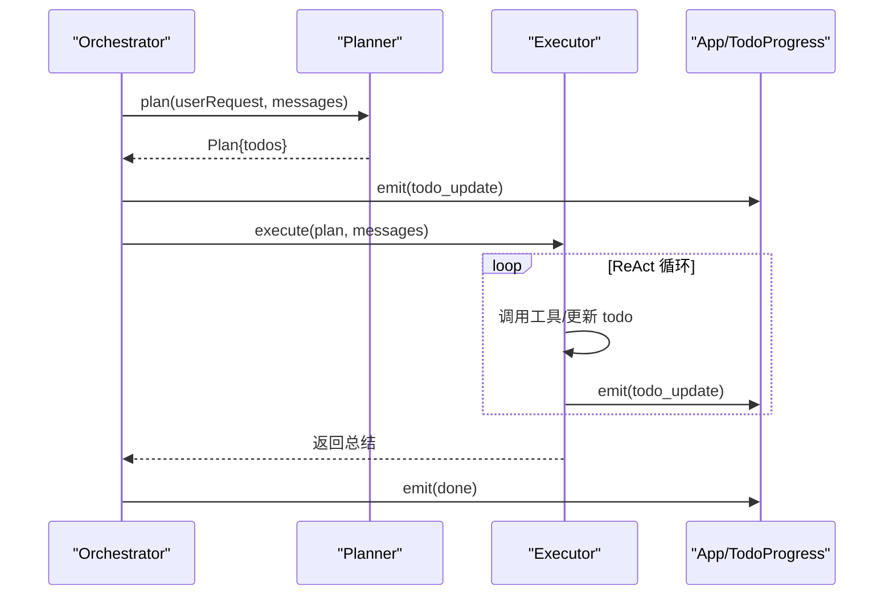
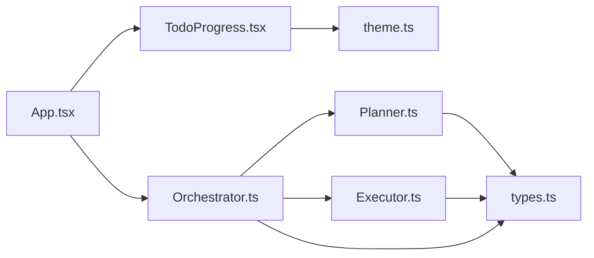

# 任务进度组件

<cite>
**本文引用的文件**
- [TodoProgress.tsx](file://src/tui/components/TodoProgress.tsx)
- [App.tsx](file://src/tui/App.tsx)
- [types.ts](file://src/agent/types.ts)
- [Orchestrator.ts](file://src/agent/Orchestrator.ts)
- [Planner.ts](file://src/agent/Planner.ts)
- [Executor.ts](file://src/agent/Executor.ts)
- [theme.ts](file://src/tui/theme.ts)
</cite>

## 目录
1. [简介](#简介)
2. [项目结构](#项目结构)
3. [核心组件](#核心组件)
4. [架构总览](#架构总览)
5. [详细组件分析](#详细组件分析)
6. [依赖关系分析](#依赖关系分析)
7. [性能与可观测性](#性能与可观测性)
8. [故障排查指南](#故障排查指南)
9. [结论](#结论)
10. [附录](#附录)

## 简介
本文件围绕 TodoProgress 组件，系统化说明其在终端界面中的任务分解可视化、进度跟踪与状态更新机制。文档同时覆盖其与 Agent 编排系统的集成方式、事件驱动的数据流、以及可扩展的过滤、搜索与导出能力的设计建议。为保证准确性，所有实现细节均基于仓库源码进行分析与图示化说明。

## 项目结构
与 TodoProgress 相关的代码主要位于 TUI 层与 Agent 层：
- TUI 层负责渲染与交互：TodoProgress 组件、主题、根应用组件 App.tsx
- Agent 层负责计划与执行：Orchestrator（编排）、Planner（规划）、Executor（执行）
- 类型定义集中在 types.ts，供前后端共享



图表来源
- [App.tsx:1-284](file://src/tui/App.tsx#L1-L284)
- [TodoProgress.tsx:1-72](file://src/tui/components/TodoProgress.tsx#L1-L72)
- [theme.ts:1-41](file://src/tui/theme.ts#L1-L41)
- [Orchestrator.ts:1-260](file://src/agent/Orchestrator.ts#L1-L260)
- [Planner.ts:1-176](file://src/agent/Planner.ts#L1-L176)
- [Executor.ts:1-234](file://src/agent/Executor.ts#L1-L234)
- [types.ts:1-269](file://src/agent/types.ts#L1-L269)

章节来源
- [App.tsx:1-284](file://src/tui/App.tsx#L1-L284)
- [TodoProgress.tsx:1-72](file://src/tui/components/TodoProgress.tsx#L1-L72)
- [theme.ts:1-41](file://src/tui/theme.ts#L1-L41)
- [Orchestrator.ts:1-260](file://src/agent/Orchestrator.ts#L1-L260)
- [Planner.ts:1-176](file://src/agent/Planner.ts#L1-L176)
- [Executor.ts:1-234](file://src/agent/Executor.ts#L1-L234)
- [types.ts:1-269](file://src/agent/types.ts#L1-L269)

## 核心组件
- TodoProgress 组件
  - 职责：接收 todos 列表，渲染总体进度统计与逐项状态；根据主题提供图标与颜色
  - 输入：todos 数组（Todo[]）
  - 输出：进度条文本、完成计数、每项的状态行
- App 根组件
  - 职责：订阅 Orchestrator 事件，维护 todos 状态并传递给 TodoProgress
  - 关键事件：todo_update、phase_change、llm_start/done、tool_call/result、done/error
- Agent 编排
  - Orchestrator：协调 Plan/Execute 两阶段，维护全局 todos，并通过 onEvent 推送 todo_update
  - Planner：生成结构化计划，包含 todos 初始状态
  - Executor：逐步执行计划，动态更新 todo 状态（pending → in_progress → complete）

章节来源
- [TodoProgress.tsx:1-72](file://src/tui/components/TodoProgress.tsx#L1-L72)
- [App.tsx:108-176](file://src/tui/App.tsx#L108-L176)
- [Orchestrator.ts:120-180](file://src/agent/Orchestrator.ts#L120-L180)
- [Planner.ts:55-137](file://src/agent/Planner.ts#L55-L137)
- [Executor.ts:50-165](file://src/agent/Executor.ts#L50-L165)
- [types.ts:29-40](file://src/agent/types.ts#L29-L40)

## 架构总览
下图展示了从用户输入到 UI 渲染的端到端流程，重点标注了 todo_update 事件如何驱动 TodoProgress 更新。



图表来源
- [App.tsx:108-176](file://src/tui/App.tsx#L108-L176)
- [Orchestrator.ts:120-180](file://src/agent/Orchestrator.ts#L120-L180)
- [Planner.ts:55-137](file://src/agent/Planner.ts#L55-L137)
- [Executor.ts:50-165](file://src/agent/Executor.ts#L50-L165)
- [TodoProgress.tsx:15-35](file://src/tui/components/TodoProgress.tsx#L15-L35)

## 详细组件分析

### TodoProgress 组件
- 渲染逻辑
  - 顶部显示“进度: 已完成/总数”与一个固定宽度的文本进度条
  - 遍历 todos，为每项渲染图标与内容，取消项使用删除线
- 视觉样式
  - 通过 theme.colors 与 theme.symbols 统一配色与符号
- 数据绑定
  - 仅依赖 props.todos，无内部状态，适合高频更新

```mermaid
classDiagram
class TodoProgress {
+props : { todos : Todo[] }
+render() : JSX
}
class TodoItem {
+props : { todo : Todo }
+render() : JSX
}
class ProgressBar {
+props : { completed : number; total : number }
+render() : JSX
}
class Theme {
+colors
+symbols
}
TodoProgress --> TodoItem : "渲染每项"
TodoProgress --> ProgressBar : "渲染进度条"
TodoProgress --> Theme : "读取样式"
```

图表来源
- [TodoProgress.tsx:15-71](file://src/tui/components/TodoProgress.tsx#L15-L71)
- [theme.ts:5-38](file://src/tui/theme.ts#L5-L38)

章节来源
- [TodoProgress.tsx:15-71](file://src/tui/components/TodoProgress.tsx#L15-L71)
- [theme.ts:5-38](file://src/tui/theme.ts#L5-L38)

### 事件与状态更新机制
- 事件模型
  - todo_update：携带完整 todos 快照，用于刷新 UI
  - phase_change：反映当前阶段（planning/executing/done 等）
  - llm_start/done、tool_call/result：辅助调试与工具卡片展示
- 数据流
  - Orchestrator 在 Plan 完成后发出 todo_update
  - Executor 在执行过程中多次发出 todo_update（如开始编辑、测试通过后标记完成）
  - App 监听事件并更新本地 todos，进而驱动 TodoProgress 重渲染



图表来源
- [App.tsx:148-151](file://src/tui/App.tsx#L148-L151)
- [Orchestrator.ts:134-136](file://src/agent/Orchestrator.ts#L134-L136)
- [Executor.ts:57-58](file://src/agent/Executor.ts#L57-L58)
- [Executor.ts:162-164](file://src/agent/Executor.ts#L162-L164)

章节来源
- [App.tsx:108-176](file://src/tui/App.tsx#L108-L176)
- [Orchestrator.ts:120-180](file://src/agent/Orchestrator.ts#L120-L180)
- [Executor.ts:50-165](file://src/agent/Executor.ts#L50-L165)

### 任务依赖关系、优先级与批量操作
- 依赖关系
  - 当前 Todo 模型未显式声明依赖字段，顺序由数组顺序体现
  - 如需强依赖，可在 Todo 扩展中增加 dependsOn 字段，并在 Executor 中按拓扑序调度
- 优先级
  - 当前无优先级字段；可在 Todo 扩展中引入 priority，排序后进入执行队列
- 批量操作
  - 当前以单步 edit_file/bash 推进；若需批量，可新增 tool 或聚合步骤，并在 updateTodoProgress 中批量更新状态

章节来源
- [types.ts:29-40](file://src/agent/types.ts#L29-L40)
- [Executor.ts:198-215](file://src/agent/Executor.ts#L198-L215)

### 进度条动画、完成统计与性能指标
- 进度条
  - 采用固定宽度文本块填充，非 CSS 动画；可通过节流或增量更新提升流畅度
- 完成统计
  - 组件内计算 completed/total，并在顶部显示
- 性能指标
  - 当前未内置性能指标；可在 App 层收集渲染次数与事件频率，或通过 cost_update 事件观察成本

章节来源
- [TodoProgress.tsx:18-29](file://src/tui/components/TodoProgress.tsx#L18-L29)
- [types.ts:18-18](file://src/agent/types.ts#L18-L18)

### 任务过滤、搜索与导出功能（设计建议）
- 过滤
  - 建议在 App 层维护 filters（如 by status），将过滤后的子集传入 TodoProgress
- 搜索
  - 在 App 层维护 searchQuery，对 content 进行模糊匹配后再传给 TodoProgress
- 导出
  - 在 App 层暴露导出接口，将当前 todos 序列化为 JSON/CSV 并提供下载

[本节为概念性设计建议，不直接分析具体文件]

### 与 Agent 编排系统的集成与任务调度机制
- 集成点
  - Orchestrator 作为中枢，负责初始化上下文、调用 Planner 生成计划、再交由 Executor 执行
  - 通过 onEvent 回调向 UI 推送事件，包括 todo_update
- 调度机制
  - Plan 阶段：只读工具探索，产出结构化 Plan（含 todos）
  - Execute 阶段：ReAct 循环，逐步调用工具，依据工具结果推进 todo 状态
  - 审批与安全：危险命令强制审批，权限模式控制自动/询问策略



图表来源
- [Orchestrator.ts:120-180](file://src/agent/Orchestrator.ts#L120-L180)
- [Planner.ts:55-137](file://src/agent/Planner.ts#L55-L137)
- [Executor.ts:50-165](file://src/agent/Executor.ts#L50-L165)
- [App.tsx:108-176](file://src/tui/App.tsx#L108-L176)

章节来源
- [Orchestrator.ts:1-260](file://src/agent/Orchestrator.ts#L1-L260)
- [Planner.ts:1-176](file://src/agent/Planner.ts#L1-L176)
- [Executor.ts:1-234](file://src/agent/Executor.ts#L1-L234)
- [App.tsx:1-284](file://src/tui/App.tsx#L1-L284)

## 依赖关系分析
- 组件耦合
  - TodoProgress 仅依赖 props 与 theme，低耦合、高内聚
  - App 与 Orchestrator 通过事件解耦，便于替换事件源
- 外部依赖
  - Ink 用于 TUI 渲染
  - ai 库用于 LLM 调用（在 Planner/Executor 中）
- 潜在循环
  - 当前无循环依赖；事件单向流动



图表来源
- [TodoProgress.tsx:1-72](file://src/tui/components/TodoProgress.tsx#L1-L72)
- [App.tsx:1-284](file://src/tui/App.tsx#L1-L284)
- [Orchestrator.ts:1-260](file://src/agent/Orchestrator.ts#L1-L260)
- [Planner.ts:1-176](file://src/agent/Planner.ts#L1-L176)
- [Executor.ts:1-234](file://src/agent/Executor.ts#L1-L234)
- [types.ts:1-269](file://src/agent/types.ts#L1-L269)
- [theme.ts:1-41](file://src/tui/theme.ts#L1-L41)

章节来源
- [TodoProgress.tsx:1-72](file://src/tui/components/TodoProgress.tsx#L1-L72)
- [App.tsx:1-284](file://src/tui/App.tsx#L1-L284)
- [Orchestrator.ts:1-260](file://src/agent/Orchestrator.ts#L1-L260)
- [Planner.ts:1-176](file://src/agent/Planner.ts#L1-L176)
- [Executor.ts:1-234](file://src/agent/Executor.ts#L1-L234)
- [types.ts:1-269](file://src/agent/types.ts#L1-L269)
- [theme.ts:1-41](file://src/tui/theme.ts#L1-L41)

## 性能与可观测性
- 渲染优化
  - TodoProgress 为纯函数式组件，可按 key 稳定渲染；建议在 App 层对事件进行节流，避免过于频繁的 todo_update
- 可观测性
  - 利用 llm_chunk、tool_call/result、cost_update 事件完善日志与度量
  - 可在 App 层记录事件时序，评估端到端延迟
- 内存与吞吐
  - 历史消息与工具调用列表可能增长，建议分页或限制保留数量

[本节提供通用指导，不直接分析具体文件]

## 故障排查指南
- 常见问题
  - 进度不更新：检查是否收到 todo_update 事件；确认 App 的事件分发是否正确
  - 状态异常：查看 Executor 的 updateTodoProgress 逻辑，确认工具调用与状态转换是否符合预期
  - 审批阻塞：确认权限模式与危险命令强制审批策略
- 定位方法
  - 关注 phase_change 与 done/error 事件，结合工具卡片状态定位问题环节

章节来源
- [App.tsx:108-176](file://src/tui/App.tsx#L108-L176)
- [Executor.ts:167-196](file://src/agent/Executor.ts#L167-L196)
- [Executor.ts:198-215](file://src/agent/Executor.ts#L198-L215)

## 结论
TodoProgress 组件以最小依赖实现了清晰的任务进度可视化，配合 Orchestrator/Planner/Executor 的事件驱动机制，形成稳定的“计划→执行→反馈”闭环。当前版本聚焦于基础进度展示与状态同步，后续可在 App 层扩展过滤、搜索与导出能力，并在 Todo 模型中增强依赖与优先级语义，以满足更复杂的编排场景。

## 附录
- 相关类型
  - Todo：id、content、status
  - Plan：summary、todos、filesToModify、estimatedSteps
  - NexusEvent：todo_update、phase_change、llm_*、tool_*、done、error

章节来源
- [types.ts:29-40](file://src/agent/types.ts#L29-L40)
- [types.ts:8-22](file://src/agent/types.ts#L8-L22)