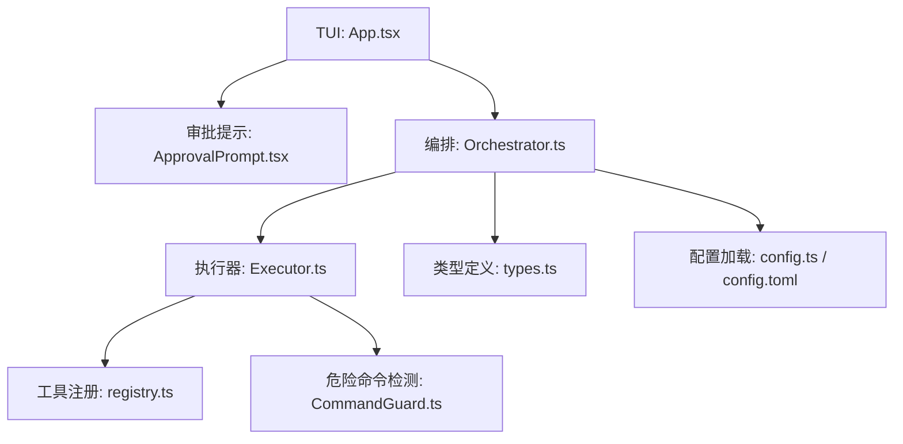
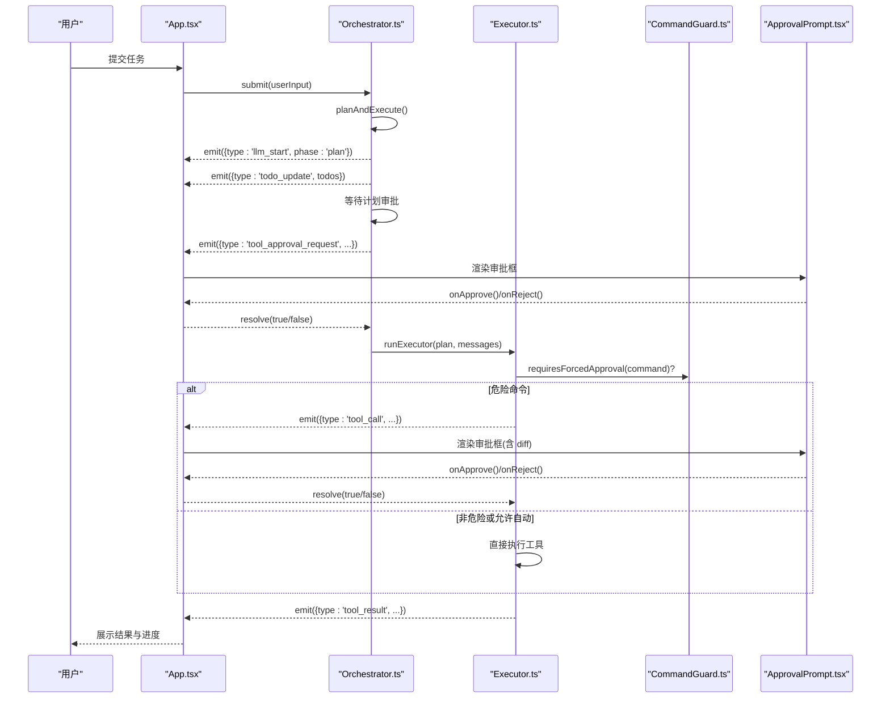
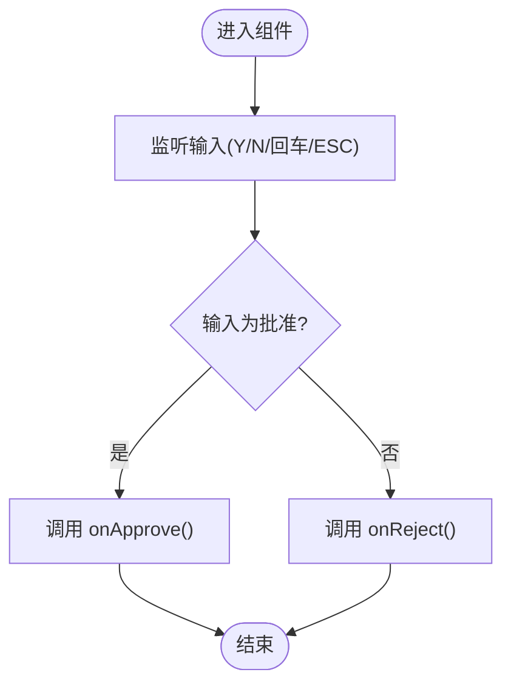
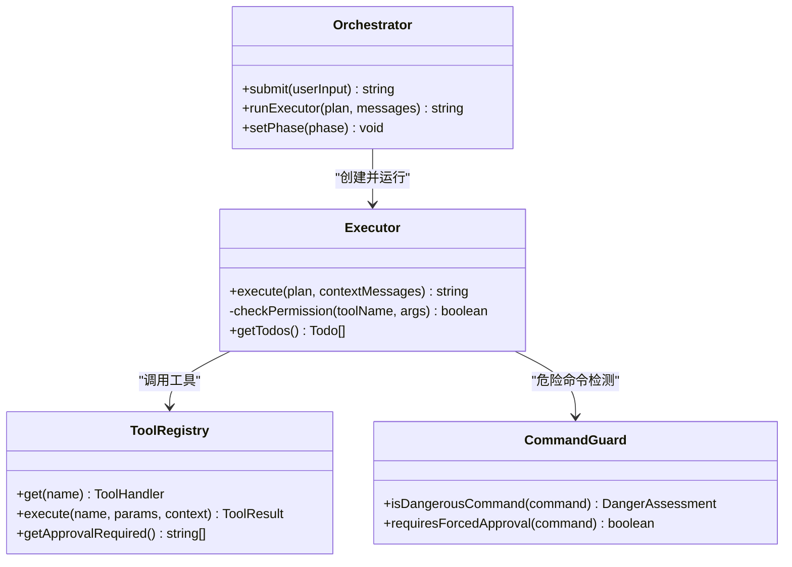
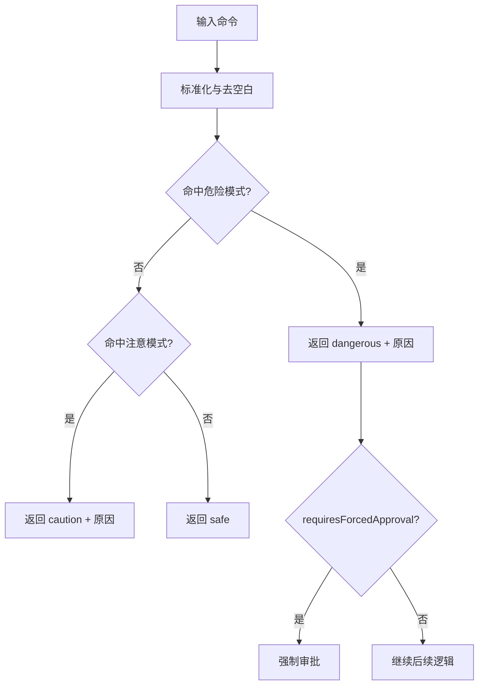
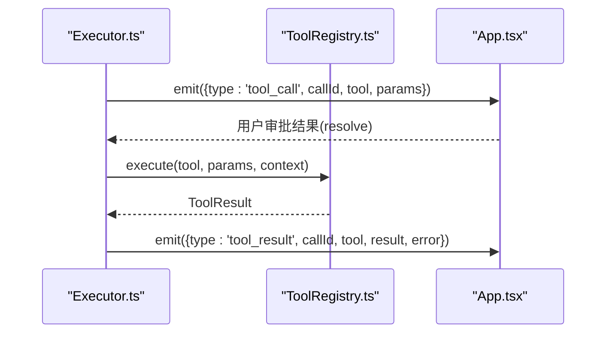
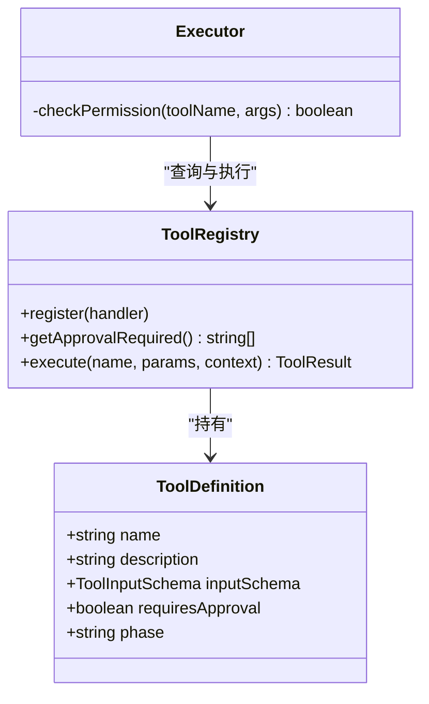
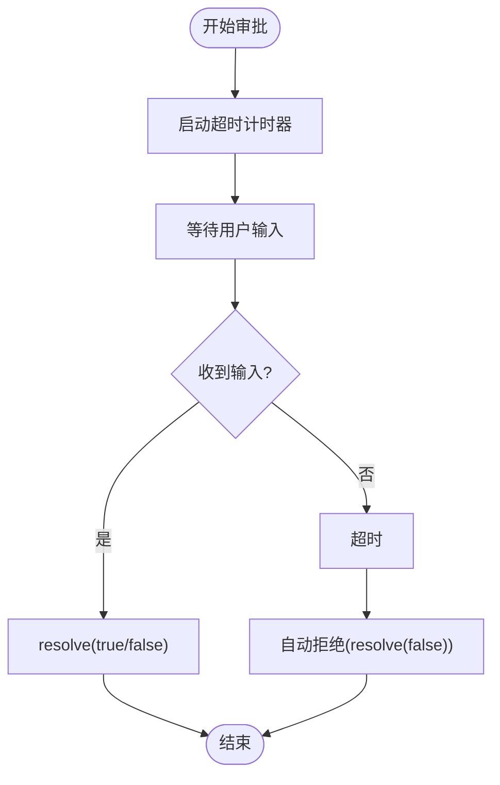
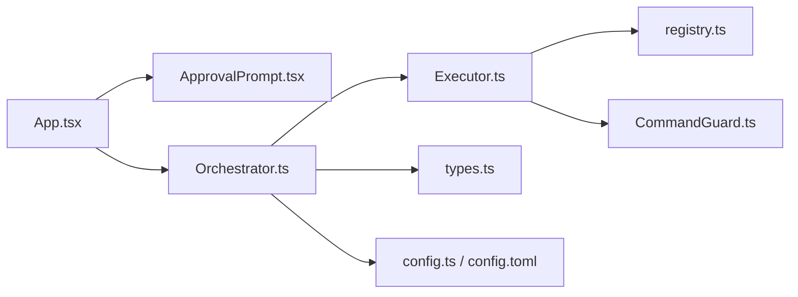

# 审批提示组件

<cite>
**本文引用的文件**   
- [ApprovalPrompt.tsx](file://src/tui/components/ApprovalPrompt.tsx)
- [App.tsx](file://src/tui/App.tsx)
- [Executor.ts](file://src/agent/Executor.ts)
- [Orchestrator.ts](file://src/agent/Orchestrator.ts)
- [CommandGuard.ts](file://src/sandbox/CommandGuard.ts)
- [types.ts](file://src/agent/types.ts)
- [registry.ts](file://src/tools/registry.ts)
- [config.ts](file://src/config.ts)
- [config.toml](file://.nexus/config.toml)
</cite>

## 目录
1. [简介](#简介)
2. [项目结构](#项目结构)
3. [核心组件](#核心组件)
4. [架构总览](#架构总览)
5. [详细组件分析](#详细组件分析)
6. [依赖关系分析](#依赖关系分析)
7. [性能考量](#性能考量)
8. [故障排查指南](#故障排查指南)
9. [结论](#结论)
10. [附录](#附录)

## 简介
本文件围绕 ApprovalPrompt 组件，系统化阐述安全审批流程、权限验证与用户确认机制。内容涵盖：
- 审批对话框的交互逻辑（批准/拒绝/查看 diff）
- 超时处理与自动拒绝策略（结合配置与执行器）
- 审批历史记录与审计日志（事件流与会话记录）
- 安全策略配置（权限模式、危险命令检测）
- 自定义审批规则与条件判断（工具定义、沙箱集成）
- 与沙箱系统的集成及危险命令检测机制

## 项目结构
与审批相关的关键位置如下：
- TUI 层：ApprovalPrompt 组件与 App 根组件负责展示与交互
- Agent 编排：Orchestrator 协调 Plan/Execute 阶段并发起审批请求
- 执行器：Executor 根据权限模式与危险命令检测决定是否请求审批
- 沙箱防护：CommandGuard 提供危险命令检测与强制审批判定
- 类型与配置：types.ts 定义事件与权限模式；config.ts 与 config.toml 管理权限模式与限制

**图表来源** 
- [App.tsx:1-284](file://src/tui/App.tsx#L1-L284)
- [ApprovalPrompt.tsx:1-57](file://src/tui/components/ApprovalPrompt.tsx#L1-L57)
- [Orchestrator.ts:1-260](file://src/agent/Orchestrator.ts#L1-L260)
- [Executor.ts:1-234](file://src/agent/Executor.ts#L1-L234)
- [CommandGuard.ts:1-98](file://src/sandbox/CommandGuard.ts#L1-L98)
- [types.ts:1-269](file://src/agent/types.ts#L1-L269)
- [config.ts:1-132](file://src/config.ts#L1-L132)
- [config.toml:1-62](file://.nexus/config.toml#L1-L62)

**章节来源**
- [App.tsx:1-284](file://src/tui/App.tsx#L1-L284)
- [ApprovalPrompt.tsx:1-57](file://src/tui/components/ApprovalPrompt.tsx#L1-L57)
- [Orchestrator.ts:1-260](file://src/agent/Orchestrator.ts#L1-L260)
- [Executor.ts:1-234](file://src/agent/Executor.ts#L1-L234)
- [CommandGuard.ts:1-98](file://src/sandbox/CommandGuard.ts#L1-L98)
- [types.ts:1-269](file://src/agent/types.ts#L1-L269)
- [config.ts:1-132](file://src/config.ts#L1-L132)
- [config.toml:1-62](file://.nexus/config.toml#L1-L62)

## 核心组件
- ApprovalPrompt 组件
  - 功能：显示“需要审批”的提示框，支持 Y/N 快捷键与 ESC 快速拒绝，可选展示 diff 前若干行
  - 输入参数：tool、description、diff、onApprove、onReject
  - 交互：监听键盘输入，触发 onApprove/onReject 回调
- App 根组件
  - 功能：维护审批状态 approval，渲染 ApprovalPrompt，并将用户选择通过 resolve(true/false) 回传给上游
  - 事件：接收 tool_approval_request 事件（由外部处理），在 UI 中展示审批框
- Executor 执行器
  - 功能：在 ReAct Loop 中调用工具前进行权限检查；对 bash 命令使用危险命令检测；按权限模式决定是否请求审批
  - 审批回调：requestApproval(tool, params, diff?) => Promise<boolean>
- Orchestrator 编排器
  - 功能：Plan 阶段结束后请求审批计划；Execute 阶段将 requestApproval 注入 Executor
- CommandGuard 危险命令检测
  - 功能：基于正则黑名单与启发式规则评估命令危险等级；dangerous 级别强制审批
- 类型与配置
  - types.ts：定义 NexusEvent、PermissionMode、ToolDefinition.requiresApproval 等
  - config.ts/config.toml：permissions.mode 控制 ask/auto-edit/auto-all/yolo

**章节来源**
- [ApprovalPrompt.tsx:1-57](file://src/tui/components/ApprovalPrompt.tsx#L1-L57)
- [App.tsx:1-284](file://src/tui/App.tsx#L1-L284)
- [Executor.ts:1-234](file://src/agent/Executor.ts#L1-L234)
- [Orchestrator.ts:1-260](file://src/agent/Orchestrator.ts#L1-L260)
- [CommandGuard.ts:1-98](file://src/sandbox/CommandGuard.ts#L1-L98)
- [types.ts:1-269](file://src/agent/types.ts#L1-L269)
- [config.ts:1-132](file://src/config.ts#L1-L132)
- [config.toml:1-62](file://.nexus/config.toml#L1-L62)

## 架构总览
下图展示了从用户输入到审批决策的端到端流程，以及关键事件与状态流转。

**图表来源** 
- [App.tsx:1-284](file://src/tui/App.tsx#L1-L284)
- [Orchestrator.ts:1-260](file://src/agent/Orchestrator.ts#L1-L260)
- [Executor.ts:1-234](file://src/agent/Executor.ts#L1-L234)
- [CommandGuard.ts:1-98](file://src/sandbox/CommandGuard.ts#L1-L98)
- [ApprovalPrompt.tsx:1-57](file://src/tui/components/ApprovalPrompt.tsx#L1-L57)

## 详细组件分析

### 审批提示组件 ApprovalPrompt
- 交互逻辑
  - 按键映射：Y/回车 → 批准；N/ESC → 拒绝
  - Diff 展示：最多显示前 15 行，+ 行为绿色，- 行为红色，其余灰色
- 数据流
  - 父组件 App 维护 approval 状态，包含 callId、tool、params、diff 与 resolve 回调
  - 用户操作后通过 resolve(true/false) 通知上游完成审批
- 可访问性与可用性
  - 明确标注“需要审批”，并提供直观的颜色与文本提示
  - 快捷键降低交互成本，适合终端环境

**图表来源** 
- [ApprovalPrompt.tsx:1-57](file://src/tui/components/ApprovalPrompt.tsx#L1-L57)

**章节来源**
- [ApprovalPrompt.tsx:1-57](file://src/tui/components/ApprovalPrompt.tsx#L1-L57)
- [App.tsx:1-284](file://src/tui/App.tsx#L1-L284)

### 权限验证与审批决策（Executor + Orchestrator）
- 权限模式
  - yolo/auto-all：无需审批（除危险命令外）
  - auto-edit：edit_file 自动通过，其他工具需审批
  - ask：所有需要审批的工具均需用户确认
- 危险命令强制审批
  - bash 命令命中 dangerous 级别时，无论权限模式均强制审批
- 审批回调
  - Executor.requestApproval(tool, params, diff?) 返回 true/false
  - 拒绝时向 LLM 反馈“被拒绝”，引导其换一种方式完成任务

**图表来源** 
- [Orchestrator.ts:1-260](file://src/agent/Orchestrator.ts#L1-L260)
- [Executor.ts:1-234](file://src/agent/Executor.ts#L1-L234)
- [CommandGuard.ts:1-98](file://src/sandbox/CommandGuard.ts#L1-L98)
- [registry.ts:1-96](file://src/tools/registry.ts#L1-L96)

**章节来源**
- [Executor.ts:1-234](file://src/agent/Executor.ts#L1-L234)
- [Orchestrator.ts:1-260](file://src/agent/Orchestrator.ts#L1-L260)
- [CommandGuard.ts:1-98](file://src/sandbox/CommandGuard.ts#L1-L98)
- [registry.ts:1-96](file://src/tools/registry.ts#L1-L96)

### 危险命令检测与安全策略
- 检测策略
  - 黑名单正则匹配：文件系统破坏、磁盘操作、Fork 炸弹、远程代码执行、权限提升、系统关键文件覆写、Windows 危险操作、Git 破坏性操作、敏感变量泄露
  - 注意级模式：删除、推送、发布、容器删除、强制杀进程、绝对路径覆写等
- 强制审批
  - level === 'dangerous' 的命令必须经过用户审批，即使处于 yolo/auto-all 模式
- 配置联动
  - permissions.mode 决定默认审批策略
  - limits.bash_timeout 影响单次 bash 命令超时

**图表来源** 
- [CommandGuard.ts:1-98](file://src/sandbox/CommandGuard.ts#L1-L98)

**章节来源**
- [CommandGuard.ts:1-98](file://src/sandbox/CommandGuard.ts#L1-L98)
- [config.ts:1-132](file://src/config.ts#L1-L132)
- [config.toml:1-62](file://.nexus/config.toml#L1-L62)

### 审批历史与审计日志
- 事件流
  - tool_call：记录工具调用（callId、tool、params）
  - tool_approval_request：触发 UI 审批（由 App 处理）
  - tool_result：记录执行结果与错误信息
  - todo_update/checkpoint/cost_update/error/done：用于进度、检查点、成本与状态
- 会话历史
  - Orchestrator 维护 history（user/assistant 消息），便于回溯与审计
- 检查点
  - edit_file 成功后创建 checkpoint，支持 undo 回滚

**图表来源** 
- [Executor.ts:1-234](file://src/agent/Executor.ts#L1-L234)
- [registry.ts:1-96](file://src/tools/registry.ts#L1-L96)
- [App.tsx:1-284](file://src/tui/App.tsx#L1-L284)
- [types.ts:1-269](file://src/agent/types.ts#L1-L269)

**章节来源**
- [types.ts:1-269](file://src/agent/types.ts#L1-L269)
- [Executor.ts:1-234](file://src/agent/Executor.ts#L1-L234)
- [App.tsx:1-284](file://src/tui/App.tsx#L1-L284)

### 自定义审批规则与条件判断
- 工具定义
  - ToolDefinition.requiresApproval：标记是否需要审批
  - ToolDefinition.phase：限定工具可用阶段（plan/execute/both）
- 扩展方法
  - 新增工具时设置 requiresApproval=true，并在 Executor.checkPermission 中自然纳入审批流程
  - 针对特定工具增加额外条件判断（如路径白名单、参数校验）
- 沙箱集成
  - SandboxProvider 接口抽象执行环境，当前实现通过 spawn + CommandGuard
  - 替换为更严格的沙箱（如 GoSandbox）不影响上层审批逻辑

**图表来源** 
- [types.ts:1-269](file://src/agent/types.ts#L1-L269)
- [registry.ts:1-96](file://src/tools/registry.ts#L1-L96)
- [Executor.ts:1-234](file://src/agent/Executor.ts#L1-L234)

**章节来源**
- [types.ts:1-269](file://src/agent/types.ts#L1-L269)
- [registry.ts:1-96](file://src/tools/registry.ts#L1-L96)
- [Executor.ts:1-234](file://src/agent/Executor.ts#L1-L234)

### 超时处理与自动拒绝策略
- 超时来源
  - limits.bash_timeout：单次 bash 命令超时（秒）
  - max_iterations：Agent loop 最大迭代步数，达到上限视为失败并提示
- 自动拒绝
  - 若用户在审批框未响应（当前实现为同步回调），建议在上层封装超时逻辑，超时则 resolve(false)
  - 危险命令强制审批，避免误放行
- 建议增强
  - 在 App.tsx 中为审批状态添加定时器，超时自动拒绝并记录审计事件

[本图为概念流程图，不直接映射具体源码文件]

## 依赖关系分析
- 组件耦合
  - App.tsx 依赖 ApprovalPrompt.tsx 与 Orchestrator.ts
  - Orchestrator.ts 依赖 Executor.ts、CheckpointManager、ModelRouter、CostTracker
  - Executor.ts 依赖 ToolRegistry、CommandGuard、types.ts
- 外部依赖
  - AI SDK（generateText）用于 LLM 调用
  - TOML 解析（smol-toml）用于配置加载
- 潜在循环依赖
  - 当前无循环依赖；事件通过 onEvent 回调解耦

**图表来源** 
- [App.tsx:1-284](file://src/tui/App.tsx#L1-L284)
- [ApprovalPrompt.tsx:1-57](file://src/tui/components/ApprovalPrompt.tsx#L1-L57)
- [Orchestrator.ts:1-260](file://src/agent/Orchestrator.ts#L1-L260)
- [Executor.ts:1-234](file://src/agent/Executor.ts#L1-L234)
- [registry.ts:1-96](file://src/tools/registry.ts#L1-L96)
- [CommandGuard.ts:1-98](file://src/sandbox/CommandGuard.ts#L1-L98)
- [types.ts:1-269](file://src/agent/types.ts#L1-L269)
- [config.ts:1-132](file://src/config.ts#L1-L132)
- [config.toml:1-62](file://.nexus/config.toml#L1-L62)

**章节来源**
- [App.tsx:1-284](file://src/tui/App.tsx#L1-L284)
- [Orchestrator.ts:1-260](file://src/agent/Orchestrator.ts#L1-L260)
- [Executor.ts:1-234](file://src/agent/Executor.ts#L1-L234)
- [registry.ts:1-96](file://src/tools/registry.ts#L1-L96)
- [CommandGuard.ts:1-98](file://src/sandbox/CommandGuard.ts#L1-L98)
- [types.ts:1-269](file://src/agent/types.ts#L1-L269)
- [config.ts:1-132](file://src/config.ts#L1-L132)
- [config.toml:1-62](file://.nexus/config.toml#L1-L62)

## 性能考量
- 审批 UI 渲染轻量：仅展示必要信息与少量 diff 行，避免阻塞
- 事件驱动：通过 onEvent 异步传递状态，减少同步阻塞
- 危险命令检测：正则匹配开销低，命中即短路返回
- 迭代上限：max_iterations 防止无限循环，保护资源

[本节为通用指导，不直接分析具体文件]

## 故障排查指南
- 常见问题
  - 审批框不出现：检查 tool_approval_request 事件是否发出；确认 App.tsx 中 approval 状态渲染逻辑
  - 危险命令未强制审批：确认 CommandGuard 的正则是否覆盖目标命令；检查 requiresForcedApproval 返回值
  - 超时未自动拒绝：在 App.tsx 中为审批状态添加定时器，超时调用 resolve(false)
  - 权限模式不符合预期：核对 .nexus/config.toml 的 permissions.mode 与 config.ts 合并逻辑
- 调试建议
  - 打印 tool_call/tool_result 事件，定位问题环节
  - 临时将 permissions.mode 设为 ask，确保所有需要审批的工具都弹出审批框
  - 使用 git checkpoint 的 undo 回滚误操作

**章节来源**
- [App.tsx:1-284](file://src/tui/App.tsx#L1-L284)
- [Executor.ts:1-234](file://src/agent/Executor.ts#L1-L234)
- [CommandGuard.ts:1-98](file://src/sandbox/CommandGuard.ts#L1-L98)
- [config.ts:1-132](file://src/config.ts#L1-L132)
- [config.toml:1-62](file://.nexus/config.toml#L1-L62)

## 结论
ApprovalPrompt 组件作为人机协作的安全闸门，结合 Orchestrator/Executor 的权限策略与 CommandGuard 的危险命令检测，构建了稳健的审批体系。通过事件流与会话历史，可实现完整的审计追踪。建议在 UI 层补充超时自动拒绝，以进一步提升安全性与用户体验。

[本节为总结，不直接分析具体文件]

## 附录
- 配置项速览
  - permissions.mode：ask | auto-edit | auto-all | yolo
  - limits.bash_timeout：bash 命令超时（秒）
  - limits.max_iterations：最大迭代次数
  - checkpoint.auto_checkpoint：是否自动创建检查点
- 扩展建议
  - 在 ToolDefinition 中增加更多元数据（如风险等级、适用场景）
  - 引入策略引擎（rules.toml）动态调整审批规则
  - 为审批事件增加时间戳与上下文快照，完善审计能力

[本节为补充说明，不直接分析具体文件]