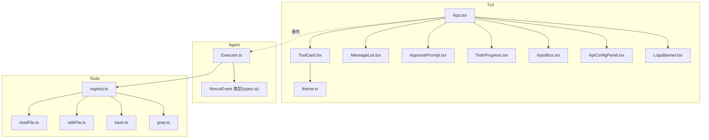
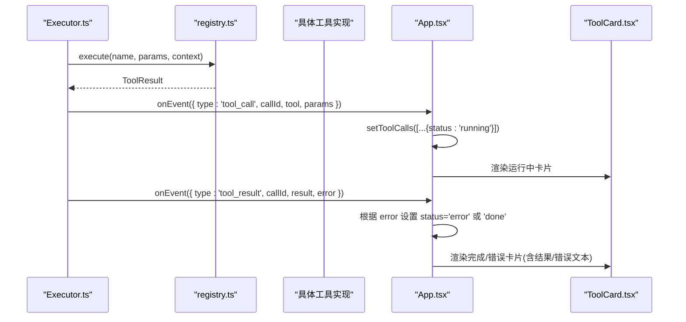
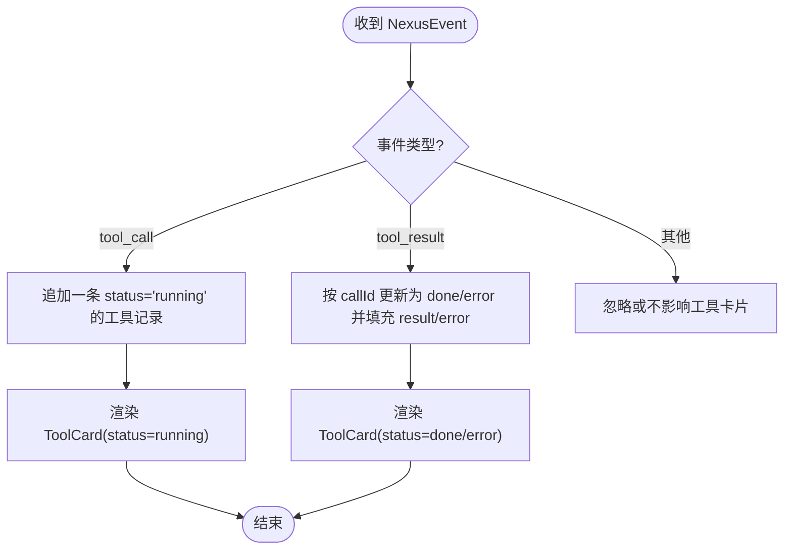
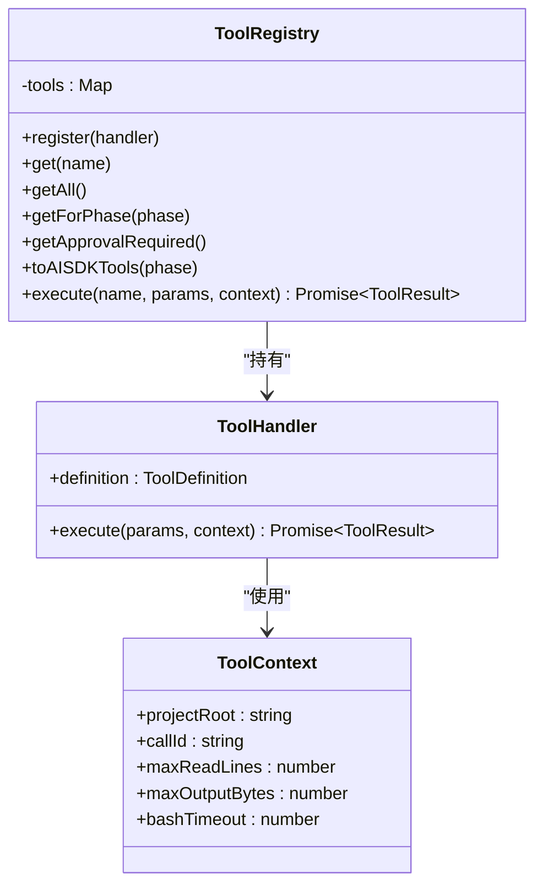
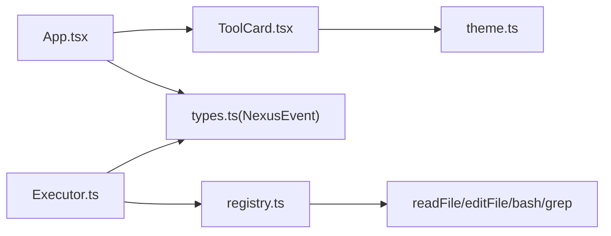

# 工具卡片组件

<cite>
**本文引用的文件**   
- [ToolCard.tsx](file://src/tui/components/ToolCard.tsx)
- [App.tsx](file://src/tui/App.tsx)
- [theme.ts](file://src/tui/theme.ts)
- [registry.ts](file://src/tools/registry.ts)
- [types.ts](file://src/agent/types.ts)
- [Executor.ts](file://src/agent/Executor.ts)
- [readFile.ts](file://src/tools/readFile.ts)
- [editFile.ts](file://src/tools/editFile.ts)
- [bash.ts](file://src/tools/bash.ts)
- [grep.ts](file://src/tools/grep.ts)
</cite>

## 目录
1. [简介](#简介)
2. [项目结构](#项目结构)
3. [核心组件](#核心组件)
4. [架构总览](#架构总览)
5. [详细组件分析](#详细组件分析)
6. [依赖关系分析](#依赖关系分析)
7. [性能与进度指示](#性能与进度指示)
8. [故障排查指南](#故障排查指南)
9. [结论](#结论)
10. [附录：自定义样式与布局](#附录自定义样式与布局)

## 简介
本文件为 ToolCard 组件的权威文档，聚焦于工具调用状态的可视化展示（pending/running/done/error/approval）、参数摘要显示、结果输出格式、不同工具类型的差异化展示逻辑、错误处理与重试机制、生命周期管理、进度指示器与性能监控、以及主题与布局定制。同时说明与工具注册中心的集成方式及数据绑定机制。

## 项目结构
ToolCard 位于 TUI 层，负责将来自 Orchestrator/Executor 的事件转换为可视化的“工具卡片”。其状态由 App 组件维护，并通过事件总线接收来自执行层的 NexusEvent。



图表来源
- [App.tsx:108-176](file://src/tui/App.tsx#L108-L176)
- [ToolCard.tsx:27-64](file://src/tui/components/ToolCard.tsx#L27-L64)
- [Executor.ts:105-154](file://src/agent/Executor.ts#L105-L154)
- [registry.ts:70-82](file://src/tools/registry.ts#L70-L82)
- [types.ts:8-21](file://src/agent/types.ts#L8-L21)

章节来源
- [App.tsx:1-284](file://src/tui/App.tsx#L1-L284)
- [ToolCard.tsx:1-85](file://src/tui/components/ToolCard.tsx#L1-L85)
- [Executor.ts:1-234](file://src/agent/Executor.ts#L1-L234)
- [registry.ts:1-96](file://src/tools/registry.ts#L1-L96)
- [types.ts:1-269](file://src/agent/types.ts#L1-L269)

## 核心组件
- ToolCard：渲染单个工具调用的卡片，包含图标、名称、参数摘要、状态色、结果/错误文本截断显示。
- App：维护 toolCalls 列表，订阅 NexusEvent，驱动 ToolCard 的状态更新。
- Executor：ReAct 循环中触发 tool_call/tool_result 等事件，并协调权限审批与检查点。
- registry：工具注册中心，提供工具定义、执行入口与阶段过滤。
- types：统一事件与工具结果类型，确保端到端数据契约一致。

章节来源
- [ToolCard.tsx:10-18](file://src/tui/components/ToolCard.tsx#L10-L18)
- [App.tsx:20-27](file://src/tui/App.tsx#L20-L27)
- [Executor.ts:105-154](file://src/agent/Executor.ts#L105-L154)
- [registry.ts:12-23](file://src/tools/registry.ts#L12-L23)
- [types.ts:44-78](file://src/agent/types.ts#L44-L78)

## 架构总览
从事件到 UI 的完整链路如下：



图表来源
- [Executor.ts:105-154](file://src/agent/Executor.ts#L105-L154)
- [registry.ts:70-82](file://src/tools/registry.ts#L70-L82)
- [App.tsx:128-147](file://src/tui/App.tsx#L128-L147)
- [ToolCard.tsx:27-64](file://src/tui/components/ToolCard.tsx#L27-L64)

## 详细组件分析

### ToolCard 组件
- 输入属性
  - tool: 工具名
  - params: 参数对象
  - status: 当前状态（pending/running/done/error/approval）
  - result?: 成功结果字符串
  - error?: 错误信息字符串
- 状态图标与颜色
  - pending → ○ / muted
  - running → ● / warning
  - done → ✓ / success
  - error → ✗ / error
  - approval → ⚠️ / warning
- 参数摘要策略
  - read_file/edit_file：显示 path
  - bash：截断 command 至固定长度
  - grep：以 /pattern/ 形式展示
  - 其他：JSON.stringify 前若干字符
- 结果与错误显示
  - done 且存在 result：截断后以弱化样式显示
  - error 且存在 error：以错误色显示
- 可访问性与可读性
  - 使用边框与颜色区分状态
  - 长文本统一截断，避免终端溢出

```mermaid
classDiagram
class ToolCard {
+props : { tool, params, status, result?, error? }
+render() JSX
}
class Theme {
+colors
+symbols
+labels
}
ToolCard --> Theme : "读取颜色/符号/标签"
```

图表来源
- [ToolCard.tsx:27-64](file://src/tui/components/ToolCard.tsx#L27-L64)
- [theme.ts:5-38](file://src/tui/theme.ts#L5-L38)

章节来源
- [ToolCard.tsx:1-85](file://src/tui/components/ToolCard.tsx#L1-L85)
- [theme.ts:1-41](file://src/tui/theme.ts#L1-L41)

### App 组件中的数据绑定
- 状态存储
  - toolCalls: 数组项包含 callId、tool、params、status、result、error
- 事件处理
  - tool_call：新增一条 status=running 的记录
  - tool_result：按 callId 匹配并更新为 done 或 error，附带 result/error
- 渲染策略
  - 仅渲染非 done 的卡片（已完成的不常驻显示）
  - 通过 key={callId} 保持 React 列表稳定性



图表来源
- [App.tsx:128-147](file://src/tui/App.tsx#L128-L147)
- [App.tsx:241-250](file://src/tui/App.tsx#L241-L250)

章节来源
- [App.tsx:108-176](file://src/tui/App.tsx#L108-L176)
- [App.tsx:241-250](file://src/tui/App.tsx#L241-L250)

### 工具注册中心与执行流程
- 注册与获取
  - register/get/getAll/getForPhase/getApprovalRequired
- 执行入口
  - execute(name, params, context)：查找处理器并调用，返回 ToolResult
- 阶段控制
  - plan/execute/both：用于在规划与执行阶段暴露不同的工具集
- 需要审批的工具
  - getApprovalRequired 返回 requiresApproval=true 的工具名集合



图表来源
- [registry.ts:25-82](file://src/tools/registry.ts#L25-L82)
- [registry.ts:12-23](file://src/tools/registry.ts#L12-L23)

章节来源
- [registry.ts:1-96](file://src/tools/registry.ts#L1-L96)

### 工具类型差异化展示逻辑
- read_file
  - 参数摘要：path
  - 典型结果：带行号的文件内容片段；超长时头部+尾部+省略提示
  - 错误示例：路径越界、非文件、二进制文件、IO 异常
- edit_file
  - 参数摘要：path
  - 典型结果：编辑后的 diff 摘要
  - 错误示例：未找到匹配、匹配不唯一、文件不存在、写入失败
- bash
  - 参数摘要：command（截断）
  - 典型结果：命令、退出码、stdout/stderr（可能截断），超时标记
  - 错误示例：退出码非零、执行异常
- grep
  - 参数摘要：/pattern/
  - 典型结果：匹配数量与匹配行；无匹配时友好提示
  - 错误示例：ripgrep 不可用、搜索出错、结果过大被截断

章节来源
- [ToolCard.tsx:66-79](file://src/tui/components/ToolCard.tsx#L66-L79)
- [readFile.ts:54-146](file://src/tools/readFile.ts#L54-L146)
- [editFile.ts:61-156](file://src/tools/editFile.ts#L61-L156)
- [bash.ts:123-183](file://src/tools/bash.ts#L123-L183)
- [grep.ts:80-175](file://src/tools/grep.ts#L80-L175)

### 错误处理与重试机制
- 错误传播
  - 工具返回 ToolResult.error 时，App 将其映射为 status='error' 并在卡片中以错误色显示
- 重试建议
  - 当出现“匹配不唯一”或“文件已变更”等错误时，建议在用户确认后重新发起调用（例如先 read_file 再 retry）
  - 对于 bash 超时或外部依赖缺失（如 rg 未安装），应提示用户调整参数或安装依赖后重试
- 审批拒绝
  - 若权限检查拒绝，Executor 会向消息流注入拒绝原因，并将对应工具卡片置为 error

章节来源
- [App.tsx:139-147](file://src/tui/App.tsx#L139-L147)
- [Executor.ts:112-119](file://src/agent/Executor.ts#L112-L119)
- [editFile.ts:113-129](file://src/tools/editFile.ts#L113-L129)
- [grep.ts:120-128](file://src/tools/grep.ts#L120-L128)
- [bash.ts:151-153](file://src/tools/bash.ts#L151-L153)

### 工具调用生命周期管理
- 生命周期阶段
  - 开始：tool_call → status='running'
  - 审批：requiresApproval=true 时进入审批流程（approval 状态可用于 UI 提示）
  - 完成：tool_result 且无 error → status='done'
  - 失败：tool_result 且存在 error → status='error'
- 检查点与回滚
  - edit_file 成功后创建 checkpoint，便于后续回滚与审计
- 迭代上限保护
  - 达到最大迭代次数时，抛出可恢复错误，避免无限循环

章节来源
- [App.tsx:128-147](file://src/tui/App.tsx#L128-L147)
- [Executor.ts:135-144](file://src/agent/Executor.ts#L135-L144)
- [Executor.ts:157-161](file://src/agent/Executor.ts#L157-L161)

### 进度指示器与性能监控
- 进度指示
  - running 状态配合主题 spinner 符号可在 UI 层实现动态旋转效果
  - TodoProgress 组件与 todo_update 事件联动，展示任务完成度
- 性能监控
  - cost_update 事件携带 token 用量与成本，适合在状态栏或侧边面板展示
  - 工具输出截断（bash/grep/read_file）避免大输出阻塞渲染

章节来源
- [App.tsx:149-155](file://src/tui/App.tsx#L149-L155)
- [types.ts:8-21](file://src/agent/types.ts#L8-L21)
- [bash.ts:111-121](file://src/tools/bash.ts#L111-L121)
- [grep.ts:147-155](file://src/tools/grep.ts#L147-L155)
- [readFile.ts:114-130](file://src/tools/readFile.ts#L114-L130)

## 依赖关系分析
- ToolCard 依赖 theme 的颜色与符号，保证一致的视觉风格
- App 依赖 Executor 产生的 NexusEvent，作为唯一的数据源
- Executor 依赖 ToolRegistry 进行工具分发与执行
- 各工具实现遵循 ToolHandler 接口，统一返回 ToolResult



图表来源
- [ToolCard.tsx:27-64](file://src/tui/components/ToolCard.tsx#L27-L64)
- [App.tsx:108-176](file://src/tui/App.tsx#L108-L176)
- [Executor.ts:105-154](file://src/agent/Executor.ts#L105-L154)
- [registry.ts:70-82](file://src/tools/registry.ts#L70-L82)
- [types.ts:8-21](file://src/agent/types.ts#L8-L21)

章节来源
- [ToolCard.tsx:1-85](file://src/tui/components/ToolCard.tsx#L1-L85)
- [App.tsx:1-284](file://src/tui/App.tsx#L1-L284)
- [Executor.ts:1-234](file://src/agent/Executor.ts#L1-L234)
- [registry.ts:1-96](file://src/tools/registry.ts#L1-L96)
- [types.ts:1-269](file://src/agent/types.ts#L1-L269)

## 性能与进度指示
- 渲染优化
  - 仅渲染非 done 的卡片，减少重绘
  - 结果与错误文本统一截断，避免超大 DOM 节点
- 交互体验
  - running 状态配合 spinner 提升反馈感
  - 审批弹窗阻断式交互，防止误操作
- 资源限制
  - bash/grep/read_file 均对输出大小做限制，避免内存与渲染压力

[本节为通用指导，无需源码引用]

## 故障排查指南
- 常见错误与定位
  - 路径越界：read_file/edit_file 报越界，检查 projectRoot 与相对路径
  - 匹配不唯一：edit_file 报错，增加上下文行或缩小范围
  - ripgrep 不可用：grep 报错，安装 rg 或改用更精确模式
  - bash 超时：检查命令耗时与 bashTimeout 配置
- 调试步骤
  - 查看 ToolCard 的 error 字段是否被正确填充
  - 确认 executor 是否正确发出 tool_call 与 tool_result
  - 检查审批流程是否被拒绝导致卡片置为 error

章节来源
- [readFile.ts:64-96](file://src/tools/readFile.ts#L64-L96)
- [editFile.ts:113-129](file://src/tools/editFile.ts#L113-L129)
- [grep.ts:120-128](file://src/tools/grep.ts#L120-L128)
- [bash.ts:151-153](file://src/tools/bash.ts#L151-L153)
- [App.tsx:139-147](file://src/tui/App.tsx#L139-L147)

## 结论
ToolCard 通过简洁的 props 与稳定的事件契约，实现了跨工具的统一可视化。结合 App 的状态管理与 Executor 的生命周期控制，形成从“开始→审批→执行→完成/失败”的闭环。通过主题系统与截断策略，兼顾了可读性与性能。未来可扩展更多工具类型与更丰富的进度指标。

[本节为总结，无需源码引用]

## 附录：自定义样式与布局
- 主题定制
  - 修改 theme.colors 与 symbols 即可全局改变 ToolCard 的边框色、文字色与状态图标
- 布局扩展
  - 在 App 中可按需调整 ToolCard 的渲染顺序与过滤条件（例如保留最近 N 条）
  - 可将 ToolCard 封装为更高阶组件，注入额外的元数据（如耗时、token 消耗）
- 行为增强
  - 在 App 的 tool_result 分支中，可根据 truncated 标志添加“展开详情”交互
  - 针对 approval 状态，可增加倒计时或快捷审批按钮

章节来源
- [theme.ts:5-38](file://src/tui/theme.ts#L5-L38)
- [App.tsx:241-250](file://src/tui/App.tsx#L241-L250)