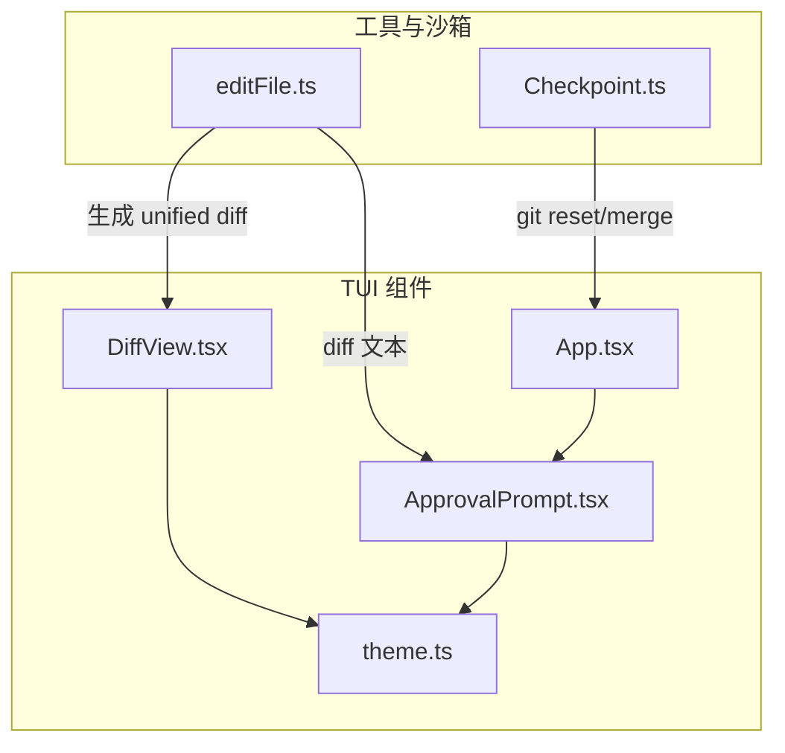
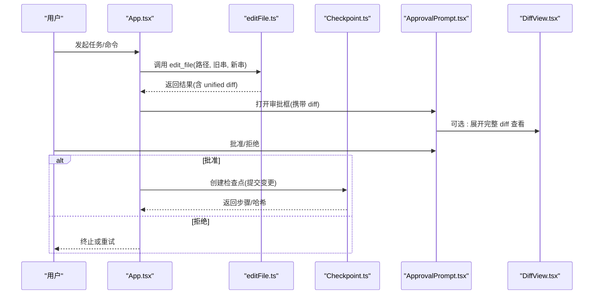
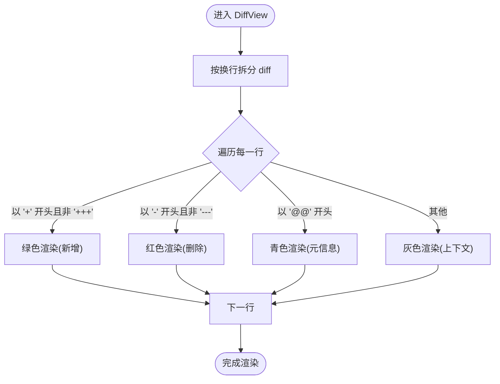
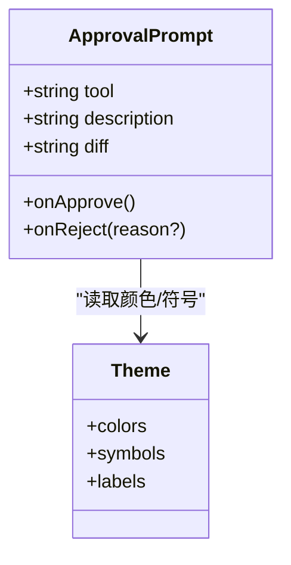
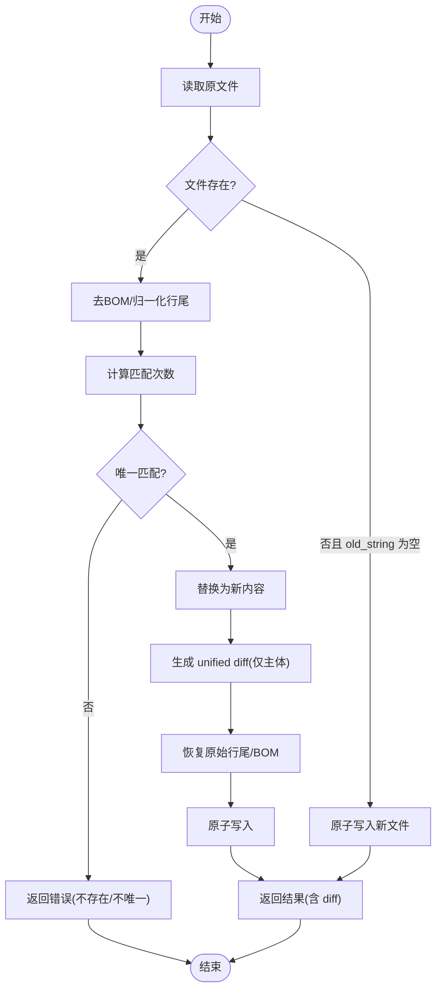
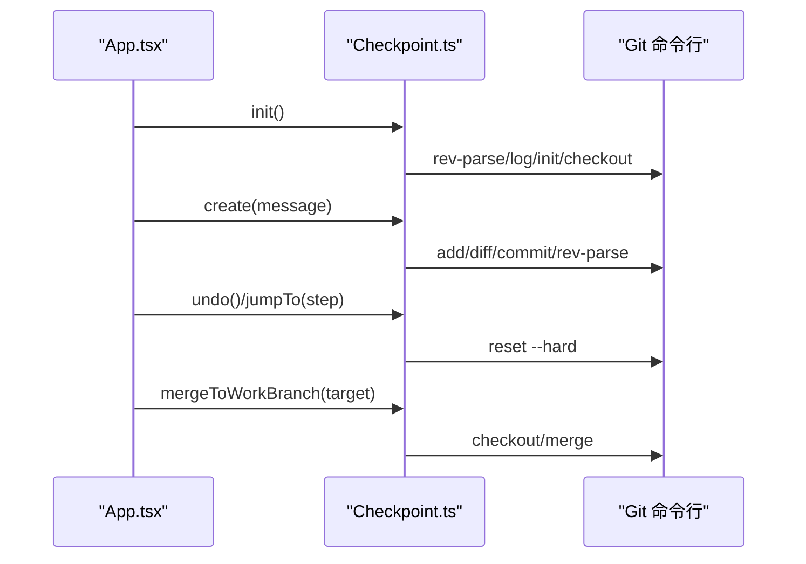
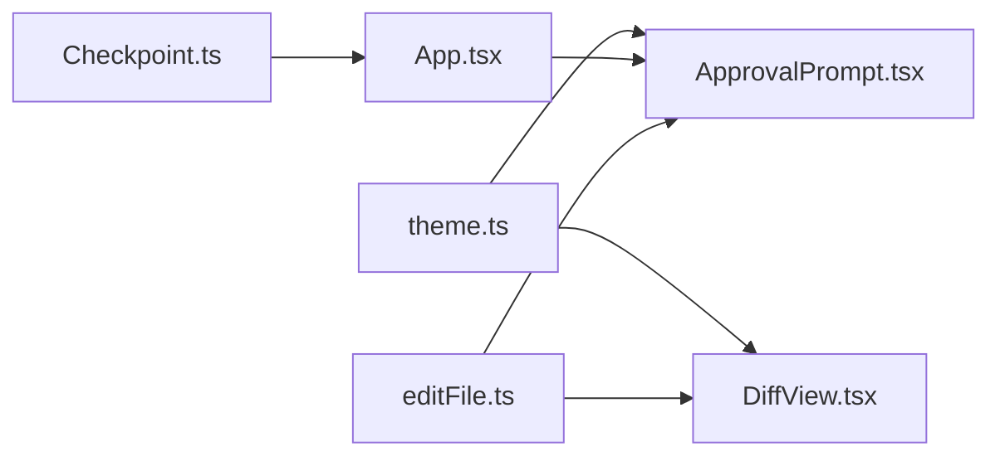

# 差异视图组件

<cite>
**本文引用的文件**   
- [DiffView.tsx](file://src/tui/components/DiffView.tsx)
- [ApprovalPrompt.tsx](file://src/tui/components/ApprovalPrompt.tsx)
- [App.tsx](file://src/tui/App.tsx)
- [editFile.ts](file://src/tools/editFile.ts)
- [Checkpoint.ts](file://src/sandbox/Checkpoint.ts)
- [theme.ts](file://src/tui/theme.ts)
</cite>

## 目录
1. [简介](#简介)
2. [项目结构](#项目结构)
3. [核心组件](#核心组件)
4. [架构总览](#架构总览)
5. [详细组件分析](#详细组件分析)
6. [依赖关系分析](#依赖关系分析)
7. [性能与增量更新](#性能与增量更新)
8. [搜索与导航](#搜索与导航)
9. [批量操作](#批量操作)
10. [自定义配置与样式定制](#自定义配置与样式定制)
11. [与文件系统操作的集成](#与文件系统操作的集成)
12. [撤销与重做机制](#撤销与重做机制)
13. [故障排查指南](#故障排查指南)
14. [结论](#结论)

## 简介
本文件为 DiffView 组件的权威文档，聚焦于终端 TUI 中的“差异可视化”能力。内容涵盖：
- 行级变更高亮与统一 diff 展示
- 与编辑工具链的集成（生成 unified diff）
- 审批流中的差异预览
- 可扩展的主题与样式定制
- 与 Git 检查点系统的协作，支持撤销/回滚
- 面向未来扩展的增量渲染、搜索与批量操作建议

## 项目结构
DiffView 位于 TUI 组件层，负责将统一 diff 文本以“绿增红删”的方式在终端中呈现；审批提示组件内嵌了轻量 diff 预览；编辑工具负责生成 diff；检查点系统提供版本化与回滚能力。

图示来源
- [DiffView.tsx:1-41](file://src/tui/components/DiffView.tsx#L1-L41)
- [ApprovalPrompt.tsx:1-57](file://src/tui/components/ApprovalPrompt.tsx#L1-L57)
- [App.tsx:1-284](file://src/tui/App.tsx#L1-L284)
- [editFile.ts:1-170](file://src/tools/editFile.ts#L1-L170)
- [Checkpoint.ts:1-182](file://src/sandbox/Checkpoint.ts#L1-L182)
- [theme.ts:1-41](file://src/tui/theme.ts#L1-L41)

章节来源
- [DiffView.tsx:1-41](file://src/tui/components/DiffView.tsx#L1-L41)
- [ApprovalPrompt.tsx:1-57](file://src/tui/components/ApprovalPrompt.tsx#L1-L57)
- [App.tsx:1-284](file://src/tui/App.tsx#L1-L284)
- [editFile.ts:1-170](file://src/tools/editFile.ts#L1-L170)
- [Checkpoint.ts:1-182](file://src/sandbox/Checkpoint.ts#L1-L182)
- [theme.ts:1-41](file://src/tui/theme.ts#L1-L41)

## 核心组件
- DiffView：接收统一 diff 字符串与可选文件名，逐行解析并按前缀着色（新增绿色、删除红色、@@ 元信息青色、其余灰色）。
- ApprovalPrompt：审批弹窗，内嵌最多 15 行的 diff 预览，用于快速审阅变更。
- App：编排消息、工具调用与审批流程，持有 diff 文本并传递给审批组件进行展示。
- editFile：执行精准替换后，基于库函数生成 unified diff，供 UI 展示与 LLM 消费。
- Checkpoint：每次编辑后自动提交，提供 undo/jumpTo/merge 等能力，支撑撤销与重做。
- theme：集中定义颜色、符号与标签，便于全局主题定制。

章节来源
- [DiffView.tsx:1-41](file://src/tui/components/DiffView.tsx#L1-L41)
- [ApprovalPrompt.tsx:1-57](file://src/tui/components/ApprovalPrompt.tsx#L1-L57)
- [App.tsx:1-284](file://src/tui/App.tsx#L1-L284)
- [editFile.ts:1-170](file://src/tools/editFile.ts#L1-L170)
- [Checkpoint.ts:1-182](file://src/sandbox/Checkpoint.ts#L1-L182)
- [theme.ts:1-41](file://src/tui/theme.ts#L1-L41)

## 架构总览
下图展示了从“编辑触发”到“差异展示与审批”的端到端流程，以及后续的回滚路径。

图示来源
- [App.tsx:1-284](file://src/tui/App.tsx#L1-L284)
- [editFile.ts:1-170](file://src/tools/editFile.ts#L1-L170)
- [ApprovalPrompt.tsx:1-57](file://src/tui/components/ApprovalPrompt.tsx#L1-L57)
- [DiffView.tsx:1-41](file://src/tui/components/DiffView.tsx#L1-L41)
- [Checkpoint.ts:1-182](file://src/sandbox/Checkpoint.ts#L1-L182)

## 详细组件分析

### DiffView 组件
职责
- 接收统一 diff 文本与可选文件名
- 按行解析并应用颜色：新增行绿色、删除行红色、@@ 行青色、其他灰色
- 通过 Box/Text 组合输出到 Ink 终端

数据结构与复杂度
- 输入：diff 字符串、可选 fileName
- 处理：按换行分割 O(n)，逐行判断前缀 O(1)
- 输出：React 元素树

错误与边界
- 空 diff：渲染为空列表
- 非标准 diff：未识别前缀的行将以灰色显示，避免崩溃

可访问性与体验
- 使用语义化颜色对比，便于快速定位变更
- 支持可选文件名加粗显示，提升上下文可读性

图示来源
- [DiffView.tsx:1-41](file://src/tui/components/DiffView.tsx#L1-L41)

章节来源
- [DiffView.tsx:1-41](file://src/tui/components/DiffView.tsx#L1-L41)

### 审批提示与内联 diff 预览
职责
- 展示工具名称与描述
- 提供 Y/N 快捷键批准/拒绝
- 内嵌最多 15 行 diff 预览，采用与 DiffView 一致的着色策略

交互
- 键盘事件监听：回车/Y 批准，Esc/N 拒绝
- 当存在 diff 时，优先展示摘要，必要时再展开完整 diff

图示来源
- [ApprovalPrompt.tsx:1-57](file://src/tui/components/ApprovalPrompt.tsx#L1-L57)
- [theme.ts:1-41](file://src/tui/theme.ts#L1-L41)

章节来源
- [ApprovalPrompt.tsx:1-57](file://src/tui/components/ApprovalPrompt.tsx#L1-L57)
- [theme.ts:1-41](file://src/tui/theme.ts#L1-L41)

### 编辑工具与 diff 生成
职责
- 安全校验路径、唯一匹配 old_string
- 原子写入（临时文件 + rename）
- 生成 unified diff，仅保留主体部分（从 @@ 开始）
- 返回包含 diff 的结果给上层 UI 与 LLM

算法要点
- 规范化行尾与 BOM，确保跨平台一致性
- 计数匹配次数，保证唯一性
- 使用库函数生成 patch，再裁剪头部信息

图示来源
- [editFile.ts:1-170](file://src/tools/editFile.ts#L1-L170)

章节来源
- [editFile.ts:1-170](file://src/tools/editFile.ts#L1-L170)

### 检查点与撤销/回滚
职责
- 初始化 git 仓库与分支
- 每次有效变更创建检查点并提交
- 支持回退到上一个检查点或跳转到指定步骤
- 会话结束时合并到工作分支

关键流程
- create：add -A → 检测是否有变更 → commit → 记录 HEAD 与变更文件
- undo：reset --hard 到上一提交
- jumpTo：reset --hard 到目标提交，并清理后续检查点
- mergeToWorkBranch：切换分支并合并

图示来源
- [Checkpoint.ts:1-182](file://src/sandbox/Checkpoint.ts#L1-L182)
- [App.tsx:1-284](file://src/tui/App.tsx#L1-L284)

章节来源
- [Checkpoint.ts:1-182](file://src/sandbox/Checkpoint.ts#L1-L182)
- [App.tsx:1-284](file://src/tui/App.tsx#L1-L284)

## 依赖关系分析
- DiffView 依赖 Ink 的 Box/Text 进行渲染，依赖 theme 的颜色体系
- ApprovalPrompt 同样依赖 Ink 与 theme，并在内部复用 diff 着色逻辑
- App 作为编排者，持有 diff 文本并传递给审批组件
- editFile 依赖 diff 库生成 unified diff，并通过 fs/promises 进行原子写入
- Checkpoint 通过 child_process 调用 git 命令管理版本历史

图示来源
- [theme.ts:1-41](file://src/tui/theme.ts#L1-L41)
- [DiffView.tsx:1-41](file://src/tui/components/DiffView.tsx#L1-L41)
- [ApprovalPrompt.tsx:1-57](file://src/tui/components/ApprovalPrompt.tsx#L1-L57)
- [App.tsx:1-284](file://src/tui/App.tsx#L1-L284)
- [editFile.ts:1-170](file://src/tools/editFile.ts#L1-L170)
- [Checkpoint.ts:1-182](file://src/sandbox/Checkpoint.ts#L1-L182)

章节来源
- [theme.ts:1-41](file://src/tui/theme.ts#L1-L41)
- [DiffView.tsx:1-41](file://src/tui/components/DiffView.tsx#L1-L41)
- [ApprovalPrompt.tsx:1-57](file://src/tui/components/ApprovalPrompt.tsx#L1-L57)
- [App.tsx:1-284](file://src/tui/App.tsx#L1-L284)
- [editFile.ts:1-170](file://src/tools/editFile.ts#L1-L170)
- [Checkpoint.ts:1-182](file://src/sandbox/Checkpoint.ts#L1-L182)

## 性能与增量更新
现状
- DiffView 对整份 diff 进行一次性 split 与映射渲染
- ApprovalPrompt 默认只展示前 15 行 diff，降低首屏开销

优化建议
- 虚拟滚动：对超大 diff 实现可视区域渲染，减少 DOM/Ink 节点数量
- 增量更新：基于 diff 的 hunk 范围进行局部重绘，避免全量重建
- 分页/分块加载：首次渲染前 N 行，滚动触底加载更多
- 防抖与节流：在频繁变更场景下合并渲染批次
- 缓存行样式：对相同前缀的行复用样式对象，减少重复计算

[本节为通用性能建议，不涉及具体代码片段]

## 搜索与导航
当前实现
- 未内置搜索与跳转功能
- 审批预览限制为前 15 行，适合快速审阅

扩展建议
- 行号与锚点：为每行分配稳定 key，便于定位
- 关键词高亮：在 diff 文本上叠加搜索词高亮
- 跳转至变更：根据搜索结果直接滚动到对应 hunk
- 过滤模式：仅显示新增/删除/上下文行

[本节为概念性设计，不涉及具体代码片段]

## 批量操作
当前实现
- 单次 edit_file 仅针对一个文件
- 审批流程一次一个 diff

扩展建议
- 多文件 diff 聚合：将多个文件的 diff 分段渲染，并提供文件间导航
- 批量审批：对一组相关变更提供“全部批准/拒绝”
- 变更分组：按文件或 hunk 分组，支持折叠/展开

[本节为概念性设计，不涉及具体代码片段]

## 自定义配置与样式定制
主题系统
- 通过 theme.colors 统一管理颜色，便于全局替换
- symbols 与 labels 可用于扩展图标与文案

DiffView 定制
- 可通过 props 传入自定义颜色映射或样式函数
- 支持按需启用/禁用特定行类型的高亮

审批预览定制
- 调整预览行数上限
- 支持在审批界面嵌入完整 diff 查看器

章节来源
- [theme.ts:1-41](file://src/tui/theme.ts#L1-L41)
- [DiffView.tsx:1-41](file://src/tui/components/DiffView.tsx#L1-L41)
- [ApprovalPrompt.tsx:1-57](file://src/tui/components/ApprovalPrompt.tsx#L1-L57)

## 与文件系统操作的集成
编辑流程
- 安全校验：防止路径越界
- 原子写入：临时文件 + rename，避免中间态
- 格式保持：BOM 与行尾保留，跨平台一致

diff 生成
- 使用库函数生成 unified diff
- 仅保留主体部分，去除头部信息，便于 UI 渲染

章节来源
- [editFile.ts:1-170](file://src/tools/editFile.ts#L1-L170)

## 撤销与重做机制
撤销
- 通过 Checkpoint.undo 回退到上一个检查点
- 适用于误改后的快速恢复

重做
- 当前未提供显式“重做”按钮
- 可在会话结束后通过 mergeToWorkBranch 将检查点分支合并到工作分支，达到“持久化变更”的效果

章节来源
- [Checkpoint.ts:1-182](file://src/sandbox/Checkpoint.ts#L1-L182)

## 故障排查指南
常见问题
- 路径越界：确保编辑路径在项目根目录下
- 匹配不唯一：old_string 需提供足够上下文以确保唯一匹配
- 文件不存在：若需创建新文件，请将 old_string 设为空字符串
- 无变更：当 diff 为空时，检查是否已存在相同内容或权限问题

定位方法
- 查看工具返回的错误信息
- 确认 git 环境可用（仓库、分支、权限）
- 在审批界面预览 diff，确认变更范围

章节来源
- [editFile.ts:1-170](file://src/tools/editFile.ts#L1-L170)
- [Checkpoint.ts:1-182](file://src/sandbox/Checkpoint.ts#L1-L182)

## 结论
DiffView 提供了简洁高效的统一 diff 可视化能力，配合审批流程与检查点系统，形成了“编辑—审阅—回滚”的闭环。当前实现注重可靠性与易用性，同时为未来的虚拟滚动、搜索、批量操作与更丰富的主题定制预留了扩展空间。建议在大规模变更场景下引入增量渲染与分页加载，以提升交互流畅度与可维护性。