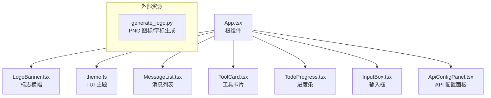
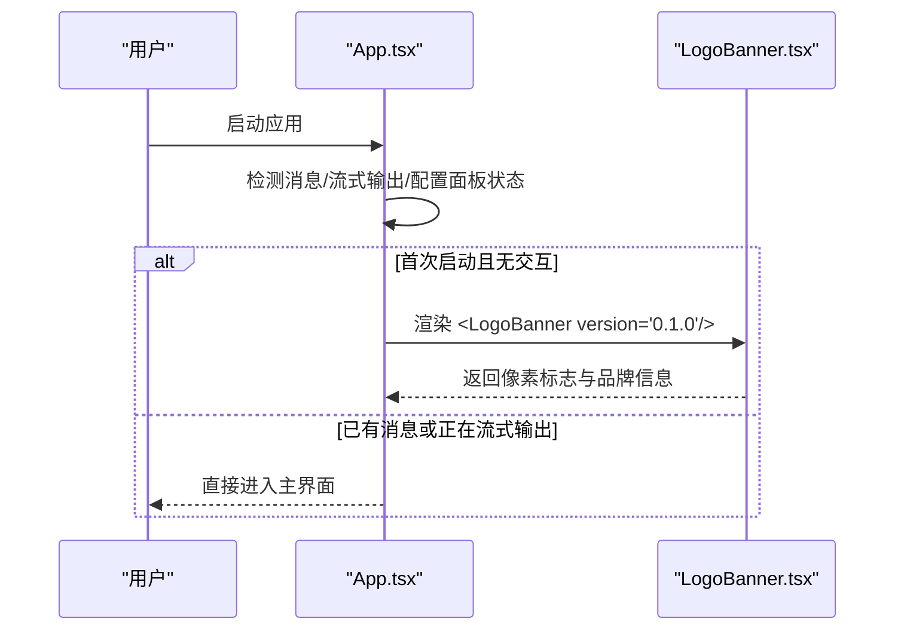
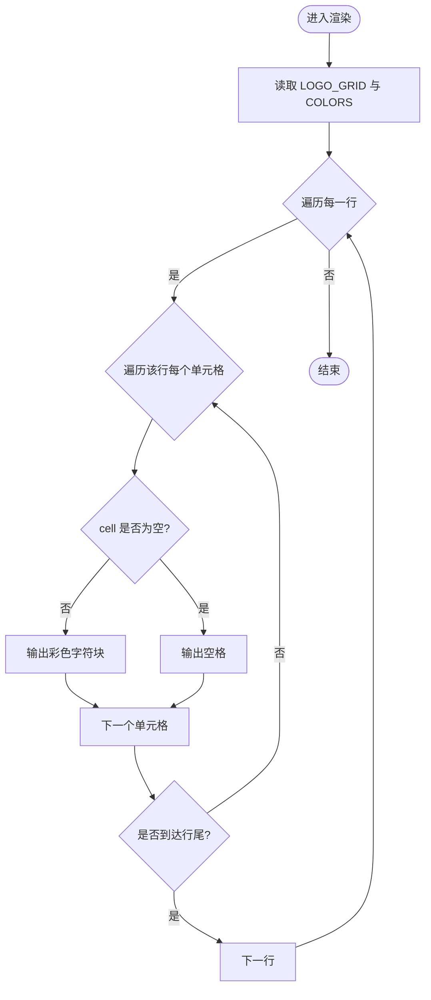
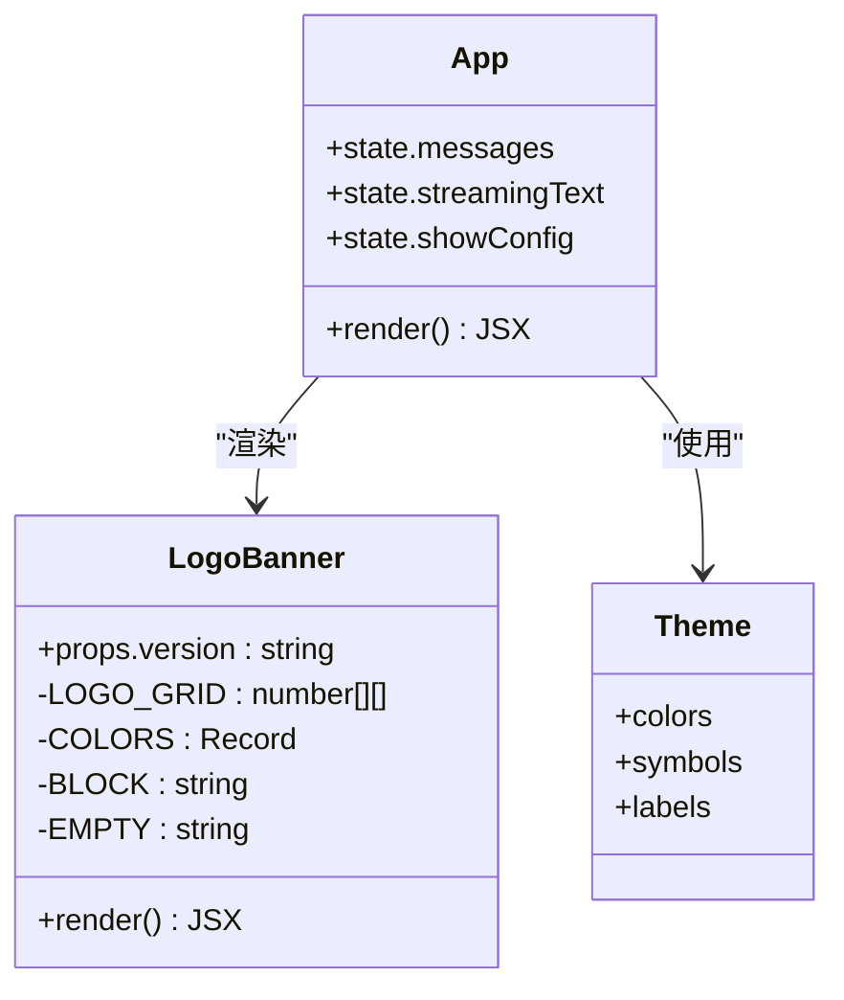

# 标志横幅组件

<cite>
**本文引用的文件**
- [src/tui/components/LogoBanner.tsx](file://src/tui/components/LogoBanner.tsx)
- [src/tui/App.tsx](file://src/tui/App.tsx)
- [src/tui/theme.ts](file://src/tui/theme.ts)
- [generate_logo.py](file://generate_logo.py)
</cite>

## 目录
1. [简介](#简介)
2. [项目结构](#项目结构)
3. [核心组件](#核心组件)
4. [架构总览](#架构总览)
5. [详细组件分析](#详细组件分析)
6. [依赖关系分析](#依赖关系分析)
7. [性能与动画配置](#性能与动画配置)
8. [终端兼容性与主题适配](#终端兼容性与主题适配)
9. [故障排查指南](#故障排查指南)
10. [结论](#结论)

## 简介
本文件为 LogoBanner 组件的权威文档，聚焦以下目标：
- ASCII 艺术标志渲染机制（像素网格、字符块映射）
- 动画效果与响应式布局策略
- 品牌展示、版本信息与启动欢迎界面集成
- 自定义标志支持、颜色主题适配与终端兼容性
- 动画配置与性能优化选项
- 与应用程序启动流程的集成方式

## 项目结构
LogoBanner 位于 TUI 子系统中，作为应用首次启动时的“欢迎横幅”显示。其关键位置与关系如下：
- 组件实现：src/tui/components/LogoBanner.tsx
- 使用入口：src/tui/App.tsx（在消息为空且无流式输出时渲染）
- 主题定义：src/tui/theme.ts（TUI 全局主题，LogoBanner 当前未直接引用）
- 图形生成脚本：generate_logo.py（用于生成 PNG 图标与字标，供非终端场景使用）

图表来源
- [src/tui/App.tsx:1-284](file://src/tui/App.tsx#L1-L284)
- [src/tui/components/LogoBanner.tsx:1-62](file://src/tui/components/LogoBanner.tsx#L1-L62)
- [src/tui/theme.ts:1-41](file://src/tui/theme.ts#L1-L41)
- [generate_logo.py:1-145](file://generate_logo.py#L1-L145)

章节来源
- [src/tui/App.tsx:1-284](file://src/tui/App.tsx#L1-L284)
- [src/tui/components/LogoBanner.tsx:1-62](file://src/tui/components/LogoBanner.tsx#L1-L62)
- [src/tui/theme.ts:1-41](file://src/tui/theme.ts#L1-L41)
- [generate_logo.py:1-145](file://generate_logo.py#L1-L145)

## 核心组件
LogoBanner 负责在终端中以彩色方块渲染像素风格的 “N” 标识，并展示品牌名称、版本号与副标题。

- 像素网格：11x11 矩阵，包含三类标记（空、主体色、对角亮色、节点强调色），通过映射到不同颜色值进行渲染。
- 颜色映射：将网格中的数字键映射到十六进制颜色字符串，形成视觉层次。
- 渲染单元：以双宽字符块表示填充像素，空格表示空白区域，逐行构建矩形网格。
- 品牌信息：在像素图下方展示品牌名、版本号与描述文本。

章节来源
- [src/tui/components/LogoBanner.tsx:10-23](file://src/tui/components/LogoBanner.tsx#L10-L23)
- [src/tui/components/LogoBanner.tsx:25-32](file://src/tui/components/LogoBanner.tsx#L25-L32)
- [src/tui/components/LogoBanner.tsx:34-48](file://src/tui/components/LogoBanner.tsx#L34-L48)
- [src/tui/components/LogoBanner.tsx:50-61](file://src/tui/components/LogoBanner.tsx#L50-L61)

## 架构总览
LogoBanner 在应用启动阶段作为欢迎界面的一部分被渲染，当用户尚未开始交互（无历史消息、无流式输出、未打开配置面板）时显示。

图表来源
- [src/tui/App.tsx:221-224](file://src/tui/App.tsx#L221-L224)
- [src/tui/components/LogoBanner.tsx:50-61](file://src/tui/components/LogoBanner.tsx#L50-L61)

章节来源
- [src/tui/App.tsx:221-224](file://src/tui/App.tsx#L221-L224)
- [src/tui/components/LogoBanner.tsx:50-61](file://src/tui/components/LogoBanner.tsx#L50-L61)

## 详细组件分析

### 像素网格与渲染逻辑
- 数据结构：LOGO_GRID 为二维数组，元素取值代表像素类型；COLORS 提供类型到颜色的映射。
- 渲染过程：外层按行遍历，内层按列遍历，根据 cell 是否为空决定输出字符块或空格，并按颜色映射设置文本颜色。
- 复杂度：时间 O(R*C)，空间 O(1)（不计输出缓冲）。对于 11x11 网格，渲染开销极低。

图表来源
- [src/tui/components/LogoBanner.tsx:10-23](file://src/tui/components/LogoBanner.tsx#L10-L23)
- [src/tui/components/LogoBanner.tsx:34-48](file://src/tui/components/LogoBanner.tsx#L34-L48)

章节来源
- [src/tui/components/LogoBanner.tsx:10-23](file://src/tui/components/LogoBanner.tsx#L10-L23)
- [src/tui/components/LogoBanner.tsx:34-48](file://src/tui/components/LogoBanner.tsx#L34-L48)

### 品牌展示与版本信息
- 品牌名：固定文本，加粗显示。
- 版本号：通过 props.version 传入，默认值为 0.1.0。
- 副标题：描述性文案，弱化显示。

章节来源
- [src/tui/components/LogoBanner.tsx:50-61](file://src/tui/components/LogoBanner.tsx#L50-L61)
- [src/tui/App.tsx:222-224](file://src/tui/App.tsx#L222-L224)

### 响应式设计与布局
- 使用容器按列排列，整体居中对齐，并在底部留出间距。
- 像素图与品牌信息之间增加上边距，提升可读性。
- 由于终端宽度受限，建议保持网格尺寸稳定，避免换行导致错位。

章节来源
- [src/tui/components/LogoBanner.tsx:52-59](file://src/tui/components/LogoBanner.tsx#L52-L59)

### 自定义标志支持
- 网格数据：可通过替换 LOGO_GRID 自定义像素图案。
- 颜色映射：可调整 COLORS 映射表，实现多主题或高对比度模式。
- 字符块：BLOCK 与 EMPTY 可替换为其他字符以实现不同风格（如点阵、虚线等）。
- 外部资源：generate_logo.py 可用于生成 PNG 图标与字标，便于在非终端环境展示品牌资产。

章节来源
- [src/tui/components/LogoBanner.tsx:10-32](file://src/tui/components/LogoBanner.tsx#L10-L32)
- [generate_logo.py:1-145](file://generate_logo.py#L1-L145)

### 与应用程序启动流程的集成
- 触发条件：当 messages 长度为 0、无流式输出、未打开配置面板时，渲染 LogoBanner。
- 版本注入：由 App 在调用处传入 version 属性。
- 生命周期：随 App 挂载而显示，进入交互后自动隐藏。

章节来源
- [src/tui/App.tsx:221-224](file://src/tui/App.tsx#L221-L224)
- [src/tui/components/LogoBanner.tsx:50-61](file://src/tui/components/LogoBanner.tsx#L50-L61)

## 依赖关系分析
- 组件依赖：React、ink（Box、Text）。
- 主题系统：theme.ts 定义了全局颜色与符号，但 LogoBanner 当前未直接引用 theme.colors.primary 等字段，而是使用硬编码颜色。
- 外部资源：generate_logo.py 独立于运行时，仅用于设计期生成图像资源。

图表来源
- [src/tui/components/LogoBanner.tsx:1-62](file://src/tui/components/LogoBanner.tsx#L1-L62)
- [src/tui/App.tsx:1-284](file://src/tui/App.tsx#L1-L284)
- [src/tui/theme.ts:1-41](file://src/tui/theme.ts#L1-L41)

章节来源
- [src/tui/components/LogoBanner.tsx:1-62](file://src/tui/components/LogoBanner.tsx#L1-L62)
- [src/tui/App.tsx:1-284](file://src/tui/App.tsx#L1-L284)
- [src/tui/theme.ts:1-41](file://src/tui/theme.ts#L1-L41)

## 性能与动画配置
- 渲染性能：网格较小（11x11），每次渲染仅创建少量 Text 节点，开销可忽略。
- 重渲染控制：仅在父组件状态变化时触发；建议在需要时缓存网格与颜色映射对象，避免重复创建。
- 动画效果：当前实现为静态渲染，无内置动画。如需入场动画，可在父组件中引入过渡库或基于 ink 的动画能力，在显示前短暂延迟或逐步绘制行。
- 批量更新：若扩展为更大网格，建议合并 DOM 更新或使用虚拟滚动思路减少节点数量。

章节来源
- [src/tui/components/LogoBanner.tsx:34-48](file://src/tui/components/LogoBanner.tsx#L34-L48)
- [src/tui/App.tsx:221-224](file://src/tui/App.tsx#L221-L224)

## 终端兼容性与主题适配
- 颜色支持：
  - 使用十六进制颜色码，需终端支持真彩（24位色）。在不支持的终端中可能降级为 ANSI 颜色或失效。
  - 可通过环境变量控制颜色开关（例如 NO_COLOR、NODE_DISABLE_COLORS），具体行为取决于运行环境与 ink 的实现。
- 字符宽度：
  - 使用双宽字符块（██）确保像素对齐；在某些窄字体或特殊终端下可能出现错位，建议测试常用终端（Windows Terminal、iTerm2、GNOME Terminal、Alacritty 等）。
- 主题适配：
  - 当前 LogoBanner 使用硬编码颜色，未直接引用 theme.ts。若需统一主题，可将 COLORS 映射改为从 theme.colors 派生，或在组件中接收主题参数。
- 无障碍与可读性：
  - 在高对比度模式下，建议提高主体与背景对比度；在低分辨率终端上适当增大 BLOCK 字符或减小网格尺寸。

章节来源
- [src/tui/components/LogoBanner.tsx:25-32](file://src/tui/components/LogoBanner.tsx#L25-L32)
- [src/tui/theme.ts:1-41](file://src/tui/theme.ts#L1-L41)

## 故障排查指南
- 颜色不显示或异常：
  - 检查终端是否支持真彩；尝试在支持真彩的终端中运行。
  - 确认未设置禁用颜色的环境变量（如 NO_COLOR、NODE_DISABLE_COLORS）。
- 像素错位或重叠：
  - 检查终端字体与字符宽度；更换等宽字体并确保 BLOCK 字符宽度一致。
  - 调整网格尺寸或字符块，避免超出终端宽度。
- 版本信息未更新：
  - 确认 App 在渲染时传入正确的 version 属性。
- 首次启动未显示横幅：
  - 检查是否有历史消息、流式输出或配置面板处于打开状态，这些条件会阻止横幅显示。

章节来源
- [src/tui/App.tsx:221-224](file://src/tui/App.tsx#L221-L224)
- [src/tui/components/LogoBanner.tsx:50-61](file://src/tui/components/LogoBanner.tsx#L50-L61)

## 结论
LogoBanner 以简洁高效的像素网格渲染实现了品牌标志的终端展示，并与应用启动流程无缝集成。当前实现为静态渲染，具备良好性能与可扩展性。未来可通过接入主题系统与动画能力进一步提升一致性与用户体验。同时，建议在设计期使用 generate_logo.py 生成配套图像资源，以满足多端品牌一致性需求。