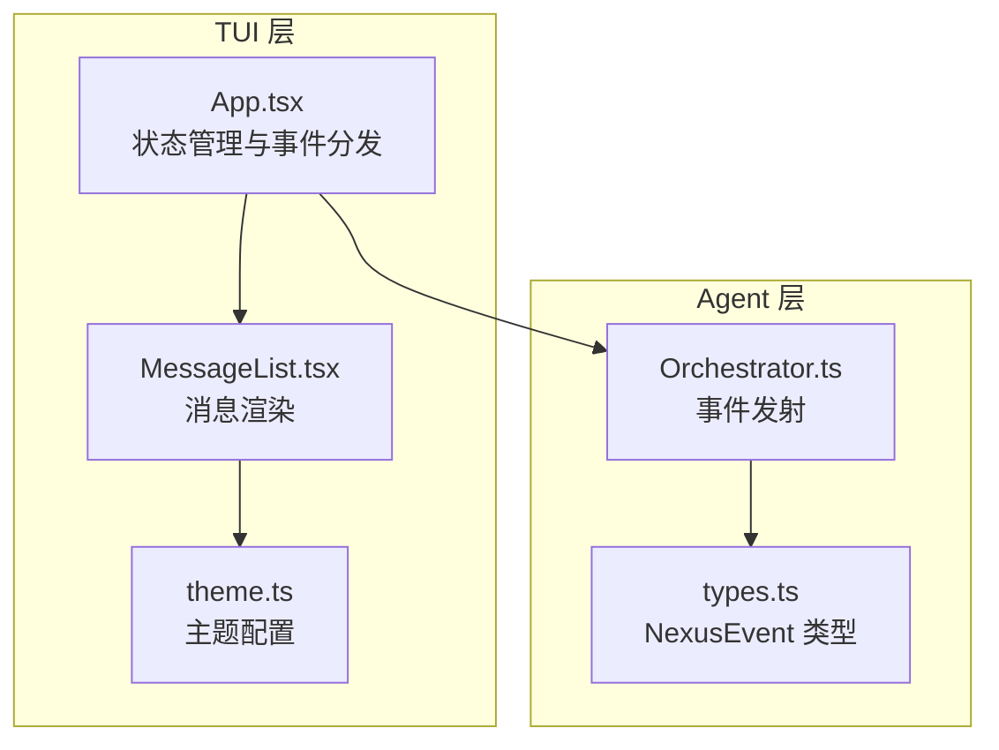
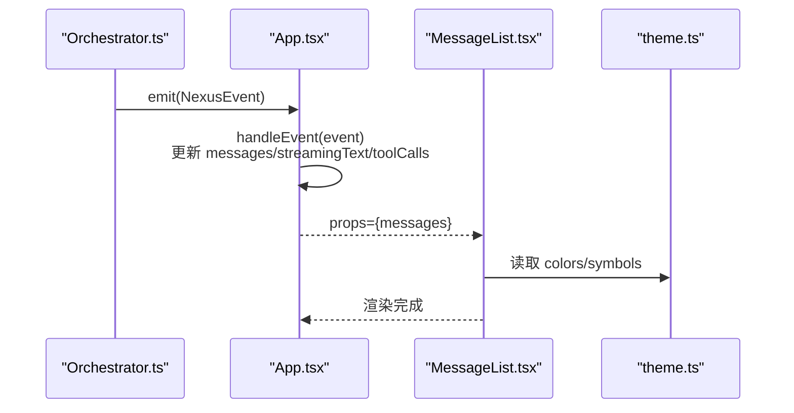
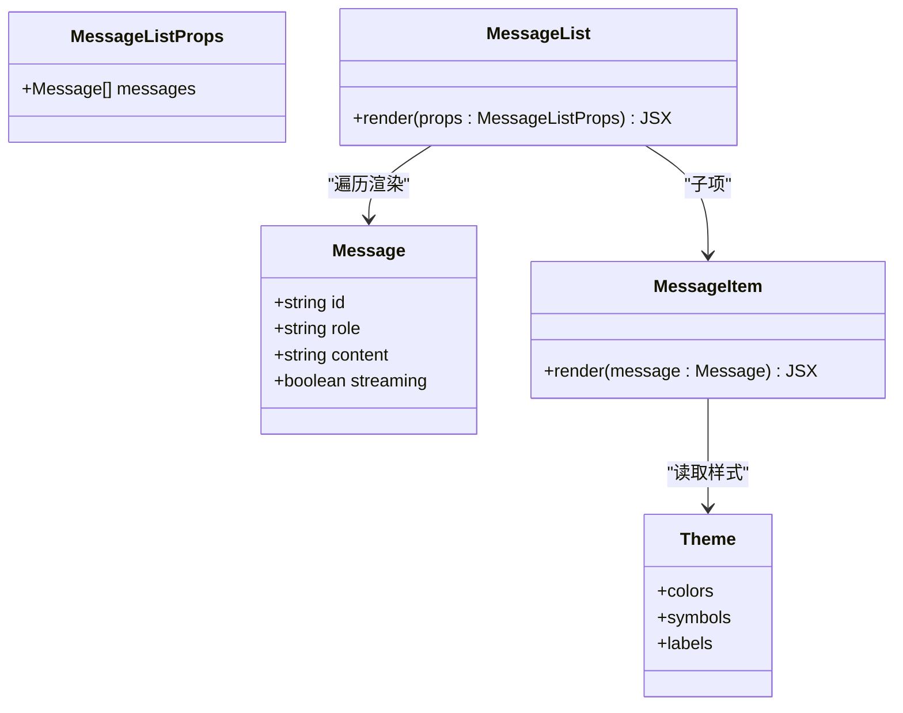
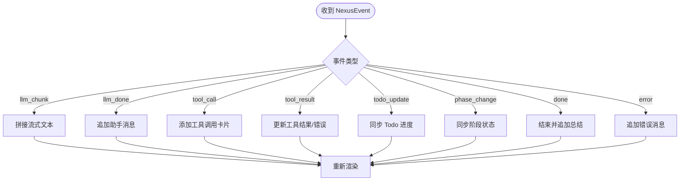
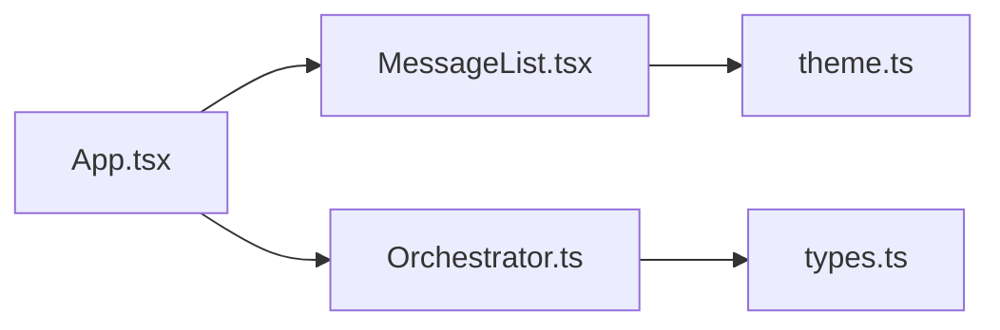

# 消息列表组件

<cite>
**本文引用的文件**
- [MessageList.tsx](file://src/tui/components/MessageList.tsx)
- [App.tsx](file://src/tui/App.tsx)
- [theme.ts](file://src/tui/theme.ts)
- [Orchestrator.ts](file://src/agent/Orchestrator.ts)
- [types.ts](file://src/agent/types.ts)
</cite>

## 目录
1. [简介](#简介)
2. [项目结构](#项目结构)
3. [核心组件](#核心组件)
4. [架构总览](#架构总览)
5. [详细组件分析](#详细组件分析)
6. [依赖关系分析](#依赖关系分析)
7. [性能与内存管理](#性能与内存管理)
8. [故障排查指南](#故障排查指南)
9. [结论](#结论)
10. [附录](#附录)

## 简介
本文件为 TUI 中的“消息列表”组件提供完整文档，覆盖以下方面：
- 消息显示逻辑与角色区分（user、assistant、system）
- 样式定制机制（主题系统）
- 滚动机制、虚拟列表优化与内存管理现状与建议
- 消息格式化、代码高亮支持与链接处理现状与建议
- 消息过滤、搜索与导出功能的实现建议
- 与 Orchestrator 的事件集成与数据更新机制

## 项目结构
消息列表位于 TUI 层，由根应用组件负责事件分发与状态管理，编排器通过事件驱动 UI 更新。

图表来源
- [App.tsx:1-284](file://src/tui/App.tsx#L1-L284)
- [MessageList.tsx:1-56](file://src/tui/components/MessageList.tsx#L1-L56)
- [theme.ts:1-41](file://src/tui/theme.ts#L1-L41)
- [Orchestrator.ts:1-260](file://src/agent/Orchestrator.ts#L1-L260)
- [types.ts:1-269](file://src/agent/types.ts#L1-L269)

章节来源
- [App.tsx:1-284](file://src/tui/App.tsx#L1-L284)
- [MessageList.tsx:1-56](file://src/tui/components/MessageList.tsx#L1-L56)
- [theme.ts:1-41](file://src/tui/theme.ts#L1-L41)
- [Orchestrator.ts:1-260](file://src/agent/Orchestrator.ts#L1-L260)
- [types.ts:1-269](file://src/agent/types.ts#L1-L269)

## 核心组件
- MessageList：接收消息数组并逐项渲染；根据 role 区分用户、助手与系统消息的展示样式。
- App：维护消息状态、流式输出、工具调用卡片、Todo 进度等；订阅 Orchestrator 事件并更新本地状态。
- theme：集中定义颜色、符号与标签，供各组件统一使用。

章节来源
- [MessageList.tsx:10-56](file://src/tui/components/MessageList.tsx#L10-L56)
- [App.tsx:46-176](file://src/tui/App.tsx#L46-L176)
- [theme.ts:5-38](file://src/tui/theme.ts#L5-L38)

## 架构总览
消息从 Orchestrator 以事件形式发出，App 在 handleEvent 中转换为本地状态，最终由 MessageList 渲染。

图表来源
- [Orchestrator.ts:256-258](file://src/agent/Orchestrator.ts#L256-L258)
- [App.tsx:107-176](file://src/tui/App.tsx#L107-L176)
- [MessageList.tsx:21-55](file://src/tui/components/MessageList.tsx#L21-L55)
- [theme.ts:5-38](file://src/tui/theme.ts#L5-L38)

## 详细组件分析

### 消息显示与角色区分
- 数据结构：每条消息包含 id、role、content、streaming 标记。
- 角色渲染：
  - user：以用户图标与颜色标识，显示内容。
  - assistant：以助手图标与颜色标识，若 streaming 为真则附加“思考中...”提示。
  - system：当前组件不渲染 system 角色（返回 null），但 App 会向消息队列追加 system 类型的命令结果或错误信息。
- 渲染容器：使用 Box 垂直排列，设置间距。

章节来源
- [MessageList.tsx:10-56](file://src/tui/components/MessageList.tsx#L10-L56)
- [App.tsx:88-94](file://src/tui/App.tsx#L88-L94)
- [App.tsx:168-174](file://src/tui/App.tsx#L168-L174)

#### 类图（组件与类型）

图表来源
- [MessageList.tsx:10-56](file://src/tui/components/MessageList.tsx#L10-L56)
- [theme.ts:5-38](file://src/tui/theme.ts#L5-L38)

### 样式定制
- 主题对象集中管理颜色与符号，MessageList 直接引用 theme.colors.user、theme.colors.assistant 以及 theme.symbols.user、theme.symbols.assistant。
- 扩展方式：新增颜色键或符号键即可全局生效。

章节来源
- [MessageList.tsx:31-52](file://src/tui/components/MessageList.tsx#L31-L52)
- [theme.ts:5-38](file://src/tui/theme.ts#L5-L38)

### 滚动机制与虚拟列表
- 当前实现：对 messages 进行全量映射渲染，未实现虚拟列表或分页加载。
- 影响：当消息数量较大时，可能导致渲染与滚动性能下降。
- 建议方案：
  - 引入虚拟列表（如 ink 生态或自研）仅渲染可视区域的消息项。
  - 结合窗口高度估算行高，计算可见范围索引区间。
  - 对长文本进行截断与展开交互，减少 DOM 节点数。

[本节为通用建议，不直接分析具体文件]

### 内存管理
- 当前实现：每次事件触发都会创建新的消息对象并追加到数组，旧消息保留在内存中。
- 风险：长时间会话可能累积大量历史消息，占用内存。
- 建议方案：
  - 限制历史消息数量（例如最近 N 条）。
  - 对长文本内容进行摘要或压缩存储。
  - 在切换会话或清理上下文时主动释放引用。

章节来源
- [App.tsx:118-126](file://src/tui/App.tsx#L118-L126)
- [App.tsx:160-166](file://src/tui/App.tsx#L160-L166)

### 消息格式化、代码高亮与链接处理
- 当前实现：消息内容以纯文本渲染，未做 Markdown 解析、代码块高亮或链接点击处理。
- 建议方案：
  - 引入轻量 Markdown 解析器，将代码块转为带语言标识的高亮片段。
  - 终端环境下可使用 ANSI 转义序列或外部渲染器进行语法高亮。
  - 链接可通过终端超链接协议（OSC 8）或提示用户复制粘贴的方式支持。

[本节为通用建议，不直接分析具体文件]

### 消息过滤、搜索与导出
- 当前实现：无内置过滤、搜索与导出功能。
- 实现建议：
  - 过滤：基于 role 或关键词筛选，维护一个 filteredMessages 派生状态。
  - 搜索：提供输入框，按内容模糊匹配，实时刷新视图。
  - 导出：将 messages 序列化为 JSON 或文本文件，提供下载或写入磁盘操作。

[本节为通用建议，不直接分析具体文件]

### 与 Orchestrator 的事件集成与数据更新
- 事件类型：包括 llm_start、llm_chunk、llm_done、tool_call、tool_result、todo_update、phase_change、done、error 等。
- 数据更新流程：
  - App 注册全局事件处理器，Orchestrator 通过 onEvent 回调发送事件。
  - App 在 handleEvent 中根据事件类型更新 messages、streamingText、toolCalls、todos、phase 等状态。
  - MessageList 仅消费 messages 属性进行渲染。

图表来源
- [App.tsx:107-176](file://src/tui/App.tsx#L107-L176)
- [types.ts:8-21](file://src/agent/types.ts#L8-L21)
- [Orchestrator.ts:256-258](file://src/agent/Orchestrator.ts#L256-L258)

章节来源
- [App.tsx:107-176](file://src/tui/App.tsx#L107-L176)
- [types.ts:8-21](file://src/agent/types.ts#L8-L21)
- [Orchestrator.ts:256-258](file://src/agent/Orchestrator.ts#L256-L258)

## 依赖关系分析
- MessageList 依赖 theme 进行样式渲染。
- App 依赖 MessageList 进行消息展示，同时依赖 Orchestrator 事件源。
- Orchestrator 依赖 types 定义的事件类型，并通过 onEvent 回调向外广播。

图表来源
- [MessageList.tsx:1-56](file://src/tui/components/MessageList.tsx#L1-56)
- [App.tsx:1-284](file://src/tui/App.tsx#L1-284)
- [Orchestrator.ts:1-260](file://src/agent/Orchestrator.ts#L1-260)
- [types.ts:1-269](file://src/agent/types.ts#L1-269)

章节来源
- [MessageList.tsx:1-56](file://src/tui/components/MessageList.tsx#L1-56)
- [App.tsx:1-284](file://src/tui/App.tsx#L1-284)
- [Orchestrator.ts:1-260](file://src/agent/Orchestrator.ts#L1-260)
- [types.ts:1-269](file://src/agent/types.ts#L1-L269)

## 性能与内存管理
- 当前瓶颈：全量渲染与无虚拟列表；长会话下消息数组持续增长。
- 优化方向：
  - 虚拟列表：仅渲染可视区消息项，降低重绘开销。
  - 文本截断与懒加载：对超长内容默认折叠，按需展开。
  - 历史裁剪：限制保留最近 N 条消息，避免内存膨胀。
  - 事件节流：高频 llm_chunk 可合并更新，减少状态更新频率。

[本节为通用建议，不直接分析具体文件]

## 故障排查指南
- 现象：消息不显示或重复显示
  - 检查 App 是否在 handleEvent 中正确追加消息，并确保 key 唯一。
  - 确认 MessageList 是否接收到 messages 属性且非空。
- 现象：流式输出异常
  - 检查 llm_chunk 与 llm_done 的处理分支是否正确拼接与清空流式文本。
- 现象：系统消息未显示
  - 当前 MessageList 不渲染 system 角色，如需显示可在组件内增加对应分支。
- 现象：性能卡顿
  - 评估消息数量与长度，考虑引入虚拟列表与历史裁剪策略。

章节来源
- [App.tsx:118-126](file://src/tui/App.tsx#L118-L126)
- [MessageList.tsx:31-55](file://src/tui/components/MessageList.tsx#L31-L55)

## 结论
MessageList 组件目前实现了基础的消息渲染与角色区分，样式通过主题统一管理。与 Orchestrator 的事件集成清晰稳定。针对大规模会话场景，建议引入虚拟列表、文本截断与历史裁剪以提升性能与内存效率；同时可扩展 Markdown 解析、代码高亮与链接处理，增强可读性与交互性。

[本节为总结性内容，不直接分析具体文件]

## 附录
- 相关类型参考：NexusEvent、AgentPhase、Todo 等定义见 types.ts。
- 主题扩展：在 theme.ts 中新增颜色或符号键，即可在组件中直接使用。

章节来源
- [types.ts:8-21](file://src/agent/types.ts#L8-L21)
- [theme.ts:5-38](file://src/tui/theme.ts#L5-L38)