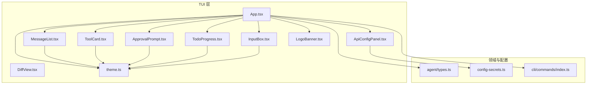
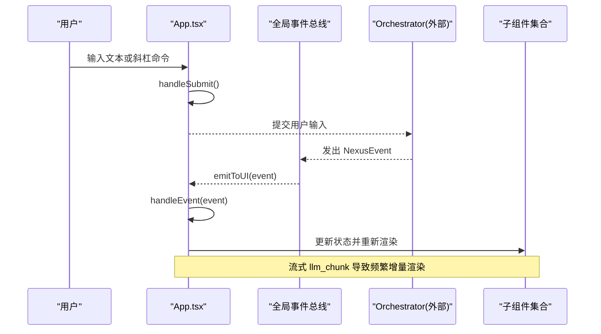
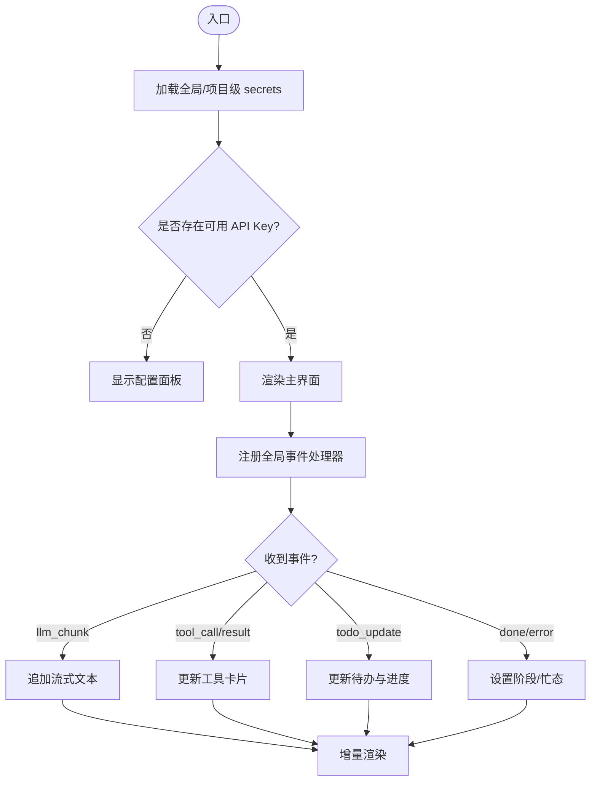
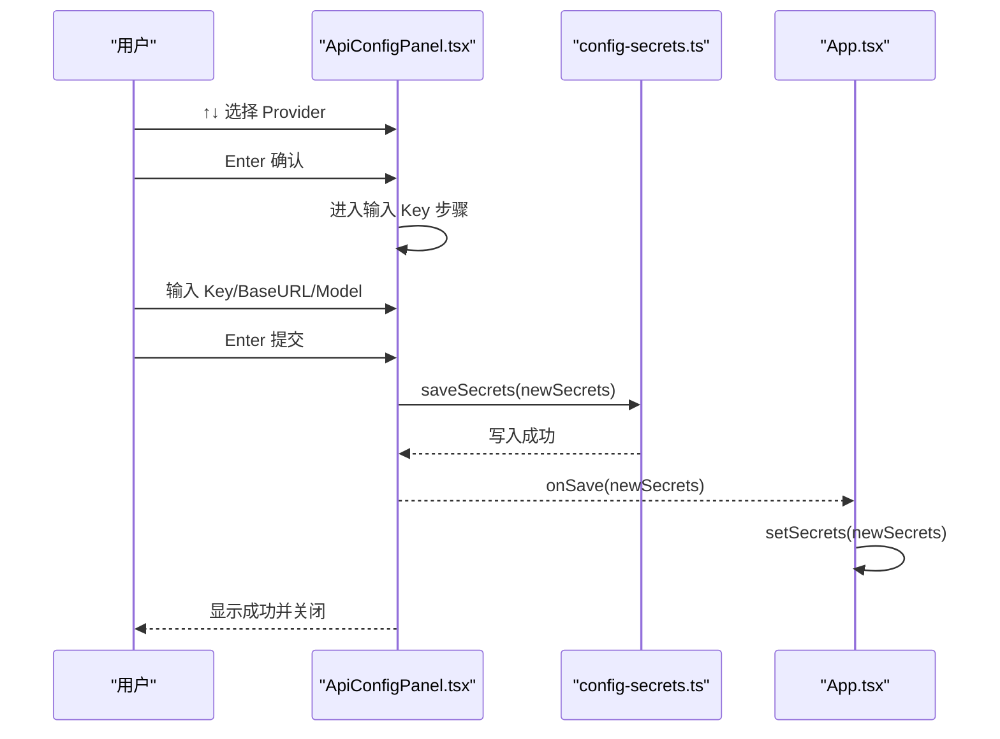
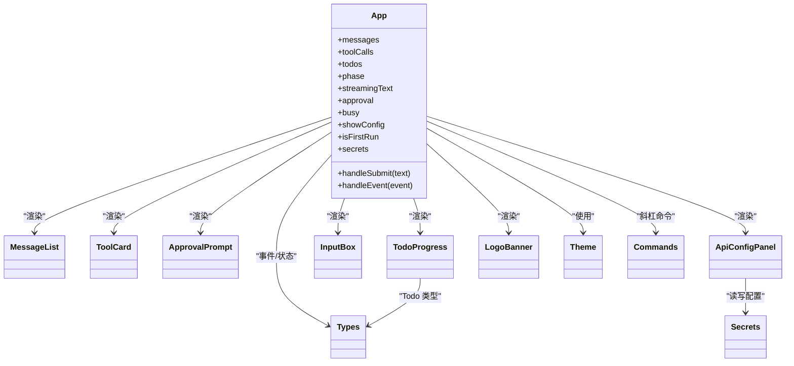

# 用户界面

<cite>
**本文引用的文件**
- [App.tsx](file://src/tui/App.tsx)
- [theme.ts](file://src/tui/theme.ts)
- [MessageList.tsx](file://src/tui/components/MessageList.tsx)
- [ToolCard.tsx](file://src/tui/components/ToolCard.tsx)
- [DiffView.tsx](file://src/tui/components/DiffView.tsx)
- [ApprovalPrompt.tsx](file://src/tui/components/ApprovalPrompt.tsx)
- [TodoProgress.tsx](file://src/tui/components/TodoProgress.tsx)
- [InputBox.tsx](file://src/tui/components/InputBox.tsx)
- [ApiConfigPanel.tsx](file://src/tui/components/ApiConfigPanel.tsx)
- [LogoBanner.tsx](file://src/tui/components/LogoBanner.tsx)
- [types.ts](file://src/agent/types.ts)
- [config-secrets.ts](file://src/config-secrets.ts)
- [commands/index.ts](file://src/cli/commands/index.ts)
</cite>

## 目录
1. [简介](#简介)
2. [项目结构](#项目结构)
3. [核心组件](#核心组件)
4. [架构总览](#架构总览)
5. [详细组件分析](#详细组件分析)
6. [依赖关系分析](#依赖关系分析)
7. [性能与渲染特性](#性能与渲染特性)
8. [主题定制与样式扩展](#主题定制与样式扩展)
9. [使用示例与自定义开发指南](#使用示例与自定义开发指南)
10. [故障排查](#故障排查)
11. [结论](#结论)

## 简介
本文件为 Nexus 的流式 TUI（基于 Ink/React）界面的组件文档。重点说明：
- 基于 Ink 的架构设计与组件层次结构
- 状态管理与事件驱动的数据流
- 各 UI 组件的职责、交互与渲染机制
- 流式输出、实时交互与用户反馈设计
- 主题定制与样式扩展方法
- 组件使用示例与二次开发指南

## 项目结构
TUI 位于 src/tui，根组件 App.tsx 组合了消息列表、工具卡片、审批提示、进度展示、输入框、API 配置面板与启动横幅等子组件。主题定义在 theme.ts，类型与事件模型来自 agent/types.ts，命令处理来自 cli/commands/index.ts，密钥持久化逻辑来自 config-secrets.ts。

图表来源
- [App.tsx:1-284](file://src/tui/App.tsx#L1-L284)
- [MessageList.tsx:1-56](file://src/tui/components/MessageList.tsx#L1-L56)
- [ToolCard.tsx:1-85](file://src/tui/components/ToolCard.tsx#L1-L85)
- [DiffView.tsx:1-41](file://src/tui/components/DiffView.tsx#L1-L41)
- [ApprovalPrompt.tsx:1-57](file://src/tui/components/ApprovalPrompt.tsx#L1-L57)
- [TodoProgress.tsx:1-72](file://src/tui/components/TodoProgress.tsx#L1-L72)
- [InputBox.tsx:1-65](file://src/tui/components/InputBox.tsx#L1-L65)
- [ApiConfigPanel.tsx:1-249](file://src/tui/components/ApiConfigPanel.tsx#L1-L249)
- [LogoBanner.tsx:1-62](file://src/tui/components/LogoBanner.tsx#L1-L62)
- [theme.ts:1-41](file://src/tui/theme.ts#L1-L41)
- [types.ts:1-269](file://src/agent/types.ts#L1-L269)
- [config-secrets.ts:1-171](file://src/config-secrets.ts#L1-L171)
- [commands/index.ts:1-116](file://src/cli/commands/index.ts#L1-L116)

章节来源
- [App.tsx:1-284](file://src/tui/App.tsx#L1-L284)
- [theme.ts:1-41](file://src/tui/theme.ts#L1-L41)

## 核心组件
- App：根容器，管理全局状态（消息、工具调用、待办、阶段、流式文本、审批、忙态、配置面板可见性），分发事件到 UI，并编排子组件布局。
- MessageList：按角色渲染用户、助手与系统消息，支持“思考中”标识。
- ToolCard：以卡片形式展示工具调用名、参数摘要、状态与结果/错误摘要。
- DiffView：内联渲染 git diff 风格差异文本，增删行高亮。
- ApprovalPrompt：交互式审批弹窗，支持键盘快捷操作与预览 diff。
- TodoProgress：任务清单与进度条，实时更新完成度。
- InputBox：多行输入框，支持回车发送、退格删除、Esc 清空与快捷键提示。
- ApiConfigPanel：交互式 Provider 选择与 API Key 录入，支持首次引导与 /config 触发。
- LogoBanner：像素风启动横幅，无消息时显示。

章节来源
- [App.tsx:1-284](file://src/tui/App.tsx#L1-L284)
- [MessageList.tsx:1-56](file://src/tui/components/MessageList.tsx#L1-L56)
- [ToolCard.tsx:1-85](file://src/tui/components/ToolCard.tsx#L1-L85)
- [DiffView.tsx:1-41](file://src/tui/components/DiffView.tsx#L1-L41)
- [ApprovalPrompt.tsx:1-57](file://src/tui/components/ApprovalPrompt.tsx#L1-L57)
- [TodoProgress.tsx:1-72](file://src/tui/components/TodoProgress.tsx#L1-L72)
- [InputBox.tsx:1-65](file://src/tui/components/InputBox.tsx#L1-L65)
- [ApiConfigPanel.tsx:1-249](file://src/tui/components/ApiConfigPanel.tsx#L1-L249)
- [LogoBanner.tsx:1-62](file://src/tui/components/LogoBanner.tsx#L1-L62)

## 架构总览
Nexus TUI 采用“事件驱动 + 局部状态”的架构：
- 外部 Orchestrator 通过全局事件总线将 NexusEvent 推送至 App.handleEvent。
- App 根据事件类型更新本地状态（消息、工具调用、待办、阶段、流式文本等）。
- React 增量渲染 Ink 树，实现流式输出与实时交互。
- 用户输入经 InputBox 进入 handleSubmit，支持斜杠命令分流；必要时打开 ApiConfigPanel。
- 审批流程由 ApprovalPrompt 提供交互，返回布尔结果给上游。

图表来源
- [App.tsx:78-176](file://src/tui/App.tsx#L78-L176)
- [App.tsx:178-183](file://src/tui/App.tsx#L178-L183)
- [App.tsx:278-284](file://src/tui/App.tsx#L278-L284)
- [types.ts:8-21](file://src/agent/types.ts#L8-L21)

## 详细组件分析

### App（根组件）
职责
- 维护消息、工具调用、待办、阶段、流式文本、审批、忙态、配置面板可见性等状态。
- 监听 Ctrl+C 退出应用。
- 解析斜杠命令，打开配置面板或执行内置命令。
- 订阅全局事件总线，统一分发到 handleEvent。
- 组装页面布局：顶栏、Logo、消息区、工具卡片、进度、审批、状态栏与输入框。

关键流程
- 首次运行检测：加载 secrets，若无任何 API Key 则自动进入配置向导。
- 事件处理：llm_start/llm_chunk/llm_done 控制流式输出；tool_call/tool_result 更新工具卡片；todo_update 更新进度；phase_change/done/error 更新阶段与忙态。
- 暴露 emitToUI 供外部调用。

图表来源
- [App.tsx:60-69](file://src/tui/App.tsx#L60-L69)
- [App.tsx:72-76](file://src/tui/App.tsx#L72-L76)
- [App.tsx:78-105](file://src/tui/App.tsx#L78-L105)
- [App.tsx:107-176](file://src/tui/App.tsx#L107-L176)
- [App.tsx:178-183](file://src/tui/App.tsx#L178-L183)
- [App.tsx:195-275](file://src/tui/App.tsx#L195-L275)
- [App.tsx:278-284](file://src/tui/App.tsx#L278-L284)

章节来源
- [App.tsx:1-284](file://src/tui/App.tsx#L1-L284)
- [types.ts:8-21](file://src/agent/types.ts#L8-L21)
- [config-secrets.ts:42-59](file://src/config-secrets.ts#L42-L59)
- [commands/index.ts:92-111](file://src/cli/commands/index.ts#L92-L111)

### MessageList（消息列表）
- 接收 messages 数组，按 role 区分渲染用户、助手与系统消息。
- 支持“思考中”标识（streaming 字段），用于辅助提示。
- 使用主题中的颜色与符号进行视觉区分。

章节来源
- [MessageList.tsx:1-56](file://src/tui/components/MessageList.tsx#L1-L56)
- [theme.ts:5-38](file://src/tui/theme.ts#L5-L38)

### ToolCard（工具卡片）
- 展示工具名称、参数摘要、状态图标与颜色。
- 对结果与错误进行截断显示，避免终端溢出。
- 针对常用工具（read_file/edit_file/bash/grep）提供友好标签与参数摘要策略。

章节来源
- [ToolCard.tsx:1-85](file://src/tui/components/ToolCard.tsx#L1-L85)
- [theme.ts:5-38](file://src/tui/theme.ts#L5-L38)

### DiffView（差异视图）
- 将 diff 文本按行拆分，逐行着色：新增绿色、删除红色、@@ 元信息青色、其余灰色。
- 可选显示文件名标题。

章节来源
- [DiffView.tsx:1-41](file://src/tui/components/DiffView.tsx#L1-L41)

### ApprovalPrompt（审批提示）
- 提供批准/拒绝交互，支持键盘快捷键（Y/N、Enter/Esc）。
- 可内联预览前若干行 diff，帮助快速决策。
- 与 App 协作：当 tool_approval_request 发生时，由上层决定是否弹出此组件。

章节来源
- [ApprovalPrompt.tsx:1-57](file://src/tui/components/ApprovalPrompt.tsx#L1-L57)
- [types.ts:14](file://src/agent/types.ts#L14)

### TodoProgress（进度展示）
- 计算已完成/总数，渲染进度条与每项状态。
- 使用主题符号与颜色表达 pending/in_progress/complete/cancelled。

章节来源
- [TodoProgress.tsx:1-72](file://src/tui/components/TodoProgress.tsx#L1-L72)
- [theme.ts:19-31](file://src/tui/theme.ts#L19-L31)
- [types.ts:29-33](file://src/agent/types.ts#L29-L33)

### InputBox（输入框）
- 支持回车发送、退格/删除回退、Esc 清空。
- 忽略控制字符，避免误触。
- 底部提示快捷键与命令前缀。

章节来源
- [InputBox.tsx:1-65](file://src/tui/components/InputBox.tsx#L1-L65)
- [theme.ts:5-18](file://src/tui/theme.ts#L5-L18)

### ApiConfigPanel（API 配置面板）
- 分步向导：选择 Provider → 输入 API Key → 可选 Base URL → 可选默认模型 → 保存成功。
- 支持首次启动强制引导与 /config 命令触发。
- 读取 provider 状态（环境变量优先），掩码显示已配置的 Key。
- 保存至全局 ~/.nexus/secrets.toml，同时记录默认 Provider 与默认模型。

图表来源
- [ApiConfigPanel.tsx:30-145](file://src/tui/components/ApiConfigPanel.tsx#L30-L145)
- [config-secrets.ts:62-91](file://src/config-secrets.ts#L62-L91)
- [App.tsx:204-219](file://src/tui/App.tsx#L204-L219)

章节来源
- [ApiConfigPanel.tsx:1-249](file://src/tui/components/ApiConfigPanel.tsx#L1-L249)
- [config-secrets.ts:1-171](file://src/config-secrets.ts#L1-L171)
- [App.tsx:60-69](file://src/tui/App.tsx#L60-L69)

### LogoBanner（标志横幅）
- 在无消息且未处于配置模式时显示，包含像素风 Logo 与版本信息。
- 使用固定网格与颜色映射渲染彩色方块。

章节来源
- [LogoBanner.tsx:1-62](file://src/tui/components/LogoBanner.tsx#L1-L62)

## 依赖关系分析
- App 依赖：
  - Ink 基础组件与钩子（Box、Text、useApp、useInput）
  - 子组件（MessageList、ToolCard、ApprovalPrompt、TodoProgress、InputBox、ApiConfigPanel、LogoBanner）
  - 主题 theme.ts
  - 事件类型与状态 types.ts
  - 斜杠命令 commands/index.ts
  - 密钥持久化 config-secrets.ts
- 子组件依赖：
  - 多数组件依赖 theme.ts 的颜色与符号
  - TodoProgress 依赖 agent/types.ts 的 Todo 类型
  - ApiConfigPanel 依赖 config-secrets.ts 的读写与状态查询

图表来源
- [App.tsx:1-284](file://src/tui/App.tsx#L1-L284)
- [MessageList.tsx:1-56](file://src/tui/components/MessageList.tsx#L1-L56)
- [ToolCard.tsx:1-85](file://src/tui/components/ToolCard.tsx#L1-L85)
- [ApprovalPrompt.tsx:1-57](file://src/tui/components/ApprovalPrompt.tsx#L1-L57)
- [TodoProgress.tsx:1-72](file://src/tui/components/TodoProgress.tsx#L1-L72)
- [InputBox.tsx:1-65](file://src/tui/components/InputBox.tsx#L1-L65)
- [ApiConfigPanel.tsx:1-249](file://src/tui/components/ApiConfigPanel.tsx#L1-L249)
- [LogoBanner.tsx:1-62](file://src/tui/components/LogoBanner.tsx#L1-L62)
- [theme.ts:1-41](file://src/tui/theme.ts#L1-L41)
- [types.ts:1-269](file://src/agent/types.ts#L1-L269)
- [config-secrets.ts:1-171](file://src/config-secrets.ts#L1-L171)
- [commands/index.ts:1-116](file://src/cli/commands/index.ts#L1-L116)

章节来源
- [App.tsx:1-284](file://src/tui/App.tsx#L1-L284)
- [types.ts:1-269](file://src/agent/types.ts#L1-L269)
- [config-secrets.ts:1-171](file://src/config-secrets.ts#L1-L171)
- [commands/index.ts:1-116](file://src/cli/commands/index.ts#L1-L116)

## 性能与渲染特性
- 流式渲染：llm_chunk 事件会追加 streamingText，触发高频小粒度重渲染。建议保持单条流式文本对象，避免不必要的 DOM 重组。
- 列表渲染：MessageList 与 ToolCard 使用稳定 key（消息 id、callId），减少重排。
- 文本截断：ToolCard 对长结果/错误进行截断，降低终端宽度压力。
- 输入节流：InputBox 仅响应必要按键，忽略控制字符，减少无效渲染。
- 审批与配置面板：仅在需要时挂载，避免常驻开销。

[本节为通用指导，不直接分析具体文件]

## 主题定制与样式扩展
- 主题位置：theme.ts 集中定义 colors、symbols、labels。
- 扩展方式：
  - 新增颜色：在 colors 中添加键值，并在组件中以 theme.colors.xxx 引用。
  - 新增符号：在 symbols 中添加键值，如 spinner 动画帧、状态图标等。
  - 工具标签：在 labels 中为工具名添加人类可读标签，或在 ToolCard 的 TOOL_LABELS 中扩展。
- 组件引用：所有组件均通过 import { theme } from '../theme' 获取主题，确保一致性。

章节来源
- [theme.ts:1-41](file://src/tui/theme.ts#L1-L41)
- [ToolCard.tsx:20-25](file://src/tui/components/ToolCard.tsx#L20-L25)
- [MessageList.tsx:31-55](file://src/tui/components/MessageList.tsx#L31-L55)

## 使用示例与自定义开发指南

### 基本用法
- 在根组件中引入 App，传入 onSubmit、commandContext、model、cost、projectRoot 等 props。
- 外部 Orchestrator 通过 emitToUI(event) 向 UI 推送事件。

章节来源
- [App.tsx:37-44](file://src/tui/App.tsx#L37-L44)
- [App.tsx:278-284](file://src/tui/App.tsx#L278-L284)

### 事件对接
- 事件类型参考 types.ts 的 NexusEvent 联合类型。
- 在外部模块中调用 emitToUI(event)，App 内部通过全局 __nexusEventHandler 回调处理。

章节来源
- [types.ts:8-21](file://src/agent/types.ts#L8-L21)
- [App.tsx:178-183](file://src/tui/App.tsx#L178-L183)

### 斜杠命令
- 支持 /model、/cost、/clear、/undo、/history、/help 等命令。
- 可通过 CommandContext 访问当前模型、切换模型、查看花费、清除上下文、撤销检查点、历史等能力。
- 自定义命令：在 commands/index.ts 中注册新的 SlashCommand。

章节来源
- [commands/index.ts:23-90](file://src/cli/commands/index.ts#L23-L90)
- [commands/index.ts:92-111](file://src/cli/commands/index.ts#L92-L111)

### 审批流程集成
- 当收到 tool_approval_request 事件时，App 应构造 approval 状态并渲染 ApprovalPrompt。
- 用户确认后，调用 resolve(true/false) 通知上游继续或中止。

章节来源
- [types.ts:14](file://src/agent/types.ts#L14)
- [ApprovalPrompt.tsx:18-25](file://src/tui/components/ApprovalPrompt.tsx#L18-L25)
- [App.tsx:256-264](file://src/tui/App.tsx#L256-L264)

### 配置面板集成
- 首次运行或输入 /config 时，显示 ApiConfigPanel。
- 保存成功后，更新 secrets 并关闭面板。

章节来源
- [App.tsx:60-69](file://src/tui/App.tsx#L60-L69)
- [App.tsx:80-86](file://src/tui/App.tsx#L80-L86)
- [ApiConfigPanel.tsx:121-145](file://src/tui/components/ApiConfigPanel.tsx#L121-L145)

### 自定义组件接入
- 新建组件文件于 src/tui/components，遵循 Props 接口与主题引用规范。
- 在 App.tsx 中按需引入并组合到布局中。
- 若涉及外部数据，通过事件总线或 props 注入。

[本节为通用指导，不直接分析具体文件]

## 故障排查
- 无法启动配置面板：
  - 检查 loadSecrets 是否成功读取全局或项目级 secrets 文件。
  - 确认 hasAnyApiKey 判断逻辑与环境变量是否正确。
- 流式输出不刷新：
  - 确认 llm_chunk 事件是否被 emitToUI 正确分发。
  - 检查 App.handleEvent 中对 streamingText 的追加逻辑。
- 工具卡片状态异常：
  - 核对 tool_call 与 tool_result 事件中的 callId 是否一致。
  - 检查 ToolCard 的状态映射与截断逻辑。
- 审批无响应：
  - 确认 ApprovalPrompt 的 useInput 绑定是否生效。
  - 检查 onApprove/onReject 回调是否被调用并清理 approval 状态。
- 配置保存失败：
  - 检查 saveSecrets 的文件权限与目录创建逻辑。
  - 确认 TOML 序列化与嵌套 providers 结构是否符合预期。

章节来源
- [App.tsx:60-69](file://src/tui/App.tsx#L60-L69)
- [App.tsx:107-176](file://src/tui/App.tsx#L107-L176)
- [ToolCard.tsx:27-63](file://src/tui/components/ToolCard.tsx#L27-L63)
- [ApprovalPrompt.tsx:18-25](file://src/tui/components/ApprovalPrompt.tsx#L18-L25)
- [ApiConfigPanel.tsx:121-145](file://src/tui/components/ApiConfigPanel.tsx#L121-L145)
- [config-secrets.ts:62-91](file://src/config-secrets.ts#L62-L91)

## 结论
Nexus TUI 以 App 为中心，结合事件驱动与局部状态，实现了流式输出、实时交互与清晰的组件分层。通过统一的 theme 与类型体系，保证了可扩展性与一致性。开发者可在现有组件基础上快速扩展功能，并通过事件总线与外部 Orchestrator 无缝集成。