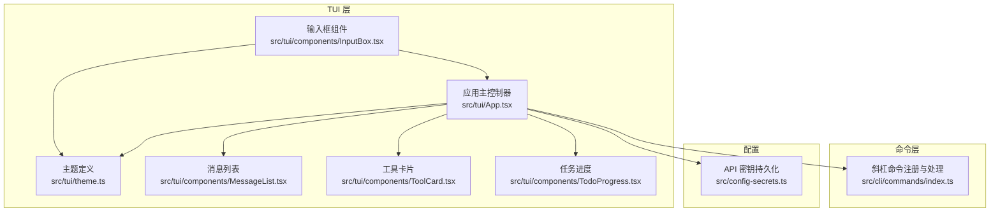
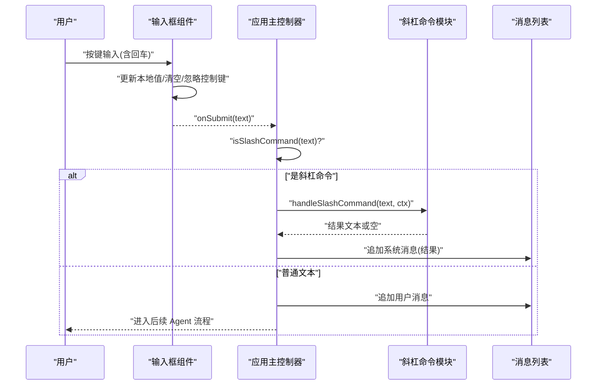
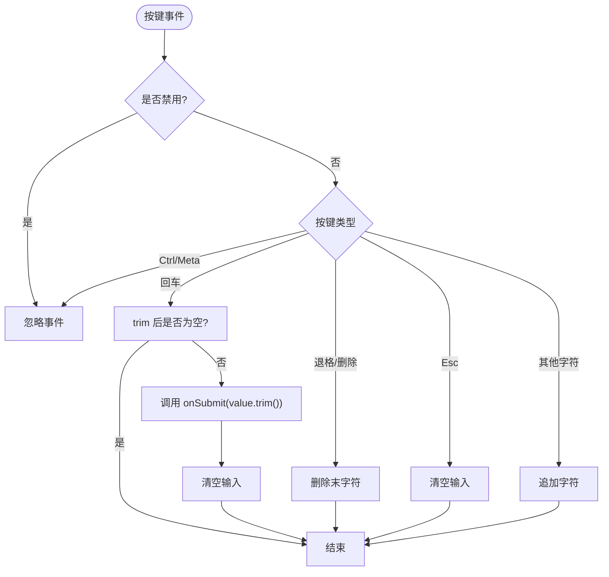
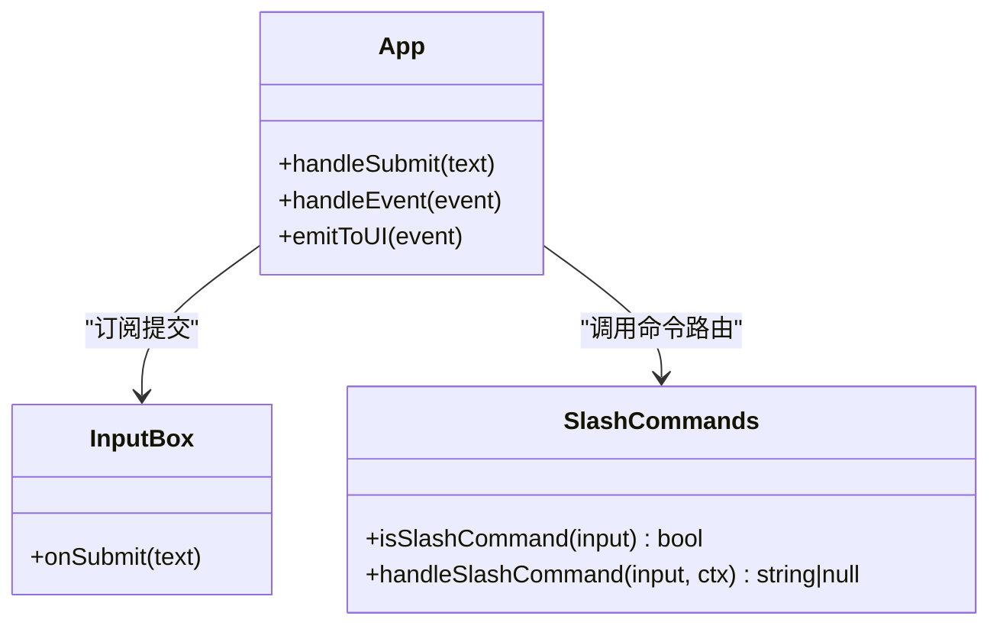
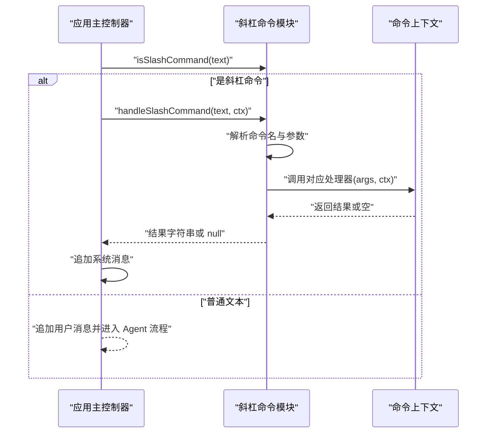
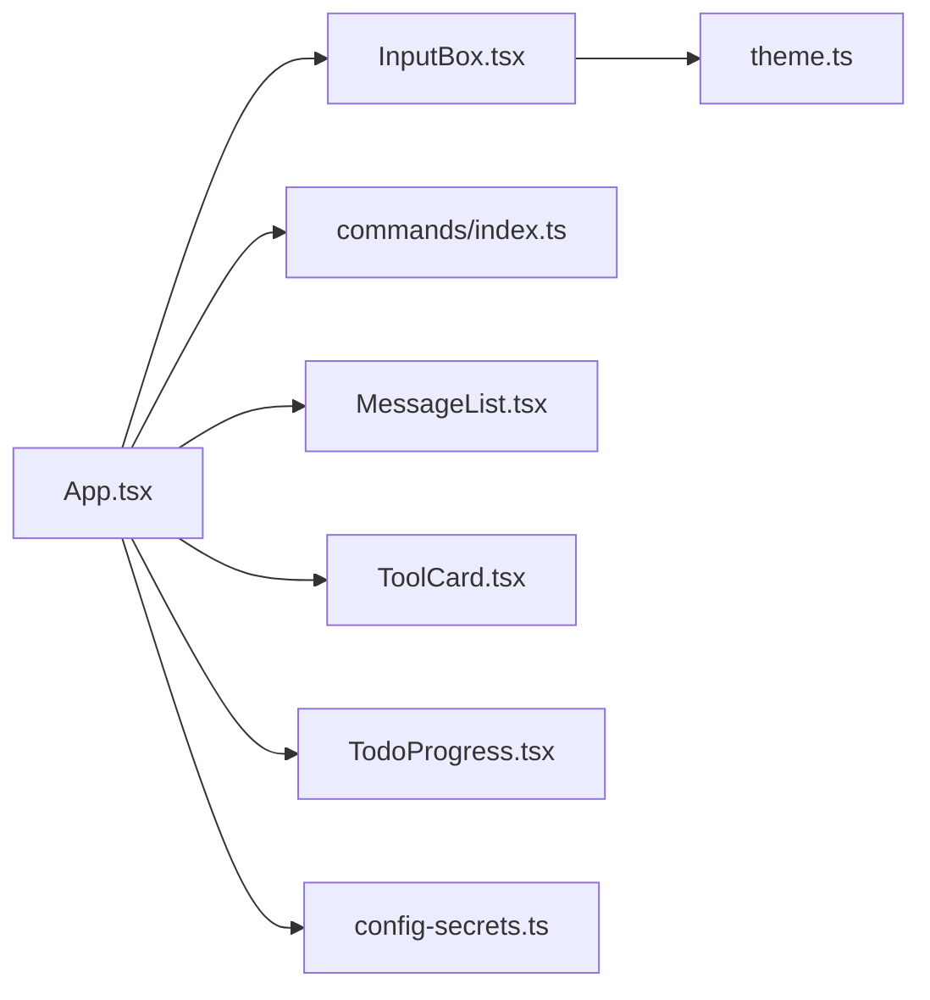

# 输入框组件

<cite>
**本文引用的文件**   
- [InputBox.tsx](file://src/tui/components/InputBox.tsx)
- [App.tsx](file://src/tui/App.tsx)
- [index.ts](file://src/cli/commands/index.ts)
- [theme.ts](file://src/tui/theme.ts)
- [MessageList.tsx](file://src/tui/components/MessageList.tsx)
- [ToolCard.tsx](file://src/tui/components/ToolCard.tsx)
- [TodoProgress.tsx](file://src/tui/components/TodoProgress.tsx)
- [config-secrets.ts](file://src/config-secrets.ts)
- [README.md](file://README.md)
</cite>

## 目录
1. [简介](#简介)
2. [项目结构](#项目结构)
3. [核心组件](#核心组件)
4. [架构总览](#架构总览)
5. [详细组件分析](#详细组件分析)
6. [依赖分析](#依赖分析)
7. [性能考虑](#性能考虑)
8. [故障排查指南](#故障排查指南)
9. [结论](#结论)
10. [附录](#附录)

## 简介
本文件围绕 TUI 中的输入框组件，系统化说明命令行输入处理、命令路由与执行机制、斜杠命令解析、参数校验与错误提示、输入验证、自动完成与快捷键支持、样式定制与扩展接口，以及与命令路由器的集成方式。目标是帮助开发者快速理解并扩展输入框能力，同时保证交互体验的一致性与可维护性。

## 项目结构
输入框位于 TUI 层，作为用户交互的入口，向上对接应用主控制器（App），并通过命令模块进行斜杠命令解析与分发。主题系统提供统一的视觉风格。

图表来源
- [InputBox.tsx:1-65](file://src/tui/components/InputBox.tsx#L1-L65)
- [App.tsx:1-284](file://src/tui/App.tsx#L1-L284)
- [index.ts:1-116](file://src/cli/commands/index.ts#L1-L116)
- [theme.ts:1-41](file://src/tui/theme.ts#L1-L41)
- [MessageList.tsx:1-56](file://src/tui/components/MessageList.tsx#L1-L56)
- [ToolCard.tsx:1-85](file://src/tui/components/ToolCard.tsx#L1-L85)
- [TodoProgress.tsx:1-72](file://src/tui/components/TodoProgress.tsx#L1-L72)
- [config-secrets.ts:1-171](file://src/config-secrets.ts#L1-L171)

章节来源
- [InputBox.tsx:1-65](file://src/tui/components/InputBox.tsx#L1-L65)
- [App.tsx:1-284](file://src/tui/App.tsx#L1-L284)
- [index.ts:1-116](file://src/cli/commands/index.ts#L1-L116)
- [theme.ts:1-41](file://src/tui/theme.ts#L1-L41)

## 核心组件
- 输入框组件：负责接收键盘事件、维护本地输入状态、触发提交回调、显示占位符与光标、展示快捷键提示。
- 应用主控制器：集中处理输入提交、斜杠命令识别与分发、消息追加、流式输出、工具调用状态、审批流程、配置面板开关等。
- 斜杠命令模块：定义命令元数据、解析器、处理器集合及通用路由逻辑。
- 主题系统：统一颜色、符号与标签，便于输入框与整体 UI 保持一致风格。

章节来源
- [InputBox.tsx:1-65](file://src/tui/components/InputBox.tsx#L1-L65)
- [App.tsx:1-284](file://src/tui/App.tsx#L1-L284)
- [index.ts:1-116](file://src/cli/commands/index.ts#L1-L116)
- [theme.ts:1-41](file://src/tui/theme.ts#L1-L41)

## 架构总览
输入框通过 Ink 的事件钩子捕获按键，将回车、退格、删除、Esc 等行为映射到内部状态更新或提交动作。提交后由应用主控制器判断是否为斜杠命令；若是则交由命令模块解析与执行，否则作为普通用户消息进入后续 Agent 流程。

图表来源
- [InputBox.tsx:19-46](file://src/tui/components/InputBox.tsx#L19-L46)
- [App.tsx:78-105](file://src/tui/App.tsx#L78-L105)
- [index.ts:92-111](file://src/cli/commands/index.ts#L92-L111)

## 详细组件分析

### 输入框组件（InputBox）
- 功能要点
  - 使用 Ink 的 useInput 监听键盘事件，区分回车、退格、删除、Esc 与常规字符输入。
  - 对 Ctrl/Meta 组合键进行忽略，避免干扰终端行为。
  - 提交时去除首尾空白，非空才触发 onSubmit，并在成功后清空输入。
  - 渲染前缀提示、当前内容或占位符、以及光标指示。
  - 底部显示快捷键提示，引导用户使用 Enter 发送、Esc 清空等。
- 快捷键支持
  - Enter：提交当前输入（若为空则不提交）。
  - Backspace/Delete：删除最后一个字符。
  - Esc：清空输入。
  - Ctrl/Cmd 组合：忽略，避免与终端快捷键冲突。
- 输入验证
  - 仅做基础 trim 与非空检查，复杂校验建议在上层（App）或命令处理器中实现。
- 自动完成
  - 当前未实现自动补全；可在 useInput 中增加 Tab 检测与候选项匹配逻辑，或使用 Ink 提供的补全方案。
- 历史管理
  - 当前未实现历史记录；可在上层维护历史数组，结合 Up/Down 键切换。
- 样式定制
  - 通过 theme.colors.primary/muted 等变量控制前景色与提示色，便于全局换肤。
- 扩展接口
  - 对外暴露 onSubmit 回调，上层可注入业务逻辑（如命令路由、消息追加、Agent 调度）。
  - 可通过 props 控制 disabled、placeholder 等状态。

图表来源
- [InputBox.tsx:19-46](file://src/tui/components/InputBox.tsx#L19-L46)

章节来源
- [InputBox.tsx:1-65](file://src/tui/components/InputBox.tsx#L1-L65)
- [theme.ts:1-41](file://src/tui/theme.ts#L1-L41)

### 应用主控制器（App）与输入集成
- 职责
  - 接收输入框提交的文本，判断是否为斜杠命令。
  - 对于 /config 或 /api，打开配置面板；其他斜杠命令交由命令模块处理。
  - 普通文本作为用户消息追加，并进入后续 Agent 流程。
  - 统一管理消息、工具调用、Todo 进度、流式输出与审批提示。
- 与输入框的关系
  - 通过 onSubmit 回调绑定输入框提交行为。
  - 在 busy、审批或配置面板打开时禁用输入框，防止并发操作。
- 事件总线
  - 将 handleEvent 挂载到全局以便外部事件驱动 UI 更新。

图表来源
- [App.tsx:78-105](file://src/tui/App.tsx#L78-L105)
- [index.ts:92-111](file://src/cli/commands/index.ts#L92-L111)

章节来源
- [App.tsx:1-284](file://src/tui/App.tsx#L1-L284)

### 斜杠命令解析与执行
- 命令注册
  - 以数组形式声明命令名、别名、描述与处理器。
  - 内置命令包括模型查看/切换、会话花费、上下文清除、回滚、历史、帮助等。
- 解析流程
  - isSlashCommand 判断是否以“/”开头。
  - handleSlashCommand 去掉前导“/”，按空格拆分命令名与参数，查找匹配的命令处理器并执行。
  - 未知命令返回友好提示，引导用户查看帮助。
- 参数校验
  - 各命令处理器内部进行参数校验与分支处理（例如 /model 无参列出可用模型，有参则切换）。
- 错误提示
  - 未知命令返回错误信息；具体异常可由上层捕获并转为系统消息显示。

图表来源
- [index.ts:23-90](file://src/cli/commands/index.ts#L23-L90)
- [index.ts:92-111](file://src/cli/commands/index.ts#L92-L111)
- [App.tsx:78-105](file://src/tui/App.tsx#L78-L105)

章节来源
- [index.ts:1-116](file://src/cli/commands/index.ts#L1-L116)
- [App.tsx:78-105](file://src/tui/App.tsx#L78-L105)

### 输入验证、自动完成与快捷键支持
- 输入验证
  - 当前仅做 trim 与非空检查；更严格的语义校验建议在命令处理器或上层服务中进行。
- 自动完成
  - 当前未实现；可扩展点：
    - 在 useInput 中监听 Tab，基于 getAvailableCommands 生成候选项。
    - 根据当前输入前缀过滤候选，并支持上下键选择、回车确认。
- 快捷键支持
  - 已支持 Enter 提交、Backspace/Delete 删除、Esc 清空。
  - 可扩展 Up/Down 历史切换、Tab 补全、Ctrl+R 刷新等。

章节来源
- [InputBox.tsx:19-46](file://src/tui/components/InputBox.tsx#L19-L46)
- [index.ts:113-116](file://src/cli/commands/index.ts#L113-L116)

### 样式定制与扩展接口
- 样式定制
  - 通过 theme.colors 与 symbols 统一控制颜色与图标，输入框与消息列表、工具卡片均复用该主题。
- 扩展接口
  - 输入框：onSubmit、disabled、placeholder。
  - 应用层：可注入自定义命令处理器、扩展命令上下文（如更多查询能力）、接入第三方补全库。
  - 主题：新增颜色、符号、标签即可影响全局 UI。

章节来源
- [theme.ts:1-41](file://src/tui/theme.ts#L1-L41)
- [InputBox.tsx:10-14](file://src/tui/components/InputBox.tsx#L10-L14)
- [MessageList.tsx:1-56](file://src/tui/components/MessageList.tsx#L1-L56)
- [ToolCard.tsx:1-85](file://src/tui/components/ToolCard.tsx#L1-L85)

### 与命令路由器的集成和命令执行机制
- 集成方式
  - App 在 handleSubmit 中先判断斜杠命令，再决定走配置面板或命令路由。
  - 命令路由器集中管理命令元数据与处理器，保持高内聚低耦合。
- 执行机制
  - 命令处理器可访问 CommandContext，读取当前模型、成本、历史等上下文信息，并返回结果文本供 UI 展示。
  - 错误路径：未知命令返回提示；具体异常由上层转换为系统消息。

章节来源
- [App.tsx:78-105](file://src/tui/App.tsx#L78-L105)
- [index.ts:92-111](file://src/cli/commands/index.ts#L92-L111)

## 依赖分析
- 组件耦合
  - 输入框仅依赖 Ink 与主题，保持轻量。
  - 应用主控制器聚合多个子组件与命令模块，承担协调职责。
- 外部依赖
  - Ink：终端 UI 框架，提供 useInput、Box、Text 等。
  - smol-toml：用于 secrets 配置读写（间接影响配置面板与命令上下文的数据源）。
- 潜在循环依赖
  - 当前未见循环引用；命令模块与 UI 通过函数调用解耦。

图表来源
- [InputBox.tsx:1-65](file://src/tui/components/InputBox.tsx#L1-L65)
- [App.tsx:1-284](file://src/tui/App.tsx#L1-L284)
- [index.ts:1-116](file://src/cli/commands/index.ts#L1-L116)
- [theme.ts:1-41](file://src/tui/theme.ts#L1-L41)
- [MessageList.tsx:1-56](file://src/tui/components/MessageList.tsx#L1-L56)
- [ToolCard.tsx:1-85](file://src/tui/components/ToolCard.tsx#L1-L85)
- [TodoProgress.tsx:1-72](file://src/tui/components/TodoProgress.tsx#L1-L72)
- [config-secrets.ts:1-171](file://src/config-secrets.ts#L1-L171)

章节来源
- [App.tsx:1-284](file://src/tui/App.tsx#L1-L284)
- [index.ts:1-116](file://src/cli/commands/index.ts#L1-L116)

## 性能考虑
- 输入事件处理
  - useInput 回调应保持轻量，避免阻塞渲染；复杂计算应异步或在 Web Worker 中执行（不适用 CLI）。
- 状态更新
  - 合并多次 setState 调用，减少重绘频率；例如批量追加消息时使用一次性更新。
- 长文本与流式输出
  - 流式文本增量更新，注意截断与滚动策略，避免大对象频繁创建。
- 命令处理器
  - 耗时操作应异步返回，UI 侧通过事件驱动更新，避免长时间占用主线程。

[本节为通用指导，无需源码引用]

## 故障排查指南
- 常见问题
  - 输入无响应：检查是否处于 busy、审批或配置面板打开状态导致输入框被禁用。
  - 斜杠命令无效：确认命令是否存在于注册表，或是否拼写正确；查看帮助命令获取可用列表。
  - 未知命令提示：当命令不存在时，会返回“未知命令”提示，请核对命令名与别名。
  - 配置面板无法保存：检查 secrets 文件写入权限与路径是否正确。
- 定位方法
  - 在 App 的 handleSubmit 与 handleEvent 处添加日志，追踪输入与事件流转。
  - 在命令处理器中记录入参与返回值，确认解析与执行链路。
  - 使用 /help 与 /history 辅助诊断。

章节来源
- [App.tsx:78-105](file://src/tui/App.tsx#L78-L105)
- [index.ts:92-111](file://src/cli/commands/index.ts#L92-L111)
- [config-secrets.ts:62-91](file://src/config-secrets.ts#L62-L91)

## 结论
输入框组件以最小依赖实现了稳定的键盘输入与基础交互，配合应用主控制器与命令路由器，形成了清晰的命令解析与执行链路。当前版本聚焦于核心交互与命令路由，未来可在自动补全、历史记录、参数校验与错误提示方面进一步增强，以提升用户体验与可维护性。

[本节为总结，无需源码引用]

## 附录
- 相关文档
  - README 提供了运行方式、权限模式与斜杠命令概览，可作为使用参考。

章节来源
- [README.md:123-133](file://README.md#L123-L133)