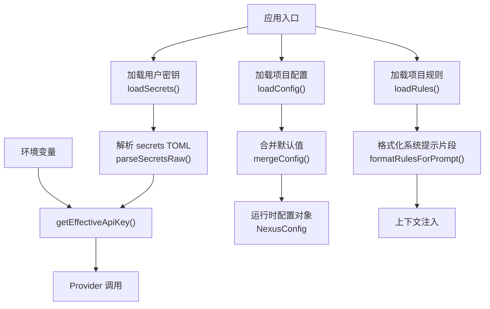
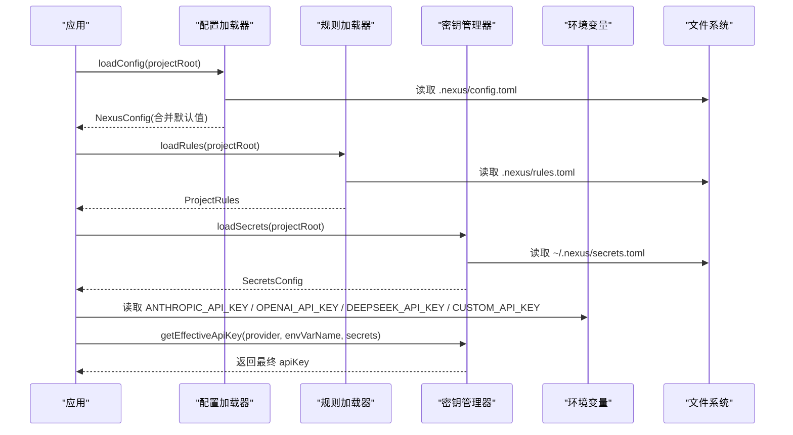
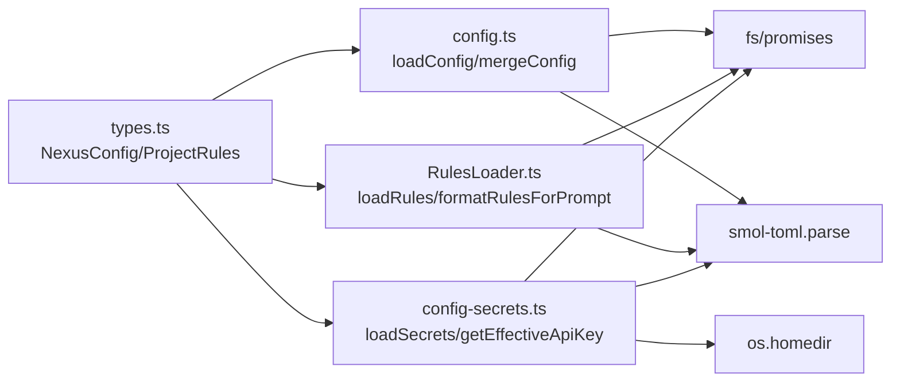

# 配置管理

<cite>
**本文引用的文件**
- [src/config.ts](file://src/config.ts)
- [src/config-secrets.ts](file://src/config-secrets.ts)
- [src/context/RulesLoader.ts](file://src/context/RulesLoader.ts)
- [src/agent/types.ts](file://src/agent/types.ts)
- [.nexus/config.toml](file://.nexus/config.toml)
- [.nexus/rules.toml](file://.nexus/rules.toml)
- [README.md](file://README.md)
- [DESIGN.md](file://DESIGN.md)
</cite>

## 目录
1. [简介](#简介)
2. [项目结构](#项目结构)
3. [核心组件](#核心组件)
4. [架构总览](#架构总览)
5. [详细组件分析](#详细组件分析)
6. [依赖关系分析](#依赖关系分析)
7. [性能与安全性考量](#性能与安全性考量)
8. [故障排查指南](#故障排查指南)
9. [结论](#结论)
10. [附录：迁移与兼容性](#附录：迁移与兼容性)

## 简介
本章节面向 Nexus 的配置管理系统，聚焦以下目标：
- 解释配置文件层次结构与优先级：全局配置、项目配置与环境变量。
- 详细说明 .nexus/config.toml 的配置项（模型路由、权限、限制、上下文、检查点等）。
- 说明 .nexus/rules.toml 的项目规则定义语法与最佳实践。
- 深入密钥管理机制：环境变量注入、持久化存储与安全传输。
- 提供配置验证与错误处理机制说明。
- 给出配置迁移指南与版本兼容性建议。
- 列举常见配置场景与排障方法。

## 项目结构
Nexus 的配置由三类来源构成：
- 项目级配置：.nexus/config.toml（模型路由、权限模式、资源限制、上下文预算、检查点策略等）
- 项目级规则：.nexus/rules.toml（项目信息、代码风格、硬约束、常驻上下文）
- 用户级密钥：~/.nexus/secrets.toml（API Key 等敏感信息，被 .gitignore 排除）

图示来源
- [src/config.ts:62-131](file://src/config.ts#L62-L131)
- [src/context/RulesLoader.ts:29-58](file://src/context/RulesLoader.ts#L29-L58)
- [src/config-secrets.ts:41-115](file://src/config-secrets.ts#L41-L115)
- [src/config-secrets.ts:117-131](file://src/config-secrets.ts#L117-L131)

章节来源
- [README.md:51-52](file://README.md#L51-L52)
- [DESIGN.md:111-113](file://DESIGN.md#L111-L113)
- [DESIGN.md:337-366](file://DESIGN.md#L337-L366)

## 核心组件
- 配置加载器：负责读取 .nexus/config.toml，合并默认值，输出类型化的 NexusConfig。
- 规则加载器：负责读取 .nexus/rules.toml，结构化项目约定并生成 system prompt 片段。
- 密钥管理器：负责从环境变量或 ~/.nexus/secrets.toml 获取有效 API Key，并提供状态检测与掩码显示。
- 类型契约：在 types.ts 中统一声明配置与规则的数据结构，确保前后端一致。

章节来源
- [src/config.ts:1-131](file://src/config.ts#L1-L131)
- [src/context/RulesLoader.ts:1-90](file://src/context/RulesLoader.ts#L1-L90)
- [src/config-secrets.ts:1-171](file://src/config-secrets.ts#L1-L171)
- [src/agent/types.ts:132-184](file://src/agent/types.ts#L132-L184)

## 架构总览
配置系统的整体流程如下：
- 启动时并行加载项目配置、项目规则与用户密钥。
- 将 TOML 原始数据映射为内部类型对象，缺失字段使用默认值。
- 通过 getEffectiveApiKey 按“环境变量 > secrets 文件”的优先级解析最终密钥。
- 将规则格式化为 system prompt 片段，注入到上下文中。

图示来源
- [src/config.ts:62-74](file://src/config.ts#L62-L74)
- [src/context/RulesLoader.ts:29-58](file://src/context/RulesLoader.ts#L29-L58)
- [src/config-secrets.ts:41-59](file://src/config-secrets.ts#L41-L59)
- [src/config-secrets.ts:117-131](file://src/config-secrets.ts#L117-L131)

## 详细组件分析

### 配置加载器（config.ts）
职责与行为
- 读取 .nexus/config.toml，若不存在则回退到内置默认值。
- 将 TOML 键名（下划线命名）映射为内部驼峰命名，如 max_session_cost → maxSessionCost。
- 支持 models.providers.* 动态扩展，允许新增自定义 provider。
- 对权限模式、限制、上下文预算、检查点分支等进行类型安全合并。

关键数据结构
- NexusConfig：包含 models、permissions、limits、context、checkpoint 五大块。
- ProviderConfig：每个 provider 可配置 api_key_env、base_url、default_model。

默认值与覆盖策略
- DEFAULT_CONFIG 定义了所有模块的默认值。
- mergeConfig 仅覆盖存在且类型正确的字段，避免污染默认值。

示例路径参考
- 默认值定义：[src/config.ts:11-60](file://src/config.ts#L11-L60)
- 加载与合并：[src/config.ts:62-131](file://src/config.ts#L62-L131)
- 类型定义：[src/agent/types.ts:132-184](file://src/agent/types.ts#L132-L184)

章节来源
- [src/config.ts:1-131](file://src/config.ts#L1-L131)
- [src/agent/types.ts:132-184](file://src/agent/types.ts#L132-L184)

### 规则加载器（RulesLoader.ts）
职责与行为
- 读取 .nexus/rules.toml，若不存在或解析失败则返回默认规则。
- 将 TOML 键名（下划线命名）映射为内部驼峰命名，如 test_command → testCommand。
- 提供 formatRulesForPrompt 将规则转换为 system prompt 片段，便于上下文注入。
- 提供 getAlwaysIncludePaths 将 always_include 列表解析为绝对路径。

最佳实践
- 在项目根目录维护 rules.toml，明确语言、测试与构建命令，减少歧义。
- 使用 constraints 声明硬约束，强制 Agent 遵守团队规范。
- 使用 context.always_include 固定注入重要文档与类型定义，提升上下文质量。

示例路径参考
- 默认规则与加载：[src/context/RulesLoader.ts:11-58](file://src/context/RulesLoader.ts#L11-L58)
- 格式化与路径解析：[src/context/RulesLoader.ts:60-90](file://src/context/RulesLoader.ts#L60-L90)
- 类型定义：[src/agent/types.ts:168-184](file://src/agent/types.ts#L168-L184)

章节来源
- [src/context/RulesLoader.ts:1-90](file://src/context/RulesLoader.ts#L1-L90)
- [src/agent/types.ts:168-184](file://src/agent/types.ts#L168-L184)

### 密钥管理器（config-secrets.ts）
职责与行为
- 优先读取全局密钥文件 ~/.nexus/secrets.toml；若为空则回退到项目级 .nexus/secrets.toml（兼容旧版）。
- 提供 saveSecrets 写入全局密钥文件，自动创建目录与格式化 TOML。
- getEffectiveApiKey 实现“环境变量 > secrets 文件”的优先级策略。
- hasAnyApiKey 与 getProviderStatus 用于检测可用密钥与展示来源。
- maskApiKey 用于安全地显示部分密钥。

优先级与来源
- 环境变量：ANTHROPIC_API_KEY、OPENAI_API_KEY、DEEPSEEK_API_KEY、CUSTOM_API_KEY。
- 全局 secrets：~/.nexus/secrets.toml。
- 项目 secrets（兼容）：.nexus/secrets.toml。

安全传输
- 密钥仅在内存中使用，不记录日志；对外暴露时使用掩码显示。
- 通过环境变量注入，避免将密钥写入项目仓库。

示例路径参考
- 全局/项目路径与加载：[src/config-secrets.ts:28-59](file://src/config-secrets.ts#L28-L59)
- 保存与序列化：[src/config-secrets.ts:61-91](file://src/config-secrets.ts#L61-L91)
- 解析与优先级：[src/config-secrets.ts:93-131](file://src/config-secrets.ts#L93-L131)
- 状态与掩码：[src/config-secrets.ts:133-171](file://src/config-secrets.ts#L133-L171)

章节来源
- [src/config-secrets.ts:1-171](file://src/config-secrets.ts#L1-L171)

### 配置与规则文件详解

#### .nexus/config.toml 配置项
- models
  - planner/executor/summarizer/verifier：各阶段使用的模型，支持 "auto" 自动选择。
  - providers.*：每个 provider 可配置 api_key_env、base_url、default_model。
- permissions.mode：权限模式，可选 ask | auto-edit | auto-all | yolo。
- limits：会话成本上限、bash 超时、最大读取行数、最大迭代步数、bash 输出字节上限。
- context：token 预算比例、保留最近对话轮数。
- checkpoint：是否自动创建 git checkpoint、checkpoint 分支名。

示例路径参考
- 配置样例：[.nexus/config.toml:1-62](file://.nexus/config.toml#L1-L62)
- 默认值与映射：[src/config.ts:11-60](file://src/config.ts#L11-L60)
- 类型定义：[src/agent/types.ts:132-166](file://src/agent/types.ts#L132-L166)

章节来源
- [.nexus/config.toml:1-62](file://.nexus/config.toml#L1-L62)
- [src/config.ts:11-60](file://src/config.ts#L11-L60)
- [src/agent/types.ts:132-166](file://src/agent/types.ts#L132-L166)

#### .nexus/rules.toml 规则定义
- project：name、language、test_command、build_command。
- style：indent、quote、semicolons。
- constraints：以字符串为键、布尔值为值的硬约束集合。
- context.always_include：需要常驻注入的文件路径列表。

最佳实践
- 明确语言与构建/测试命令，使 Agent 能正确执行工程任务。
- 使用 constraints 表达不可违背的团队规范。
- 使用 always_include 注入架构文档与类型定义，提升上下文质量。

示例路径参考
- 规则样例：[.nexus/rules.toml:1-21](file://.nexus/rules.toml#L1-L21)
- 加载与格式化：[src/context/RulesLoader.ts:29-90](file://src/context/RulesLoader.ts#L29-L90)
- 类型定义：[src/agent/types.ts:168-184](file://src/agent/types.ts#L168-L184)

章节来源
- [.nexus/rules.toml:1-21](file://.nexus/rules.toml#L1-L21)
- [src/context/RulesLoader.ts:29-90](file://src/context/RulesLoader.ts#L29-L90)
- [src/agent/types.ts:168-184](file://src/agent/types.ts#L168-L184)

### 配置验证与错误处理
- 配置文件缺失：config.ts 与 RulesLoader.ts 均捕获异常并返回默认值，保证可用性。
- 类型校验：mergeConfig 与 parseSecretsRaw 对字段进行类型判断后再赋值，避免脏数据。
- 密钥可用性：hasAnyApiKey 与 getProviderStatus 帮助快速诊断密钥来源与有效性。
- 错误传播：当无法读取文件或解析失败时，系统不会崩溃，而是降级到默认配置。

示例路径参考
- 配置加载容错：[src/config.ts:66-74](file://src/config.ts#L66-L74)
- 规则加载容错：[src/context/RulesLoader.ts:54-58](file://src/context/RulesLoader.ts#L54-L58)
- 密钥可用性检测：[src/config-secrets.ts:133-164](file://src/config-secrets.ts#L133-L164)

章节来源
- [src/config.ts:66-74](file://src/config.ts#L66-L74)
- [src/context/RulesLoader.ts:54-58](file://src/context/RulesLoader.ts#L54-L58)
- [src/config-secrets.ts:133-164](file://src/config-secrets.ts#L133-L164)

## 依赖关系分析
配置系统的关键依赖关系如下：
- config.ts 依赖 smol-toml 解析 TOML，依赖 fs/promises 读取文件，依赖 agent/types.ts 的类型定义。
- RulesLoader.ts 同样依赖 smol-toml 与 fs/promises，并引用 ProjectRules 类型。
- config-secrets.ts 依赖 os.homedir 定位全局密钥路径，依赖 smol-toml 序列化/反序列化。

图示来源
- [src/config.ts:6-9](file://src/config.ts#L6-L9)
- [src/context/RulesLoader.ts:6-9](file://src/context/RulesLoader.ts#L6-L9)
- [src/config-secrets.ts:7-10](file://src/config-secrets.ts#L7-L10)
- [src/agent/types.ts:132-184](file://src/agent/types.ts#L132-L184)

章节来源
- [src/config.ts:6-9](file://src/config.ts#L6-L9)
- [src/context/RulesLoader.ts:6-9](file://src/context/RulesLoader.ts#L6-L9)
- [src/config-secrets.ts:7-10](file://src/config-secrets.ts#L7-L10)
- [src/agent/types.ts:132-184](file://src/agent/types.ts#L132-L184)

## 性能与安全性考量
- 性能
  - 配置与规则加载均为一次性 IO 操作，开销极小。
  - 合并逻辑采用浅拷贝与条件赋值，避免深拷贝带来的额外开销。
- 安全性
  - 密钥优先从环境变量注入，避免落盘；secrets.toml 位于用户主目录并被忽略提交。
  - 对外展示密钥时使用掩码，防止泄露。
  - 通过权限模式控制写操作审批，降低误改风险。

章节来源
- [src/config-secrets.ts:117-171](file://src/config-secrets.ts#L117-L171)
- [src/config.ts:77-131](file://src/config.ts#L77-L131)

## 故障排查指南
常见问题与解决步骤
- 未设置 API Key
  - 现象：无法调用任何 provider。
  - 排查：运行 getProviderStatus 查看各 provider 的状态与来源；确认环境变量已设置或已在 ~/.nexus/secrets.toml 中配置。
  - 参考：[src/config-secrets.ts:140-164](file://src/config-secrets.ts#L140-L164)
- 配置文件缺失或格式错误
  - 现象：使用默认配置继续运行。
  - 排查：检查 .nexus/config.toml 与 .nexus/rules.toml 是否存在且符合 TOML 语法；确认键名与类型匹配。
  - 参考：[src/config.ts:66-74](file://src/config.ts#L66-L74)、[src/context/RulesLoader.ts:54-58](file://src/context/RulesLoader.ts#L54-L58)
- 权限模式导致频繁审批
  - 现象：每次编辑都需人工批准。
  - 排查：在 config.toml 中将 permissions.mode 调整为 auto-edit 或 auto-all（注意危险命令仍会要求二次确认）。
  - 参考：[.nexus/config.toml:35-37](file://.nexus/config.toml#L35-L37)
- 上下文窗口过大
  - 现象：长会话出现 token 超限。
  - 排查：调整 context.budget_ratio 与 recent_turns_keep，或使用 rules.context.always_include 精简常驻上下文。
  - 参考：[.nexus/config.toml:51-55](file://.nexus/config.toml#L51-L55)、[.nexus/rules.toml:18-21](file://.nexus/rules.toml#L18-L21)

章节来源
- [src/config-secrets.ts:140-164](file://src/config-secrets.ts#L140-L164)
- [src/config.ts:66-74](file://src/config.ts#L66-L74)
- [src/context/RulesLoader.ts:54-58](file://src/context/RulesLoader.ts#L54-L58)
- [.nexus/config.toml:35-37](file://.nexus/config.toml#L35-L37)
- [.nexus/config.toml:51-55](file://.nexus/config.toml#L51-L55)
- [.nexus/rules.toml:18-21](file://.nexus/rules.toml#L18-L21)

## 结论
Nexus 的配置管理系统以“最小默认值 + 显式覆盖”为核心原则，结合环境变量与全局密钥文件，实现了灵活、安全、可扩展的配置能力。项目规则的结构化设计提升了上下文质量与团队协作一致性。通过类型契约与容错加载，系统在健壮性与易用性之间取得平衡。

## 附录：迁移与兼容性
- 向后兼容
  - 密钥文件：优先读取全局 ~/.nexus/secrets.toml，若为空则回退到项目级 .nexus/secrets.toml，确保旧项目平滑过渡。
  - 键名映射：TOML 使用下划线命名，内部使用驼峰命名，避免破坏现有配置。
- 迁移建议
  - 将 API Key 从项目级 secrets.toml 迁移至全局 ~/.nexus/secrets.toml，并在项目中移除敏感信息。
  - 逐步启用 constraints 与 always_include，提升规则驱动的工程效率。
  - 根据团队需求调整权限模式与限制参数，平衡自动化与安全性。
- 版本兼容性
  - 当前默认值与类型定义保持稳定；新增 provider 可通过 models.providers.* 动态扩展，无需改动核心逻辑。
  - 未来若引入新的配置项，建议在 mergeConfig 中保持类型安全合并，避免破坏既有行为。

章节来源
- [src/config-secrets.ts:41-59](file://src/config-secrets.ts#L41-L59)
- [src/config.ts:77-131](file://src/config.ts#L77-L131)
- [src/agent/types.ts:132-184](file://src/agent/types.ts#L132-L184)