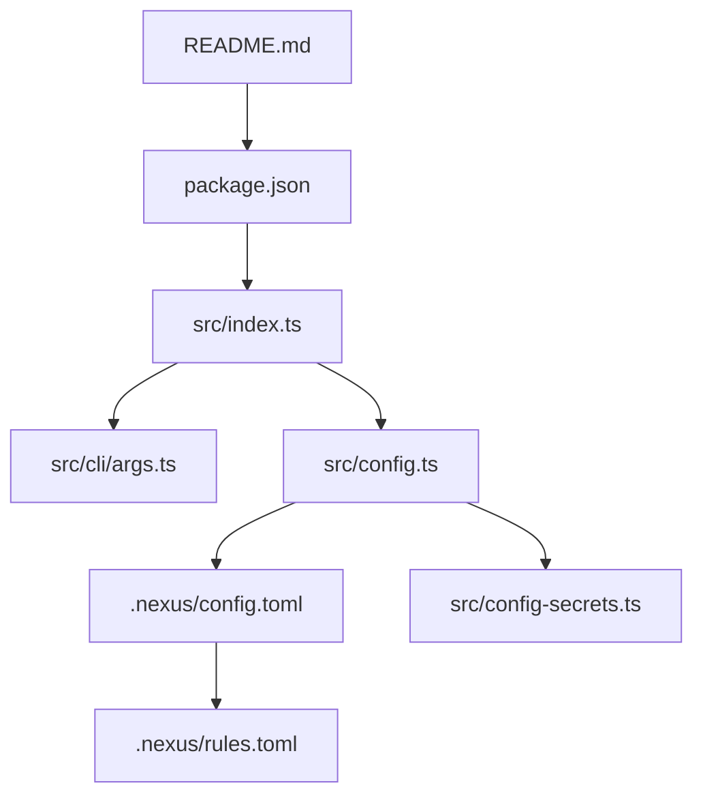
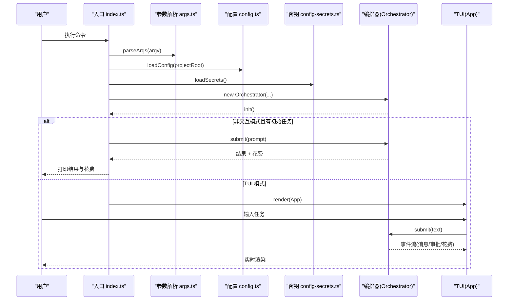
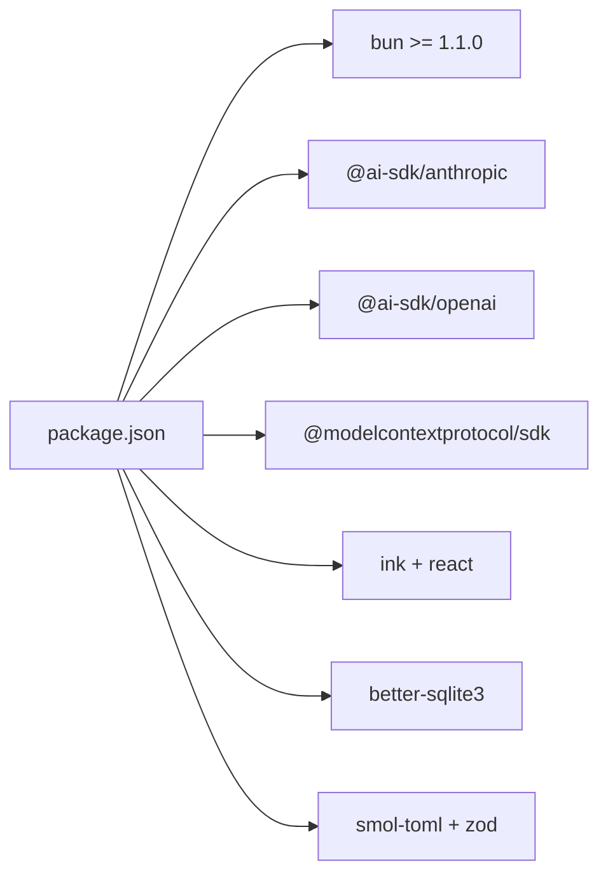

# 快速开始指南

<cite>
**本文引用的文件**   
- [README.md](file://README.md)
- [package.json](file://package.json)
- [src/index.ts](file://src/index.ts)
- [src/cli/args.ts](file://src/cli/args.ts)
- [src/config.ts](file://src/config.ts)
- [.nexus/config.toml](file://.nexus/config.toml)
- [.nexus/rules.toml](file://.nexus/rules.toml)
- [src/config-secrets.ts](file://src/config-secrets.ts)
</cite>

## 目录
1. [简介](#简介)
2. [项目结构](#项目结构)
3. [核心组件](#核心组件)
4. [架构总览](#架构总览)
5. [详细组件分析](#详细组件分析)
6. [依赖分析](#依赖分析)
7. [性能注意事项](#性能注意事项)
8. [故障排查指南](#故障排查指南)
9. [结论](#结论)
10. [附录：常用命令速查](#附录常用命令速查)

## 简介
Nexus 是一个面向生产级的终端 Coding Agent，强调“上下文为王、工具为先、人在环中”。它提供流式 TUI、Plan/Execute 双阶段执行、多模型路由、子 Agent 编排、Git Checkpoint、上下文工程与成本追踪等能力。本快速开始指南将帮助你在 5 分钟内完成安装、配置并运行第一个任务。

## 项目结构
- 入口与 CLI：src/index.ts、src/cli/args.ts
- 配置与密钥：src/config.ts、.nexus/config.toml、src/config-secrets.ts、.nexus/rules.toml
- 包管理与脚本：package.json（包含启动脚本与引擎要求）
- 文档与说明：README.md

图表来源
- [README.md:18-112](file://README.md#L18-L112)
- [package.json:10-18](file://package.json#L10-L18)
- [src/index.ts:18-113](file://src/index.ts#L18-L113)
- [src/cli/args.ts:58-124](file://src/cli/args.ts#L58-L124)
- [src/config.ts:63-74](file://src/config.ts#L63-L74)
- [.nexus/config.toml:1-62](file://.nexus/config.toml#L1-L62)
- [.nexus/rules.toml:1-21](file://.nexus/rules.toml#L1-L21)
- [src/config-secrets.ts:42-59](file://src/config-secrets.ts#L42-L59)

章节来源
- [README.md:18-112](file://README.md#L18-L112)
- [package.json:10-18](file://package.json#L10-L18)

## 核心组件
- 入口与参数解析：入口文件负责解析命令行参数、加载配置、创建编排器、启动 TUI 或非交互模式。
- 配置系统：从 .nexus/config.toml 合并默认值，支持权限、限制、上下文预算、Checkpoint 分支等。
- 密钥管理：支持环境变量优先，其次 ~/.nexus/secrets.toml 或项目级 secrets.toml，提供状态检测与掩码显示。
- CLI 选项：支持指定模型、provider、权限模式、非交互模式、最大迭代步数、跳过 Plan 等。

章节来源
- [src/index.ts:18-113](file://src/index.ts#L18-L113)
- [src/cli/args.ts:58-124](file://src/cli/args.ts#L58-L124)
- [src/config.ts:63-74](file://src/config.ts#L63-L74)
- [src/config-secrets.ts:42-59](file://src/config-secrets.ts#L42-L59)

## 架构总览
Nexus 的运行流程如下：CLI 解析参数 → 加载配置与密钥 → 初始化编排器 → 根据模式进入 TUI 或非交互执行 → 事件驱动 UI 与审批 → 输出结果与花费统计。

图表来源
- [src/index.ts:18-113](file://src/index.ts#L18-L113)
- [src/cli/args.ts:58-124](file://src/cli/args.ts#L58-L124)
- [src/config.ts:63-74](file://src/config.ts#L63-L74)
- [src/config-secrets.ts:42-59](file://src/config-secrets.ts#L42-L59)

## 详细组件分析

### 安装与环境准备
- 前置要求
  - Bun >= 1.1.0
  - ripgrep（grep 工具依赖）
  - Git
- 安装步骤
  - 在项目根目录执行安装命令
  - 设置 API Key 环境变量（见下节）
  - 可选：编辑 .nexus/config.toml 与 .nexus/rules.toml

章节来源
- [README.md:20-31](file://README.md#L20-L31)
- [package.json:39-41](file://package.json#L39-L41)

### 环境变量与密钥配置
- 支持的提供商与对应环境变量
  - Anthropic：ANTHROPIC_API_KEY
  - OpenAI：OPENAI_API_KEY
  - DeepSeek：DEEPSEEK_API_KEY
  - Custom（OpenAI 兼容）：CUSTOM_API_KEY，可配合 CUSTOM_BASE_URL、CUSTOM_DEFAULT_MODEL
- Ollama：本地模型，无需 API Key，需确保服务在默认地址可用
- 优先级：环境变量 > ~/.nexus/secrets.toml（全局）> 项目级 .nexus/secrets.toml
- 建议做法：通过环境变量注入密钥；如需持久化，可使用 secrets 文件

章节来源
- [README.md:34-62](file://README.md#L34-L62)
- [src/config-secrets.ts:120-138](file://src/config-secrets.ts#L120-L138)
- [src/config-secrets.ts:140-164](file://src/config-secrets.ts#L140-L164)

### 模型与提供商配置
- 配置文件位置：.nexus/config.toml
- 支持字段
  - models.planner/executor/summarizer/verifier：各阶段模型选择（auto 表示自动）
  - models.providers.*：各提供商的 api_key_env、base_url、default_model
  - permissions.mode：ask | auto-edit | auto-all | yolo
  - limits.*：会话成本上限、bash 超时、读取行数上限、最大迭代次数、输出字节上限
  - context.*：token 预算比例、保留轮数
  - checkpoint.*：是否自动创建 git checkpoint、分支名
- 示例：DeepSeek、Moonshot、智谱、硅基流动等均可通过 custom provider 接入

章节来源
- [.nexus/config.toml:1-62](file://.nexus/config.toml#L1-L62)
- [src/config.ts:77-131](file://src/config.ts#L77-L131)

### 运行方式与命令示例
- 交互式会话
  - 直接启动，进入 TUI 界面
- 带初始任务
  - 启动后立即提交任务
- 指定模型
  - 使用 -m/--model 指定模型名称
- 权限模式控制
  - --permission 指定 ask/auto-edit/auto-all/yolo
- 非交互模式
  - --non-interactive 执行完即退出，适合自动化脚本

章节来源
- [README.md:95-112](file://README.md#L95-L112)
- [src/cli/args.ts:33-56](file://src/cli/args.ts#L33-L56)
- [src/index.ts:78-85](file://src/index.ts#L78-L85)

### 权限模式详解
- ask：每个写操作都询问（默认）
- auto-edit：edit 自动批准，bash 仍询问
- auto-all：全部自动（危险命令仍强制询问）
- yolo：全部自动，含危险命令（自负责任）

章节来源
- [README.md:114-122](file://README.md#L114-L122)
- [.nexus/config.toml:35-37](file://.nexus/config.toml#L35-L37)

### 斜杠命令（TUI 内）
- /model [name]：查看或切换模型
- /cost：查看本次会话花费
- /clear：清除当前上下文
- /undo：回滚到上一个检查点
- /history：查看会话历史
- /help：显示可用命令

章节来源
- [README.md:123-133](file://README.md#L123-L133)

### 项目规则与上下文
- .nexus/rules.toml：定义项目名称、语言、测试与构建命令、风格约束、硬约束、常驻上下文文件
- 这些规则会作为额外上下文提供给 Agent，保证生成代码符合项目规范

章节来源
- [.nexus/rules.toml:1-21](file://.nexus/rules.toml#L1-L21)

## 依赖分析
- 运行时要求：Bun >= 1.1.0（由 engines 字段声明）
- 关键依赖：AI SDK（Anthropic/OpenAI）、MCP SDK、Ink（TUI）、React、SQLite、Zod、TOML 解析等
- 脚本：start/dev/build/test/lint 等

图表来源
- [package.json:19-31](file://package.json#L19-L31)
- [package.json:39-41](file://package.json#L39-L41)

章节来源
- [package.json:10-18](file://package.json#L10-L18)
- [package.json:19-31](file://package.json#L19-L31)
- [package.json:39-41](file://package.json#L39-L41)

## 性能注意事项
- 合理设置 limits.max_iterations 与 limits.bash_timeout，避免长时间阻塞
- 调整 context.budgetRatio 控制 token 预算，防止长会话爆窗口
- 使用 auto 模型路由让 Nexus 在不同阶段选择合适模型，平衡能力与成本
- 开启 checkpoint.auto_checkpoint 便于回滚与审计

[本节为通用指导，不直接分析具体文件]

## 故障排查指南
- 无法连接模型服务
  - 检查环境变量是否正确设置（ANTHROPIC_API_KEY、OPENAI_API_KEY、DEEPSEEK_API_KEY、CUSTOM_API_KEY）
  - 若使用自定义 OpenAI 兼容接口，确认 CUSTOM_BASE_URL 与模型名称正确
  - 使用 getProviderStatus 检测各 provider 可用性
- 权限模式导致卡住
  - 确认 --permission 参数与 .nexus/config.toml 中的 permissions.mode 一致
  - 在非交互模式下，审批默认通过
- Bash 命令超时或输出过大
  - 调整 limits.bash_timeout 与 limits.max_output_bytes
- 上下文过长或成本过高
  - 降低 context.budgetRatio，减少 recent_turns_keep
  - 使用 /cost 监控花费
- 找不到 ripgrep
  - 安装 ripgrep 并确保 PATH 中包含其路径

章节来源
- [src/config-secrets.ts:140-164](file://src/config-secrets.ts#L140-L164)
- [src/index.ts:78-85](file://src/index.ts#L78-L85)
- [.nexus/config.toml:39-49](file://.nexus/config.toml#L39-L49)
- [README.md:20-24](file://README.md#L20-L24)

## 结论
按照本指南完成环境准备、API Key 配置与基本运行后，你可以在 5 分钟内成功运行第一个任务。后续可根据项目需求调整 .nexus/config.toml 与 rules.toml，结合权限模式与非交互模式实现自动化工作流。

[本节为总结性内容，不直接分析具体文件]

## 附录：常用命令速查
- 交互式会话
  - bun run start
- 带初始任务
  - bun run start "重构 utils 模块"
- 指定模型
  - bun run start -m gpt-4o "修复登录 bug"
- 自动批准编辑
  - bun run start --permission auto-edit "添加单元测试"
- 非交互模式
  - bun run start --non-interactive "运行测试并修复失败的用例"

章节来源
- [README.md:95-112](file://README.md#L95-L112)
- [src/cli/args.ts:33-56](file://src/cli/args.ts#L33-L56)