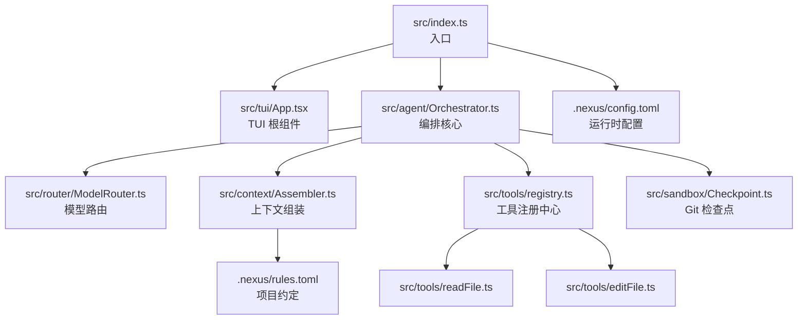
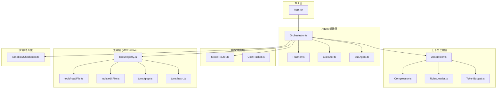
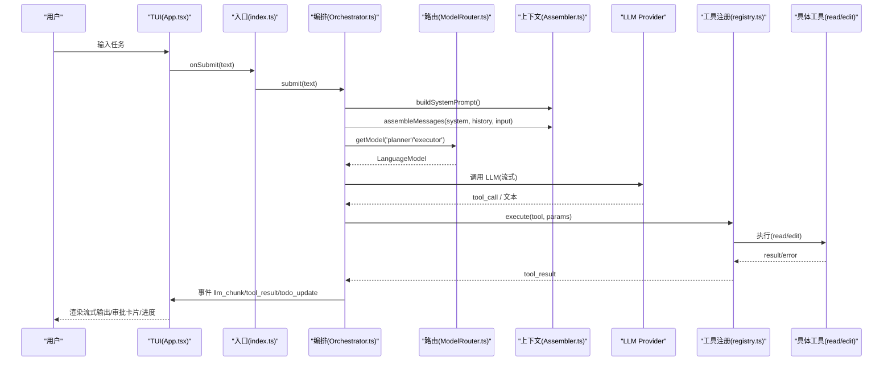
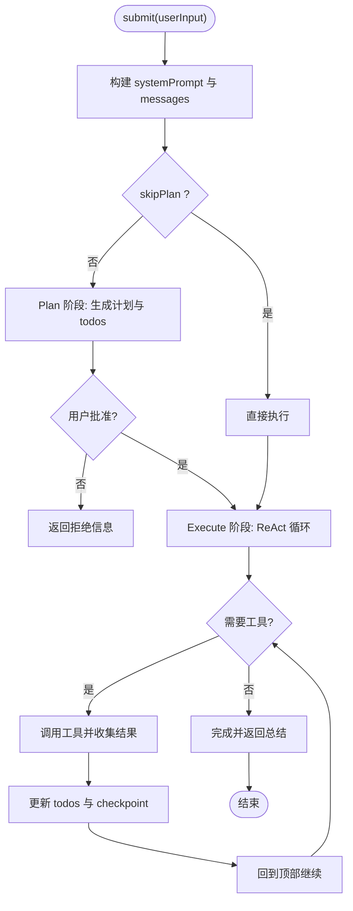
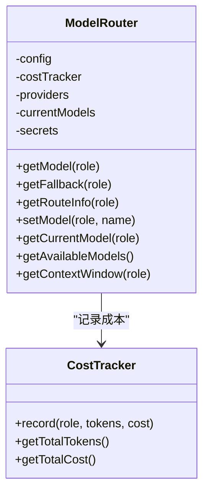
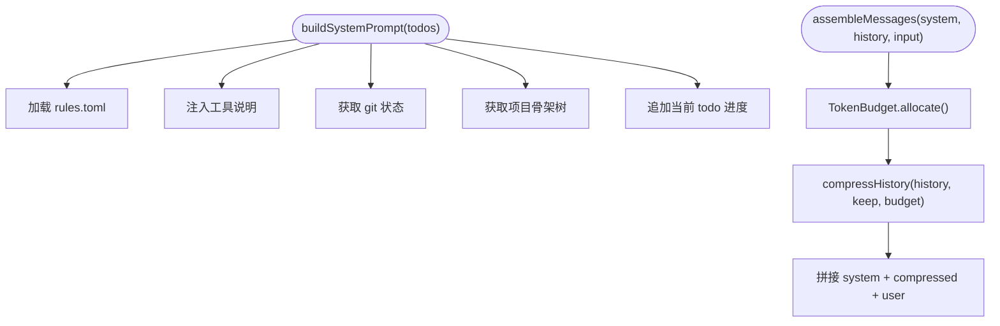
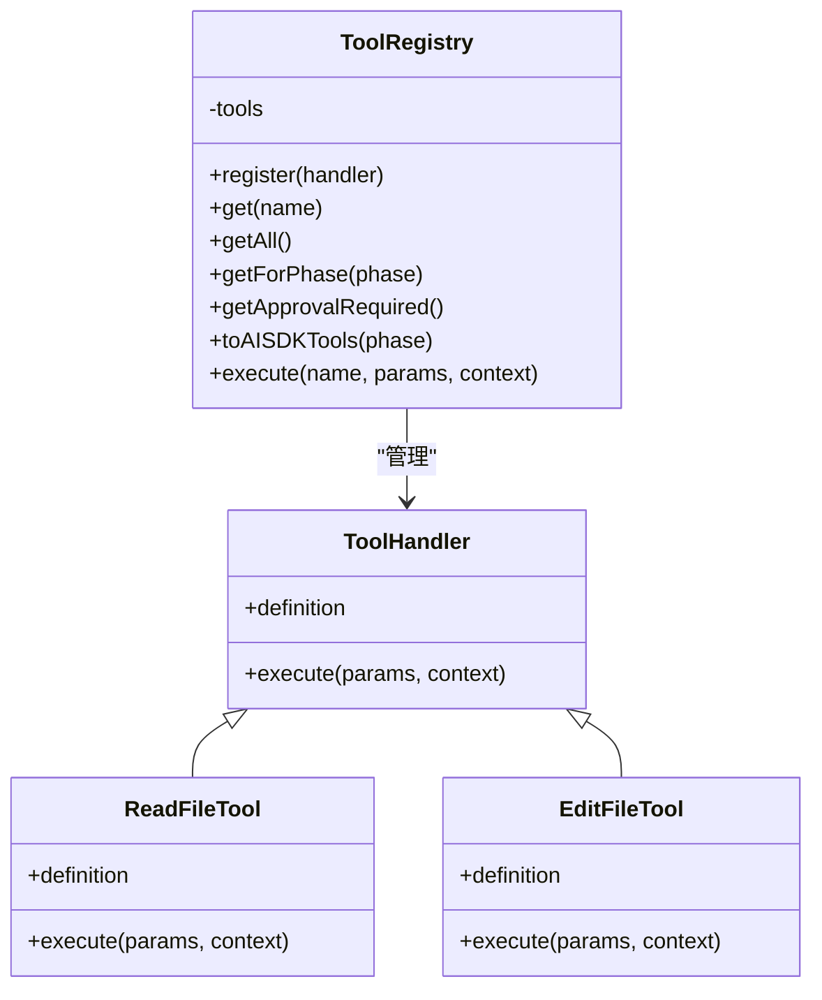
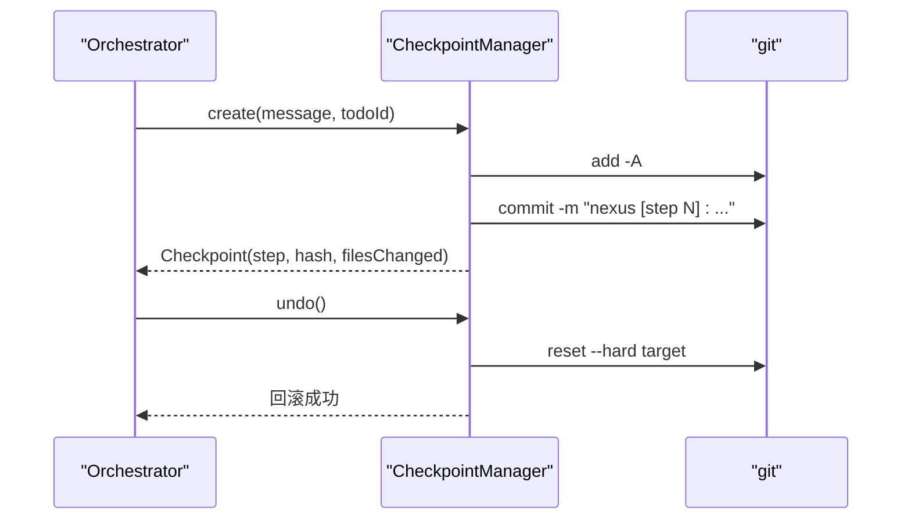
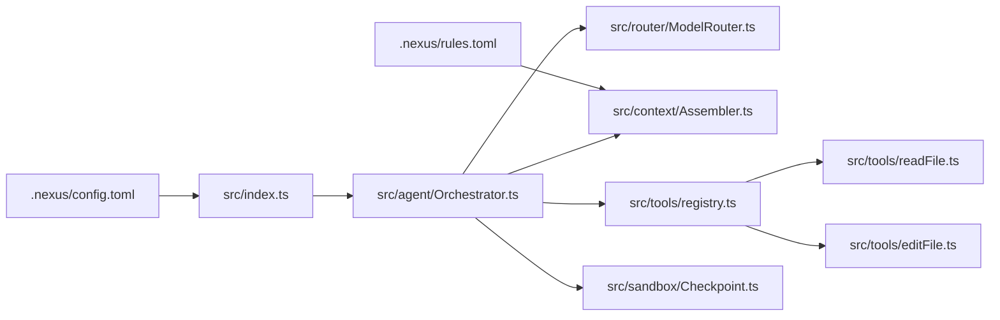

# 架构概览

<cite>
**本文引用的文件**
- [README.md](file://README.md)
- [DESIGN.md](file://DESIGN.md)
- [package.json](file://package.json)
- [src/index.ts](file://src/index.ts)
- [src/agent/Orchestrator.ts](file://src/agent/Orchestrator.ts)
- [src/tui/App.tsx](file://src/tui/App.tsx)
- [src/router/ModelRouter.ts](file://src/router/ModelRouter.ts)
- [src/context/Assembler.ts](file://src/context/Assembler.ts)
- [src/tools/registry.ts](file://src/tools/registry.ts)
- [src/tools/readFile.ts](file://src/tools/readFile.ts)
- [src/tools/editFile.ts](file://src/tools/editFile.ts)
- [src/sandbox/Checkpoint.ts](file://src/sandbox/Checkpoint.ts)
- [src/config.ts](file://src/config.ts)
- [.nexus/config.toml](file://.nexus/config.toml)
- [.nexus/rules.toml](file://.nexus/rules.toml)
</cite>

## 目录
1. [简介](#简介)
2. [项目结构](#项目结构)
3. [核心组件](#核心组件)
4. [架构总览](#架构总览)
5. [详细组件分析](#详细组件分析)
6. [依赖关系分析](#依赖关系分析)
7. [性能与成本考量](#性能与成本考量)
8. [故障排查指南](#故障排查指南)
9. [结论](#结论)
10. [附录](#附录)

## 简介
Nexus 是一个面向生产级的终端 Coding Agent，采用分层架构：TUI 层（Ink React）、Agent 编排层（Plan/Execute + ReAct + 子 Agent）、模型路由层、上下文工程层、工具层（MCP-native）。其核心理念是“上下文为王、工具为先、人在环中”，通过 Plan/Execute 双阶段、多模型路由、Git Checkpoint 和 MCP 原生工具实现高可靠、可回滚、可扩展的编程助手。

## 项目结构
- 入口与启动：src/index.ts 解析参数、加载配置、创建 Orchestrator、渲染 TUI 或执行非交互模式
- TUI 层：src/tui/App.tsx 及 components 提供流式消息、审批卡片、进度条等
- Agent 编排层：src/agent/Orchestrator.ts 协调 Plan/Execute、子 Agent、检查点
- 模型路由层：src/router/ModelRouter.ts 管理 Provider、降级、成本追踪
- 上下文工程层：src/context/Assembler.ts 组装三层上下文并做预算控制
- 工具层：src/tools/* 注册与实现 read/edit/bash/grep，遵循 MCP 协议
- 沙箱与持久化：src/sandbox/Checkpoint.ts Git 检查点；src/storage 用于未来扩展
- 配置与约定：.nexus/config.toml、.nexus/rules.toml、src/config.ts

图表来源
- [src/index.ts:1-119](file://src/index.ts#L1-L119)
- [src/tui/App.tsx:1-284](file://src/tui/App.tsx#L1-L284)
- [src/agent/Orchestrator.ts:1-260](file://src/agent/Orchestrator.ts#L1-L260)
- [src/router/ModelRouter.ts:1-308](file://src/router/ModelRouter.ts#L1-L308)
- [src/context/Assembler.ts:1-184](file://src/context/Assembler.ts#L1-L184)
- [src/tools/registry.ts:1-96](file://src/tools/registry.ts#L1-L96)
- [src/tools/readFile.ts:1-150](file://src/tools/readFile.ts#L1-L150)
- [src/tools/editFile.ts:1-170](file://src/tools/editFile.ts#L1-L170)
- [src/sandbox/Checkpoint.ts:1-182](file://src/sandbox/Checkpoint.ts#L1-L182)
- [.nexus/config.toml:1-62](file://.nexus/config.toml#L1-L62)
- [.nexus/rules.toml:1-21](file://.nexus/rules.toml#L1-L21)

章节来源
- [README.md:1-174](file://README.md#L1-L174)
- [DESIGN.md:54-114](file://DESIGN.md#L54-L114)
- [package.json:1-43](file://package.json#L1-L43)

## 核心组件
- 入口与事件桥接：index.ts 负责参数解析、配置加载、Orchestrator 初始化、TUI 渲染与非交互流程，并通过全局事件总线将 Orchestrator 事件分发到 UI
- 编排核心：Orchestrator 维护状态机（idle/planning/executing/done），驱动 Plan/Execute 双阶段、子 Agent 分派、Todo 更新、成本汇总与 Undo
- 模型路由：ModelRouter 抽象 Provider、按角色选择模型、自动降级、统计成本
- 上下文工程：ContextAssembler 构建 L1/L2/L3 上下文，结合 TokenBudget 压缩历史与裁剪内容
- 工具层：registry.ts 统一注册与调度内置工具，readFile/editFile 等实现遵循 MCP 语义与安全约束
- 检查点：CheckpointManager 在每次编辑后自动提交，支持 /undo 与跳转

章节来源
- [src/index.ts:1-119](file://src/index.ts#L1-L119)
- [src/agent/Orchestrator.ts:1-260](file://src/agent/Orchestrator.ts#L1-L260)
- [src/router/ModelRouter.ts:1-308](file://src/router/ModelRouter.ts#L1-L308)
- [src/context/Assembler.ts:1-184](file://src/context/Assembler.ts#L1-L184)
- [src/tools/registry.ts:1-96](file://src/tools/registry.ts#L1-L96)
- [src/sandbox/Checkpoint.ts:1-182](file://src/sandbox/Checkpoint.ts#L1-L182)

## 架构总览
分层职责与数据流向：
- TUI 层：接收用户输入，展示流式输出、工具调用卡片、审批面板与 Todo 进度
- Agent 编排层：Plan 阶段只读探索生成结构化计划；Execute 阶段 ReAct 循环执行工具，必要时请求审批
- 模型路由层：根据角色与可用性选择模型，处理降级与重试，记录成本
- 上下文工程层：组装系统提示、规则、项目骨架、历史压缩与检索结果，确保不超预算
- 工具层：MCP-native 工具（read/edit/bash/grep）提供安全可靠的文件系统与命令执行能力

图表来源
- [src/tui/App.tsx:1-284](file://src/tui/App.tsx#L1-L284)
- [src/agent/Orchestrator.ts:1-260](file://src/agent/Orchestrator.ts#L1-L260)
- [src/router/ModelRouter.ts:1-308](file://src/router/ModelRouter.ts#L1-L308)
- [src/context/Assembler.ts:1-184](file://src/context/Assembler.ts#L1-L184)
- [src/tools/registry.ts:1-96](file://src/tools/registry.ts#L1-L96)
- [src/tools/readFile.ts:1-150](file://src/tools/readFile.ts#L1-L150)
- [src/tools/editFile.ts:1-170](file://src/tools/editFile.ts#L1-L170)
- [src/sandbox/Checkpoint.ts:1-182](file://src/sandbox/Checkpoint.ts#L1-L182)

## 详细组件分析

### 入口与 TUI 集成
- index.ts 解析 CLI 参数，加载 .nexus/config.toml，构造 Orchestrator，并在 TUI 模式下通过 emitToUI 将事件推送至 App.tsx
- App.tsx 监听 NexusEvent，渲染消息、工具卡片、审批弹窗与 Todo 进度，支持斜杠命令与首次运行 API Key 引导

图表来源
- [src/index.ts:1-119](file://src/index.ts#L1-L119)
- [src/tui/App.tsx:1-284](file://src/tui/App.tsx#L1-L284)
- [src/agent/Orchestrator.ts:1-260](file://src/agent/Orchestrator.ts#L1-L260)
- [src/router/ModelRouter.ts:1-308](file://src/router/ModelRouter.ts#L1-L308)
- [src/context/Assembler.ts:1-184](file://src/context/Assembler.ts#L1-L184)
- [src/tools/registry.ts:1-96](file://src/tools/registry.ts#L1-L96)
- [src/tools/readFile.ts:1-150](file://src/tools/readFile.ts#L1-L150)
- [src/tools/editFile.ts:1-170](file://src/tools/editFile.ts#L1-L170)

章节来源
- [src/index.ts:1-119](file://src/index.ts#L1-L119)
- [src/tui/App.tsx:1-284](file://src/tui/App.tsx#L1-L284)

### 编排核心（Plan/Execute + ReAct + 子 Agent）
- Orchestrator 维护 phase、history、todos，init 时加载 secrets、rules、router、assembler、checkpoint
- planAndExecute：先由 Planner 生成结构化计划与 todos，等待用户审批后再进入 Execute
- runExecutor：使用 Executor 进行 ReAct 循环，按需调用工具、更新 todos、触发 checkpoint
- 子 Agent：通过 SubAgent 分派独立上下文与权限的子任务，限制深度与写权限

图表来源
- [src/agent/Orchestrator.ts:1-260](file://src/agent/Orchestrator.ts#L1-L260)

章节来源
- [src/agent/Orchestrator.ts:1-260](file://src/agent/Orchestrator.ts#L1-L260)

### 模型路由层
- ModelRouter 维护 MODEL_CATALOG 与 DEFAULT_ROLE_MODELS，按角色选择模型，支持 auto 模式与降级链 FALLBACK_CHAIN
- initProviders 动态注入 Anthropic/OpenAI/Ollama/DeepSeek/Custom，读取环境变量与 secrets
- getRouteInfo 与 CostTracker 配合统计 token 与费用

图表来源
- [src/router/ModelRouter.ts:1-308](file://src/router/ModelRouter.ts#L1-L308)

章节来源
- [src/router/ModelRouter.ts:1-308](file://src/router/ModelRouter.ts#L1-L308)

### 上下文工程层
- ContextAssembler 构建 L1（system prompt、规则、git 状态、项目骨架）、L2（任务与历史压缩）、L3（检索结果）
- 通过 TokenBudget 分配历史预算，compressHistory 保留近期完整轮次，早期摘要压缩
- 支持 alwaysInclude 文件加载与行数截断策略

图表来源
- [src/context/Assembler.ts:1-184](file://src/context/Assembler.ts#L1-L184)
- [.nexus/rules.toml:1-21](file://.nexus/rules.toml#L1-L21)

章节来源
- [src/context/Assembler.ts:1-184](file://src/context/Assembler.ts#L1-L184)
- [.nexus/rules.toml:1-21](file://.nexus/rules.toml#L1-L21)

### 工具层（MCP-native）
- registry.ts 统一管理工具定义、阶段可见性、审批需求与 AI SDK 兼容导出
- readFile：路径越界检测、二进制拒绝、行数截断、行号格式化
- editFile：强制唯一匹配、原子写入、diff 输出、BOM/换行符保持

图表来源
- [src/tools/registry.ts:1-96](file://src/tools/registry.ts#L1-L96)
- [src/tools/readFile.ts:1-150](file://src/tools/readFile.ts#L1-L150)
- [src/tools/editFile.ts:1-170](file://src/tools/editFile.ts#L1-L170)

章节来源
- [src/tools/registry.ts:1-96](file://src/tools/registry.ts#L1-L96)
- [src/tools/readFile.ts:1-150](file://src/tools/readFile.ts#L1-L150)
- [src/tools/editFile.ts:1-170](file://src/tools/editFile.ts#L1-L170)

### 检查点与回滚
- CheckpointManager 在 git 仓库中维护 nexus/checkpoints 分支，每次编辑自动提交，支持 undo/jump/merge
- 与 Orchestrator 协作，在关键步骤创建检查点，保障“可回滚”的设计哲学

图表来源
- [src/sandbox/Checkpoint.ts:1-182](file://src/sandbox/Checkpoint.ts#L1-L182)
- [src/agent/Orchestrator.ts:1-260](file://src/agent/Orchestrator.ts#L1-L260)

章节来源
- [src/sandbox/Checkpoint.ts:1-182](file://src/sandbox/Checkpoint.ts#L1-L182)

## 依赖关系分析
- 入口依赖：CLI 参数、配置加载、Orchestrator、TUI 事件桥
- Orchestrator 依赖：Planner/Executor/SubAgent、工具注册、上下文组装、模型路由、成本追踪、检查点
- 模型路由依赖：Provider SDK、secrets、成本追踪
- 上下文依赖：规则加载、历史压缩、Token 预算
- 工具层依赖：文件系统、diff、路径规范化、安全校验

图表来源
- [src/index.ts:1-119](file://src/index.ts#L1-L119)
- [src/agent/Orchestrator.ts:1-260](file://src/agent/Orchestrator.ts#L1-L260)
- [src/router/ModelRouter.ts:1-308](file://src/router/ModelRouter.ts#L1-L308)
- [src/context/Assembler.ts:1-184](file://src/context/Assembler.ts#L1-L184)
- [src/tools/registry.ts:1-96](file://src/tools/registry.ts#L1-L96)
- [src/tools/readFile.ts:1-150](file://src/tools/readFile.ts#L1-L150)
- [src/tools/editFile.ts:1-170](file://src/tools/editFile.ts#L1-L170)
- [src/sandbox/Checkpoint.ts:1-182](file://src/sandbox/Checkpoint.ts#L1-L182)
- [.nexus/config.toml:1-62](file://.nexus/config.toml#L1-L62)
- [.nexus/rules.toml:1-21](file://.nexus/rules.toml#L1-L21)

章节来源
- [package.json:1-43](file://package.json#L1-L43)
- [src/config.ts:1-132](file://src/config.ts#L1-L132)
- [.nexus/config.toml:1-62](file://.nexus/config.toml#L1-L62)

## 性能与成本考量
- 模型路由与降级：按角色选择合适模型，不可用时自动降级，避免昂贵模型滥用
- 上下文预算：TokenBudget 按比例分配历史预算，压缩旧对话与工具结果，防止窗口溢出
- 工具可靠性：edit 唯一匹配与原子写入减少错误修复开销；bash 超时与输出截断降低资源消耗
- 成本追踪：每步记录 token 与估算费用，会话结束汇总，帮助用户感知花费

章节来源
- [src/router/ModelRouter.ts:1-308](file://src/router/ModelRouter.ts#L1-L308)
- [src/context/Assembler.ts:1-184](file://src/context/Assembler.ts#L1-L184)
- [src/tools/editFile.ts:1-170](file://src/tools/editFile.ts#L1-L170)

## 故障排查指南
- 无可用 Provider：检查 .nexus/config.toml 与 secrets，确认 API Key 与 base_url 正确
- 模型不在目录：未知模型名会尝试默认 provider，若失败需添加至 MODEL_CATALOG 或修正配置
- 工具报错：read_file 路径越界/二进制拒绝；edit_file 未找到或不唯一匹配；bash 危险命令强制审批
- 回滚失败：确认处于 git 仓库且 checkpoint 分支存在；查看 git 错误输出定位问题
- 成本超限：limits.max_session_cost 触发暂停，调整预算比例或切换更便宜模型

章节来源
- [src/router/ModelRouter.ts:1-308](file://src/router/ModelRouter.ts#L1-L308)
- [src/tools/readFile.ts:1-150](file://src/tools/readFile.ts#L1-L150)
- [src/tools/editFile.ts:1-170](file://src/tools/editFile.ts#L1-L170)
- [src/sandbox/Checkpoint.ts:1-182](file://src/sandbox/Checkpoint.ts#L1-L182)
- [.nexus/config.toml:1-62](file://.nexus/config.toml#L1-L62)

## 结论
Nexus 以分层架构清晰解耦 TUI、编排、路由、上下文与工具，通过 Plan/Execute 双阶段与 ReAct 循环提升复杂任务成功率；多模型路由与成本追踪兼顾能力与经济性；MCP-native 工具与 Git Checkpoint 强化可靠性与可回滚性。该设计为后续扩展（如 Go 引擎、语义检索、更多工具）提供了稳定接口与平滑迁移路径。

## 附录
- 快速开始与用法参考 README 中的安装、配置与运行示例
- 设计决策与路线图详见 DESIGN.md

章节来源
- [README.md:1-174](file://README.md#L1-L174)
- [DESIGN.md:642-774](file://DESIGN.md#L642-L774)