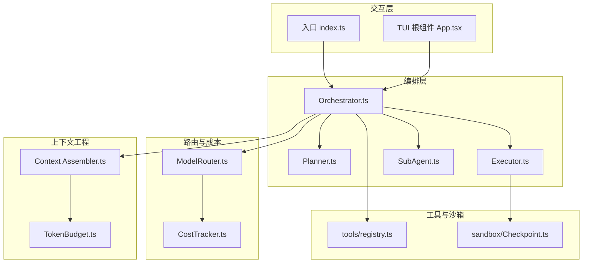
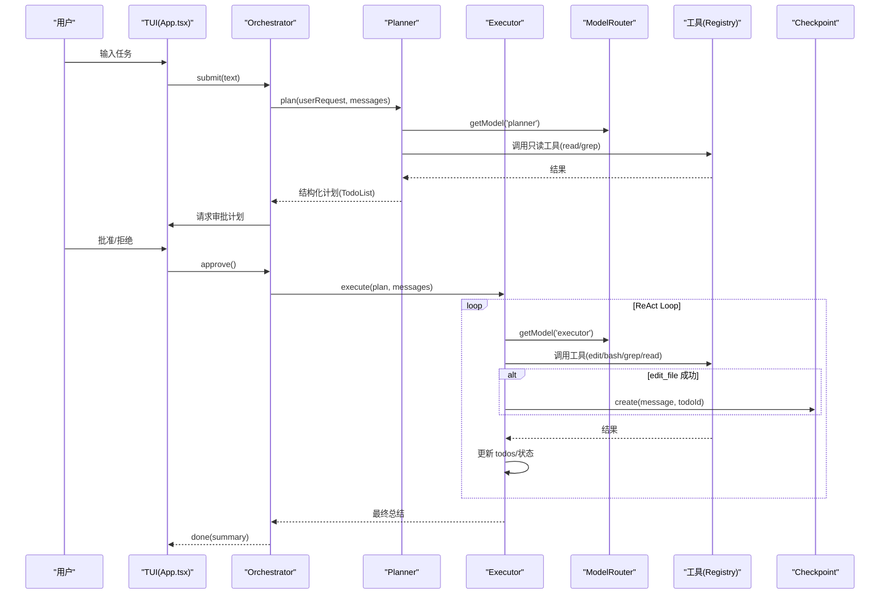
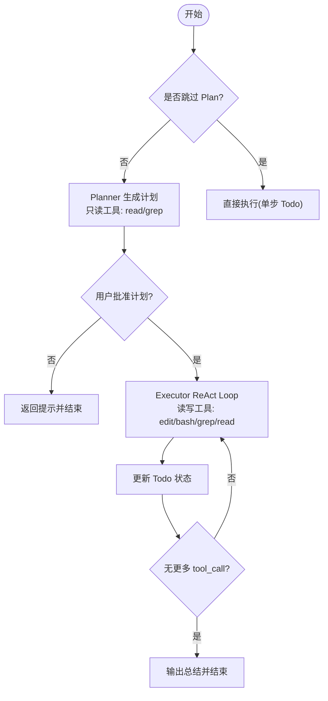
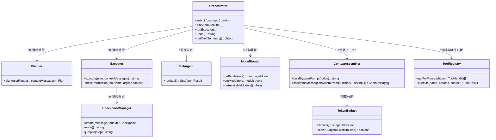

# 核心特性概览

<cite>
**本文引用的文件**   
- [README.md](file://README.md)
- [DESIGN.md](file://DESIGN.md)
- [src/index.ts](file://src/index.ts)
- [src/agent/Orchestrator.ts](file://src/agent/Orchestrator.ts)
- [src/agent/Planner.ts](file://src/agent/Planner.ts)
- [src/agent/Executor.ts](file://src/agent/Executor.ts)
- [src/agent/SubAgent.ts](file://src/agent/SubAgent.ts)
- [src/router/ModelRouter.ts](file://src/router/ModelRouter.ts)
- [src/router/CostTracker.ts](file://src/router/CostTracker.ts)
- [src/context/Assembler.ts](file://src/context/Assembler.ts)
- [src/context/TokenBudget.ts](file://src/context/TokenBudget.ts)
- [src/tools/registry.ts](file://src/tools/registry.ts)
- [src/sandbox/Checkpoint.ts](file://src/sandbox/Checkpoint.ts)
- [src/config.ts](file://src/config.ts)
</cite>

## 目录
1. [引言](#引言)
2. [项目结构](#项目结构)
3. [核心组件](#核心组件)
4. [架构总览](#架构总览)
5. [详细组件分析](#详细组件分析)
6. [依赖关系分析](#依赖关系分析)
7. [性能与成本](#性能与成本)
8. [故障排查指南](#故障排查指南)
9. [结论](#结论)
10. [附录：使用示例与最佳实践](#附录使用示例与最佳实践)

## 引言
Nexus 是一个面向生产级的终端编程助手，围绕“上下文为王、工具为先、人在环中”的理念构建。其核心价值在于将复杂编程任务拆解为可验证的闭环流程，通过流式 TUI 提供实时反馈，以 Plan/Execute 双阶段保障质量，借助多模型路由平衡能力与成本，并以 Git Checkpoint 确保可回滚。四个核心工具（read_file/edit_file/bash/grep）覆盖绝大多数工程场景；子 Agent 编排用于并行化复杂任务；上下文工程保证长会话稳定运行；成本追踪让花费透明可控。

## 项目结构
整体采用分层设计：TUI 层负责交互与渲染；Agent 编排层实现 Plan/Execute 循环与子 Agent 分派；模型路由层抽象多 Provider 并管理降级与成本；上下文工程层负责三层上下文组装与压缩；工具层基于 MCP 协议暴露 read/edit/bash/grep；沙箱层提供命令防护与检查点；配置与密钥加载贯穿各层。

图表来源
- [src/index.ts:1-119](file://src/index.ts#L1-L119)
- [src/tui/App.tsx:1-284](file://src/tui/App.tsx#L1-L284)
- [src/agent/Orchestrator.ts:1-260](file://src/agent/Orchestrator.ts#L1-L260)
- [src/agent/Planner.ts:1-176](file://src/agent/Planner.ts#L1-L176)
- [src/agent/Executor.ts:1-234](file://src/agent/Executor.ts#L1-L234)
- [src/agent/SubAgent.ts:1-148](file://src/agent/SubAgent.ts#L1-L148)
- [src/router/ModelRouter.ts:1-308](file://src/router/ModelRouter.ts#L1-L308)
- [src/router/CostTracker.ts:1-96](file://src/router/CostTracker.ts#L1-L96)
- [src/context/Assembler.ts:1-184](file://src/context/Assembler.ts#L1-L184)
- [src/context/TokenBudget.ts:1-79](file://src/context/TokenBudget.ts#L1-L79)
- [src/tools/registry.ts:1-96](file://src/tools/registry.ts#L1-L96)
- [src/sandbox/Checkpoint.ts:1-182](file://src/sandbox/Checkpoint.ts#L1-L182)

章节来源
- [README.md:1-174](file://README.md#L1-L174)
- [DESIGN.md:54-114](file://DESIGN.md#L54-L114)

## 核心组件
- 流式 TUI：基于 Ink 的终端界面，支持消息列表、工具卡片、审批面板、进度条与输入框，事件驱动渲染。
- Plan/Execute 双阶段：Plan 仅用只读工具探索与生成结构化计划；Execute 按步骤执行并持续验证。
- 四个核心工具：read_file、edit_file、bash、grep，统一注册并通过 MCP 协议对外暴露。
- 多模型路由：按角色选择模型，支持自动选择、降级链与重试，记录成本。
- 子 Agent 编排：主 Agent 可派发独立子任务，限制深度与写权限，结果汇总回传。
- Git Checkpoint：每次编辑后自动提交到专用分支，支持一键回滚与跳转。
- 上下文工程：三层上下文组装 + Token 预算分配 + 历史压缩，避免长会话爆窗口。
- 成本追踪：按调用记录 token 与估算费用，会话结束展示总花费。

章节来源
- [src/tui/App.tsx:1-284](file://src/tui/App.tsx#L1-L284)
- [src/agent/Orchestrator.ts:1-260](file://src/agent/Orchestrator.ts#L1-L260)
- [src/agent/Planner.ts:1-176](file://src/agent/Planner.ts#L1-L176)
- [src/agent/Executor.ts:1-234](file://src/agent/Executor.ts#L1-L234)
- [src/agent/SubAgent.ts:1-148](file://src/agent/SubAgent.ts#L1-L148)
- [src/router/ModelRouter.ts:1-308](file://src/router/ModelRouter.ts#L1-L308)
- [src/router/CostTracker.ts:1-96](file://src/router/CostTracker.ts#L1-L96)
- [src/context/Assembler.ts:1-184](file://src/context/Assembler.ts#L1-L184)
- [src/context/TokenBudget.ts:1-79](file://src/context/TokenBudget.ts#L1-L79)
- [src/tools/registry.ts:1-96](file://src/tools/registry.ts#L1-L96)
- [src/sandbox/Checkpoint.ts:1-182](file://src/sandbox/Checkpoint.ts#L1-L182)

## 架构总览
Nexus 的架构强调“解耦与可演进”。TUI 与 Agent 通过事件总线通信；Agent 编排层协调 Plan/Execute 与子 Agent；模型路由层屏蔽不同 Provider 差异；上下文工程层控制输入大小与内容优先级；工具层遵循 MCP 协议，便于未来迁移至 Go 后端或外部 MCP Server。

图表来源
- [src/tui/App.tsx:1-284](file://src/tui/App.tsx#L1-L284)
- [src/agent/Orchestrator.ts:1-260](file://src/agent/Orchestrator.ts#L1-L260)
- [src/agent/Planner.ts:1-176](file://src/agent/Planner.ts#L1-L176)
- [src/agent/Executor.ts:1-234](file://src/agent/Executor.ts#L1-L234)
- [src/router/ModelRouter.ts:1-308](file://src/router/ModelRouter.ts#L1-L308)
- [src/tools/registry.ts:1-96](file://src/tools/registry.ts#L1-L96)
- [src/sandbox/Checkpoint.ts:1-182](file://src/sandbox/Checkpoint.ts#L1-L182)

## 详细组件分析

### 流式 TUI 界面
- 价值：实时反馈提升人机协作效率，审批卡片与 Diff 内联高亮降低误操作风险。
- 工作原理：Ink 组件树维护消息、工具调用、Todo 进度与审批状态；全局事件分发将 Orchestrator 的事件映射到 UI 更新。
- 使用场景：交互式会话、非交互模式下的结果输出、API Key 首次引导。
- 最佳实践：在审批阻塞时禁用输入；对错误消息进行可恢复标记，避免中断整个会话。

章节来源
- [src/tui/App.tsx:1-284](file://src/tui/App.tsx#L1-L284)
- [src/index.ts:1-119](file://src/index.ts#L1-L119)

### Plan/Execute 双阶段执行
- 价值：先规划后执行，显著降低大任务的翻车概率；Plan 阶段只读探索，Execute 阶段精准修改与验证。
- 工作原理：Orchestrator 根据配置决定是否跳过 Plan；Planner 使用只读工具生成 TodoList；Executor 进入 ReAct Loop，逐步执行并更新进度。
- 使用场景：重构、跨文件修改、需要测试验证的任务。
- 最佳实践：合理设置最大迭代次数；在 Plan 阶段充分探索后再进入 Execute。

图表来源
- [src/agent/Orchestrator.ts:1-260](file://src/agent/Orchestrator.ts#L1-L260)
- [src/agent/Planner.ts:1-176](file://src/agent/Planner.ts#L1-L176)
- [src/agent/Executor.ts:1-234](file://src/agent/Executor.ts#L1-L234)

章节来源
- [src/agent/Orchestrator.ts:1-260](file://src/agent/Orchestrator.ts#L1-L260)
- [src/agent/Planner.ts:1-176](file://src/agent/Planner.ts#L1-L176)
- [src/agent/Executor.ts:1-234](file://src/agent/Executor.ts#L1-L234)

### 四个核心工具（read_file / edit_file / bash / grep）
- 价值：覆盖 90% 编程任务；MCP 原生使工具生态可扩展且可迁移。
- 工作原理：ToolRegistry 统一管理工具定义与执行；不同阶段过滤可用工具；权限策略决定是否需要审批。
- 使用场景：读取源码、精准替换、运行测试、代码检索。
- 最佳实践：edit_file 必须保证 old_string 唯一匹配；bash 注意超时与输出截断；grep 结合正则与文件过滤提高召回率。

章节来源
- [src/tools/registry.ts:1-96](file://src/tools/registry.ts#L1-L96)
- [DESIGN.md:229-281](file://DESIGN.md#L229-L281)

### 多模型路由
- 价值：按角色选择合适模型，兼顾质量与成本；Provider 不可用时自动降级。
- 工作原理：ModelRouter 初始化各 Provider，按配置或 auto 策略选择模型；记录成本并提供降级链。
- 使用场景：Plan 用高档模型、Execute 用中档、Summarize/Verify 用低档。
- 最佳实践：为每个角色配置合适的默认模型；开启 auto 模式以适配本地 Ollama 或自定义 OpenAI 兼容接口。

章节来源
- [src/router/ModelRouter.ts:1-308](file://src/router/ModelRouter.ts#L1-L308)
- [src/router/CostTracker.ts:1-96](file://src/router/CostTracker.ts#L1-L96)
- [src/config.ts:1-132](file://src/config.ts#L1-L132)

### 子 Agent 编排
- 价值：复杂任务自动拆解，子 Agent 拥有独立上下文，减少主 Agent 上下文压力。
- 工作原理：SubAgent 根据 writable 选择工具集，限制深度与写权限，完成后返回摘要与变更文件列表。
- 使用场景：批量修改、跨模块重构、独立验证。
- 最佳实践：明确描述子任务目标；谨慎授予写权限；限制 maxIterations 防止失控。

章节来源
- [src/agent/SubAgent.ts:1-148](file://src/agent/SubAgent.ts#L1-L148)
- [DESIGN.md:188-216](file://DESIGN.md#L188-L216)

### Git Checkpoint
- 价值：每次编辑自动提交，一键回滚，让“犯错”变成“撤销一步”。
- 工作原理：在专用分支上创建提交，记录步骤号、消息与变更文件；支持 undo/jump/merge。
- 使用场景：大规模重构、高风险修改、需要审计的历史。
- 最佳实践：保持工作区干净；合并前确认冲突；必要时保留 checkpoint 分支作为审计线。

章节来源
- [src/sandbox/Checkpoint.ts:1-182](file://src/sandbox/Checkpoint.ts#L1-L182)

### 上下文工程
- 价值：三层上下文 + 预算分配 + 历史压缩，确保长会话不爆窗口。
- 工作原理：Assembler 组装 L1/L2/L3 上下文；TokenBudget 计算预算并按优先级裁剪；Compressor 压缩早期对话。
- 使用场景：长时间会话、大型仓库、频繁工具调用。
- 最佳实践：合理设置 recentTurnsKeep 与 budgetRatio；优先保留关键规则与最近轮次。

章节来源
- [src/context/Assembler.ts:1-184](file://src/context/Assembler.ts#L1-L184)
- [src/context/TokenBudget.ts:1-79](file://src/context/TokenBudget.ts#L1-L79)
- [DESIGN.md:284-366](file://DESIGN.md#L284-L366)

### 成本追踪
- 价值：透明显示 token 消耗与估算费用，帮助控制预算。
- 工作原理：CostTracker 记录每次调用的 provider、模型、token 数与单价，累计总成本。
- 使用场景：多模型切换、自动化流水线、团队共享账号。
- 最佳实践：设置会话成本上限；定期查看按角色分组统计。

章节来源
- [src/router/CostTracker.ts:1-96](file://src/router/CostTracker.ts#L1-L96)
- [DESIGN.md:407-410](file://DESIGN.md#L407-L410)

## 依赖关系分析
- Orchestrator 依赖 Planner、Executor、SubAgent、ModelRouter、ContextAssembler、ToolRegistry、CheckpointManager。
- Planner/Executor 依赖 ToolRegistry 与 ModelRouter；Executor 依赖 CheckpointManager。
- ContextAssembler 依赖 TokenBudget 与 RulesLoader；Router 依赖 CostTracker。
- TUI 通过事件系统与 Orchestrator 解耦。

图表来源
- [src/agent/Orchestrator.ts:1-260](file://src/agent/Orchestrator.ts#L1-L260)
- [src/agent/Planner.ts:1-176](file://src/agent/Planner.ts#L1-L176)
- [src/agent/Executor.ts:1-234](file://src/agent/Executor.ts#L1-L234)
- [src/agent/SubAgent.ts:1-148](file://src/agent/SubAgent.ts#L1-L148)
- [src/router/ModelRouter.ts:1-308](file://src/router/ModelRouter.ts#L1-L308)
- [src/context/Assembler.ts:1-184](file://src/context/Assembler.ts#L1-L184)
- [src/context/TokenBudget.ts:1-79](file://src/context/TokenBudget.ts#L1-L79)
- [src/tools/registry.ts:1-96](file://src/tools/registry.ts#L1-L96)
- [src/sandbox/Checkpoint.ts:1-182](file://src/sandbox/Checkpoint.ts#L1-L182)

## 性能与成本
- 启动与交互：Bun 运行时与 Ink 组件化带来快速启动与流畅渲染。
- 模型延迟主导：LLM 响应时间远大于工具执行，优化应聚焦于上下文压缩与路由策略。
- 工具可靠性：edit_file 的唯一匹配校验与原子写减少回滚成本；bash 的超时与进程组管理避免僵尸进程。
- 成本优化：按角色选择模型、启用 auto 模式、限制迭代次数与输出大小。

[本节为通用指导，无需具体文件分析]

## 故障排查指南
- 流式 + tool calling 解析边界：不同 Provider 的流式返回方式存在差异，需尽早用真实 Provider 测试。
- 全屏 vs 行模式：审批卡片需要全屏交互，流式输出适合行模式，混用需谨慎。
- Windows 路径与换行符：内部统一 POSIX，bash 工具锁定 Git Bash。
- 大文件读取：read_file 默认截断，提示使用 grep 定位具体内容。
- 僵尸进程：bash 超时后需 kill 进程组，避免残留 CPU 占用。
- MCP SDK 版本：锁定版本并在升级时跑评估用例。
- 成本失控：auto-all/yolo 模式下设置会话成本上限，超限时暂停并询问。

章节来源
- [DESIGN.md:729-746](file://DESIGN.md#L729-L746)

## 结论
Nexus 通过流式 TUI、Plan/Execute 双阶段、四大核心工具、多模型路由、子 Agent 编排、Git Checkpoint、上下文工程与成本追踪，构建了强大的终端编程助手。各特性协同工作：上下文工程保障输入质量，路由层优化成本与可用性，工具层提供可靠执行，检查点确保可回滚，TUI 提供直观交互。建议在生产环境中结合项目约定与权限策略，充分利用子 Agent 与多模型路由，以获得高质量与低成本的双重收益。

[本节为总结性内容，无需具体文件分析]

## 附录：使用示例与最佳实践
- 快速开始
  - 安装与运行：参考 README 的安装与运行说明，支持交互式与非交互模式。
  - 指定模型：使用命令行参数或配置文件指定 planner/executor 模型。
  - 权限模式：根据需求选择 ask/auto-edit/auto-all/yolo，危险命令始终强制审批。
- 斜杠命令
  - /model：查看或切换当前模型。
  - /cost：查看本次会话花费。
  - /clear：清除当前上下文。
  - /undo：回滚到上一个检查点。
  - /history：查看会话历史。
- 配置要点
  - .nexus/config.toml：设置各阶段模型、Provider 地址与默认模型。
  - .nexus/rules.toml：注入项目约定与约束，增强 agent 行为一致性。
- 最佳实践
  - 在 Plan 阶段充分探索，再进入 Execute。
  - 使用 edit_file 时提供足够上下文的 old_string，确保唯一匹配。
  - 为 bash 设置合理的超时与输出大小上限。
  - 利用子 Agent 处理批量修改与独立验证任务。
  - 监控成本，按需切换到更经济的模型。

章节来源
- [README.md:18-133](file://README.md#L18-L133)
- [src/config.ts:1-132](file://src/config.ts#L1-L132)
- [DESIGN.md:338-366](file://DESIGN.md#L338-L366)