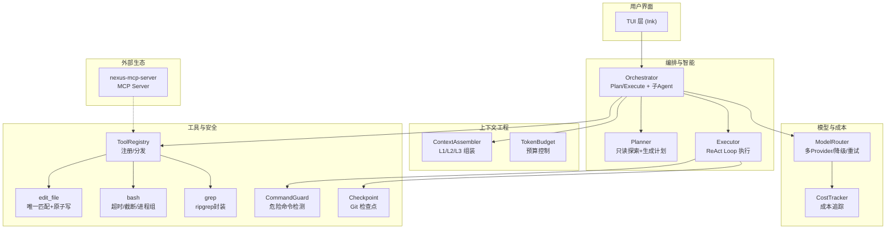
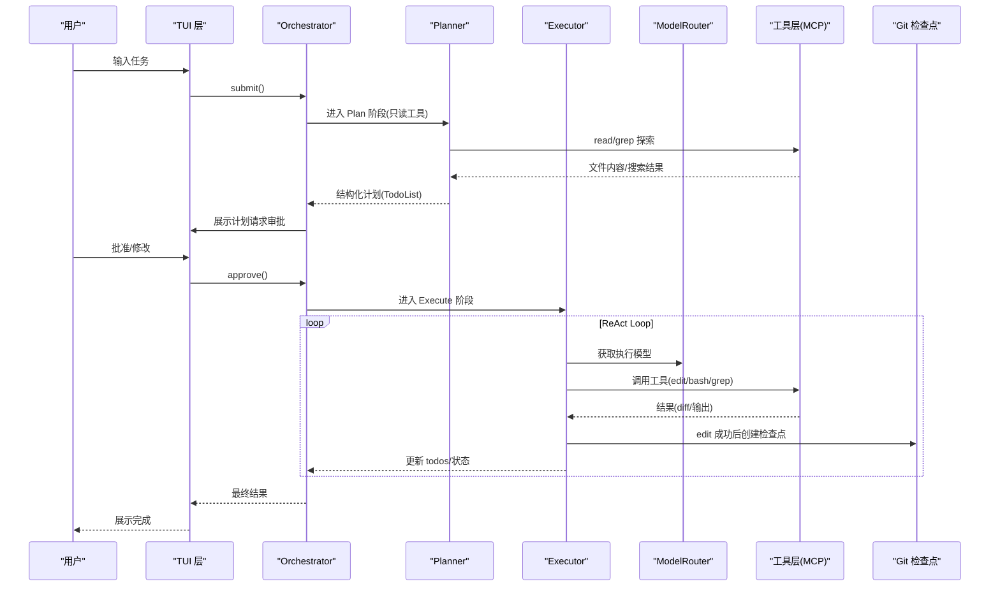
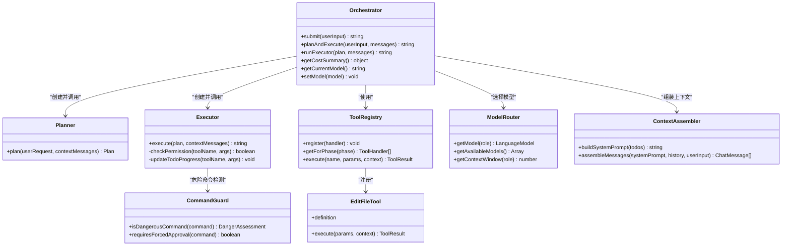
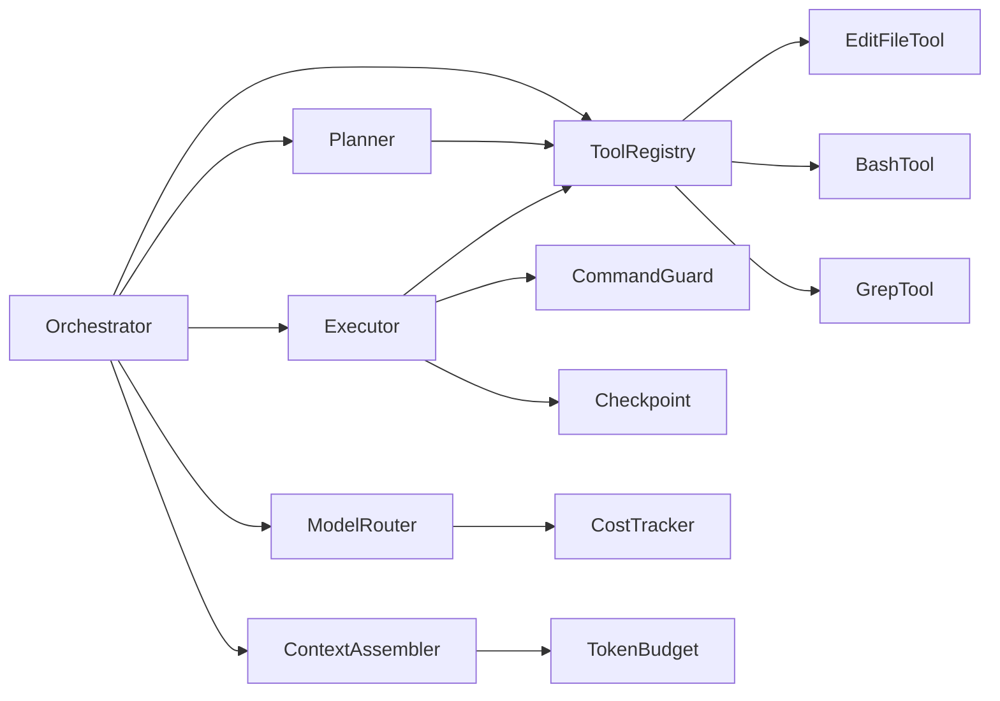

# 核心理念与设计原则

<cite>
**本文引用的文件**   
- [README.md](file://README.md)
- [DESIGN.md](file://DESIGN.md)
- [src/index.ts](file://src/index.ts)
- [src/config.ts](file://src/config.ts)
- [src/agent/Orchestrator.ts](file://src/agent/Orchestrator.ts)
- [src/agent/Planner.ts](file://src/agent/Planner.ts)
- [src/agent/Executor.ts](file://src/agent/Executor.ts)
- [src/context/Assembler.ts](file://src/context/Assembler.ts)
- [src/tools/registry.ts](file://src/tools/registry.ts)
- [src/tools/editFile.ts](file://src/tools/editFile.ts)
- [src/sandbox/CommandGuard.ts](file://src/sandbox/CommandGuard.ts)
- [src/router/ModelRouter.ts](file://src/router/ModelRouter.ts)
- [packages/nexus-mcp-server/src/index.ts](file://packages/nexus-mcp-server/src/index.ts)
</cite>

## 目录
1. [引言](#引言)
2. [项目结构](#项目结构)
3. [核心组件](#核心组件)
4. [架构总览](#架构总览)
5. [详细组件分析](#详细组件分析)
6. [依赖分析](#依赖分析)
7. [性能考量](#性能考量)
8. [故障排查指南](#故障排查指南)
9. [结论](#结论)
10. [附录](#附录)

## 引言
Nexus 的三大核心理念为“上下文为王、工具为先、人在环中”。这些理念贯穿从系统架构到交互体验的每个决策：以高质量上下文驱动 LLM 推理，以可靠且最小化的工具集保障执行质量，并以审批机制确保关键操作始终受人类监督。本文件将深入解释这三大理念的含义与实现方式，阐述设计哲学如何指导架构选择（如 Plan/Execute 双阶段、MCP 协议、审批机制），并说明其对用户体验、安全性与可扩展性的影响。同时提供具体代码路径，展示这些原则在真实实现中的体现。

## 项目结构
Nexus 采用分层与模块化组织：TUI 层负责流式交互；Agent 编排层实现 Plan/Execute 双阶段与子 Agent 分派；模型路由层在多 Provider 间动态选择；上下文工程层负责三层上下文组装与压缩；工具层基于 MCP 协议暴露 read/edit/bash/grep 等能力；沙箱与安全模块提供危险命令检测与 Git 检查点。

图表来源
- [src/index.ts:1-119](file://src/index.ts#L1-L119)
- [src/agent/Orchestrator.ts:1-260](file://src/agent/Orchestrator.ts#L1-L260)
- [src/agent/Planner.ts:1-176](file://src/agent/Planner.ts#L1-L176)
- [src/agent/Executor.ts:1-234](file://src/agent/Executor.ts#L1-L234)
- [src/context/Assembler.ts:1-184](file://src/context/Assembler.ts#L1-L184)
- [src/tools/registry.ts:1-96](file://src/tools/registry.ts#L1-L96)
- [src/tools/editFile.ts:1-170](file://src/tools/editFile.ts#L1-L170)
- [src/sandbox/CommandGuard.ts:1-98](file://src/sandbox/CommandGuard.ts#L1-L98)
- [src/router/ModelRouter.ts:1-308](file://src/router/ModelRouter.ts#L1-L308)
- [packages/nexus-mcp-server/src/index.ts:1-383](file://packages/nexus-mcp-server/src/index.ts#L1-L383)

章节来源
- [README.md:1-174](file://README.md#L1-L174)
- [DESIGN.md:54-114](file://DESIGN.md#L54-L114)

## 核心组件
- 入口与配置
  - 入口解析参数、加载配置、创建 Orchestrator、启动 TUI 或非交互模式，并将审批回调桥接到 UI。
  - 配置加载器合并默认值与 .nexus/config.toml，支持权限模式、迭代上限、上下文预算、检查点分支等。
- 编排与智能
  - Orchestrator 协调 Plan/Execute 双阶段、子 Agent 分派、检查点管理，并通过事件系统与 TUI 通信。
  - Planner 仅使用只读工具进行探索，输出结构化计划（TodoList）。
  - Executor 进入 ReAct Loop，逐步执行计划，每步可回滚，拒绝也作为观察反馈给 LLM。
- 上下文工程
  - ContextAssembler 构建 L1（静态）+ L2（任务）+ L3（检索）三层上下文，并在组装前进行 Token 预算裁剪。
- 工具与安全
  - ToolRegistry 统一注册、按阶段过滤、生成 AI SDK 兼容定义并执行工具。
  - edit_file 强制 old_string 唯一匹配、原子写入、保留 BOM/行尾风格。
  - bash 具备超时、输出截断、工作目录锁定与危险命令检测。
  - CommandGuard 提供黑名单与启发式规则，危险命令无论权限模式都强制审批。
- 模型路由
  - ModelRouter 抽象多 Provider，按角色选择模型，支持降级链、自动选择最佳可用模型、成本追踪。
- MCP 生态
  - nexus-mcp-server 独立暴露 read/edit/bash/grep 为 MCP Server，供 IDE/Claude Desktop 等挂载。

章节来源
- [src/index.ts:1-119](file://src/index.ts#L1-L119)
- [src/config.ts:1-132](file://src/config.ts#L1-L132)
- [src/agent/Orchestrator.ts:1-260](file://src/agent/Orchestrator.ts#L1-L260)
- [src/agent/Planner.ts:1-176](file://src/agent/Planner.ts#L1-L176)
- [src/agent/Executor.ts:1-234](file://src/agent/Executor.ts#L1-L234)
- [src/context/Assembler.ts:1-184](file://src/context/Assembler.ts#L1-L184)
- [src/tools/registry.ts:1-96](file://src/tools/registry.ts#L1-L96)
- [src/tools/editFile.ts:1-170](file://src/tools/editFile.ts#L1-L170)
- [src/sandbox/CommandGuard.ts:1-98](file://src/sandbox/CommandGuard.ts#L1-L98)
- [src/router/ModelRouter.ts:1-308](file://src/router/ModelRouter.ts#L1-L308)
- [packages/nexus-mcp-server/src/index.ts:1-383](file://packages/nexus-mcp-server/src/index.ts#L1-L383)

## 架构总览
Nexus 的架构围绕三大理念展开：
- 上下文为王：通过三层上下文与预算控制，确保 LLM 获得“正确且足够”的信息，避免整库灌入导致的 token 爆炸。
- 工具为先：以最小但可靠的工具集（read/edit/bash/grep）为核心，强调 edit 的唯一匹配与原子写、bash 的安全边界与资源限制。
- 人在环中：Plan 阶段产出计划需用户批准；Execute 阶段对写操作与危险命令实施审批策略，拒绝也被视为有效观察。

图表来源
- [src/index.ts:1-119](file://src/index.ts#L1-L119)
- [src/agent/Orchestrator.ts:1-260](file://src/agent/Orchestrator.ts#L1-L260)
- [src/agent/Planner.ts:1-176](file://src/agent/Planner.ts#L1-L176)
- [src/agent/Executor.ts:1-234](file://src/agent/Executor.ts#L1-L234)
- [src/router/ModelRouter.ts:1-308](file://src/router/ModelRouter.ts#L1-L308)
- [packages/nexus-mcp-server/src/index.ts:1-383](file://packages/nexus-mcp-server/src/index.ts#L1-L383)

## 详细组件分析

### 理念一：上下文为王（Context is King）
- 含义
  - “喂什么决定它聪不聪明”。Nexus 通过三层上下文（L1 静态、L2 任务、L3 检索）与 Token 预算控制，确保每次调用都携带最相关的信息，避免整库注入导致窗口爆掉或注意力分散。
- 实现要点
  - 三层上下文组装：system prompt、项目规则、git 状态、项目骨架树（L1）；当前轮次与历史摘要（L2）；按需拉取 grep/read 结果（L3）。
  - 历史压缩与分级保留：近期完整保留，早期摘要；工具结果分级丢弃（成功 bash 仅保留摘要，失败 bash 完整保留）。
  - Token 预算管理：组装前估算 token，超预算按优先级裁剪（L3 → 旧 L2 → L1 的部分）。
- 对体验与安全的影响
  - 长会话稳定不爆窗口，减少幻觉与误判；错误信息完整保留便于调试；结构化规则注入提升一致性。
- 代码示例路径
  - 上下文组装与预算：[src/context/Assembler.ts:1-184](file://src/context/Assembler.ts#L1-L184)
  - 配置项（预算比例、最近轮次保留）：[src/config.ts:1-132](file://src/config.ts#L1-L132)
  - 设计文档中的三层上下文与压缩策略：[DESIGN.md:284-366](file://DESIGN.md#L284-L366)

章节来源
- [src/context/Assembler.ts:1-184](file://src/context/Assembler.ts#L1-L184)
- [src/config.ts:1-132](file://src/config.ts#L1-L132)
- [DESIGN.md:284-366](file://DESIGN.md#L284-L366)

### 理念二：工具为先（Tools First）
- 含义
  - 工具可靠性优先于覆盖面。四个核心工具覆盖 90% 编程任务，每个都经过严格安全与健壮性设计。
- 实现要点
  - edit_file：强制 old_string 唯一匹配、原子写入、保留 BOM/行尾风格、返回 diff 以便 LLM 理解变更。
  - bash：超时、输出大小上限、工作目录锁定、进程组管理与危险命令拦截。
  - grep：封装 ripgrep，支持正则、文件过滤与上下文行。
  - 工具注册与阶段隔离：Plan 阶段仅暴露只读工具，Execute 阶段解锁读写工具。
- 对体验与安全的影响
  - 编辑更稳健，降低“幻觉覆盖错文件”的风险；bash 安全边界防止破坏性操作；阶段隔离避免过早写操作。
- 代码示例路径
  - 工具注册与阶段过滤：[src/tools/registry.ts:1-96](file://src/tools/registry.ts#L1-L96)
  - edit_file 唯一匹配与原子写：[src/tools/editFile.ts:1-170](file://src/tools/editFile.ts#L1-L170)
  - 危险命令检测与强制审批：[src/sandbox/CommandGuard.ts:1-98](file://src/sandbox/CommandGuard.ts#L1-L98)
  - MCP Server 工具实现（read/edit/bash/grep）：[packages/nexus-mcp-server/src/index.ts:1-383](file://packages/nexus-mcp-server/src/index.ts#L1-L383)
  - 设计文档中 edit 可靠性设计与 bash 安全设计：[DESIGN.md:240-281](file://DESIGN.md#L240-L281)

章节来源
- [src/tools/registry.ts:1-96](file://src/tools/registry.ts#L1-L96)
- [src/tools/editFile.ts:1-170](file://src/tools/editFile.ts#L1-L170)
- [src/sandbox/CommandGuard.ts:1-98](file://src/sandbox/CommandGuard.ts#L1-L98)
- [packages/nexus-mcp-server/src/index.ts:1-383](file://packages/nexus-mcp-server/src/index.ts#L1-L383)
- [DESIGN.md:240-281](file://DESIGN.md#L240-L281)

### 理念三：人在环中（Human-in-the-Loop）
- 含义
  - 关键决策点必须经人类批准，但不应频繁打扰。危险操作必审批，安全操作可自动跑；拒绝也被视为有效观察，引导 agent 改道。
- 实现要点
  - Plan 阶段输出计划后请求审批，拒绝则提示重新描述需求。
  - Execute 阶段根据权限模式（ask/auto-edit/auto-all/yolo）与危险命令检测决定是否审批；拒绝时注入“用户拒绝”的结果消息，让 LLM 调整策略。
  - Git 检查点：每次 edit 成功后自动提交，支持 /undo 一键回滚。
- 对体验与安全的影响
  - 用户掌控感强，信任度提升；危险命令不可绕过；可回滚降低试错成本。
- 代码示例路径
  - Orchestrator 计划审批与执行流程：[src/agent/Orchestrator.ts:1-260](file://src/agent/Orchestrator.ts#L1-L260)
  - Executor 权限检查与拒绝处理：[src/agent/Executor.ts:1-234](file://src/agent/Executor.ts#L1-L234)
  - 入口审批回调桥接：[src/index.ts:1-119](file://src/index.ts#L1-L119)
  - 设计文档中审批策略与 Git 检查点：[DESIGN.md:461-485](file://DESIGN.md#L461-L485)

章节来源
- [src/agent/Orchestrator.ts:1-260](file://src/agent/Orchestrator.ts#L1-L260)
- [src/agent/Executor.ts:1-234](file://src/agent/Executor.ts#L1-L234)
- [src/index.ts:1-119](file://src/index.ts#L1-L119)
- [DESIGN.md:461-485](file://DESIGN.md#L461-L485)

### 为什么选择 Plan/Execute 双阶段模式
- 原因
  - 单 loop 在大任务上容易“边想边写”，方向错了也不舍得删，导致乱改。双阶段强制先探索与规划，再执行，显著降低大任务翻车概率。
- 实现
  - Plan 阶段仅允许只读工具（read/grep），输出结构化 TodoList；Execute 阶段解锁写工具，每步可回滚。
- 代码示例路径
  - 双阶段流程与审批：[src/agent/Orchestrator.ts:120-148](file://src/agent/Orchestrator.ts#L120-L148)
  - Planner 只读探索与 JSON 计划解析：[src/agent/Planner.ts:1-176](file://src/agent/Planner.ts#L1-L176)
  - Executor ReAct Loop 与 todo 进度：[src/agent/Executor.ts:50-165](file://src/agent/Executor.ts#L50-L165)
  - 设计文档中双阶段动机与流程图：[DESIGN.md:122-143](file://DESIGN.md#L122-L143)

章节来源
- [src/agent/Orchestrator.ts:120-148](file://src/agent/Orchestrator.ts#L120-L148)
- [src/agent/Planner.ts:1-176](file://src/agent/Planner.ts#L1-L176)
- [src/agent/Executor.ts:50-165](file://src/agent/Executor.ts#L50-L165)
- [DESIGN.md:122-143](file://DESIGN.md#L122-L143)

### 为什么采用 MCP 协议
- 原因
  - 免费接入生态（社区大量 MCP Server）、反向被挂载（IDE/Claude Desktop 可直接调用 Nexus 工具）、未来抽离零成本（将某个工具迁移到 Go 后端只需更换 transport）。
- 实现
  - 内部工具通过 in-process transport 零开销调用；外部 MCP Server 通过 stdio JSON-RPC 接入。
- 代码示例路径
  - MCP Server 工具注册与实现：[packages/nexus-mcp-server/src/index.ts:1-383](file://packages/nexus-mcp-server/src/index.ts#L1-L383)
  - 设计文档中 MCP 选型理由与生态接入：[DESIGN.md:219-228](file://DESIGN.md#L219-L228)

章节来源
- [packages/nexus-mcp-server/src/index.ts:1-383](file://packages/nexus-mcp-server/src/index.ts#L1-L383)
- [DESIGN.md:219-228](file://DESIGN.md#L219-L228)

### 为什么强调审批机制
- 原因
  - 人在环中是底线，危险操作必须审批；拒绝也是观察，帮助 agent 学会改道而非抛异常。
- 实现
  - 权限模式（ask/auto-edit/auto-all/yolo）结合危险命令检测；拒绝时注入“用户拒绝”的消息；Git 检查点保证可回滚。
- 代码示例路径
  - 权限检查与拒绝处理：[src/agent/Executor.ts:167-196](file://src/agent/Executor.ts#L167-L196)
  - 危险命令检测：[src/sandbox/CommandGuard.ts:1-98](file://src/sandbox/CommandGuard.ts#L1-L98)
  - 设计文档中审批策略与 UX：[DESIGN.md:461-472](file://DESIGN.md#L461-L472)

章节来源
- [src/agent/Executor.ts:167-196](file://src/agent/Executor.ts#L167-L196)
- [src/sandbox/CommandGuard.ts:1-98](file://src/sandbox/CommandGuard.ts#L1-L98)
- [DESIGN.md:461-472](file://DESIGN.md#L461-L472)

### 代码级类图（核心编排与工具）

图表来源
- [src/agent/Orchestrator.ts:1-260](file://src/agent/Orchestrator.ts#L1-L260)
- [src/agent/Planner.ts:1-176](file://src/agent/Planner.ts#L1-L176)
- [src/agent/Executor.ts:1-234](file://src/agent/Executor.ts#L1-L234)
- [src/tools/registry.ts:1-96](file://src/tools/registry.ts#L1-L96)
- [src/tools/editFile.ts:1-170](file://src/tools/editFile.ts#L1-L170)
- [src/sandbox/CommandGuard.ts:1-98](file://src/sandbox/CommandGuard.ts#L1-L98)
- [src/router/ModelRouter.ts:1-308](file://src/router/ModelRouter.ts#L1-L308)
- [src/context/Assembler.ts:1-184](file://src/context/Assembler.ts#L1-L184)

## 依赖分析
- 组件耦合与内聚
  - Orchestrator 高内聚地协调各子系统，低耦合地通过接口（事件、工具注册、模型路由）协作。
  - 工具层通过 ToolRegistry 解耦具体实现，便于扩展与替换（包括未来 Go 后端）。
- 直接/间接依赖
  - Planner/Executor 依赖 ToolRegistry 与 ModelRouter；Executor 依赖 CommandGuard 与 Checkpoint；Assembler 依赖 TokenBudget 与 Compressor。
- 外部依赖与集成点
  - Vercel AI SDK 抽象多 Provider；MCP SDK 提供双向 client/server 能力；ripgrep 用于 grep 工具。
- 潜在循环依赖
  - 当前结构无循环依赖；各层职责清晰，依赖方向自上而下。

图表来源
- [src/agent/Orchestrator.ts:1-260](file://src/agent/Orchestrator.ts#L1-L260)
- [src/agent/Planner.ts:1-176](file://src/agent/Planner.ts#L1-L176)
- [src/agent/Executor.ts:1-234](file://src/agent/Executor.ts#L1-L234)
- [src/tools/registry.ts:1-96](file://src/tools/registry.ts#L1-L96)
- [src/tools/editFile.ts:1-170](file://src/tools/editFile.ts#L1-L170)
- [src/sandbox/CommandGuard.ts:1-98](file://src/sandbox/CommandGuard.ts#L1-L98)
- [src/router/ModelRouter.ts:1-308](file://src/router/ModelRouter.ts#L1-L308)
- [src/context/Assembler.ts:1-184](file://src/context/Assembler.ts#L1-L184)

章节来源
- [DESIGN.md:54-114](file://DESIGN.md#L54-L114)

## 性能考量
- LLM 延迟主导：Agent loop 中最慢的是等待 LLM 返回 token，因此 MVP 阶段保持 TS 单体以降低 IPC 调试成本与分发复杂度。
- 工具优化：grep 使用 ripgrep 子进程，bash 设置超时与输出截断，避免长时间阻塞与大输出占用内存。
- 上下文压缩：历史摘要与工具结果分级保留，Token 预算控制，避免长会话爆窗口。
- 模型路由：不同阶段选用合适档位模型，平衡能力与成本；支持降级链提高可用性。

章节来源
- [DESIGN.md:87-114](file://DESIGN.md#L87-L114)
- [src/router/ModelRouter.ts:1-308](file://src/router/ModelRouter.ts#L1-L308)
- [src/context/Assembler.ts:1-184](file://src/context/Assembler.ts#L1-L184)

## 故障排查指南
- 常见错误与定位
  - 未知工具：ToolRegistry 未注册或名称拼写错误。
  - 文件不存在/匹配不唯一：edit_file 明确报错，建议重新 read_file 获取最新内容。
  - 危险命令被拒：CommandGuard 命中黑名单，需修改命令或走人工审批。
  - 模型不可用：ModelRouter 抛出 Provider 缺失或降级失败，检查 API Key 与 baseUrl。
- 调试建议
  - 启用非交互模式快速复现；查看 cost 与 todo 进度定位卡点；利用 /undo 回滚到最近检查点。
- 代码示例路径
  - 工具错误返回与诊断：[src/tools/registry.ts:70-82](file://src/tools/registry.ts#L70-L82)
  - edit_file 错误分支：[src/tools/editFile.ts:113-156](file://src/tools/editFile.ts#L113-L156)
  - 危险命令检测：[src/sandbox/CommandGuard.ts:71-98](file://src/sandbox/CommandGuard.ts#L71-L98)
  - 模型路由错误与降级：[src/router/ModelRouter.ts:205-243](file://src/router/ModelRouter.ts#L205-L243)

章节来源
- [src/tools/registry.ts:70-82](file://src/tools/registry.ts#L70-L82)
- [src/tools/editFile.ts:113-156](file://src/tools/editFile.ts#L113-L156)
- [src/sandbox/CommandGuard.ts:71-98](file://src/sandbox/CommandGuard.ts#L71-L98)
- [src/router/ModelRouter.ts:205-243](file://src/router/ModelRouter.ts#L205-L243)

## 结论
Nexus 的三大核心理念不仅定义了产品形态，也深刻影响了架构与实现：
- 上下文为王：通过三层上下文与预算控制，确保 LLM 高效、准确地进行推理。
- 工具为先：以最小但可靠的工具集为核心，强化 edit 的唯一匹配与原子写、bash 的安全边界。
- 人在环中：通过 Plan 审批、权限模式与危险命令强制审批，确保关键操作受人类监督，拒绝也被视为有效观察。

这些理念共同提升了用户体验（可控、可回滚、透明）、安全性（危险命令拦截、原子写、输出截断）与可扩展性（MCP 生态接入、未来 Go 后端平滑迁移）。

## 附录
- 快速开始与特性概览：[README.md:1-174](file://README.md#L1-L174)
- 设计哲学与 ADR 摘要：[DESIGN.md:21-52](file://DESIGN.md#L21-L52), [DESIGN.md:714-727](file://DESIGN.md#L714-L727)