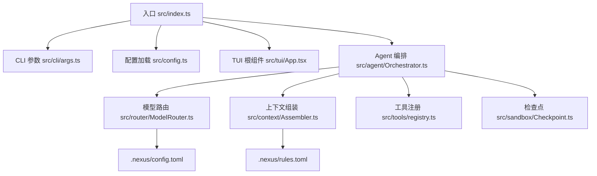
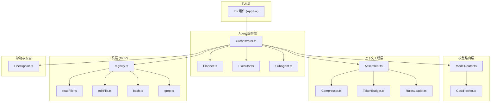
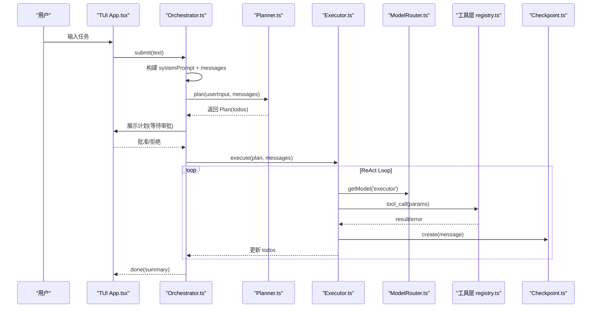
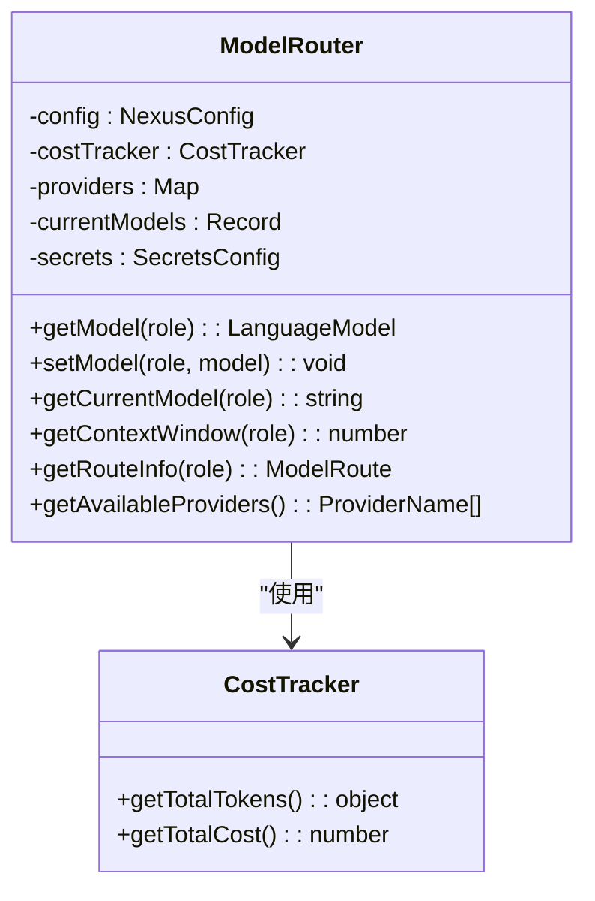
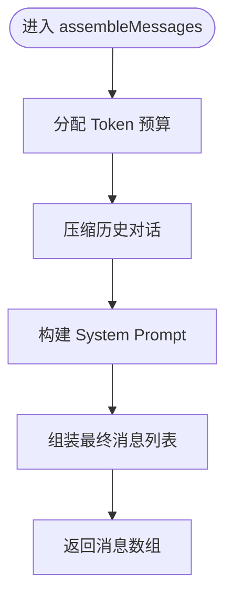
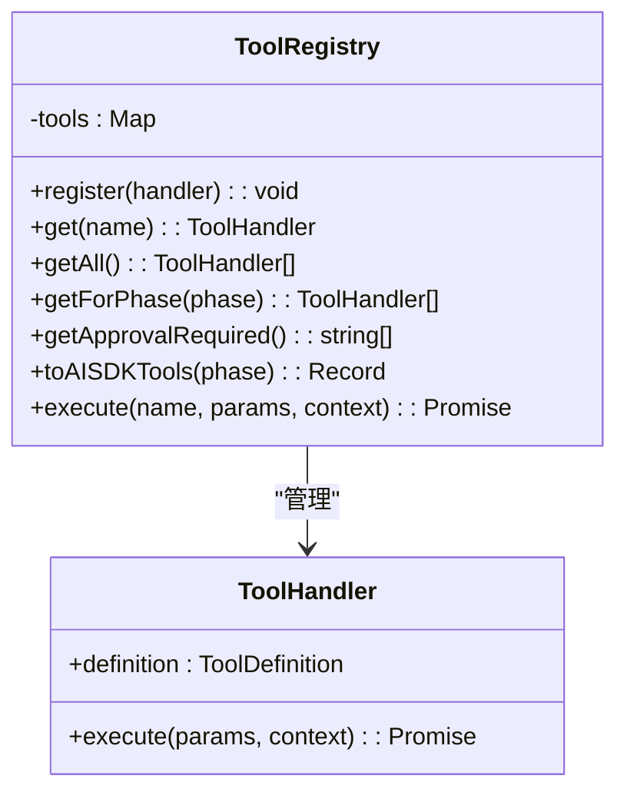
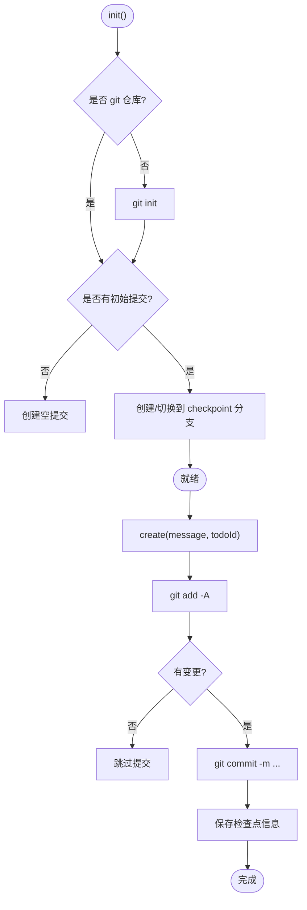
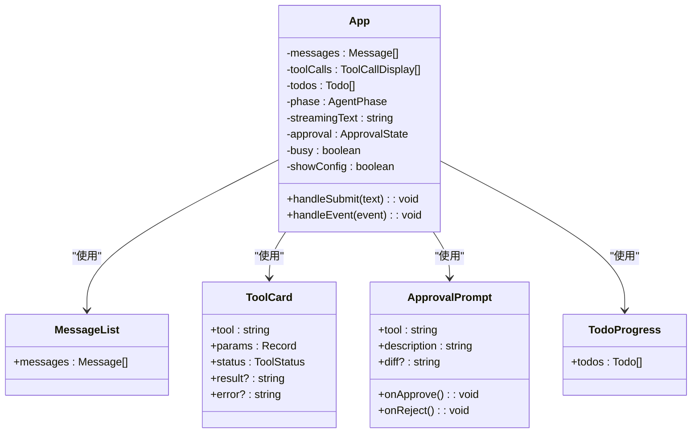
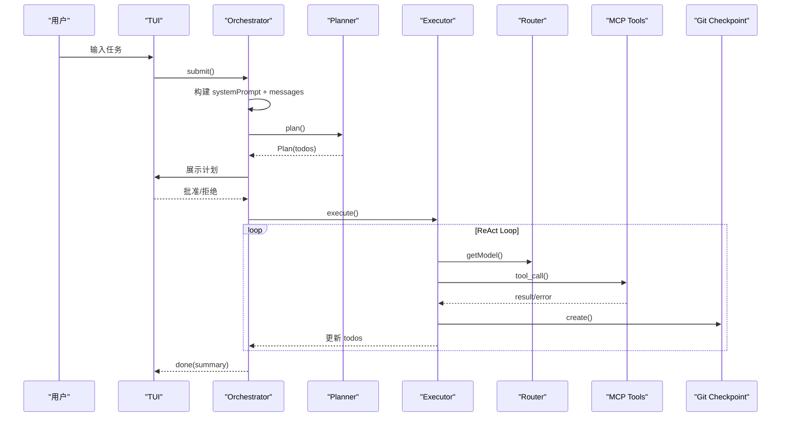
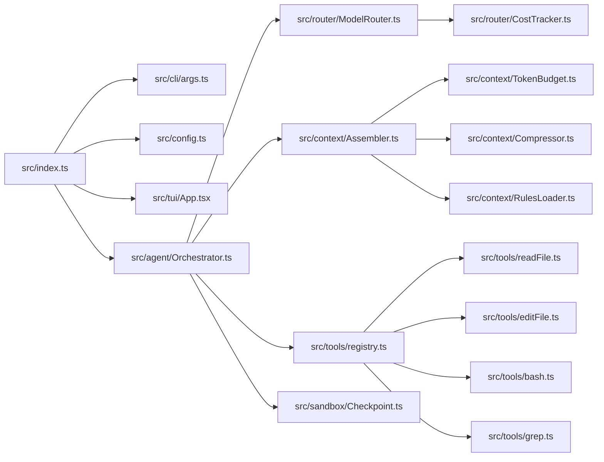

# 项目概述

<cite>
**本文引用的文件**   
- [README.md](file://README.md)
- [DESIGN.md](file://DESIGN.md)
- [package.json](file://package.json)
- [src/index.ts](file://src/index.ts)
- [src/agent/Orchestrator.ts](file://src/agent/Orchestrator.ts)
- [src/tui/App.tsx](file://src/tui/App.tsx)
- [src/config.ts](file://src/config.ts)
- [src/router/ModelRouter.ts](file://src/router/ModelRouter.ts)
- [src/context/Assembler.ts](file://src/context/Assembler.ts)
- [src/tools/registry.ts](file://src/tools/registry.ts)
- [src/sandbox/Checkpoint.ts](file://src/sandbox/Checkpoint.ts)
- [src/cli/args.ts](file://src/cli/args.ts)
- [.nexus/config.toml](file://.nexus/config.toml)
- [.nexus/rules.toml](file://.nexus/rules.toml)
</cite>

## 目录
1. [简介](#简介)
2. [项目结构](#项目结构)
3. [核心组件](#核心组件)
4. [架构总览](#架构总览)
5. [详细组件分析](#详细组件分析)
6. [依赖关系分析](#依赖关系分析)
7. [性能考量](#性能考量)
8. [故障排查指南](#故障排查指南)
9. [结论](#结论)
10. [附录：快速开始与使用示例](#附录快速开始与使用示例)

## 简介
Nexus 是一个面向生产级的终端 Coding Agent，核心理念为“上下文为王、工具为先、人在环中”。它通过流式 TUI 界面、Plan/Execute 双阶段执行、多模型路由、子 Agent 编排、Git Checkpoint 和上下文工程等技术，帮助开发者在终端中以自然语言驱动代码理解、规划、编辑、验证与回滚的完整闭环。

- 核心价值
  - 上下文为王：三层上下文组装（静态、任务、检索）+ 压缩策略，确保长会话不爆窗口。
  - 工具为先：MCP-native 工具层（read/edit/bash/grep），强调可靠性与可验证性。
  - 人在环中：关键决策点审批，危险命令强制确认，支持自动/半自动模式。

- 主要特性
  - 流式 TUI：基于 Ink（React for CLI）实时渲染消息、工具卡片、Diff 与进度条。
  - Plan/Execute 双阶段：先规划后执行，计划可修改与审批。
  - 多模型路由：按角色选择模型（planner/executor/summarizer/verifier），支持降级与重试。
  - 子 Agent 编排：复杂任务自动拆解为子任务并行执行，独立上下文与权限控制。
  - Git Checkpoint：每次编辑自动提交，一键回滚到任意步骤。
  - 上下文工程：代码图谱 + 语义检索（v1.1）、Token 预算与历史压缩。
  - 成本追踪：实时统计 token 消耗与估算花费。

**章节来源**
- [README.md:1-174](file://README.md#L1-L174)
- [DESIGN.md:1-774](file://DESIGN.md#L1-L774)

## 项目结构
Nexus 采用 TypeScript + Bun 单体起步，模块按职责分层组织：
- 入口与 CLI：解析参数、加载配置、启动 TUI 或非交互模式。
- Agent 编排：Orchestrator 协调 Plan/Execute、子 Agent、检查点。
- 模型路由：Provider 适配、成本追踪、降级与重试。
- 上下文工程：系统提示、规则注入、历史压缩、Token 预算。
- 工具层：MCP 注册中心与内置工具（read/edit/bash/grep）。
- 沙箱与安全：危险命令检测、Git Checkpoint。
- TUI 界面：Ink 组件化 UI，流式输出、审批面板、进度展示。

**图表来源**
- [src/index.ts:1-118](file://src/index.ts#L1-L118)
- [src/cli/args.ts:1-129](file://src/cli/args.ts#L1-L129)
- [src/config.ts:1-132](file://src/config.ts#L1-L132)
- [src/tui/App.tsx:1-284](file://src/tui/App.tsx#L1-L284)
- [src/agent/Orchestrator.ts:1-255](file://src/agent/Orchestrator.ts#L1-L255)
- [src/router/ModelRouter.ts:1-290](file://src/router/ModelRouter.ts#L1-L290)
- [src/context/Assembler.ts:1-184](file://src/context/Assembler.ts#L1-L184)
- [src/tools/registry.ts:1-96](file://src/tools/registry.ts#L1-L96)
- [src/sandbox/Checkpoint.ts:1-182](file://src/sandbox/Checkpoint.ts#L1-L182)
- [.nexus/config.toml:1-62](file://.nexus/config.toml#L1-L62)
- [.nexus/rules.toml:1-21](file://.nexus/rules.toml#L1-L21)

**章节来源**
- [package.json:1-43](file://package.json#L1-L43)
- [DESIGN.md:575-638](file://DESIGN.md#L575-L638)

## 核心组件
- Orchestrator（编排器）
  - 负责 Plan/Execute 双阶段、子 Agent 分派、检查点管理、事件派发。
  - 初始化时加载 secrets、规则、构建上下文组装器与 Token 预算。
  - 提供 submit、undo、clearContext、getHistory 等能力。
- ModelRouter（模型路由）
  - 维护 MODEL_CATALOG 与 FALLBACK_CHAIN，按角色选择模型并支持降级。
  - 初始化各 Provider（Anthropic/OpenAI/Ollama/DeepSeek/Custom），统一调用。
- ContextAssembler（上下文组装）
  - 构建 system prompt（含规则、工具说明、Git 状态、项目骨架树、Todos）。
  - 组装消息列表并进行历史压缩与 Token 预算裁剪。
- ToolRegistry（工具注册）
  - 注册内置工具（read_file/edit_file/bash/grep），按阶段过滤与生成 AI SDK 兼容定义。
- CheckpointManager（检查点）
  - 自动创建 git 分支与提交，记录变更文件与步骤，支持 undo/jumpTo/merge。
- TUI App（终端界面）
  - 流式渲染 LLM 输出、工具卡片、审批面板、Todo 进度、输入框与斜杠命令。

**章节来源**
- [src/agent/Orchestrator.ts:1-255](file://src/agent/Orchestrator.ts#L1-L255)
- [src/router/ModelRouter.ts:1-290](file://src/router/ModelRouter.ts#L1-L290)
- [src/context/Assembler.ts:1-184](file://src/context/Assembler.ts#L1-L184)
- [src/tools/registry.ts:1-96](file://src/tools/registry.ts#L1-L96)
- [src/sandbox/Checkpoint.ts:1-182](file://src/sandbox/Checkpoint.ts#L1-L182)
- [src/tui/App.tsx:1-284](file://src/tui/App.tsx#L1-L284)

## 架构总览
Nexus 的分层架构清晰解耦，便于扩展与迁移：
- TUI 层：Ink 组件化界面，流式渲染与审批交互。
- Agent 编排层：Plan/Execute 双阶段、ReAct Loop、子 Agent 分派、检查点。
- 模型路由层：Provider 抽象、成本追踪、降级与重试。
- 上下文工程层：代码图谱、语义检索、压缩策略、Token 预算。
- 工具层：MCP-native 工具，未来可平滑迁移至 Go 引擎。

**图表来源**
- [src/tui/App.tsx:1-284](file://src/tui/App.tsx#L1-L284)
- [src/agent/Orchestrator.ts:1-255](file://src/agent/Orchestrator.ts#L1-L255)
- [src/router/ModelRouter.ts:1-290](file://src/router/ModelRouter.ts#L1-L290)
- [src/context/Assembler.ts:1-184](file://src/context/Assembler.ts#L1-L184)
- [src/tools/registry.ts:1-96](file://src/tools/registry.ts#L1-L96)
- [src/sandbox/Checkpoint.ts:1-182](file://src/sandbox/Checkpoint.ts#L1-L182)

## 详细组件分析

### Orchestrator（编排器）
- 职责
  - 协调 Plan 与 Execute 两阶段；处理用户输入、事件派发、历史与 Todos 管理。
  - 初始化上下文组装器、模型路由、检查点管理器。
  - 支持中断、回滚、切换模型、清除上下文、获取历史摘要。
- 关键流程
  - submit → 构建 systemPrompt 与 messages → planAndExecute 或 executeDirectly → runExecutor。
  - Executor 内部 ReAct Loop：tool_call → 权限检查 → 执行工具 → 结果喂回 LLM → 更新 todos。
- 设计要点
  - Plan 阶段只允许读工具（read/grep），Execute 阶段解锁写工具（edit/bash）。
  - 拒绝也是观察：用户拒绝作为 tool_result 反馈给 LLM，引导改道。
  - TodoList 持久化与迭代上限保护。

**图表来源**
- [src/agent/Orchestrator.ts:1-255](file://src/agent/Orchestrator.ts#L1-L255)
- [src/tui/App.tsx:1-284](file://src/tui/App.tsx#L1-L284)
- [src/router/ModelRouter.ts:1-290](file://src/router/ModelRouter.ts#L1-L290)
- [src/tools/registry.ts:1-96](file://src/tools/registry.ts#L1-L96)
- [src/sandbox/Checkpoint.ts:1-182](file://src/sandbox/Checkpoint.ts#L1-L182)

**章节来源**
- [src/agent/Orchestrator.ts:1-255](file://src/agent/Orchestrator.ts#L1-L255)

### ModelRouter（模型路由）
- 职责
  - 维护已知模型目录（MODEL_CATALOG）与降级链（FALLBACK_CHAIN）。
  - 初始化各 Provider（Anthropic/OpenAI/Ollama/DeepSeek/Custom），按角色选择模型。
  - 提供 getModel、setModel、getContextWindow、getRouteInfo 等方法。
- 路由策略
  - planner/executor 使用高档模型，summarizer/verifier 使用低档模型。
  - auto 模式根据可用 provider 优先级选择最佳模型。
  - 降级链：claude-sonnet-4-20250514 → deepseek-chat → gpt-4o-mini → claude-haiku-3-5。

**图表来源**
- [src/router/ModelRouter.ts:1-290](file://src/router/ModelRouter.ts#L1-L290)

**章节来源**
- [src/router/ModelRouter.ts:1-290](file://src/router/ModelRouter.ts#L1-L290)

### ContextAssembler（上下文组装）
- 职责
  - 构建 system prompt（包含角色、工具说明、规则、Git 状态、项目骨架树、Todos）。
  - 组装消息列表并进行历史压缩与 Token 预算裁剪。
- 压缩策略
  - 近期完整保留、早期摘要、工具结果分级、Token 预算管理。
- 项目规则注入
  - 从 .nexus/rules.toml 加载结构化规则，程序化校验与注入。

**图表来源**
- [src/context/Assembler.ts:1-184](file://src/context/Assembler.ts#L1-L184)

**章节来源**
- [src/context/Assembler.ts:1-184](file://src/context/Assembler.ts#L1-L184)

### ToolRegistry（工具注册）
- 职责
  - 注册内置工具（read_file/edit_file/bash/grep），按阶段过滤与生成 AI SDK 兼容定义。
  - 执行工具调用并返回标准化结果。
- 阶段限制
  - plan 阶段仅允许 read/grep，execute 阶段解锁 edit/bash。
- 审批要求
  - 标记需要审批的工具名列表，供上层进行权限控制。

**图表来源**
- [src/tools/registry.ts:1-96](file://src/tools/registry.ts#L1-L96)

**章节来源**
- [src/tools/registry.ts:1-96](file://src/tools/registry.ts#L1-L96)

### CheckpointManager（检查点）
- 职责
  - 初始化 git 仓库与 checkpoint 分支，自动提交每次编辑。
  - 支持 undo、jumpTo、mergeToWorkBranch 等操作。
- 设计要点
  - 每个 edit 后自动 commit，记录变更文件与步骤号。
  - 无变更时跳过提交，避免冗余提交。

**图表来源**
- [src/sandbox/Checkpoint.ts:1-182](file://src/sandbox/Checkpoint.ts#L1-L182)

**章节来源**
- [src/sandbox/Checkpoint.ts:1-182](file://src/sandbox/Checkpoint.ts#L1-L182)

### TUI App（终端界面）
- 职责
  - 整合消息列表、工具卡片、审批面板、Todo 进度、输入框与斜杠命令。
  - 流式渲染 LLM 输出，处理用户输入与事件分发。
- 交互设计
  - 流式打字机、工具调用卡片、Diff 内联高亮、审批三选项（批准/拒绝/查看 diff）。
  - 进度条、中断与撤销、斜杠命令（/model /cost /clear /undo /history /help）。

**图表来源**
- [src/tui/App.tsx:1-284](file://src/tui/App.tsx#L1-L284)

**章节来源**
- [src/tui/App.tsx:1-284](file://src/tui/App.tsx#L1-L284)

### 概念总览
- 一次完整任务的时序包括：用户输入 → TUI 提交 → Orchestrator 构建上下文 → Plan 阶段生成计划 → 用户审批 → Execute 阶段 ReAct Loop → 工具调用与审批 → Git Checkpoint → 最终结果展示。
- 该流程体现了“上下文为王、工具为先、人在环中”的设计理念。

[本图为概念性流程图，不直接映射具体源码文件]

## 依赖关系分析
- 入口依赖 CLI 参数解析与配置加载，随后启动 TUI 或进入非交互模式。
- Orchestrator 依赖 ModelRouter、ContextAssembler、ToolRegistry、CheckpointManager。
- ModelRouter 依赖 CostTracker 与各 Provider SDK。
- ContextAssembler 依赖 TokenBudget、Compressor、RulesLoader。
- ToolRegistry 依赖内置工具实现（read/edit/bash/grep）。
- CheckpointManager 依赖 git 命令执行。

**图表来源**
- [src/index.ts:1-118](file://src/index.ts#L1-L118)
- [src/cli/args.ts:1-129](file://src/cli/args.ts#L1-L129)
- [src/config.ts:1-132](file://src/config.ts#L1-L132)
- [src/tui/App.tsx:1-284](file://src/tui/App.tsx#L1-L284)
- [src/agent/Orchestrator.ts:1-255](file://src/agent/Orchestrator.ts#L1-L255)
- [src/router/ModelRouter.ts:1-290](file://src/router/ModelRouter.ts#L1-L290)
- [src/context/Assembler.ts:1-184](file://src/context/Assembler.ts#L1-L184)
- [src/tools/registry.ts:1-96](file://src/tools/registry.ts#L1-L96)
- [src/sandbox/Checkpoint.ts:1-182](file://src/sandbox/Checkpoint.ts#L1-L182)

**章节来源**
- [package.json:1-43](file://package.json#L1-L43)

## 性能考量
- LLM 延迟主导：Agent Loop 中最慢的是等待 LLM 返回 token，Go 引擎仅在必要时引入。
- IPC 调试成本：跨进程 JSON-RPC 增加调试复杂度，MVP 阶段优先单体内联。
- 分发复杂度：多平台二进制与 postinstall 下载影响首次安装体验。
- MCP 解耦：工具层接口稳定，未来抽离至 Go 引擎对 Agent Loop 零改动。
- 触发信号：真沙箱需求、常驻后台索引、实测 P95 延迟瓶颈。

[本节为通用指导，不直接分析具体文件]

## 故障排查指南
- 流式 + tool calling 边界：不同 Provider 流式返回 tool_call 方式不同，需早期用真实 Provider 测试透。
- Ink 全屏 vs 行模式：审批卡片需全屏交互，流式输出适合行模式，混用需谨慎。
- Windows 路径与换行符：内部统一 POSIX，出口再转换；bash 工具锁定 Git Bash。
- 大文件读取消耗：read_file 默认截断，提示使用 grep 查询具体内容。
- 僵尸进程：bash 超时后 kill 不干净，需用进程组 kill（Windows 用 taskkill /T）。
- MCP SDK 版本动荡：锁定版本，升级时跑 eval。
- 成本失控：auto-all 模式下设置每会话成本上限，超了暂停询问用户。
- Eval 不能只数通过率：看 diff 干净度与无关文件修改。

**章节来源**
- [DESIGN.md:729-746](file://DESIGN.md#L729-L746)

## 结论
Nexus 以“上下文为王、工具为先、人在环中”为核心设计理念，通过流式 TUI、Plan/Execute 双阶段、多模型路由、子 Agent 编排、Git Checkpoint 与上下文工程，构建了生产级终端 Coding Agent 的完整闭环。其模块化架构与 MCP 原生工具层为未来扩展与迁移提供了坚实基础。

[本节为总结性内容，不直接分析具体文件]

## 附录：快速开始与使用示例
- 前置要求
  - Bun >= 1.1.0
  - ripgrep（grep 工具依赖）
  - Git
- 安装
  - bun install
- 配置
  - 设置 API Key 环境变量（ANTHROPIC_API_KEY、OPENAI_API_KEY、DEEPSEEK_API_KEY、CUSTOM_API_KEY + CUSTOM_BASE_URL + CUSTOM_DEFAULT_MODEL）。
  - 项目级配置在 .nexus/config.toml，项目约定在 .nexus/rules.toml。
- 运行
  - 交互式会话：bun run start
  - 带初始任务：bun run start "重构 utils 模块"
  - 指定模型：bun run start -m gpt-4o "修复登录 bug"
  - 自动批准编辑：bun run start --permission auto-edit "添加单元测试"
  - 非交互模式：bun run start --non-interactive "运行测试并修复失败的用例"
- 权限模式
  - ask：每个写操作都问（默认）
  - auto-edit：edit 自动批准，bash 仍问
  - auto-all：全部自动（危险命令仍强制问）
  - yolo：全部自动，含危险命令（自负责任）
- 斜杠命令
  - /model：查看或切换模型
  - /cost：查看本次会话花费
  - /clear：清除当前上下文
  - /undo：回滚到上一个检查点
  - /history：查看会话历史
  - /help：显示可用命令

**章节来源**
- [README.md:18-133](file://README.md#L18-L133)
- [.nexus/config.toml:1-62](file://.nexus/config.toml#L1-L62)
- [.nexus/rules.toml:1-21](file://.nexus/rules.toml#L1-L21)
- [src/cli/args.ts:33-56](file://src/cli/args.ts#L33-L56)