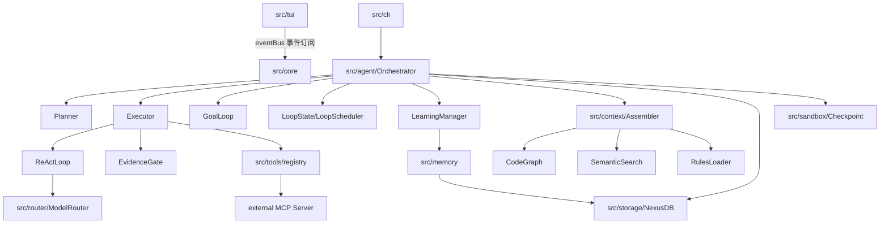
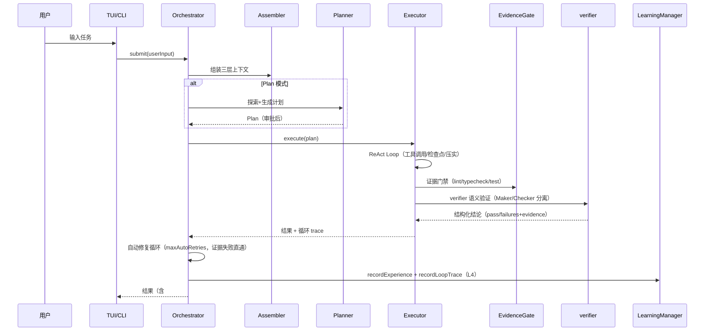

# Nexus 项目详解（PROJECT_DETAILS）

> 基于当前代码库真实状态逐文件核对的完整项目文档（核对日期：2026-08-09）。
> 与 [PROJECT_OVERVIEW.md](PROJECT_OVERVIEW.md)（概览版）互补；与 [DESIGN.md](DESIGN.md)（设计契约）存在出入处以**当前代码为准**并在文中标注。
> 所有路径均相对于仓库根目录 `d:\Project\Nexus`。

---

## 目录（TOC）

1. [项目概览](#1-项目概览)
2. [技术栈与依赖](#2-技术栈与依赖)
3. [项目结构](#3-项目结构)
4. [系统架构](#4-系统架构)
5. [模块间连接方式](#5-模块间连接方式)
6. [核心工作流](#6-核心工作流)
7. [数据与持久化](#7-数据与持久化)
8. [配置系统](#8-配置系统)
9. [测试体系](#9-测试体系)
10. [引用关系图](#10-引用关系图)

---

## 1. 项目概览

**Nexus** 是一个运行在终端的 AI 编程助手（CLI Coding Agent），用自然语言驱动"理解代码库 → 规划 → 读文件 → 改文件 → 跑测试 → 自我验证 → 交付"的完整闭环。核心理念：**上下文为王、工具为先、人在环中**。

### 核心能力

| 能力 | 说明 |
|------|------|
| Plan/Execute/Verify 双阶段 | 先探索制定计划 → 审批 → 逐步执行 → 独立验证 → 修复循环 |
| Loop Engineering 四层循环 | L1 ReAct 执行 → L2 证据门禁验证 → L3 事件驱动（/goal /loop /loops）→ L4 trace 驱动自改进 |
| 多模型路由 | Anthropic / OpenAI / DeepSeek / 任意 OpenAI 兼容端点；角色路由 + 降级链 + 成本追踪 |
| 上下文工程 | 三层组装（L1 静态 / L2 任务 / L3 检索）+ Token 预算 + 分级压缩 + 代码图谱 + 语义检索 |
| 多智能体协作 | 内置 4 引擎（explorer/coder/reviewer/researcher）× 3 拓扑（Supervisor/Fan-out/Pipeline）+ worktree 隔离 |
| 记忆与学习 | 经验 → 教训 → 技能三级沉淀；教训检索注入上下文；L4 循环 trace 聚类反哺 |
| 安全可控 | 四档权限模式 + CommandGuard 危险命令拦截 + Git Checkpoint 回滚 + SSRF/路径防护 |
| 外部扩展 | MCP Server 接入（stdin/stdout）+ 独立 MCP Server 发布（packages/nexus-mcp-server） |
| 评估引擎 | TOML 任务定义 + Mock/Real 双模式 + 6 种验证规则 + CI 回归门 |

### 设计理念（与 DESIGN.md §1.2 一致）

1. 上下文质量 > 工具数量；2. 工具可靠性 > 工具覆盖面；3. 可验证 > 可执行；4. 人在环中但别烦人；5. 可回滚 > 不会错。

> **与 DESIGN.md 的差异**：DESIGN.md 标注工具数量/架构为 v0.1 设计期状态；当前实际工具约 24 个、已实现 L1-L4 完整循环，DESIGN 中的 "Go 引擎 v2" 仍为规划（见 §10 与 ROADMAP.md）。

**相关文件**：`README.md`（使用手册）、`docs/DESIGN.md`（设计契约）、`docs/ROADMAP.md`（演进路线）

---

## 2. 技术栈与依赖

### 运行时与语言

| 项 | 版本/说明 |
|---|---|
| 运行时 | [Bun](https://bun.sh) >= 1.1.0（唯一支持，不兼容 Node.js；`engines.bun` 声明） |
| 语言 | TypeScript（strict 模式，`src/types/bun-test.d.ts` 提供测试类型） |
| 模块系统 | ESM（`"type": "module"`） |

### 依赖（`package.json` 精确版本）

**dependencies**

| 包 | 版本 | 用途 |
|---|---|---|
| `ai` | 6.0.246 | Vercel AI SDK（v6，`streamText`/`generateText`） |
| `@ai-sdk/anthropic` | 3.0.107 | Claude provider |
| `@ai-sdk/openai` | 3.0.91 | OpenAI/DeepSeek/兼容端点 provider（`.chat()` 路由） |
| `@modelcontextprotocol/sdk` | ^1.12.0 | 外部 MCP Server 接入 + nexus-mcp-server 发布 |
| `@xenova/transformers` | ^2.17.2 | 本地 embedding（语义检索） |
| `chalk` | ^5.4.1 | 终端着色 |
| `diff` | ^7.0.0 | Diff 生成（审批预览） |
| `ink` | ^5.2.0 | React 终端渲染（TUI） |
| `react` | ^18.3.1 | TUI 组件模型 |
| `smol-toml` | ^1.3.1 | TOML 解析（config/agents/loops/rules） |
| `tree-sitter-wasm` | ^1.1.2 | WASM grammar 资源 |
| `web-tree-sitter` | ^0.26.11 | AST 解析（多语言代码骨架） |
| `zod` | 4.4.3 | 工具参数校验 |

**devDependencies**：`@biomejs/biome` ^2.5.6（lint/format）、`@types/diff` ^7.0.0、`@types/node` ^26.1.1、`@types/react` ^18.3.18、`bun-types` latest、`ink-testing-library` ^4.0.0（TUI 测试）、`react-devtools-core` ^7.0.1、`typescript` ^5.7.0

### 关键脚本（`package.json` scripts）

| 命令 | 作用 |
|---|---|
| `bun run start` | 启动 Nexus（`src/index.ts`） |
| `bun run dev` | 开发模式（`bun --watch`） |
| `bun run build` | 构建到 `dist/`（target bun） |
| `bun run lint` | Biome check + `tsc --noEmit` 类型检查 |
| `bun run format` | Biome 自动格式化 |
| `bun run lint:boundaries` | import 边界检查（`scripts/check-import-boundaries.ts`） |
| `bun test` | 全部测试 |
| `bun run test:unit` / `test:unit:all` | 单元测试（默认排除 tree-sitter/skill-plugin 分组） |
| `bun run test:unit:tree-sitter` / `test:unit:skillplugin` | 特殊分组（WASM/文件系统敏感） |
| `bun run test:integration` | 集成测试 |
| `bun run test:isolated` | 隔离运行器全量（`scripts/run-tests-isolated.ts` + 两个特殊分组） |
| `bun run test:coverage` / `test:coverage:ci` | 覆盖率 |
| `bun run eval:mock` | 评估引擎 mock 模式 |
| `bun run learn:eval` | 学习系统评估脚本（`scripts/learn-eval.ts`） |

**相关文件**：`package.json`、`tsconfig.json`、`bunfig.toml`、`biome.json`

---

## 3. 项目结构

### 完整目录树（src/tests/scripts/packages，不含 node_modules/dist）

```
Nexus/
├── src/
│   ├── index.ts                     # 入口：参数解析→配置→Orchestrator→TUI/非交互
│   ├── config.ts                    # 配置加载/合并/校验（.nexus/config.toml + 默认值）
│   ├── config-secrets.ts            # API Key 秘密管理（~/.nexus/secrets.toml，0600）
│   ├── agent/                       # Agent 编排层（核心）
│   │   ├── Orchestrator.ts          # 编排核心：init/submit/计划审批/会话恢复/自动修复循环/循环报告
│   │   ├── Planner.ts               # Plan 阶段：探索循环→生成结构化计划
│   │   ├── Executor.ts              # Execute 阶段：ReAct Loop 执行 + 权限/检查点/压实 + 验证循环
│   │   ├── ReActLoop.ts             # 共享 LLM 调用：streamText+重试+成本+推理事件+422自愈
│   │   ├── EvidenceGate.ts          # L2 证据门禁：lint/typecheck/test 确定性检查
│   │   ├── GoalLoop.ts              # L3 /goal 目标驱动循环（跨 execute 验收）
│   │   ├── LoopState.ts             # 循环状态文件（loop-state-<name>.md）+ Triage 分级
│   │   ├── LoopScheduler.ts         # L3 /loops 会话内自动心跳调度器
│   │   ├── LoopConfigLoader.ts      # loops.toml 声明式配置解析
│   │   ├── SubAgent.ts              # 子 Agent 分派（dispatch_subagent(s)）
│   │   ├── AgentEngine.ts           # 多引擎注册表（内置 explorer/coder/reviewer/researcher）
│   │   ├── agentsConfig.ts          # agents.toml 自定义引擎解析
│   │   ├── PipelineRunner.ts        # Pipeline 拓扑执行器
│   │   ├── LearningManager.ts       # 学习闭环：经验/教训/技能 + L4 trace 消费
│   │   ├── Reflector.ts             # 会话末反思提炼（LLM）
│   │   ├── SkillLibrary.ts          # SKILL.md 技能库（渐进式披露）
│   │   ├── PluginLoader.ts          # 插件加载（.nexus/plugins/）
│   │   ├── SessionManager.ts        # 会话持久化封装（NexusDB）
│   │   ├── Mailbox.ts               # 多智能体信箱（跨会话消息）
│   │   ├── TaskBoard.ts             # 多智能体任务板（任务领取/状态）
│   │   └── types.ts                 # 全部共享类型（NexusEvent/Plan/Todo/配置类型）
│   ├── cli/
│   │   ├── args.ts                  # CLI 参数解析 + 帮助文本
│   │   └── commands/index.ts        # 斜杠命令注册（/model /cost /goal /loop /loops 等 22 个）
│   ├── context/                     # 上下文工程层
│   │   ├── Assembler.ts             # 三层上下文组装（L1 静态/L2 任务/L3 检索）+ 预算裁剪
│   │   ├── CodeGraph.ts             # 多语言代码图谱（骨架/符号/导入）
│   │   ├── GraphCache.ts            # 图谱持久化缓存（sqlite）
│   │   ├── parsers/treesitter.ts    # tree-sitter WASM 解析（TS/JS/Python/Go/Rust/Java）
│   │   ├── parsers/index.ts         # 正则 parser 分发
│   │   ├── SemanticSearch.ts        # 本地 embedding 语义检索
│   │   ├── Compressor.ts            # LLM 历史压缩（llmCompressHistory）
│   │   ├── Compactor.ts             # 循环内压实（micro/emergency）
│   │   ├── TokenBudget.ts           # token 估算与预算分配
│   │   ├── RulesLoader.ts           # rules.toml 项目规则加载
│   │   └── FileWatcher.ts           # 文件监听（图谱增量更新）
│   ├── router/                      # 模型路由层
│   │   ├── ModelRouter.ts           # 角色路由/内置成本表/降级链
│   │   ├── CostTracker.ts           # 成本记录（分级/峰谷计价/预算）
│   │   ├── RateLimiter.ts           # 客户端令牌桶限流
│   │   └── providers/
│   │       ├── index.ts             # Provider 适配器（模型参数/提示后缀）
│   │       ├── deepseekFetch.ts     # DeepSeek 拦截器（thinking 注入/契约变换）
│   │       └── deepseekErrors.ts    # DeepSeek 错误解析（422 自愈）
│   ├── tools/                       # 工具层（MCP 注册中心 + 24 内置工具）
│   │   ├── registry.ts              # 注册/查找/调用 + 安全钩子 + 分派工具
│   │   ├── schemas.ts               # 工具 schema（resolveToolParameters）
│   │   ├── bash.ts / createFile.ts / editFile.ts / fetchUrl.ts / git.ts
│   │   ├── glob.ts / grep.ts / listDirectory.ts / readFile.ts / searchSymbol.ts
│   │   ├── lsp.ts                   # TS 语义工具（definition/references/diagnostics）
│   │   ├── notes.ts                 # 任务笔记外置（update_notes）
│   │   ├── submitPlan.ts / todo.ts / webSearch.ts
│   │   └── external.ts              # 外部 MCP Server 管理器
│   ├── sandbox/                     # 沙箱与安全
│   │   ├── SandboxEngine.ts         # 执行引擎接口（TS 实现；v2 规划 Go）
│   │   ├── CommandGuard.ts          # 危险命令检测
│   │   ├── Checkpoint.ts            # Git checkpoint 创建/回滚
│   │   └── WorktreeManager.ts       # Git worktree 隔离（并行写任务）
│   ├── storage/
│   │   ├── db.ts                    # NexusDB（bun:sqlite WAL）
│   │   └── migrations/index.ts      # 版本化迁移（v1-v5）
│   ├── memory/                      # 学习系统存储
│   │   ├── MemoryStore.ts           # 经验/教训/技能持久化 + 治理
│   │   ├── TraceStore.ts            # L4 loop_traces 持久化 + 失败模式聚类
│   │   ├── LessonRetriever.ts       # 教训检索（注入上下文）
│   │   └── types.ts                 # Experience/Lesson/Skill 类型
│   ├── harness/                     # 评估引擎
│   │   ├── Engine.ts                # 批量运行/报告
│   │   ├── TaskLoader.ts            # TOML 任务加载
│   │   ├── Validator.ts             # 6 种验证规则
│   │   ├── Reporter.ts              # 报告输出/JSON 导出
│   │   └── types.ts                 # EvalTask/EvalReport 类型
│   ├── core/
│   │   ├── eventBus.ts              # 全局事件总线（发布/订阅）
│   │   └── approvalRegistry.ts      # 审批 resolver 注册表（按 callId）
│   ├── tui/                         # TUI 层（Ink + React）
│   │   ├── App.tsx                  # 根组件（消息列表/输入框/审批面板/状态栏）
│   │   ├── theme.ts                 # 标签配色主题
│   │   └── components/
│   │       ├── MessageList.tsx / Markdown.tsx     # 流式 Markdown 渲染
│   │       ├── ToolCard.tsx / AgentRunList.tsx    # 工具调用/子 Agent 可视化
│   │       ├── ApprovalPrompt.tsx / PlanApprovalPanel.tsx  # 工具/计划审批
│   │       ├── DiffView.tsx         # 审批 diff 预览
│   │       ├── InputBox.tsx / ModelSelector.tsx / ApiConfigPanel.tsx
│   │       ├── TaskTimeline.tsx     # 任务时间线
│   │       ├── LoadingSpinner.tsx / LogoBanner.tsx
│   │       └── （已删除 TodoProgress.tsx——由 TaskTimeline 取代，2026-08 重构）
│   ├── types/bun-test.d.ts          # bun:test 类型补充
│   └── utils/
│       ├── index.ts                 # 通用工具（行尾/BOM/二进制清理/路径）
│       ├── ssrf.ts                  # SSRF 防护（私有网段/元数据端点）
│       ├── debugLog.ts              # JSONL 调试日志
│       ├── errorReport.ts           # 错误报告（.nexus/error-log.jsonl）
│       └── export.ts                # 会话导出 Markdown
├── tests/
│   ├── unit/                        # 35 个单元测试文件（见 §9 映射表）
│   ├── integration/                 # 5 个集成测试（agent/cli-args/newTools/phase4/tools）
│   ├── eval/
│   │   ├── harness.test.ts          # 评估引擎自测
│   │   └── tasks/                   # 23 个 TOML 评估任务（add-export/fix-divzero 等）
│   └── .test-fixture/               # 评估夹具项目
├── scripts/
│   ├── run-tests-isolated.ts        # 逐文件隔离运行器（根治 mock 泄漏）
│   ├── check-import-boundaries.ts   # 分层 import 边界检查
│   └── learn-eval.ts                # 学习系统评估
├── packages/nexus-mcp-server/
│   ├── src/index.ts                 # 独立 MCP Server（read_file/edit_file/bash/grep + 资源 + 提示词）
│   └── package.json
├── docs/                            # DESIGN.md / ROADMAP.md / PROJECT_OVERVIEW.md / PROJECT_DETAILS.md
├── assets/                          # Logo 资源
├── .github/workflows/ci.yml         # CI（隔离测试 + eval 门 + 边界检查）
├── .nexus/                          # 运行时目录（gitignore）
│   ├── config.toml / rules.toml / agents.toml   # 项目配置
│   ├── nexus.db（+ -wal/-shm）       # SQLite 数据
│   ├── debug.jsonl / error-log.jsonl
│   └── loop-state*.md（运行时生成）
├── .env.example                     # 环境变量示例
├── .gitignore                       # 忽略 .nexus 运行时产物
├── AGENTS.md                        # Agent 协作指南（模块边界/测试约束）
├── CHANGELOG.md / README.md / LICENSE / CONTRIBUTING.md
```

**相关文件**：本目录树由 `Get-ChildItem src -Recurse` 实测生成（2026-08-09）

---

## 4. 系统架构

### 分层架构

```
┌─────────────────────────────────────────────────────────────┐
│  TUI 层 (src/tui)        用户交互与渲染（Ink + React）        │
│  App → MessageList(流式Markdown) / ToolCard / ApprovalPrompt │
│  / PlanApprovalPanel / InputBox / ModelSelector / TaskTimeline
├─────────────────────────────────────────────────────────────┤
│  Agent 编排层 (src/agent)  Plan/Execute/Verify/Loop 编排      │
│  Orchestrator → Planner / Executor(ReAct Loop) / EvidenceGate│
│  / GoalLoop / LoopState / LoopScheduler / LearningManager    │
│  / SubAgent / AgentEngine（多引擎）/ SessionManager          │
├─────────────────────────────────────────────────────────────┤
│  上下文层 (src/context)     组装/压缩/检索/预算               │
│  Assembler(L1/L2/L3) → CodeGraph / SemanticSearch /         │
│  Compressor/Compactor / TokenBudget / RulesLoader / FileWatcher
├─────────────────────────────────────────────────────────────┤
│  工具层 (src/tools)        MCP 工具注册与调用                  │
│  registry（24 内置工具 + 分派/协作工具 + 外部 MCP）→ schemas   │
├─────────────────────────────────────────────────────────────┤
│  模型路由层 (src/router)    多 Provider / 成本 / 限流          │
│  ModelRouter → providers(anthropic/openai/deepseek/custom)   │
│  → CostTracker / RateLimiter / deepseekFetch(拦截器)         │
├─────────────────────────────────────────────────────────────┤
│  基础设施层                                                   │
│  sandbox(CommandGuard/Checkpoint/Worktree) + storage(SQLite) │
│  + memory(经验/教训/技能/trace) + core(eventBus/审批注册)      │
│  + harness(评估) + config/secrets + utils(SSRF/日志)         │
└─────────────────────────────────────────────────────────────┘
```

### 各层职责与边界

| 层 | 职责 | 关键约束 |
|---|---|---|
| TUI | 渲染事件流、审批交互、命令输入 | 不直接调用 LLM/工具；仅经 `eventBus` 与入口交互 |
| Agent 编排 | 生命周期/循环控制/学习信号 | 不直接读 DB（经 SessionManager）；不直接解析 TOML（经 config/loaders） |
| 上下文 | 组装 LLM 输入 | 不发起 LLM 调用（压缩除外）；不执行工具 |
| 工具 | 原子能力 + 安全检查 | 不感知编排状态；经 `ToolContext` 注入项目根/权限 |
| 路由 | 模型选择与成本 | 不感知任务内容；按角色/成本表决策 |
| 基础设施 | 通用能力 | 不依赖上层；`types`/`utils` 为共享层 |

**import 边界机制**（`scripts/check-import-boundaries.ts`）：层级索引 `core(0) < storage(1) < sandbox(2) < router(3) < context(4) < tools(5) < agent(6) < harness(7) < cli(8) < tui(9)`，低层不得 import 高层；`types`/`utils`/`config` 为共享；`agent/types`、`harness/types` 为共享类型文件；已知 4 个基线违规（tools→agent 3 处 + context→tools 1 处）被白名单允许。

**相关文件**：`scripts/check-import-boundaries.ts`、`src/agent/types.ts`

---

## 5. 模块间连接方式

### 5.1 依赖方向总览（Mermaid）



### 5.2 事件总线（`src/core/eventBus.ts`）

全局发布/订阅：`src/index.ts` 将 `Orchestrator.onEvent` 桥接到 `eventBus.emit`；TUI `App` 订阅并渲染。全部事件类型（`NexusEvent`，20 种）：

| 类别 | 事件 |
|---|---|
| LLM | `llm_start` / `llm_chunk` / `llm_reasoning` / `llm_done` |
| 工具 | `tool_call` / `tool_result` / `file_artifact` |
| 审批 | `tool_approval_request` / `plan_approval_request` |
| 状态 | `todo_update` / `checkpoint` / `phase_change` / `done` / `error` / `system_info` |
| 成本 | `cost_update`（含 promptTokens/windowTokens 利用率观测） |
| 子 Agent | `agent_start` / `agent_done` |
| 其他 | `user_input` / `config_updated` |

审批通信：`approvalRegistry` 按 `callId` 注册 resolver，TUI 面板回调后 resolve——避免 globalThis 反模式。

### 5.3 关键调用链：从用户输入到结果



### 5.4 多 Agent / 子 Agent 协作

- **引擎**：`AgentEngine.ts` 内置 4 引擎（explorer 只读 / coder 可写 / reviewer 审查 / researcher 联网），`agents.toml` 可覆盖或新增（`agentsConfig.ts` 字段级合并）
- **拓扑**：`dispatch_agent`（Supervisor 单引擎）/ `dispatch_agents`（Fan-out 并行 ≤3，写任务自动串行）/ `run_pipeline`（Pipeline 链式）
- **隔离与通信**：写任务经 `WorktreeManager` git worktree 隔离，完成后审批合并；`TaskBoard` 任务板 + `Mailbox` 信箱实现会话级协作
- **约束**：深度限制 1 层（引擎内不可再分派）；引擎可指定独立模型（按该模型路由计费）

### 5.5 MCP 工具集成

- **接入**：`external.ts` 按 `config.toml` 的 `[[mcp_servers]]` 启动子进程（stdio JSON-RPC），工具注册进 `ToolRegistry`，退出自动断开
- **发布**：`packages/nexus-mcp-server` 独立 MCP Server（read_file/edit_file/bash/grep 4 工具 + nexus://config、nexus://project-structure 资源 + nexus-plan/nexus-review 提示词），复用核心 `CommandGuard` 与路径/SSRF 防护，可被 Cursor/VSCode/Claude Desktop 挂载

*相关文件**：`src/core/eventBus.ts`、`src/core/approvalRegistry.ts`、`src/agent/types.ts`、`src/tools/external.ts`、`packages/nexus-mcp-server/src/index.ts`

---

## 6. 核心工作流

### 6.1 启动与初始化链路（`src/index.ts`）

```
解析 CLI 参数（cli/args.ts）→ 加载 config.toml（config.ts）→ 读取 secrets（config-secrets.ts，恢复上次模型）
→ 创建 Orchestrator → init()（加载 secrets/rules/构建 Assembler/探测 provider）
→ TUI 渲染 或 --non-interactive 执行
→ startBackgroundInit()（后台：Checkpoint.init / SessionManager / LearningManager / 插件与技能 /
   CodeGraph 构建 / 外部 MCP / FileWatcher / startLoops 自动心跳）
→ 退出：mergeCheckpoints → runEndOfSessionLearning（反思 + L4 trace 消费）→ SessionManager.endSession
```

### 6.2 Plan / Execute / 验证闭环

| 阶段 | 组件 | 关键行为 |
|---|---|---|
| Plan | `Planner.ts` | 只读探索（read_file/grep）→ 结构化计划（summary/todos/filesToModify）；用户可反馈重规划 ×3 |
| Execute | `Executor.ts` | ReAct Loop（maxIterations 默认 50）：权限检查→diff 预览→执行→checkpoint→回传；卡死检测（8 步无进展 nudge）；上下文压实；连续 3 次编辑失败自动回滚；步级测试闭环（edit 后跑受影响测试） |
| 证据门禁 | `EvidenceGate.ts` | 完成且改码时运行 lint/typecheck/test；命令三级来源（config→package.json 探测→跳过）；超时按 skipped |
| 验证 | Executor 内 `runVerification` | verifier 角色独立模型 + 只读工具（≤5 步）；证据段注入 prompt（确定性失败无需复述）；结构化结论 JSON（pass/failures+evidence） |
| 修复循环 | `Orchestrator.ts` | `max_auto_retries` 默认 1；证据门禁失败即使 verifier 通过也进修复；fixInstruction 证据优先；验证修复封顶 2 次 |
| 观测 | `LoopTraceRound` + 循环报告 | 每轮（迭代数/证据/验证/成本）聚合为 system_info，不污染交付文本 |

### 6.3 Loop Engineering 完整体系

**L1-L4 四层循环**（`docs/ROADMAP.md` 有各层落地记录）：

```
L4 Hill-Climbing（trace 驱动自改进）: loop_traces 持久化 → 失败模式聚类 → 模板化教训 → 教训检索注入上下文
L3 Event-Driven: /goal 目标驱动 + /loop 节拍 + /loops 自动心跳（LoopScheduler）
L2 Verification: EvidenceGate 确定性门禁 + verifier Maker/Checker 分离 + 自动修复循环
L1 Agent Loop: ReAct（Planner/Executor 双阶段执行）
```

### 6.4 斜杠命令（`src/cli/commands/index.ts`，22 个）

| 命令 | 说明 |
|---|---|
| `/model` `/m` | 查看/切换模型 |
| `/config` `/api` | API 配置面板 |
| `/cost` | 成本明细（含缓存命中/推理 token/峰谷） |
| `/plan` `/auto` | 切换 Plan/Auto 模式 |
| `/goal <目标> [--max-rounds N] [--max-cost $]` | 目标驱动循环（门禁优先+verifier 兜底） |
| `/loop <任务> [--interval 10m] [--max-rounds N]` | 节拍循环（loop-state 状态文件） |
| `/loops [run-now\|enable\|disable <name>\|inbox]` | 本地 Automations 管理（loops.toml 心跳） |
| `/undo` `/u` `/resume` `/r` `/export` `/e` | 回滚/恢复会话/导出 |
| `/compact` `/clear` `/cls` `/status` `/st` | 上下文压缩/清理/状态 |
| `/autofix` `/af` | 自动修复重试次数（0-3） |
| `/memory` `/mem` | 学习记忆查看/删除 |
| `/search` `/s` `/errors` `/err` `/plugins` `/plugin` `/eval` | 会话搜索/错误/插件/评估 |
| `/help` `/?` | 命令列表 |

### 6.5 L4 trace 驱动自改进（`src/memory/TraceStore.ts`）

- 采集：Orchestrator 三处钩子（exec 逐轮 / goal roundSummaries / loop 汇总）→ `recordLoopTrace`
- 聚类：`failurePatterns(minCount=3)` 按 loop_name+失败类型聚合（evidence gate 失败 / 验证 N 项未完成）
- 消费：会话末 `consumeLoopTraces`——高频失败且无等价教训时生成模板化教训（零 LLM 成本），`[循环] <loop>: <pattern>` 前缀去重

**相关文件**：`src/index.ts`、`src/agent/Orchestrator.ts`、`src/agent/Executor.ts`、`src/agent/GoalLoop.ts`、`src/agent/LoopState.ts`、`src/agent/LoopScheduler.ts`、`src/memory/TraceStore.ts`

---

## 7. 数据与持久化

### 7.1 SQLite（`src/storage/`，`.nexus/nexus.db`，WAL 模式）

迁移版本（`src/storage/migrations/index.ts`）：

| 版本 | 名称 | 表 |
|---|---|---|
| v1 | initial_schema | `sessions`（会话）/ `messages`（消息）/ `checkpoints`（Git 检查点） |
| v2 | add_embeddings_table | `embeddings`（语义检索向量） |
| v3 | add_todos_table | `todos`（任务状态） |
| v4 | add_learning_tables | `experiences`（经验快照）/ `lessons`（教训）/ `skills`（技能）/ `learning_meta` |
| v5 | add_loop_traces_table | `loop_traces`（L4 循环轨迹：loop_name/kind/round/iterations/evidence/verify/cost） |

连接方式：`NexusDB`（sessions/messages 等）与 `MemoryStore`/`TraceStore` 各自独立打开同一 db 文件（WAL 多连接），构造时运行迁移确保表存在。

### 7.2 循环状态文件（`src/agent/LoopState.ts`）

- 路径：`.nexus/loop-state.md`（main）/ `loop-state-<name>.md`（Automations 多 loop）
- 格式：人类可读 Markdown（## 状态/## 上次结果/## 待办/## 发现分级）+ HTML 注释 JSON meta（机器可读往返）
- 机制：损坏重置不阻塞；外部修改 `stop_requested` 可控制循环停止；`findings` 为 Triage 分级（[紧急]/[本周]/[观察]）

### 7.3 记忆/学习系统（`src/memory/`）

```
经验（experiences）：每次任务快照（summary/tool_sequence/outcome/error_label/cost/duration）
  ↓ 会话末 Reflector（LLM 反思，≤5 条水位线）
教训（lessons）：trigger_desc+advice，评分治理（LESSON_CAP=200，低分自动归档）
  ↓ findConsolidationCandidates
技能（skills）：固化 SKILL.md，渐进式披露（L1 索引注入系统提示 + L2 load_skill 按需加载）
  ↓ LessonRetriever 检索（top-3，≤300 token）注入下次任务上下文
L4 循环 trace（loop_traces）：失败模式聚类 → 模板化教训（零 LLM）
```

**相关文件**：`src/storage/db.ts`、`src/storage/migrations/index.ts`、`src/agent/LoopState.ts`、`src/memory/MemoryStore.ts`、`src/memory/TraceStore.ts`、`src/memory/LessonRetriever.ts`

---

## 8. 配置系统

### 8.1 配置分层（优先级从高到低）

```
CLI 参数（--model/--permission/--skip-plan 等）> 环境变量（API Key）> 配置文件（config.toml + secrets.toml）
```

### 8.2 `.nexus/config.toml`（`src/config.ts` 解析）

| 段 | 配置项 | 默认值/说明 |
|---|---|---|
| `[models]` | `planner/executor/summarizer/verifier` | `auto`（按 provider 可用性路由） |
| `[models.providers.<name>]` | `api_key_env` / `base_url` / `default_model` / `cost_overrides` | anthropic/openai/deepseek/custom 及任意自定义名 |
| `[permissions]` | `mode` | `ask`（默认）/ auto-edit / auto-all / yolo |
| `[limits]` | `max_session_cost`(5.0) / `bash_timeout`(30) / `max_read_lines`(2000) / `max_iterations`(50) / `max_output_bytes`(102400) / `max_auto_retries`(1) | 自动修复循环默认开启 |
| `[context]` | `budget_ratio`(0.8) / `recent_turns_keep`(5) / `compaction_threshold`(0.6) / `emergency_threshold`(0.9) / `keep_recent_results_full`(4) | 压实水位 |
| `[checkpoint]` | `auto_checkpoint`(true) / `branch`(nexus/checkpoints) | Git 自动检查点 |
| `[hooks]` | `pre_tool` / `post_tool` | 工具钩子（CI/外部编排，经 env 传递上下文） |
| `[evidence]` | `lint_command` / `typecheck_command` / `test_command` / `timeout_ms`(180) | 证据门禁命令；未配置时探测 package.json scripts |
| `[[mcp_servers]]` | `name` / `command` / `args` / `env` / `enabled` | 外部 MCP Server 接入 |

### 8.3 其他配置文件

| 文件 | 解析器 | 内容 |
|---|---|---|
| `~/.nexus/secrets.toml` | `config-secrets.ts` | 全局 API Key（0600）+ `lastModel` 持久化；`[providers.<name>] api_key/base_url/compatibility/default_model` |
| `.nexus/rules.toml` | `context/RulesLoader.ts` | `[project]` name/language/test_command/build_command + `[style]` 规范 + `always_include` 路径 |
| `.nexus/agents.toml` | `agent/agentsConfig.ts` | `[[agents]]` 自定义引擎（name/description/system_prompt/model/tools/writable/max_iterations/requires_approval），字段级合并内置 |
| `.nexus/loops.toml` | `agent/LoopConfigLoader.ts` | `[loops.<name>]` schedule/prompt/gates/max_cost/worktree/enabled（本地 Automations） |

### 8.4 环境变量（`.env.example`）

| 变量 | 用途 |
|---|---|
| `ANTHROPIC_API_KEY` / `OPENAI_API_KEY` / `DEEPSEEK_API_KEY` / `CUSTOM_API_KEY` | Provider Key |
| `CUSTOM_BASE_URL` / `CUSTOM_DEFAULT_MODEL` | 自定义端点 |
| `NEXUS_DEBUG` | 调试日志开关 |
| `NEXUS_DEEPSEEK_THINKING=off` | 关闭 DeepSeek 思考模式（逃生舱） |
| `NEXUS_DEEPSEEK_PEAK_MULTIPLIER` / `NEXUS_DEEPSEEK_PEAK_HOURS` | 峰谷计价倍率/时段（默认 2x，9-12/14-18） |
| `NEXUS_STALL_TIMEOUT_MS` / `NEXUS_LLM_TIMEOUT_MS` | 流停滞/总超时看门狗 |
| `NEXUS_EVAL_API_KEY` | CI eval 真实模式回归门 |

**相关文件**：`src/config.ts`、`src/config-secrets.ts`、`src/context/RulesLoader.ts`、`src/agent/agentsConfig.ts`、`src/agent/LoopConfigLoader.ts`、`.env.example`

---

## 9. 测试体系

### 9.1 测试文件与模块对应关系

| 模块 | 测试文件（tests/unit/） |
|---|---|
| agent 编排 | `orchestrator.test.ts` / `executor.test.ts` / `planner.test.ts` / `subagent.test.ts` / `dispatchSubagents.test.ts` / `agentEngine.test.ts` / `pipelineRunner.test.ts` / `reflector.test.ts` |
| Loop 体系 | `goalLoop.test.ts` / `loopState.test.ts` / `loopScheduler.test.ts` / `loopConfig.test.ts` / `evidenceGate.test.ts` / `slashCommands.test.ts` |
| 学习/L4 | `memoryStore.test.ts` / `lessonRetriever.test.ts` / `learningManagerTrace.test.ts` / `traceStore.test.ts` |
| 上下文 | `context.test.ts` / `codegraph.test.ts` / `compactor.test.ts` / `treesitter.test.ts` |
| 路由/成本 | `router.test.ts` / `providers.test.ts` / `costTracker.test.ts` / `rateLimiter.test.ts` / `deepseekParams.test.ts` |
| 沙箱/安全 | `commandGuard.test.ts` / `commandGuardEnhanced.test.ts` / `checkpoint.test.ts` / `ssrf.test.ts` |
| 工具 | `lsp.test.ts` / `utils.test.ts` /（集成）`tools.test.ts` / `newTools.test.ts` |
| 配置/CLI | `config.test.ts` / `args.test.ts` / `cli-args.test.ts`（集成） |
| 多智能体 | `multiAgent.test.ts` |
| 插件/技能 | `pluginLoader.test.ts` / `skillLibrary.test.ts` |
| TUI | `taskTimeline.test.tsx` / `tuiUx.test.tsx` |
| 评估 | `tests/eval/harness.test.ts` + 23 个 `tests/eval/tasks/*.toml`（easy 7 / medium 11 / hard 5） |

### 9.2 运行分组

| 命令 | 覆盖 | 说明 |
|---|---|---|
| `bun test` | 全部 | 一次性运行（存在 mock 跨文件泄漏风险） |
| `bun run test:isolated` | 全量 | `run-tests-isolated.ts` 逐文件进程隔离（**推荐**，根治泄漏）+ tree-sitter/plugin/skill 分组 |
| `bun run test:unit` | 单元 | 排除 Tree-sitter/SkillPlugin 分组 |
| `bun run test:unit:tree-sitter` | treesitter | 独立进程（WASM 内存冲突） |
| `bun run test:unit:skillplugin` | 插件/技能 | 独立进程 |
| `bun run test:integration` | 集成 | agent/cli-args/newTools/phase4/tools |
| `bun run lint` | 全部 | Biome + tsc（exit 0 通过） |
| `bun run lint:boundaries` | 全部 | import 边界（4 个已知基线白名单） |
| `bun run eval:mock` | 评估 | mock 模式端到端（CI gate） |

当前规模（2026-08-09 实测）：**隔离套件 42 文件 / 511 用例全绿**；CI（`.github/workflows/ci.yml`）含依赖审计、隔离测试、eval mock/真实门（passRate ≥60% + 成本 <$2，由 `NEXUS_EVAL_API_KEY` 触发）、core 变更检测。

**相关文件**：`scripts/run-tests-isolated.ts`、`scripts/check-import-boundaries.ts`、`.github/workflows/ci.yml`

---

## 10. 引用关系图

### 10.1 核心依赖方向（"谁依赖谁"）

```
index.ts ──→ cli/args, config, config-secrets, agent/Orchestrator, tui/App, core/{eventBus,approvalRegistry}
Orchestrator ──→ Planner, Executor, ReActLoop(间接), EvidenceGate, GoalLoop, LoopState,
                 LoopScheduler, LoopConfigLoader, LearningManager, SubAgent, AgentEngine,
                 PipelineRunner, SessionManager, PluginLoader, SkillLibrary(间接),
                 context/{Assembler,CodeGraph,Compressor,RulesLoader,FileWatcher,SemanticSearch},
                 router/ModelRouter, sandbox/{Checkpoint,WorktreeManager}, tools/{registry,external},
                 memory/{MemoryStore(间接),TraceStore(间接)}, storage/db
Executor ──→ ReActLoop, EvidenceGate, context/{Compactor,Compressor}, router/providers,
             sandbox/{Checkpoint,CommandGuard}, tools/{registry,editFile,schemas}
ReActLoop ──→ router/{CostTracker,RateLimiter,providers/deepseekFetch,providers/deepseekErrors}
Assembler ──→ context/{CodeGraph,Compressor,TokenBudget,RulesLoader,parsers}, memory/LessonRetriever(接口)
registry ──→ agent/{AgentEngine,PipelineRunner,SubAgent(接口)}, context/SemanticSearch,
             sandbox/WorktreeManager(接口), utils/{ssrf,index}, tools/*(全部内置)
ModelRouter ──→ router/providers, CostTracker, RateLimiter
LearningManager ──→ memory/{MemoryStore,LessonRetriever,TraceStore,SkillLibrary}, agent/Reflector
CostTracker / TraceStore / MemoryStore / NexusDB ──→ storage/migrations, bun:sqlite
```

### 10.2 已知边界违规（基线白名单，`scripts/check-import-boundaries.ts`）

| 源 | 目标 | 原因 |
|---|---|---|
| `tools/registry.ts` | `agent/SubAgent` | 分派工具需运行器接口（经接口解耦中） |
| `tools/registry.ts` | `agent/AgentEngine` | 多引擎分派需注册表 |
| `tools/registry.ts` | `agent/PipelineRunner` | Pipeline 拓扑运行器 |
| `context/Assembler.ts` | `tools/registry` | 工具元数据注入系统提示 |

### 10.3 规划中/未实现（明确标注）

| 项 | 状态 | 位置 |
|---|---|---|
| v2 Go 引擎（GoSandbox pty+cgroup / GoGraphEngine 后台索引） | **规划中** | `docs/ROADMAP.md` §v2；`SandboxEngine.ts`/`CodeGraph.ts` 中 `TODO v2` |
| Reflector 精化 L4 教训（LLM 提炼） | **规划中** | 需成本预算评估 |
| Orchestrator 拆分 | **规划中** | ROADMAP 留档（需先补核心路径测试） |
| 系统提示缓存 | 已评估暂缓 | ROADMAP（git 命令开销微小，缓存失效复杂） |

> 已从规划中移除（2026-08 完成）：云端调度模板（`docs/CLOUD_SCHEDULING.md` + `.github/workflows/nexus-cloud-automation.yml`）、eval 任务集扩充（15→23，`tests/eval/tasks/`）。

---

*本文档基于 2026-08-09 代码库真实状态生成；与 `PROJECT_OVERVIEW.md`（概览）互补，与 `DESIGN.md`（设计契约）冲突处以当前代码为准。*
